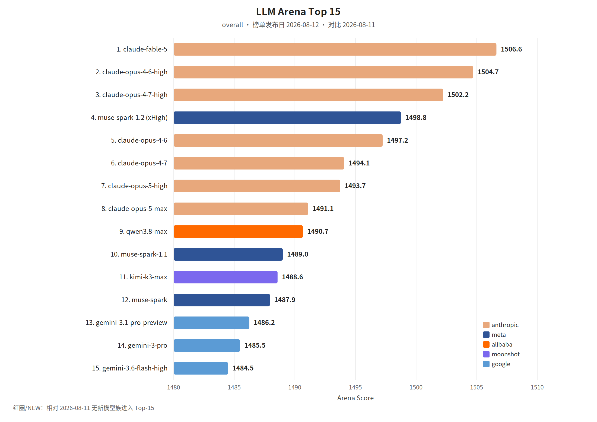

覆盖窗口：2026-08-07～2026-08-13（生成日 2026-08-14）。

## 〇、薅羊毛

本期为补录。linux.do 福利 RSS 当前只剩生成日之后的帖子，Wayback 没有该地址的存档，窗口内的社区帖补不回来。

#### Devin：Gemini 3.7 Flash 两周五折

Devin 桌面端和 CLI 已可用 Gemini 3.7 Flash。RSS 称其达到 Claude Sonnet 5 一档的表现、价格不到一半，并在两周内五折。额度与截止日期以 Devin 原文为准。

> 原始链接：[Gemini 3.7 Flash is now available in Devin](https://devin.ai/blog/gemini-37-flash)（发布日 2026-08-13）

 

## 一、本周关键词

GPT-5.6 Sol 的 Ultrafast，DeepSeek V4 Pro

Grok 4.6 与 Grok Bot，Antigravity 自定义 Agent

Claude Code 默认 Auto，Amp 的全局插件

 

## 二、模型进展

#### 整体排名

LLM Arena（Hugging Face `lmarena-ai/leaderboard-dataset` 全量文件，`text_style_control` / overall，榜单发布日 **2026-08-12**，落在本窗口内）。相对 2026-08-11，Top-15 里是 thinking / Flash 换成 high 变体，没有新的模型族进入，图中不标 NEW。当前脚本只拉 `latest`，这份历史榜来自全量 parquet。本环境无 Artificial Analysis 密钥，不单列 AA 小节。

#### GPT-5.6 Sol 的 Ultrafast

OpenAI News RSS：Ultrafast 是新的 API 服务档，把 GPT-5.6 Sol 加速到最多 14 倍，由 Cerebras 提供，输出最高约每秒 750 token。日期取自 RSS。

> 原始链接：[Previewing Ultrafast mode](https://openai.com/index/previewing-ultrafast)（发布日 2026-08-13）

#### DeepSeek V4 Pro 正式版

深度求索公众号（Wechat2RSS）：V4 Pro 正式版已在 App、网页和 API 更新。RSS 称 Agent 能力明显增强，生产环境里的提升更明显；API 模型名不变。

> 原始链接：[DeepSeek-V4-Pro 正式版上线](https://mp.weixin.qq.com/s?__biz=Mzk0OTYwNzc3NQ==&mid=2247485770&idx=1&sn=dab0be341cb46a410ec40a062a5cb895)（发布日 2026-08-13）

#### Grok 4.6

xAI RSS：Grok 4.6 在 4.5 之上，重点是长时 Agent，以及更重的交互和视觉工作。

> 原始链接：[Introducing Grok 4.6](https://x.ai/news/grok-4-6)（发布日 2026-08-12）

#### Muse Glimmer

Hugging Face 博客标题：Meta 的 Muse Glimmer，本地、可做 Agent、多模态且开源。该条 RSS 正文为空，参数与许可以原文为准。

> 原始链接：[Meta is back with Muse Glimmer](https://huggingface.co/blog/muse-glimmer)（发布日 2026-08-10）

 

## 三、项目开源

#### GitHub Trending（daily / all 前 5）

OPML 里的 GitHubTrendingRSS 只保留当天快照（本次拉取为 2026-11-11）。该 RSS 的 Wayback 在整个窗口里只有 2026-09-09 一份，盖不住各周名次。下面 5 条来自 Wayback 对 [github.com/trending](https://github.com/trending) 的存档（页面为 Today、全部语言，即 daily / all），快照 **2026-08-13**。简介译自存档页上的仓库描述。

> 存档：[2026-08-13 github.com/trending](https://web.archive.org/web/20260813000733/https://github.com/trending)

1. [cathrynlavery/diagram-design](https://github.com/cathrynlavery/diagram-design)：给 Claude Code 用的 29 种编辑式示意图，自包含 HTML + SVG。
2. [macro-inc/macro](https://github.com/macro-inc/macro)：邮件、聊天、文档、任务、Agent 和通话放在同一工作区，并共享 AI 记忆。
3. [semantica-agi/semantica](https://github.com/semantica-agi/semantica)：面向上下文与可追责 AI 的图原生基础设施。
4. [stablyai/orca](https://github.com/stablyai/orca)：并行编码 Agent 的环境，可用自有订阅。
5. [msitarzewski/agency-agents](https://github.com/msitarzewski/agency-agents)：一组带流程和交付物的专职 Agent。

 

## 四、国内进展

#### &lt;开源&gt;MiniMax H3 开源一周

MiniMax 公众号：H3 开源一周后，Hugging Face 上衍生出接近 300 个模型，ComfyUI 版本下载量近 700 万。文中提到有人把约 120GB 的模型压进消费级显卡，也有人重写了面向 Mac 的推理引擎。

> 原始链接：[开源之后，MiniMax H3 拥有了 300 个分身](https://mp.weixin.qq.com/s?__biz=MzE5MTA3NzcxMQ==&mid=2247489037&idx=1&sn=0e17d9fff121fe7c7fd8143b7287914e)（发布日 2026-08-12）

字节、阿里、腾讯、支付宝、淘宝、快手这几份 Wechat2RSS 在 2026-11-11 重拉时，最早条目已经晚于本窗口，Wayback 也没有这些 feed 的存档，这几家当周文章无法从订阅补回。

 

## 五、国际进展

#### &lt;Agent&gt;Grok Bot

xAI RSS：Grok Bot 是一组一直在线的 Agent，有自己的计算机，在工具和应用里工作，并保持 7×24。

> 原始链接：[Introducing Grok Bot](https://x.ai/news/introducing-grok-bot)（发布日 2026-08-11）

#### &lt;产品&gt;Antigravity 自定义 Agent

Antigravity 在 2026-08-12 发布自定义 Agent。该条 RSS 正文为空，能力以原文为准。

> 原始链接：[Introducing custom agents](https://antigravity.google/blog/introducing-custom-agents)（发布日 2026-08-12）

#### &lt;默认值&gt;Claude Code 打开 Auto

Claude Code 将为 Pro、Max 和 Team 默认使用 Auto，以便跑更长的自主任务，并在测试里拦住比人工复查更多的危险命令。

> 原始链接：[Auto mode is now the default in Claude Code](https://claude.com/resources/articles/auto-mode-default-in-claude-code)（发布日 2026-08-07）

#### &lt;扩展&gt;Amp 的全局插件和技能

Amp 把插件和技能放到自己托管的全局位置，让它们在 Amp 运行的各处可用，也可以让 Amp 自己创建个人插件。

> 原始链接：[Global Plugins and Skills](https://ampcode.com/news/global-plugins-and-skills)（发布日 2026-08-11）

#### &lt;评估&gt;JetBrains 如何用 Claude Fable 5

JetBrains 的 Agent 系统负责人谈他们如何在私有仓库上评估前沿模型、什么时候用 Claude Fable 5，以及为什么把防护和数据保留看成使用条件。

> 原始链接：[How JetBrains evaluates and deploys Claude Fable 5](https://claude.com/resources/articles/how-jetbrains-evaluates-and-deploys-claude-fable-5)（发布日 2026-08-13）

 

本期于 2026-11 按新版格式补录。
