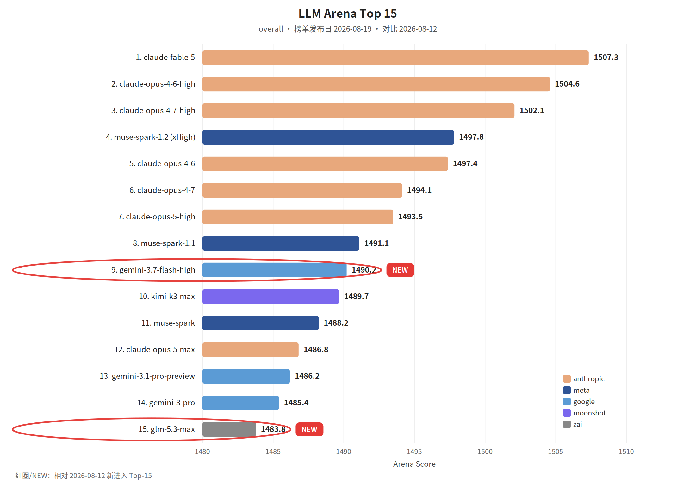

覆盖窗口：2026-08-14～2026-08-20（生成日 2026-08-21）。

## 〇、薅羊毛

#### [Amp 教育价：每月 10 美元](https://ampcode.com/news/edu-discount)

学生和教师可以按每月 10 美元订阅 Amp，RSS 称是原价的一半，包含前沿 Agent、可无人值守的远程 orbs，以及代码托管。资格以 Amp 原文为准。

#### [Devin：GPT-5.6 Sol 七折](https://devin.ai/blog/gpt-5-6-sol-promo)

Devin 桌面端和 CLI 上的 GPT-5.6 Sol 七折，截止 2026-10-03。这是折扣公告，标价下调写在下一期。

#### [Replit Free Mode](https://openai.com/index/replit)

Replit 用 GPT-5.6 Luna 做 Free Mode，让人在不考虑 token 费用的情况下把想法做成可运行的软件。

#### [Anthropic’s approach to teaching and learning AI](https://claude.com/blog/anthropics-approach-to-teaching-and-learning-ai)

本文介绍了Anthropic推出Claude Academy以帮助全球用户安全、有效、有意识地使用AI的教育理念与方法。

#### [LFM2.5 Q4_0 Checkpoints from Quantization-Aware Distillation](https://huggingface.co/blog/LiquidAI/qad)

Liquid AI发布了基于量化感知蒸馏（QAD）的LFM2.5系列模型Q4_0 GGUF检查点。

 

## 一、本周关键词

Cursor 并入 SpaceX

Warp Factories，Codex 两周做完多年的测试迁移

美团搜索 3.0 用 LLM 语义表征做排序

 

## 二、模型进展

#### 整体排名

榜单发布日 2026-08-19。红圈：gemini-3.7-flash-high、glm-5.3-max。

#### [Introducing cross-Region inference for OpenAI GPT-5.6 models on Amazon Bedrock](https://aws.amazon.com/blogs/machine-learning/introducing-cross-region-inference-for-openai-gpt-5-6-models-on-amazon-bedrock/)

亚马逊云科技在 Amazon Bedrock 上推出 OpenAI GPT-5.6 系列模型及跨区域推理（CRIS）支持。

#### [Base Optimization Stack: From Open Weights to Frontier On-Device Inference Speed](https://huggingface.co/blog/basecompute/base-optimization-stack)

本文介绍了Base Optimization Stack（B:OS），这是一个由AI研究代理驱动的自动化流水线，旨在将开源模型（如混合MoE模型Nemotron 3 Nano）无缝移植并优化至特定硬件（如Apple Silicon）上。

 

## 三、项目开源

#### GitHub Trending（daily / all 前 5）

快照 2026-08-20（daily / all）。

1. [harry0703/MoneyPrinterTurbo](https://github.com/harry0703/MoneyPrinterTurbo)：按主题用大模型生成短视频。
2. [volcengine/OpenViking](https://github.com/volcengine/OpenViking)：给 Agent 用的上下文数据库，把记忆、检索和技能放在一起。
3. [chaitanyagiri/munder-difflin](https://github.com/chaitanyagiri/munder-difflin)：本地多 Agent harness。
4. [mukul975/Anthropic-Cybersecurity-Skills](https://github.com/mukul975/Anthropic-Cybersecurity-Skills)：面向安全 Agent 的结构化技能集，存档页称有 817 条。
5. [nautechsystems/nautilus_trader](https://github.com/nautechsystems/nautilus_trader)：Rust 交易引擎。

#### [Up to 3.2x Faster Inference with LFM2.5-DSpark](https://huggingface.co/blog/LiquidAI/lfm25-dspark)

Liquid AI 为 LFM2.5 三个模型发布约 3 亿参数的 DSpark 草稿模型，通过推测解码在不改变贪心输出质量的前提下，将 GPU 吞吐最高提升 3.18 倍、端侧最高提升 2.87 倍；LFM2.5-2.6B 的多工具函数调用平均延迟降低 57%，并已支持 llama.cpp 与 SGLang。

#### [Signals in the Dark: Looking Inside Model Backdoors](https://huggingface.co/blog/assafpet/signals-in-the-dark)

本文探讨了机器学习模型后门检测与内部可解释性的局限性。

#### [ArmBench-ASR: A Benchmark for Armenian ASR](https://huggingface.co/blog/Metric-AI/armbench-asr)

本文介绍了 ArmBench-ASR，这是一个针对亚美尼亚语自动语音识别（ASR）的基准测试，涵盖了5个亚美尼亚语语音数据集，对近30个开源和闭源模型进行了评估。

#### [VLM Run Gateway: Run GLM-OCR, DeepSeek-OCR-2, dots.mocr with an OpenAI Compatible API](https://huggingface.co/blog/vlm-run/intro-to-vlmrun-gateway)

VLM Run Gateway 是一个开源视觉语言模型与 OCR 网关服务，提供 OpenAI 兼容 API 及 MCP 服务器。

#### [Manufacturing QA: When Your Production Run Is Shorter Than Your Training Data Collection](https://huggingface.co/blog/DualityAI-RebekahBogdanoff/manufacturing-qa)

本文探讨了在现代制造业中，当生产批次短于传统训练数据收集周期时，如何利用DualityAI的Falcon平台通过3D数字孪生与物理仿真生成高质量合成数据，从而在产品换线前快速训练和验证AI视觉质检模型（如瓶身标签褶皱检测），实现零物料浪费与高效自动化部署。

#### [Faithful Contouring: No SDF, No Watertight, 1024³ Voxelization](https://huggingface.co/blog/meshy-ai-team/faithful-contouring)

本文介绍了Faithful Contouring稀疏体素化3D表示法，它跳过了传统SDF与Marching Cubes等网格等值面提取瓶颈，直接对原始三角网格进行编码。

#### [Bedrock-RL: a deterministic Minecraft framework for training and benchmarking VLM agents](https://huggingface.co/blog/Michael-E/bedrock-rl)

文章介绍了Bedrock-RL，一个用于训练和评估视觉语言模型（VLM）智能体的确定性Minecraft框架。

#### [Where Model-Driven Screen Interaction Actually Runs Out of Room](https://huggingface.co/blog/NatalieY/aiden-agent)

文章探讨了基于多模态模型的屏幕交互代理（如Aiden）与浏览器级代理（如Comet）的架构差异。

#### [VoxStruct3D: Structure First, Image Follows for High-Fidelity 3D MRI Generation](https://huggingface.co/blog/Neesky/voxstruct3d)

本文介绍了VoxStruct3D——一种用于高保真3D医学图像（MRI）合成的结构引导流匹配框架。

#### [Multi-Vector (Late Interaction) Embedding Models with Sentence Transformers](https://huggingface.co/blog/multi-vector-encoder)

本文介绍了 Sentence Transformers v6.0 推出的第四种模型类型 MultiVectorEncoder，用于支持 ColBERT 风格的后期交互检索。

#### [Meshy T2: Native 3D Mesh Generation in 6 Seconds](https://huggingface.co/blog/meshy-ai-team/meshy-t2-native-3d-mesh-generation)

本文介绍了Meshy T2这一基于流匹配的本地3D网格生成框架。

#### [Masked MTP drafts](https://huggingface.co/blog/Avifenesh/masked-mtp-drafts)

该文章介绍了一种针对原生多Token预测（MTP）头进行词表裁剪（基于FR-Spec方法）以加速大模型投机解码的技术方案。

#### [KOMPRESS v2: Geometric-Mean Consensus Distillation, Spectral Rigidity, and Structural AST Invariants for Edge Reasoning](https://huggingface.co/blog/PeetPedro/geometric-mean-consensus-distillation-spectral-rig)

本文介绍了KOMPRESS v2框架，通过几何平均共识蒸馏、谱刚性和结构AST不变量，将前沿大模型蒸馏为1.7B超紧凑三值权重边缘学生模型。

#### [How Much Memory Does Your Agent Actually Need?](https://huggingface.co/blog/ibm-research/altk-evolve-hmm)

这篇文章探讨了智能体记忆工程中的核心问题：智能体究竟需要多少内存经验即指南集。

#### [How AI Agents Can Query Multiple Business Systems in Seconds](https://huggingface.co/blog/prismberry-technologies/ai-agents-can-query-multiple-systems-in-seconds)

本文探讨了企业级AI代理如何通过并行工具调用和抽象集成层在数秒内查询多个异构业务系统（如CRM、ERP、财务和客服等）。

#### [DW0.5: A Closed-Loop World Model for VLA](https://huggingface.co/blog/Dexmal/dw05)

本文介绍了Dexmal提出的用于具身智能VLA模型的闭环世界模型DW0.5。

#### [DM0.5: An Open-World Foundation Model for General-Purpose Embodied Intelligence](https://huggingface.co/blog/Dexmal/dm05)

本文介绍了Dexmal开源的通用具身智能基础模型DM0.5。

#### [Announcing dell-ai v1.0: A CLI and SDK to interact with Dell Enterprise Hub](https://huggingface.co/blog/balaatdell/deh-sdk-cli-v1)

戴尔发布 dell-ai v1.0 命令行工具与 Python SDK，旨在连接戴尔企业中心（DEH），实现开源大模型在本地戴尔硬件上的快速发现、部署与自动化资源管理。

#### [会解释知识，不等于会设计理解：我们为什么建立 CEA](https://huggingface.co/blog/BreadStudio/cognitive-engagement-alignment-cea-zh)

BreadStudio团队提出了CEA（认知参与对齐）数据集与研究假设，旨在解决大模型擅长知识翻译却无法有效设计受众认知路径的问题。

#### [Same Cluster, 33 Points More Utilization: What Changed Was the Order](https://huggingface.co/blog/Dharma-AI/gpu-management-pt2)

本文介绍了Dharma-AI团队构建的约束感知GPU分配器，通过将实时推理需求视为弹性曲线并按优先级调度批处理任务，替代了传统的FIFO调度器。

#### [Raising Beatrix: A Byte-Level Model's Measured Childhood](https://huggingface.co/blog/AbstractPhil/beatrix-ft1)

本文介绍了1.125亿参数的字节级语言模型Beatrix的训练过程、架构设计与评测。

#### [New imatrix dataset](https://huggingface.co/blog/bartowski/imatrix-dataset)

本文介绍了作者与团队构建的最新版imatrix校准数据集（v6）。

#### [Who Tells You Whether the Molecule Your AI Just Designed Is Any Good?](https://huggingface.co/blog/FINAL-Bench/open-discovery-challenge)

本文介绍了Hugging Face社区发布的FINAL-Bench与开源药物发现挑战赛（Open Discovery Challenge），旨在为AI设计的抗疟疾药物候选分子提供公正的公开评测排行榜。

#### [State of Open Models: Summer 2026 Observations](https://huggingface.co/blog/state-of-open-models-summer-2026)

本文基于2026年前七个月Hugging Face平台的生态数据，分析了开源大模型的发展现状与趋势。

#### [AX-Ray, Finding Causal-Leakage Defects in Two General-Purpose Public Models](https://huggingface.co/blog/FINAL-Bench/ax-ray)

本文介绍了VIDRAFT推出的AX-Ray模型安全诊断层与FINAL-Bench诊断机制，旨在超越传统能力基准评分，对大模型进行因果泄漏缺陷、服务完整性及部署安全等维度的可复现诊断。

 

## 四、国内进展

#### &lt;搜索&gt;[美团搜索 3.0](https://tech.meituan.com/2026/08/20/01-meituan-Query-3.0.html)

美团技术博客：搜索从关键词匹配、行为统计走到复杂意图。这篇写 LLM 语义表征在服务零售排序上的三期实践，从单点特征到可跨场景复用的表征。

#### [Qoder Completes Independent SOC 2 Type II Examination](https://qoder.com/blog/qoder-completes-soc2-examination)

Qoder宣布正式通过独立的SOC 2 Type II认证审计。

#### [400 Business Scenarios, 300 Agents: How a Retail Company Built Its AI Platform](https://qoder.com/blog/qoder-case-kidswant)

孩子王（Kidswant）利用Qoder编码平台打造内部AI平台“知数”，支撑400个业务场景与300个智能体。

 

## 五、国际进展

#### &lt;收购&gt;[Cursor 并入 SpaceX](https://cursor.com/blog/joining-spacex)

Cursor 博客标题为 Cursor is now a part of SpaceX，发布日 2026-08-14。该条 RSS 正文为空，交易范围以原文为准。

#### &lt;软件工厂&gt;[Warp Factories](https://www.warp.dev/blog/open-infrastructure-for-building-a-software-factory)

Warp Factories 提供开放的基础设施，用来加速公司内部的云软件工厂。

#### &lt;迁移&gt;[Asana 用 Codex 两周换掉旧测试系统](https://openai.com/index/asana)

OpenAI RSS：Asana 用 Codex 在两周内替换过时的测试系统，模型和基础设施费用约 1.2 万美元。

#### &lt;CI&gt;[Claude Tag 值守持续集成故障](https://claude.com/resources/articles/ai-ci-cd-on-call)

Anthropic 的持续集成工程师介绍他做的 Agent，用来处理 CI 事故响应。

#### &lt;计算机使用&gt;[150 行 Python 驱动 Android](https://www.philschmid.de/gemini-android-computer-use)

用 Gemini 3.7 Flash 的计算机使用能力，大约 150 行 Python 操作 Android 模拟器。示例是从截图玩 Wordle：打开 Chrome、关掉弹窗、读色块，两步猜中。

#### [The pull request outlived its obituaries and got a bigger job](https://www.coderabbit.ai/blog/the-pull-request-lives-on-ai-gave-it-a-bigger-job)

本文探讨了随着AI代理和自动化系统生成大量代码导致GitHub PR（Pull Request）数量激增，业界关于“PR已死”的讨论并未成真。

#### [The Claude Code guide for startups](https://claude.com/blog/claude-code-guide-for-startups)

本文介绍了快速成长的初创公司如何利用Anthropic的Claude Code等AI代理编程工具进行产品研发与规模化，并总结了五大核心运营原则：人人参与交付、自动化繁琐任务、信任但核实、为重建而构建、以及原型验证与生产化。

#### [Scaling agentic AI: Enterprise patterns without vendor lock-in](https://aws.amazon.com/blogs/machine-learning/scaling-agentic-ai-enterprise-patterns-without-vendor-lock-in/)

本文探讨了企业在扩展多智能体AI系统时如何应对多框架、多模型和多供应商的复杂环境。

#### [LangSmith Preview Builds: Test agent changes before production](https://www.langchain.com/blog/langsmith-preview-builds-test-agent-changes-before-production)

LangSmith推出Preview Builds功能，允许开发团队在合并PR前从分支创建临时的生产级部署环境。

#### [Introducing IDE Extensions](https://antigravity.google/blog/antigravity-ide-extensions)

Google Antigravity 团队正式推出面向主流开发环境的 IDE 扩展，支持 Visual Studio Code、Visual Studio、Zed 及 JetBrains 等主流编辑器。

#### [How to get your app verified for third-party data access](https://lovable.dev/blog/how-to-get-your-app-verified-for-third-party-data-access)

本文介绍了在开发第三方应用时，如何通过Google OAuth验证流程来获取用户数据访问权限。

#### [How monday.com transformed its platform into an agent-first product where humans and agents collaborate](https://claude.com/blog/how-monday-com-transformed-its-platform-into-an-agent-first-product-where-humans-and-agents-collaborate)

文章报道了协作平台 monday.com 重构产品转型为“AI 优先”代理型产品的实践。

#### [Build production agents with computer use, the Skills API, and the Files API](https://claude.com/blog/computer-use-skills-api-files-api)

Anthropic宣布其计算机操作（Computer Use）、Skills API和Files API在Claude平台上正式全面可用。

#### [Build intelligent security for healthcare APIs with Amazon Bedrock](https://aws.amazon.com/blogs/machine-learning/build-intelligent-security-for-healthcare-apis-with-amazon-bedrock/)

本文介绍了如何利用 Amazon Bedrock 及其基础模型、结构化输出和护栏功能，为医疗 FHIR API 构建智能安全监控架构。

#### [Build a no-code ML workflow with Snowflake, Amazon SageMaker Canvas and Amazon Quick – Part 3: Visualizing insights with Amazon Quick Sight](https://aws.amazon.com/blogs/machine-learning/build-a-no-code-ml-workflow-with-snowflake-amazon-sagemaker-canvas-and-amazon-quick-part-3-visualizing-insights-with-amazon-quick-sight/)

本文是构建无代码机器学习工作流系列的第三篇，介绍了如何将 Amazon SageMaker Canvas 的欺诈检测预测结果导入 Amazon QuickSight 中，并通过可视化仪表盘和生成式 BI 功能将数据转化为商业洞察。

#### [Build a no-code ML workflow with Snowflake, Amazon SageMaker Canvas and Amazon Quick – Part 2: Data preparation and model building with Amazon SageMaker Canvas](https://aws.amazon.com/blogs/machine-learning/build-a-no-code-ml-workflow-with-snowflake-amazon-sagemaker-canvas-and-amazon-quick-part-2-data-preparation-and-model-building-with-amazon-sagemaker-canvas/)

本文介绍了构建无代码机器学习工作流的第二部分，重点讲解如何使用 Amazon SageMaker Canvas 结合 Snowflake 数据源进行数据准备、特征工程与模型构建。

#### [Build a no-code ML workflow with Snowflake, Amazon SageMaker Canvas and Amazon Quick – Part 1: Setting up your Snowflake environment](https://aws.amazon.com/blogs/machine-learning/build-a-no-code-ml-workflow-with-snowflake-amazon-sagemaker-canvas-and-amazon-quick-part-1-setting-up-your-snowflake-environment/)

本文介绍了如何利用Snowflake、Amazon SageMaker Canvas与Amazon Quick构建无代码机器学习工作流。

#### [Bringing Antigravity to Gemini Enterprise: Agentic workflows for every developer](https://antigravity.google/blog/antigravity-enterprise)

Google 宣布将 AI 智能体开发工具 Antigravity 整合至 Gemini Enterprise 订阅中，并推出全新的 IDE 扩展和统一企业治理功能。

#### [Authoring Dogwood policies from natural language in Amazon Bedrock AgentCore](https://aws.amazon.com/blogs/machine-learning/authoring-dogwood-policies-from-natural-language-in-amazon-bedrock-agentcore/)

本文介绍了亚马逊云科技在 Amazon Bedrock AgentCore 中推出的基于自然语言自动编写 Dogwood 策略的新功能。

#### [AWS vector solutions: Build agentic AI where your data lives](https://aws.amazon.com/blogs/machine-learning/aws-vector-solutions-build-agentic-ai-where-your-data-lives/)

本文介绍了AWS推出的向量解决方案，旨在通过将向量搜索能力直接集成到现有的数据存储（如OpenSearch、S3、DynamoDB等）中，助力开发者构建无需数据迁移的智能Agent与RAG应用。

#### [为前沿模型提供零数据保留](https://openai.com/index/offering-zero-data-retention-for-frontier-models/)

OpenAI预览了“私密安全处理”（Private Safety Processing）技术，旨在与零数据保留（ZDR）承诺兼容。

#### [What Is Reasoning](https://lucumr.pocoo.org/2026/8/19/what-is-reasoning/)

在这篇博文中，作者 Armin Ronacher 深入探讨了 AI 模型“推理”机制的本质。

#### [Turning conversation into knowledge: how Slack builds human-agent teams](https://claude.com/blog/turning-conversation-into-knowledge-how-slack-builds-human-agent-teams)

本文采访了Slack首席产品官Jaime DeLanghe，探讨了企业如何通过将工作与对话置于公开频道、构建人机协作团队来将日常对话转化为组织知识。

#### [Pass the Orb to the Left Hand Side](https://ampcode.com/news/pass-the-orb-to-the-left-hand-side)

Amp 推出全新的团队协作功能，允许用户在 AI 编码会话（orb）中通过 `@` 符号邀请团队成员加入。

#### [MCP in Orbs](https://ampcode.com/news/mcp-in-orbs)

AmpCode 宣布在平台中全面支持模型上下文协议（MCP），允许用户在 orbs、终端用户界面（TUI）以及 Puck 智能体中连接远程 MCP 服务器。

#### [KnowledgeForge: mining gold from the ITSM ticket graveyard](https://aws.amazon.com/blogs/machine-learning/knowledgeforge-mining-gold-from-the-itsm-ticket-graveyard/)

AWS 推出的 KnowledgeForge 解决方案利用 Amazon Bedrock、Anthropic Claude 模型、Amazon S3 Vectors 及 AWS Step Functions 等构建闭环知识库生命周期系统。

#### [How Fanatics Betting and Gaming built a multi-agent customer support system](https://aws.amazon.com/blogs/machine-learning/how-fanatics-betting-and-gaming-built-a-multi-agent-customer-support-system/)

Fanatics Betting and Gaming在AWS上构建了一个多智能体客户支持系统，利用Amazon Bedrock、Spring AI、Amazon EKS和Model Context Protocol（MCP），实现跨多个州复杂合规规则下的自动化客户咨询响应与精准路由，显著提升客服效率并保障合规性。

#### [Domain and publish date filters for Web Search on AgentCore](https://aws.amazon.com/blogs/machine-learning/domain-and-publish-date-filters-for-web-search-on-agentcore/)

AWS宣布在Amazon Bedrock AgentCore平台的Web Search连接器（版本1.2.0）中推出运行时域名与发布日期过滤功能。

#### [Automate Document Processing with Quick Automate and the IDP Accelerator](https://aws.amazon.com/blogs/machine-learning/automate-document-processing-with-quick-automate-and-the-idp-accelerator/)

本文介绍AWS推出的生成式AI创新中心（GAIIC）智能文档处理（IDP）加速器与Amazon Quick Automate服务的结合应用。

#### [Asynchronous patterns for calling Amazon Bedrock AgentCore agents in serverless pipelines](https://aws.amazon.com/blogs/machine-learning/asynchronous-patterns-for-calling-amazon-bedrock-agentcore-agents-in-serverless-pipelines/)

本文探讨了在无服务器流水线中异步调用Amazon Bedrock AgentCore智能体的架构模式，以解决同步调用因推理延迟导致调用方计算资源空转及计费浪费的问题。

#### [网络安全关键能力时代的模型开发节奏](https://openai.com/index/pacing-model-development-cyber-capabilities/)

OpenAI官方宣布在面对模型网络安全关键能力挑战时调整开发节奏。

#### [任意规模的 Git](https://cursor.com/cn/blog/git-at-any-scale)

本文介绍了 Cursor 团队为应对现代单体仓库及智能体海量小仓库挑战而开发的全新 Git 存储系统 Continuity。

#### [Talk to Puck](https://ampcode.com/news/talk-to-puck)

Amp 推出了与 AI 编码助手 Puck 进行实时语音对话的功能。

#### [MCP 101: What it is and how it works in Lovable](https://lovable.dev/blog/mcp-101)

本文解析了模型上下文协议（MCP）在Lovable平台的核心应用，涵盖三大方向：一是允许外部AI工具直接在Lovable中创建和迭代项目；二是为Lovable应用添加MCP服务端供用户在AI助手中调用；三是引入外部业务上下文，提升全栈AI开发效率。

#### [Introducing LangSmith Tuned Evaluators, starting with Perceived Error](https://www.langchain.com/blog/introducing-langsmith-tuned-evaluators-starting-with-perceived-error)

LangChain 推出了 LangSmith 调整评估器（Tuned Evaluators），首发推出“感知错误”（Perceived Error）评估器。

#### [Improve contract search accuracy with auto-generated filters in Amazon Bedrock](https://aws.amazon.com/blogs/machine-learning/improve-contract-search-accuracy-with-auto-generated-filters-in-amazon-bedrock/)

本文介绍了亚马逊云科技（AWS）上基于 Amazon Bedrock 知识库提升合同检索准确率的解决方案。

#### [Implement vector-prompt document classification using Amazon Bedrock](https://aws.amazon.com/blogs/machine-learning/implement-vector-prompt-document-classification-using-amazon-bedrock/)

本文介绍了如何利用 Amazon Bedrock 结合 Anthropic Claude 与 Amazon Titan 多模态嵌入，构建基于 Strands Agents SDK 的多智能体文档分类系统。

#### [How we migrated lovable.dev away from Next.js and turned it into another Lovable app](https://lovable.dev/blog/how-we-migrated-lovable-dev-away-from-nextjs)

本文介绍了 AI 全栈开发平台 Lovable 将其核心官网 lovable.dev 从 Next.js 迁移至 TanStack Start 并托管于自身产品架构的完整实践。

#### [How Jumio built a real-time feature store on AWS](https://aws.amazon.com/blogs/machine-learning/how-jumio-built-a-real-time-feature-store-on-aws/)

本文介绍了身份验证服务商 Jumio 如何在 AWS 上构建实时特征库（Feature Store）。

#### [How Axonius built secure multi-tenant AI agents on Bedrock AgentCore](https://aws.amazon.com/blogs/machine-learning/how-axonius-built-secure-multi-tenant-ai-agents-on-bedrock-agentcore/)

本文介绍了独立软件供应商Axonius如何利用Amazon Bedrock AgentCore在AWS上构建安全的、多租户的AI智能体架构。

#### [Customize Amazon Quick embedded chat into your application](https://aws.amazon.com/blogs/machine-learning/customize-amazon-quick-embedded-chat-into-your-application/)

本文介绍了如何将亚马逊 Quick 嵌入式聊天功能集成并定制到企业Web应用中。

#### [Close the laptop, keep the agent: building with cloud sessions](https://kiro.dev/blog/cloud-sessions/)

Kiro 推出了 Cloud Sessions（云会话）预览功能，允许开发者将 AI 编码代理从本地机器迁移至云端沙箱中运行。

#### [Claude on call: How Claude Tag serves as Anthropic’s first responder for CI/CD failures](https://claude.com/blog/ai-ci-cd-on-call)

本文介绍了Anthropic如何利用Claude Tag作为CI/CD故障的值班第一响应者。

#### [Amazon Bedrock AgentCore payments is now generally available: Enabling agents to transact safely and autonomously at scale](https://aws.amazon.com/blogs/machine-learning/amazon-bedrock-agentcore-payments-is-now-generally-available-enabling-agents-to-transact-safely-and-autonomously-at-scale/)

亚马逊宣布 Amazon Bedrock AgentCore payments 正式全面上市，助力 AI 智能体在规模化场景下安全、自主地进行微交易与支付。

#### [防御者的机遇窗口](https://openai.com/index/the-defenders-window/)

本文探讨了在AI能力加速演进、网安威胁加剧的背景下面临的“防御者机遇窗口”。

#### [NVIDIA Nemotron 3.5 Lightning now available in Amazon SageMaker JumpStart](https://aws.amazon.com/blogs/machine-learning/nvidia-nemotron-3-5-lightning-now-available-in-amazon-sagemaker-jumpstart/)

NVIDIA Nemotron 3.5 Lightning 已在 Amazon SageMaker JumpStart 上线。

#### [How ABC Legal turned every employee into a builder with Claude Managed Agents](https://claude.com/blog/how-abc-legal-turned-every-employee-into-a-builder-with-claude-managed-agents)

本文报道了美国法律服务公司 ABC Legal 如何利用 Claude Managed Agents 和 Claude Code 将全员转变为软件构建者。

#### [Build OpenClaw agents that transact with Amazon Bedrock AgentCore payments](https://aws.amazon.com/blogs/machine-learning/build-openclaw-agents-that-transact-with-amazon-bedrock-agentcore-payments/)

本文介绍了 AWS 与 OpenClaw 基金会合作推出的集成方案，利用 Amazon Bedrock AgentCore 支付功能为自主 AI 代理提供安全、受限的微支付路径。

#### [Agentic Commerce at Scale: Your LangChain agents can transact securely](https://www.langchain.com/blog/langchain-agentcore-payments)

LangChain联合亚马逊Bedrock AgentCore Payments与x402微支付协议，推出了支持AI代理安全进行链上/稳定币微支付的中间件。

#### [Maximizing the value of your Claude Code sessions](https://claude.com/blog/maximizing-the-value-of-your-claude-code-sessions)

本文介绍了在使用AI编程助手Claude Code时如何最大化会话价值并优化Token成本。

#### [Custom reward functions for multi-turn reinforcement learning with Amazon Nova Forge](https://aws.amazon.com/blogs/machine-learning/custom-reward-functions-for-multi-turn-reinforcement-learning-with-amazon-nova-forge/)

本文介绍了在亚马逊 Nova Forge 平台上使用自定义奖励函数进行多轮强化学习与强化微调的方法。

#### [Cursor 现已成为 SpaceX 的一部分](https://cursor.com/cn/blog/joining-spacex)

Cursor 宣布正式被 SpaceX 收购，标志着双方自 4 月起合作的深化。

#### [Building agentic workflows with SageMaker AI and Bedrock AgentCore](https://aws.amazon.com/blogs/machine-learning/building-agentic-workflows-with-sagemaker-ai-and-bedrock-agentcore/)

本文介绍了如何结合 Amazon SageMaker AI 的 OpenAI 兼容端点与 Amazon Bedrock AgentCore 运行时构建生产级多智能体工作流。

本期于 2026-11 按新版格式补录。
