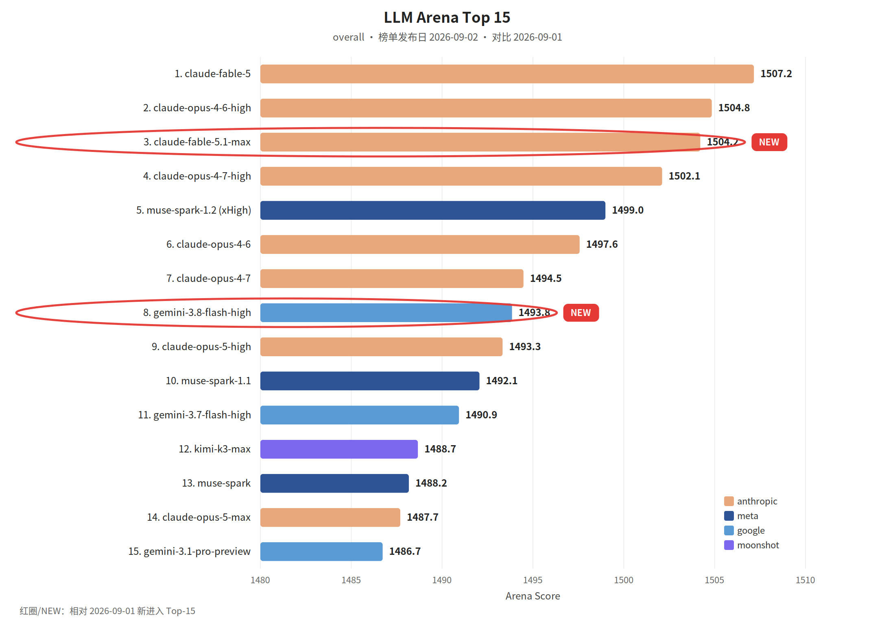

覆盖窗口：2026-08-28～2026-09-03（生成日 2026-09-04）。

## 〇、薅羊毛

#### [Claude for Teachers：美国 K-12 的免费企业版](https://claude.com/resources/articles/claude-for-teachers-now-available-for-schools-and-districts)

从即日起，美国 K-12 学校和学区可以把 Claude for Teachers 当作免费企业版使用，含面向教学的技能，以及与 50 个州学业标准的连接。资格以 Anthropic 原文为准。

#### [What would the last software engineer still need to do?](https://www.coderabbit.ai/blog/the-last-software-engineer-knows-what-to-build)

本文探讨了在AI Agent普及的未来，软件工程师的核心价值将从“实现”转向“决策”。

#### [Agents That Pay | How Nevermined Empowers LangChain Agents to Buy and Sell Services](https://www.langchain.com/blog/agents-that-pay-how-nevermined-empowers-langchain-agents-to-buy-and-sell-services)

本文详细介绍了 Nevermined 为 LangChain 智能体提供的支付基础设施，旨在解决 Agent 在执行长任务时因 API 欠费或缺乏工具而中断的问题。

#### [10 Stunning Geography PPT Templates for Every Lesson](https://www.kimi.ai/resources/geography-ppt-templates)

本文介绍了10款涵盖地图、地貌、气候及人文地理等主题的地理PPT模板，旨在帮助教师和学生快速构建生动的地理演示文稿。

#### [Claude for Teachers, now available for U.S. K-12 schools and districts](https://claude.com/blog/claude-for-teachers-now-available-for-schools-and-districts)

Anthropic 宣布面向美国 K-12 学校和学区推出免费的企业级服务“Claude for Teachers”。

#### [Blackboard PowerPoint Templates for Creative Presentations](https://www.kimi.ai/resources/blackboard-ppt-templates)

本文介绍了10款适用于教育、培训和工作坊的黑板风格PowerPoint模板，涵盖从小学教育到企业培训的多种场景。

#### [10 Animated PowerPoint Templates for Dynamic Presentations](https://www.kimi.ai/resources/animated-powerpoint-templates)

本文介绍了 10 种用于提升演示文稿动态效果的动画 PowerPoint 模板，包括信息图表、数据可视化、交互式仪表盘、时间轴、3D 模型、业务展示、教育培训、产品发布、故事讲述及创意作品集等类型。

 

## 一、本周关键词

GPT-6 Astra，Fable 5.1 进入 Devin

OpenAI 准备停止向 Cursor 供模

Qwen3.8-Max-0902，百度对比两套开源 Harness

 

## 二、模型进展

#### 整体排名

榜单发布日 2026-09-02。红圈：claude-fable-5.1-max、gemini-3.8-flash-high。

#### [GPT-6 Astra](https://openai.com/index/gpt-6-astra)

OpenAI RSS：GPT-6 Astra 是当时最强、对齐也最好的模型，计算机使用、编码、网络安全和科学都在宣传范围内。日期取自 RSS。

#### [Fable 5.1 进入 Devin](https://devin.ai/blog/fable-5-1)

Devin：Fable 5.1 已可用。因缓存方式变化，价格比原先低 54%，并低于 Opus。Fusion harness 在 FrontierCode 上以低 47% 的成本对齐 Fable 5.1。

#### [Gemini 3.8 Flash 进入 Antigravity](https://antigravity.google/blog/gemini-3-8-flash-in-google-antigravity)

Antigravity 在 2026-09-01 发布 Gemini 3.8 Flash。该条 RSS 正文为空，能力以原文为准。

#### [Qwen3.8-Max-0902](https://x.com/Alibaba_Qwen/status/2094968708288680276)

千问 RSS：Qwen3.8-Max-0902，约 2.4T 参数、1M 上下文，并在编码和协作上做了进一步后训练。

#### [Safety overview: GPT-6 Astra](https://openai.com/index/safety-overview-gpt-6-astra/)

OpenAI发布GPT-6 Astra安全概览，该模型是首个在预备框架下达到“关键”网络安全能力等级的模型。

#### [GPT-6 Astra is coming to Devin](https://devin.ai/blog/gpt-6-astra)

文章宣布 Devin 将集成 OpenAI 最新的 GPT-6 Astra 模型。

#### [Introducing Claude Fable 5.1 on AWS](https://aws.amazon.com/cn/blogs/machine-learning/introducing-claude-fable-5-1-on-aws/)

AWS宣布在Amazon Bedrock上推出Claude Fable 5.1模型。

#### [CiberIA Expected Cognitive Profile Fast: Qwen3.8-27B](https://huggingface.co/blog/gcjordi/ecpfastqwen3827b)

该文章基于 Qwen3.8-27B 的模型卡片对其进行了认知概括评估。

#### [Where the Hivemind Comes From: Geometry, Tuning and Format, Separated on Open Weights](https://huggingface.co/blog/RiverRider/where-the-hivemind-comes-from-geometry-tuning-and)

本文研究了AI模型输出趋同（Hivemind）的现象及其成因。

#### [I put a 24 dimensional lattice in a CUDA kernel to run Qwen3-4B in 2.6 GB](https://huggingface.co/blog/Pier-Jean/llvq-init)

本文探讨了2比特量化方法LLVQ（Leech Lattice Vector Quantization）在LLM部署中的工程实现。

 

## 三、项目开源

#### GitHub Trending（daily / all 前 5）

快照 2026-09-03（daily / all）。

1. [fmtlib/fmt](https://github.com/fmtlib/fmt)：C++ 格式化库。
2. [google-research/timesfm](https://github.com/google-research/timesfm)：Google Research 的时间序列基础模型。
3. [DietrichGebert/ponytail](https://github.com/DietrichGebert/ponytail)：让编码 Agent 少写不必要的代码。
4. [debpalash/VoiceStudio](https://github.com/debpalash/VoiceStudio)：可本地运行的语音工作室。
5. [sngyai/Sequoia-X](https://github.com/sngyai/Sequoia-X)：A 股形态扫描，收盘后推送到飞书。

#### [Zed：Xanadu 在等 Agent](https://zed.dev/blog/agentic-xanadu)

Zed 在 2026-09-01 发布「Xanadu Was Waiting for Agents」。RSS 未给出正文，产品变化以原文为准。

#### [Open Models vs Closed Models: What Should Enterprises Choose?](https://huggingface.co/blog/prismberry-technologies/open-models-vs-closed-models)

本文深入探讨了企业在生产环境中选择开源与闭源AI模型时的核心考量。

#### [Building VT Code, a year in](https://huggingface.co/blog/vinhnx90/building-vtcode-a-year-in)

VT Code 是一款基于 Rust 的终端编程智能体，历经一年迭代已形成包含 30 多个 crate 的成熟架构。

#### [TranslatePsy-Nano: Compact Multilingual Machine Translation for Resource-Constrained Edge Deployment](https://huggingface.co/blog/qvac/translatepsy-nano)

Tether AI Research 推出了 TranslatePsy-Nano 系列超轻量级多语言机器翻译模型，涵盖欧洲及非洲多国语言。

#### [Puffin-World: Scaling a Unified Multimodal Model with Native 3D World States](https://huggingface.co/blog/KangLiao/puffin-world)

Puffin-World是一个统一的多模态世界模型，旨在从物理（重力）、几何（深度）和外观三个维度感知、模拟及生成3D世界。

#### [NVMe + ??? = Giant MoE's in Residency?](https://huggingface.co/blog/i64systems/nvme-giant-moes-in-residency)

本文介绍了一种针对混合专家模型（MoE）的内存管理技术——“权重租赁”。

#### [How to Build a CloakBrowser and CapSolver CAPTCHA Workflow](https://huggingface.co/blog/CapSolverAI/how-to-build-a-cloakbrowser-and-capsolver-captcha)

本文详细介绍了如何集成 CloakBrowser 指纹浏览器与 CapSolver 验证码识别服务，以构建高效的 Web 自动化工作流。

#### [Cosmos-Reason2 on a Quest 3: Performance, Cost, and What Compression Actually Buys You](https://huggingface.co/blog/ErenAta00/cosmos-reason2-quest3)

本文评估了 NVIDIA Cosmos-Reason2 视觉语言模型在 Meta Quest 3 头显上的部署性能与定位精度。

#### [Nvidia Buys Hugging Face](https://huggingface.co/blog/itylergarrett/nvidia-buys-hugging-face)

本文讨论了英伟达以130亿美元收购Hugging Face的消息及其对开源生态的影响。

#### [Introducing @huggingface/kernels: 200+ WebGPU Kernels for Local AI](https://huggingface.co/blog/webgpu-kernels)

Hugging Face 发布 @huggingface/kernels：提供 207 个可从 Hub 加载运行的版本化 WebGPU 内核，每个内核附带契约、正确性测试、基准与 WGSL 模板；同时推出浏览器端 Fleet 采集跨设备性能证据。

#### [Internet-Scale Knowledge Retrieval: A Novel Vector Search Dataset at 10B Scale](https://huggingface.co/blog/Qdrant/fineweb-10b-release)

Qdrant 联合 Vultr 发布了全球最大的开源向量搜索基准测试数据集 Qdrant-FineWeb-10B，包含基于 FineWeb 语料库生成的 100 亿个向量，规模达 24.47 TB。

#### [Hands on with Buckets](https://huggingface.co/blog/prpatel/hands-on-with-buckets)

本文介绍了 Hugging Face 推出的 Buckets 存储方案及其背后的 Xet 技术。

#### [From Plain Text to a Practical Wordmark: A Browser-Based Typography Workflow](https://huggingface.co/blog/sora-2/from-plain-text-to-a-practical-wordmark-a-browser)

文章介绍了一种基于浏览器的文字商标（Wordmark）设计工作流，强调从应用场景出发而非单纯选字体。

#### [Evaluating LLMs Under Production Parity: A Replay Pipeline for Safe Model Swapping in Conversational Agents](https://huggingface.co/blog/TechforHumans/evaluating-llms-under-production-parity)

本文介绍了TechforHumans开发的LLM评估流水线，旨在解决生产环境中对话智能体更换模型时的安全性与一致性问题。

#### [Create a text logo, wordmark logo, or typography logo in minutes](https://huggingface.co/blog/sora-2/create-a-text-logo-wordmark-logo-or-typography-log)

Text Logo 是一款基于浏览器的在线排版与标志编辑器，专为独立开发者和初创团队设计。

#### [BenchMIRT: What are LLM benchmarks actually measuring?](https://huggingface.co/blog/allenai/benchmirt)

艾伦人工智能研究所（Ai2）推出 BenchMIRT，这是一种利用多维度项目反应理论（MIRT）审计 LLM 基准测试的新方法。

#### [otoSpeech is the training set for TurnBench](https://huggingface.co/blog/otoearth/turnbench-training-set)

文章介绍了由oto提供的otoSpeech数据集，它是针对语音对话轮次转换（turn-taking）基准测试TurnBench的104小时训练集。

#### [otoSpeech Task: Task-oriented full-duplex dataset](https://huggingface.co/blog/otoearth/otospeech-task)

本文介绍了 otoSpeech Task，这是一个全新的全双工任务型语音对话数据集。

#### [YOLO26-RGB: a small, fast deraining model from YOLO26's depth head](https://huggingface.co/blog/dronefreak/yolo26-rgb)

本文介绍了 YOLO26-RGB，这是一款基于 YOLO26 架构的小型快速图像去雨模型。

#### [VLANeXt: A Simple and Research-Oriented Codebase for Robotics Research](https://huggingface.co/blog/cavanloy/vlanext)

VLANeXt 是一个面向机器人研究的开源视觉-语言-动作（VLA）模型代码库。

#### [The MCAP Dilemma Because Your Robot Data Has Three Jobs](https://huggingface.co/blog/gagandeepreehal/the-mcap-dilemma)

本文探讨了机器人数据格式 MCAP 的三重角色及其在 AI 训练中的局限性。

#### [Technical writing in the agentic era](https://huggingface.co/blog/joelniklaus/technical-writing-in-the-agentic-era)

这篇文章探讨了在AI智能体时代技术写作的变革。

#### [PalmVein Recognition-Docker](https://huggingface.co/blog/kby-ai/palm-vein-recognition-docker)

本文介绍了 KBY-AI 开发的掌静脉识别 SDK 及其 Docker 部署方式。

#### [Our paper on LLM explanation faithfulness was accepted to EMNLP 2026's GroundLM workshop — and I'll be presenting in Budapest](https://huggingface.co/blog/durgesh-rao/emnlp-paper-2026)

该文章介绍了一篇关于大语言模型（LLM）解释忠实度评估的研究。

#### [Impact of Video Compression on Monocular 3D Object Detection: A Prediction-Stability Analysis](https://huggingface.co/blog/RonenNis/3d-object-compression-detection-stress-test)

本文探讨了视频压缩（特别是内容自适应比特率CABR技术）对自动驾驶中单目3D目标检测的影响。

#### [IDCardRecognition-Docker](https://huggingface.co/blog/kby-ai/id-card-recognition-docker)

该文章介绍了 KBY-AI 推出的 IDCardRecognition-Docker 解决方案，旨在为开发者提供便捷的身份识别集成工具。

#### [From watching AI-Generated worlds to exploring them with H3](https://huggingface.co/blog/zuanfilm/blog)

本文介绍了利用 MiniMax H3 模型与 ComfyUI 工作流生成 360 度全景交互式视频的技术方案。

#### [Did the Civilization Emerge, or Was It Recited?](https://huggingface.co/blog/FINAL-Bench/ai-world)

本文探讨了多智能体研究中观察到的“文明涌现”现象，质疑其本质是真正的逻辑推理还是对训练数据中人类历史的“背诵”。

#### [An Empirical Study of Robot Policies Trained on UMI-Style Data](https://huggingface.co/blog/zfff/umi-models)

本文是一项关于机器人策略选择的实证研究，旨在解决从训练完成的检查点到物理部署之间的评估难题。

#### [Why We Built Reflexive Role Routing (and Why Static Agent Loops Waste Your Compute)](https://huggingface.co/blog/NitrAI/rrr)

本文介绍了NitrAI开发的Reflexive Role Routing（RRR）技术，旨在解决多智能体协作中静态循环导致的计算浪费。

#### [What is an AI Gateway? The View from Trillions of Production Tokens](https://huggingface.co/blog/Thibault-Requesty/requesty)

本文基于生产环境数万亿 Token 的实测数据，深入阐述了 AI 网关（AI Gateway）在现代软件开发中的核心价值。

#### [Supervised Self-Repair: Keeping a Code-Fixing Agent on a Leash](https://huggingface.co/blog/Tomoushie/httpshuggingfacecospacestomoushiexeno-sss-orchestr)

本文通过一个多智能体代码编排器的案例，探讨了代码修复智能体自主性的安全边界。

#### [Gala: an Apple-Silicon-first model, trained on one](https://huggingface.co/blog/junafinity/gala-an-apple-silicon-first-model-trained-on-one)

本文介绍了专为 Apple Silicon 优化的语言模型 Gala。

#### [Frozen Backbones Read Each Other](https://huggingface.co/blog/RiverRider/frozen-backbones-read-each-other)

本文研究了不同厂商的多模态模型在处理相同图像时，其隐藏层编码是否具有通用性。

#### [Frontier-Assisted Single-Prompt Disposable Risk Assessment](https://huggingface.co/blog/darkc0de/disposable-risk-assessment)

本文介绍了一种名为FADRA的AI风险评估框架，利用强力前沿模型动态生成测试题与评分标准，旨在衡量AI模型在通用能力及有害赋能方面的表现。

#### [CUDA's default failure mode is silence — notes from a tester's first week](https://huggingface.co/blog/nazeerbashashaik/cuda-silent-failure)

本文记录了作者在学习CUDA编程时的重要发现：GPU程序的默认失败模式是“静默失败”。

#### [Inside three.ws: The Open-Source Stack That Gives AI Agents a Body, a Brain, a Wallet, and a Job](https://huggingface.co/blog/three-ws/building-3d-ai-agents-end-to-end)

本文介绍了开源项目 three.ws，这是一个为 AI 智能体提供 3D 身体、大脑、钱包和分发渠道的全栈方案。

#### [Train Robot Policy using LeRobot Framework with UMI Data](https://huggingface.co/blog/zfff/umi-lerobot)

本文介绍了如何利用 LeRobot 框架和 UMI（通用操纵接口）数据训练机器人策略。

#### [The Open ASR Leaderboard Adds Its First Global South Language](https://huggingface.co/blog/open-asr-leaderboard-global-south)

Hugging Face与Voice Arena合作，在Open ASR排行榜中引入首个全球南方语言（印地语）及印度英语，发布了Monsoon评价集。

#### [FAST — A Standard for How Agents Report Vulnerabilities](https://huggingface.co/blog/caleanderson/fast-agent-standard)

本文介绍了FAST（自主严重程度与分拣框架），这是一项旨在规范自主黑客和分拣智能体报告漏洞的开放标准。

#### [Can an Image Model Hold a Creative Direction?](https://huggingface.co/blog/Showmake233/pixpix2)

文章通过测试 GPT Image 2、Qwen Image 3.0 Pro 等四款模型，探讨了 AI 图像模型在仅依靠文本提示词的情况下，能否在不同尺寸和布局中保持一致的创意方向。

 

## 四、国内进展

#### &lt;Harness&gt;[百度：DeepSeek Harness 把工具调用压成一次往返](https://mp.weixin.qq.com/s?__biz=Mzg5MjU0NTI5OQ==&mid=2247607531&idx=1&sn=f1115d58767f05a34b5778fbdf468056)

百度 Geek 说读 dsh 0.1.1-rc.2：PTC 模式把多次工具调用压成一次往返，创造模式让模型在运行中装卸插件，用来给自进化和持续学习留运行时。

#### &lt;对比&gt;[Codex 和 DeepSeek 开源的不是同一层 Harness](https://mp.weixin.qq.com/s?__biz=Mzg5MjU0NTI5OQ==&mid=2247607560&idx=1&sn=377945189293dcd34a7b23fd6256e40d)

同一公众号 9 月 3 日的文章：两家都叫开源 Harness，一个开的是整套零件，一个开的是调教好的工作方式。模型能力接近之后，差别在怎么把模型用起来。

#### &lt;评测&gt;[E-Commerce Bench](https://x.com/Alibaba_Qwen/status/2095476249556853100)

千问发布长程商业操作基准：Agent 以 10 万元起步经营网店 365 天，覆盖采购、谈判、定价、促销、库存和现金流。

#### [高效电商 AI 智能体解剖指南 | 选自 Anthropic 的 Claude 博客](https://baoyu.io/translations/2026-09-02/the-anatomy-of-effective-commerce-agents)

本文是 Anthropic 关于构建高效电商 AI 智能体的工程指南。

#### [50 AI Image Prompts to Boost Creativity](https://www.kimi.ai/resources/prompts-for-ai-image-generators)

这篇文章整理了50个用于AI图像生成器的提示词，涵盖人像、风景、产品、Logo、动漫、奇幻等10个类别。

#### [Kimi K3 for Legal Work](https://www.kimi.ai/resources/kimi-k3-for-legal-work)

文章介绍了 Kimi K3 在法律专业领域的应用表现。

#### [AI 原生思维——像训练大模型一样训练自己](https://baoyu.io/blog/2026-08-31/ai-native-thinking)

本文整理自资深技术人宝玉的分享，核心探讨“AI原生思维”在产品研发与个人成长中的落地。

#### [10 Stylish Project Presentation PPT Templates](https://www.kimi.ai/resources/project-presentation-templates)

本文介绍了 Kimi Slides 提供的 10 种专业项目演示 PPT 模板，涵盖项目总结、提案、范围、计划、进度及报告等核心场景。

#### [Types of Speeches: 11 Common Types to Know](https://www.kimi.ai/resources/types-of-speeches)

本文详细介绍了11种常见的演讲类型（如信息型、说服型、即兴演讲等），并根据演讲目的、形式和场合对其进行了分类，阐述了每种类型的核心特征与应用场景。

#### [Types of Speech Style: A Complete Guide with Examples](https://www.kimi.ai/resources/styles-of-speech)

该文章详细介绍了亲密、随意、协商、正式和固定五种言语风格的定义及应用场景，强调了根据受众和目的选择合适沟通方式的重要性。

#### [How to Write a Speech for School with Simple Steps](https://www.kimi.ai/resources/how-to-write-a-speech-for-school)

本文详细介绍了如何利用 AI 文档助手 Kimi Docs 撰写学校演讲稿的步骤。

#### [10 Speech Outline Templates for Effective Public Speaking](https://www.kimi.ai/resources/speech-outline-templates)

本文介绍了10种适用于不同场合的演讲大纲模板，包括信息型、说服型、演示型及自我介绍等，旨在帮助演讲者理清逻辑、优化结构。

#### [10 Innovative AI Image Generators Worth Trying in 2026](https://www.kimi.ai/resources/best-ai-image-generator)

本文盘点了 2026 年值得关注的 10 款 AI 图像生成工具，包括 Kimi Design、Midjourney 和 Adobe Firefly 等。

#### [Literature PowerPoint Templates for Engaging Presentations](https://www.kimi.ai/resources/literature-powerpoint-templates)

本文介绍了 10 种利用 AI 工具 Kimi Slides 生成的文学类 PowerPoint 模板，旨在帮助用户高效完成文学分析、书籍评论及诗歌解析等演示任务。

#### [10 PowerPoint Templates for Science to Explore in 2026](https://www.kimi.ai/resources/powerpoint-template-for-science)

本文介绍了 Kimi Slides 提供的 10 款科学主题 PowerPoint 模板，涵盖生物、化学、物理等领域。

#### [10 Mathematics Themes for PowerPoint that Boost Engagement](https://www.kimi.ai/resources/mathematics-powerpoint-templates)

本文介绍了 10 款利用 AI 演示文稿工具 Kimi Slides 创建的数学主题 PowerPoint 模板，涵盖代数、统计、几何等学科。

#### [How to Create AI Images Easily from Your Ideas](https://www.kimi.ai/resources/how-to-create-ai-images)

本文详细介绍了如何利用 Kimi Design 通过简单步骤创作 AI 图像。

#### [10 Research Presentation Templates for Professional Slides](https://www.kimi.ai/resources/research-presentation-templates)

本文介绍了 Kimi Slides 提供的 10 种研究报告演示文稿模板，涵盖学术研究、科学实验、论文答辩及市场调研等场景。

#### [10 Music PPT Templates for Captivating Presentations](https://www.kimi.ai/resources/music-powerpoint-templates)

本文介绍了 Kimi Slides 提供的 10 款针对不同音乐流派（如摇滚、流行、古典等）的 PPT 模板。

 

## 五、国际进展

#### &lt;供应&gt;[OpenAI 准备停止向 Cursor 提供模型](https://openai.com/index/our-decision-on-cursor-following-its-acquisition-by-spacex)

OpenAI RSS 的标题和摘要：在 Cursor 被 SpaceX 收购之后，OpenAI 决定结束向 Cursor 提供模型的合同。RSS 没有写关闭日，不在这里补日期。

#### &lt;解读&gt;[Warp 如何让 Agent 改自己的 Skill](https://baoyu.io/blog/2026-08-28/warp-self-improving-agents)

宝玉的订阅：Warp 用人类反馈持续改 Skill，做成低摩擦的自我改进循环。这是对 Warp 做法的转述。

#### &lt;审查&gt;[CodeRabbit 测 Fable 5.1](https://coderabbit.ai/blog/fable-5-1-model-review)

CodeRabbit 用「能理解仓库、跨文件做决定、把一段意图做到实现」来测 Fable 5.1 的编码和审查。

#### [Set up OpenAI ChatGPT Codex with LiteLLM on Amazon ECS and Amazon Bedrock](https://aws.amazon.com/cn/blogs/machine-learning/set-up-openai-chatgpt-codex-with-litellm-on-amazon-ecs-and-amazon-bedrock/)

本文介绍了如何在 Amazon ECS 上部署 LiteLLM 网关，并将 OpenAI ChatGPT Codex 连接到 Amazon Bedrock 上的模型。

#### [Migrate agentic workloads to Amazon Bedrock AgentCore](https://aws.amazon.com/cn/blogs/machine-learning/migrate-agentic-workloads-to-amazon-bedrock-agentcore/)

本文介绍了将 LangGraph 等框架构建的 AI Agent 迁移至 Amazon Bedrock AgentCore 的实战方案。

#### [Introducing Factory Benchmarks](https://www.warp.dev/blog/warp-factory-benchmarks)

Warp 推出 Factory Benchmarks，这是首个基于用户真实编程任务生成的 AI 模型基准测试工具。

#### [Integrating Outlook with Amazon Quick for AI-powered email automation](https://aws.amazon.com/cn/blogs/machine-learning/integrating-outlook-with-amazon-quick-for-ai-powered-email-automation/)

本文详细介绍了如何将 Microsoft Outlook 与 AWS 的生成式 AI 助手 Amazon Quick 进行集成，以实现智能化邮件管理与工作流自动化。

#### [Embed Quick Sight visuals using Cognito user authentication](https://aws.amazon.com/cn/blogs/machine-learning/embed-quick-sight-visuals-using-cognito-user-authentication/)

本文详细介绍了将 Amazon QuickSight 分析组件嵌入 React 应用的完整方案。

#### [Daybreak for Frontline Defenders](https://openai.com/index/daybreak-for-frontline-defenders/)

OpenAI推出“Daybreak for Frontline Defenders”计划，投入10亿美元补贴资金，为水利、电力等关键基础设施的防御者提供前沿AI网络安全模型及技术支持。

#### [Best practices for building agentic automations with Amazon Quick Automate](https://aws.amazon.com/cn/blogs/machine-learning/best-practices-for-building-agentic-automations-with-amazon-quick-automate/)

本文总结了使用 Amazon Quick Automate 构建生产级智能体自动化的最佳实践。

#### [Agentic engineering in the cloud](https://kiro.dev/blog/agentic-engineering-in-the-cloud/)

Kiro 宣布其 Web 端和云端会话（Cloud Sessions）正式商用。

#### [AI-driven development lifecycle using Amazon Bedrock AgentCore](https://aws.amazon.com/cn/blogs/machine-learning/ai-driven-development-lifecycle-using-amazon-bedrock-agentcore/)

本文介绍了利用 Amazon Bedrock AgentCore 构建 AI 驱动的软件开发生命周期（AI-DLC）的实践方案。

#### [在您自行管理的机器上运行云端智能体](https://cursor.com/cn/blog/self-hosted-machines)

Cursor 推出新功能，支持在用户自托管的基础设施上运行云端智能体。

#### [Nokia 借助 Cursor 在两周内分析超过 5000 万行代码](https://cursor.com/cn/blog/nokia)

本文介绍了诺基亚（Nokia）核心网部门利用 AI 编程工具 Cursor 重塑软件开发生命周期（SDLC）的案例。

#### [Modernizing and scaling support operations with generative AI on AWS](https://aws.amazon.com/cn/blogs/machine-learning/modernizing-and-scaling-support-operations-with-generative-ai-on-aws/)

本文介绍了如何利用 AWS 上的生成式 AI 技术（如 Amazon Bedrock 和 AWS Strands Agents SDK）来现代化和扩展企业支持运营。

#### [How an AWS team detects dashboard content failures at scale using Amazon Bedrock](https://aws.amazon.com/cn/blogs/machine-learning/how-an-aws-team-detects-dashboard-content-failures-at-scale-using-amazon-bedrock/)

本文介绍了 AWS 团队利用 Amazon Bedrock 构建的自动化仪表板内容验证方案，旨在解决传统监控无法发现的“静默失败”（如图表空白或数据错误）。

#### [From code to diagrams: Agentic architecture documentation with Amazon Bedrock AgentCore](https://aws.amazon.com/cn/blogs/machine-learning/from-code-to-diagrams-agentic-architecture-documentation-with-amazon-bedrock-agentcore/)

本文介绍了如何利用 Amazon Bedrock AgentCore 构建自主智能体，实现从代码到架构图的自动生成与维护。

#### [Building commerce agents with Claude](https://claude.com/blog/claude-for-commerce-agents)

Anthropic推出“电商智能体蓝图”，旨在帮助开发者快速构建购物和商家端智能体。

#### [Accessing OpenAI models on Amazon Bedrock from Australia with global cross-Region inference](https://aws.amazon.com/cn/blogs/machine-learning/accessing-openai-gpt-5-6-models-on-amazon-bedrock-from-australia-with-global-cross-region-inference/)

本文介绍了澳大利亚团队如何通过 Amazon Bedrock 在悉尼和墨尔本区域访问 OpenAI 的 GPT-5.6 系列模型（Sol、Terra、Luna）。

#### [A guide to the anatomy of effective commerce agents](https://claude.com/blog/the-anatomy-of-effective-commerce-agents)

本文是 Anthropic 发布的电商智能体构建指南，详细探讨了基于 Claude 的智能体工程化实践。

#### [Tokenomics at scale: How Jamf built real-time spend enforcement for Amazon Bedrock](https://aws.amazon.com/cn/blogs/machine-learning/tokenomics-at-scale-how-jamf-built-real-time-spend-enforcement-for-amazon-bedrock/)

本文介绍了 Jamf 如何利用 AWS 构建一套实时的 Amazon Bedrock Token 消耗治理系统。

#### [Securing Amazon Quick from POC to production: Agents, Flows, and Spaces](https://aws.amazon.com/cn/blogs/machine-learning/securing-amazon-quick-from-poc-to-production-agents-flows-and-spaces/)

本文详细阐述了将 Amazon Quick AI 智能体及工作流从 POC 推向生产环境的安全加固方案。

#### [Lovable now builds with Fable 5.1](https://lovable.dev/blog/fable-5-1-now-in-lovable)

Lovable 宣布集成 Fable 5.1 模型，显著提升了其在现有应用维护和迭代方面的能力。

#### [Intelligently Ordered Diffs](https://ampcode.com/news/intelligently-ordered-diffs)

Amp 推出了“智能差异排序”功能，旨在优化代码审查流程。

#### [How t54 built a trust layer with Amazon Bedrock AgentCore payments](https://aws.amazon.com/cn/blogs/machine-learning/how-t54-built-a-trust-layer-with-amazon-bedrock-agentcore-payments/)

t54 结合 Amazon Bedrock AgentCore 构建了 x402-secure 信任层，为 AI 智能体提供自主支付基础设施。

#### [How ZS democratized secure ad-hoc analytics with Amazon SageMaker](https://aws.amazon.com/cn/blogs/machine-learning/how-zs-democratized-secure-ad-hoc-analytics-with-amazon-sagemaker/)

本文详细介绍了 ZS Associates 如何基于 Amazon SageMaker 构建安全加固的自助式机器学习平台。

#### [How Foundational Models Became Superhuman in Bash](https://www.philschmid.de/superhuman-bash)

这篇文章探讨了现代AI编码智能体在Bash脚本编写方面已达到“超人类”水平。

#### [How Boomi Scribe streamlines documentation using AWS](https://aws.amazon.com/cn/blogs/machine-learning/how-boomi-scribe-streamlines-documentation-using-aws/)

Boomi 推出了基于 AWS 的 AI 智能体 Boomi Scribe，旨在自动化生成集成工作流的文档，解决企业开发中的技术债。

#### [From theory to delivery: How Atos upskilled 400 engineers in agentic AI](https://aws.amazon.com/cn/blogs/machine-learning/from-theory-to-delivery-how-atos-upskilled-400-engineers-in-agentic-ai/)

本文介绍了Atos与AWS合作通过“AI League”竞赛为400名工程师提供智能体AI（Agentic AI）实战培训的案例。

#### [Fable 5.1](https://ampcode.com/news/fable-5.1)

Amp 将 Claude Fable 5.1 接入 ultra 模式以替代 Fable 5，强调其可长时间自主执行、在中途接收多条指令、反复验证并修正结果。

#### [Developing Enterprise Frontier Safeguards with our customers](https://www.anthropic.com/news/enterprise-frontier-safeguards)

Anthropic推出企业级前沿安全防护（EFS）方案，通过将数据存储在客户控制的云基础设施中，实现零数据留存隐私与安全监控的平衡。

#### [ChatGPT 现可连接医疗保健数据源](https://openai.com/index/chatgpt-connects-health-records-and-healthcare-sources/)

OpenAI 为 ChatGPT for Healthcare 推出 Epic 电子病历集成与 Healthcare Public Data 插件，可在受治理工作区中连接授权患者记录及九类官方医疗数据源。

#### [AI 原生企业如何将工作流转化为运营能力](https://openai.com/index/ai-native-company-workflows/)

本文通过Basis、Clay和Exa Labs的案例，阐述了AI原生企业如何将AI智能体（Agents）深度集成到业务中，从简单的AI辅助转向实质性的工作执行。

#### [Space to Talk](https://ampcode.com/news/space)

Amp 发布了名为 “Space to Talk” 的新功能，为平台内的每个会话线程提供独立的协作空间。

#### [Setup OpenClaw 2.0 with Gemini in Under 60 Seconds](https://www.philschmid.de/openclaw-v2-gemini)

该文章介绍了如何在60秒内快速部署 OpenClaw 2.0 并接入 Gemini 3.7 Flash 模型。

#### [OpenAI 支持加州推进青少年 AI 安全的法案](https://openai.com/index/supporting-california-bill-advance-ai-youth-safety/)

文章报道了 OpenAI 宣布支持加州 SB 1119 法案，该法案旨在建立青少年使用 AI 的安全框架。

#### [Manage agents, tools and skills at scale with AWS Agent Registry](https://aws.amazon.com/cn/blogs/machine-learning/manage-agents-tools-and-skills-at-scale-with-aws-agent-registry/)

AWS宣布正式推出AWS Agent Registry，旨在解决企业规模化应用AI智能体时面临的发现难、治理难和资源冗余问题。

#### [Improving our alignment and security efforts](https://www.anthropic.com/news/improving-alignment-security-efforts)

Anthropic发布文章总结其在对齐与安全方面的改进。

#### [Connect an AgentCore Runtime hosted MCP server to Amazon Quick](https://aws.amazon.com/cn/blogs/machine-learning/connect-an-agentcore-runtime-hosted-mcp-server-to-amazon-quick/)

本文详细介绍了将部署在 Amazon Bedrock AgentCore Runtime 上的 MCP（模型上下文协议）服务器集成到 Amazon Quick 的技术方案。

#### [Build observable enterprise agentic retrieval using Managed Amazon Bedrock Knowledge Base with AWS CloudFormation](https://aws.amazon.com/cn/blogs/machine-learning/build-observable-enterprise-agentic-retrieval-using-managed-amazon-bedrock-knowledge-base-with-aws-cloudformation/)

本文介绍了如何利用 Amazon Bedrock 托管知识库和 AWS CloudFormation 构建可观测的企业级智能体检索方案。

#### [Build multi-tenant agentic chat applications on enterprise data with Amazon Bedrock Managed Knowledge Base](https://aws.amazon.com/cn/blogs/machine-learning/build-multi-tenant-agentic-chat-applications-on-enterprise-data-with-amazon-bedrock-managed-knowledge-base/)

本文介绍了利用 Amazon Bedrock 托管知识库构建多租户 Agentic 文档聊天应用的架构方案。

#### [AWS recognized as a Leader in The Forrester Wave: AI Infrastructure Solutions, Q4 2025](https://aws.amazon.com/cn/blogs/machine-learning/aws-recognized-as-a-leader-in-the-forrester-wave-ai-infrastructure-solutions-q4-2025/)

AWS 在 2025 年第四季度 Forrester Wave AI 基础设施解决方案报告中获评领导者，并在战略维度排名第一。

#### [A milestone in expanding access to AI](https://openai.com/index/expanding-access-to-ai-with-chatgpt-ads/)

OpenAI 表示 ChatGPT Ads 上线不足 200 天已达到 10 亿美元年化收入运行率，并继续扩展至全球市场。

#### [Spreading the load: How Salesforce met Multi-AZ HA with SageMaker Inference Components](https://aws.amazon.com/cn/blogs/machine-learning/spreading-the-load-how-salesforce-met-multi-az-ha-with-sagemaker-inference-components/)

本文详细介绍了Salesforce如何利用Amazon SageMaker AI推理组件（IC）的新功能，为其AI Agent基础架构Agentforce实现跨可用区（Multi-AZ）的高可用部署。

#### [No Mailmap Required](https://ampcode.com/news/no-mailmap-required)

Amp平台新增了独立Git身份管理功能，允许用户在提交代码时使用与账户邮箱不同的身份信息，从而免去了配置.mailmap文件的繁琐过程。

#### [How Decathlon runs demand forecasting at scale with Chronos-2](https://aws.amazon.com/cn/blogs/machine-learning/how-decathlon-runs-demand-forecasting-at-scale-with-chronos-2/)

迪卡侬在AWS上利用时间序列基础模型Chronos-2实现了全球精准需求预测。

#### [How Anthropic employees use Claude Tag](https://claude.com/blog/how-anthropic-employees-use-claude-tag)

Anthropic 介绍了其员工如何利用集成在 Slack 中的 Claude Tag 提升工作效率。

#### [Batch write and discover records in Amazon SageMaker Feature Store](https://aws.amazon.com/cn/blogs/machine-learning/batch-write-and-discover-records-in-amazon-sagemaker-feature-store/)

本文介绍了 Amazon SageMaker Feature Store 推出的两项新 API：BatchWriteRecord 和 ListRecords。

#### [Automated researchers can reliably mitigate alignment failures](https://www.anthropic.com/research/automated-researchers-mitigate-alignment-failures)

Anthropic 报告称，Claude 可针对十类对齐失效自主检索文献、提出方法、训练并测试模型，在不降低既定通用能力的约束下改进目标评测，且部分方法能迁移至未见评测与更大模型。

#### [Amp on iOS & macOS](https://ampcode.com/news/amp-on-ios-and-macos)

文章宣布 AI 编程智能体与开发环境 Amp 正式上线 iOS 和 macOS 平台。

本期于 2026-11 按新版格式补录。
