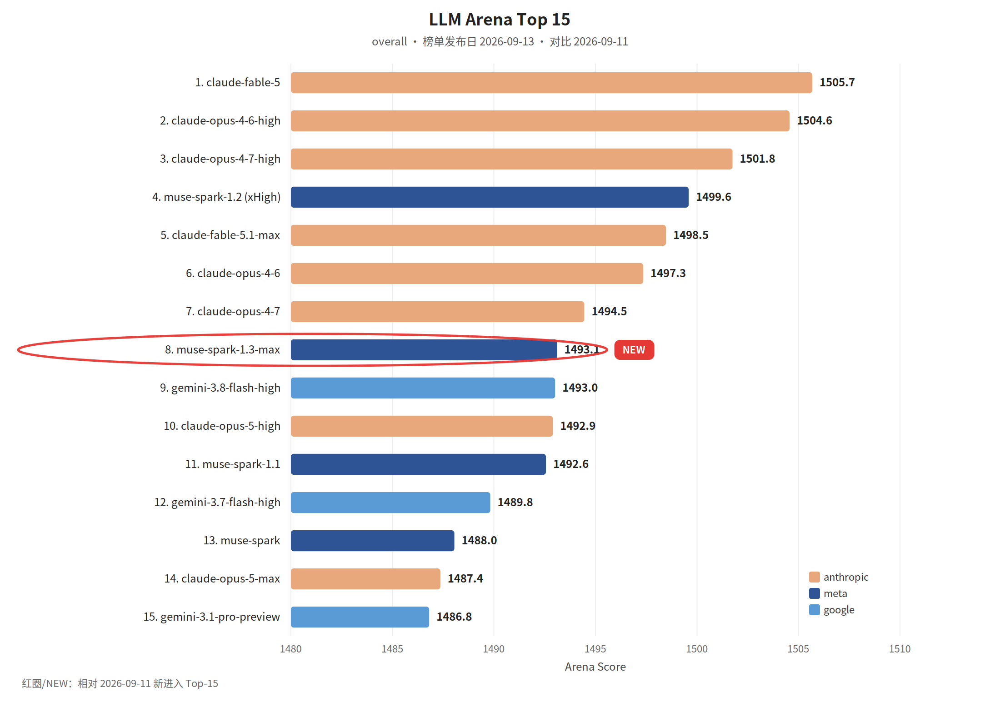

覆盖窗口：2026-09-11～2026-09-17（生成日 2026-09-18）。

## 〇、薅羊毛

本期为补录。linux.do 福利 RSS 没有落到这个窗口的可核验快照（Wayback 未收录该栏目），不把后来的帖子写进来。

#### Amp：自带算力和模型钥匙则可免费使用

Amp 称，若自己带计算和模型订阅或 API 钥匙，就可以免费使用。这不是赠送额度，而是把计费留在你已有的供应商账上。限制以官方说明为准。

> 原始链接：[Free Agent](https://ampcode.com/news/free-agent)（发布日 2026-09-13）

 

## 一、本周关键词

Devin Fusion harness，Amp 可自带钥匙免费用

Fable 5.1 与百万上下文的 GPT-5.6 进入 Kiro

Anthropic 的 CI 被 Agent 编码撑大，Grab 把 Cursor 开放给非工程团队

 

## 二、模型进展

#### 整体排名

LLM Arena（Hugging Face `lmarena-ai/leaderboard-dataset`，`text_style_control` / overall，榜单发布日 **2026-09-13**，落在本窗口内）。红圈为相对 2026-09-11 新进入 Top-15 的 **muse-spark-1.3-max**。本环境无 Artificial Analysis 密钥，不单列 AA 小节。

#### Claude Fable 5.1 进入 Kiro 企业版

Kiro 称 Claude Fable 5.1 已向企业客户开放，并把它放在长时、重上下文的 Agent 会话上。

> 原始链接：[Claude Fable 5.1 is now available in Kiro](https://kiro.dev/blog/fable-5-1/)（发布日 2026-09-16）

#### Kiro 里的 GPT-5.6 支持约一百万 token

Kiro 称 GPT-5.6 的 Sol、Terra 和 Luna 在 IDE、CLI 等表面支持约一百万 token 的上下文。上下文变长之后，更值得看的是缓存和截断策略，而不是只把窗口数字写进配置。

> 原始链接：[GPT-5.6 models now support 1 million token context windows in Kiro](https://kiro.dev/blog/gpt-5-6-1m-context/)（发布日 2026-09-14）

 

## 三、项目开源

#### GitHub Trending（daily / all 前 5）

第三方 RSS 没有这一窗口的历史名次。下面 5 条来自 Wayback 对 [github.com/trending](https://github.com/trending) 的存档（Today、全部语言），快照 **2026-09-17**。简介译自存档页描述。

> 存档：[2026-09-17 github.com/trending](https://web.archive.org/web/20260917012101/https://github.com/trending)

1. [alibaba/open-code-review](https://github.com/alibaba/open-code-review)：阿里巴巴的代码审查工具，确定性流水线加 LLM Agent，做到行级评论，并带多语言规则。
2. [cloudflare/security-audit-skill](https://github.com/cloudflare/security-audit-skill)：给编码 Agent 用的分阶段安全审计技能，发现要能独立核验、机器可读。
3. [JustVugg/colibri](https://github.com/JustVugg/colibri)：用纯 C、无依赖的方式在已有硬件上跑 MoE，专家权重从磁盘流式读取。
4. [abue-ammar/tinycast](https://github.com/abue-ammar/tinycast)：很小的原生 macOS 启动器，带热键和剪贴板历史。
5. [jamiepine/voicebox](https://github.com/jamiepine/voicebox)：开源语音工作室，用于克隆、听写和生成。

 

## 五、国际进展

#### &lt;Harness&gt;Devin Fusion

Cognition 发布 Fusion，称它是面向 Opus、Fable 和 Astra 的 harness，相对其它模型 harness 最高可再省 39% 的开销。省的是同模型下的调用方式，不是换一个更大的模型。

> 原始链接：[Introducing Fusion in Devin Desktop & CLI](https://cognition.ai/blog/local-fusion)（发布日 2026-09-11）

#### &lt;CI&gt;Agent 编码把 Anthropic 的 CI 撑大了

Anthropic 称 6 个月内 CI 任务量增加到 25 倍，测试选择服务改了三次才稳住。Agent 提高了提交频率之后，先坏的往往是测试选择和队列，不是编辑器。

> 原始链接：[Agentic coding is straining CI](https://claude.com/blog/agentic-coding-is-straining-ci-heres-how-we-scaled-test-impact-analysis-at-anthropic)（发布日 2026-09-14）

#### &lt;软件工厂&gt;爬、走、跑

Warp 把采用软件工厂分成三步：先做单点自动化，再做端到端 Agent 循环，最后做成可度量的闭环。没有度量就直接「跑」，工厂只是更多的并行聊天。

> 原始链接：[Adopting the software factory model](https://www.warp.dev/blog/adopting-the-software-factory-model-crawl-walk-run)（发布日 2026-09-15）

#### &lt;推广&gt;Grab 让非工程团队也用 Cursor

Cursor 的客户故事称，Grab 里 Cursor 不再只给工程团队。设计、运营和工程都能用它来做东西。权限模型若仍按「只有工程师有仓库写权限」来设，这一步会先撞上。

> 原始链接：[Grab 如何让设计、运营和工程团队都用上 Cursor](https://cursor.com/cn/blog/grab)（发布日 2026-09-15）

#### &lt;运行时&gt;goose 改用可重入状态机

goose 用可重入状态机替换经典 Agent 循环：对话就是状态，每种行为是一次 Operation。长任务中断后能否从状态恢复，比循环里再加一个工具更关键。

> 原始链接：[Agentic State Machines](https://goose-docs.ai/blog/2026/09/16/agentic-state-machines)（发布日 2026-09-16）

#### &lt;产品&gt;Claude Cowork 并入 Claude

Anthropic 把 Cowork 和聊天收成同一个 Claude，向 Pro、Max 和 Ultra 铺开。任务可以交出去，最后决定仍留在人这边。

> 原始链接：[Claude Cowork and chat are now one Claude](https://claude.com/blog/cowork-is-now-claude)（发布日 2026-09-16）

#### &lt;债务&gt;Kiro Web 的自主模式用来还技术债

Kiro 讨论用 Web 上的自主模式处理技术债，把维护和新功能的时间冲突当成问题，而不是只演示新功能生成。

> 原始链接：[Tackling technical debt at scale](https://kiro.dev/blog/tackling-technical-debt-at-scale-with-autonomous-mode/)（发布日 2026-09-14）

 

本期于 2026-11 按新版格式补录。
