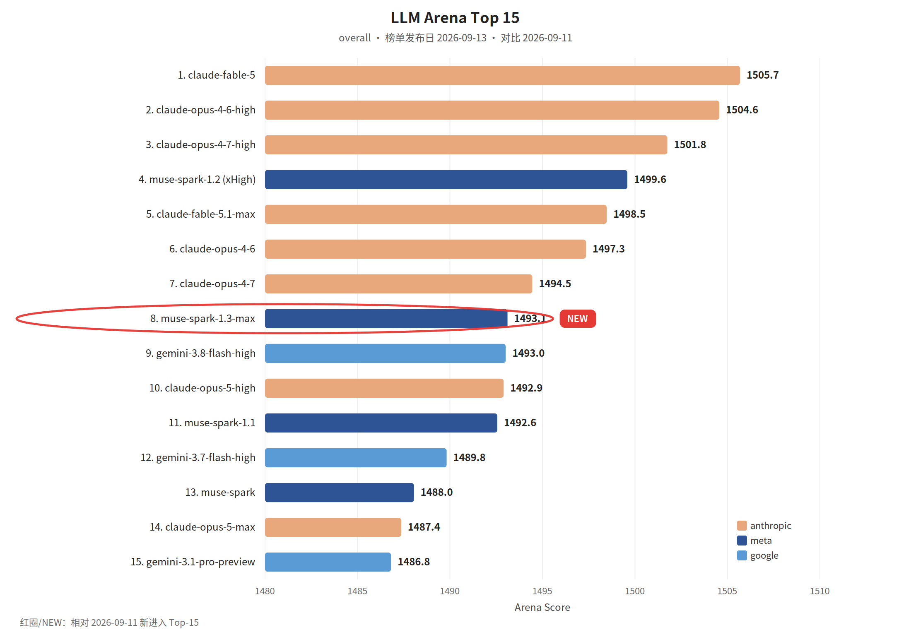

覆盖窗口：2026-09-18～2026-09-24（生成日 2026-09-25）。

## 〇、薅羊毛

#### [You can now chat with Lovable for free](https://lovable.dev/blog/chat-for-free)

Lovable 现已提供免费对话功能，用户可通过提问让 Lovable 帮助评估创意、将客户反馈转为计划、比较不同版本并实时迭代；Lovable 能读取已连接工具（如 Notion、Granola、Linear）、检查应用代码与 Lovable Cloud 数据库以分析使用数据并据此建议或构建功能，还可撰写邮件、指南和提案等文档。

 

## 一、本周关键词

GPT-6 Sol 与 Luna，Claude Opus 5.5

Kimi Code Desktop，MiniMax Code CLI 开源

Qwen3.8-Omni-Flash，Grok 4.7

 

## 二、模型进展

#### 整体排名

较上周无新榜。榜单发布日 2026-09-13。红圈：muse-spark-1.3-max。

#### [GPT-6 Sol 与 Luna](https://openai.com/index/introducing-gpt-6-sol-and-luna)

OpenAI RSS：两个模型把前沿能力放到日常工作里，能力和成本的平衡不同。日期取自 RSS。

#### [GPT-6 的提示缓存](https://openai.com/index/better-prompt-caching-for-gpt-6)

同一天的 OpenAI RSS：更高的缓存命中、新的诊断、显式断点和用来降延迟与成本的控制。

#### [Claude Opus 5.5](https://www.anthropic.com/claude-opus-5-5)

Anthropic News RSS：Opus 5.5 在 Agent 编码和知识工作上领先，典型负载的运行成本比 Opus 5 低 40%。

#### [Qwen3.8-Omni-Flash](https://x.com/Alibaba_Qwen/status/2100785962414702599)

千问 RSS：第一款围绕 Agent 能力做的全模态 Flash。原生音视频理解、推理和工具使用放在一个模型里。

#### [Grok 4.7](https://x.ai/news/grok-4-7)

xAI RSS 标题为 Introducing Grok 4.7，发布日 2026-09-21。正文摘要只有日期，功能以原文为准。

#### [Coding sessions are longer and use more context. Claude Opus 5.5 is built with that in mind.](https://claude.com/resources/articles/claude-opus-5-5-built-for-coding-sessions-that-use-more-context)

Anthropic 表示 Opus 5.5 在典型按 token 计费工作负载下比 Opus 5 运行成本约低 40%，并通过三方面优化让长时、高上下文的编码会话更省钱：降低输入/输出 token 价 20% 及缓存读取价 60%；改进 Claude Code 的缓存利用率以减少缓存未命中并延长缓存寿命；以及模型在同等…

#### [Create your own voice for Gemini 3.8 TTS](https://www.philschmid.de/gemini-3-8-tts)

介绍 Gemini 3.8 Flash TTS 与 Flash‑Lite TTS 在 Gemini API 与 AI Studio 可用，支持通过两段录音（参考录音与授权句）生成可复刻的个人语音，或仅用一句提示设计新语音。

#### [Use open weight models as your AI coding agent with Amazon Bedrock](https://aws.amazon.com/blogs/machine-learning/use-open-weight-models-as-your-ai-coding-agent-with-amazon-bedrock/)

介绍将开源权重模型与 Amazon Bedrock 配合使用，通过开源终端原生代理 OpenCode 在本地运行、在用户 AWS 账户内安全进行推理，从而避免第三方 API、按席订阅或外部数据离开账户的问题。

#### [Bring more intelligence to everyday work with GPT-6 Sol and GPT-6 Luna on Amazon Bedrock](https://aws.amazon.com/blogs/machine-learning/bring-more-intelligence-to-everyday-work-with-gpt-6-sol-and-gpt-6-luna-on-amazon-bedrock/)

AWS 在 Amazon Bedrock 上推出 GPT-6 Sol 与 GPT-6 Luna，并已全面可用；两款模型在推理引擎上运行、较 GPT-5.6 定价显著降低，适配不同工作负载：GPT-6 Sol 面向复杂、重复的开发与运维任务，改进了编码、调试与事实性表现；GPT-6 Luna 面向高并发、重复性文档提取、…

#### [Claude Opus 5.5 for code review: More catches, different misses](https://coderabbit.ai/blog/opus-5-5-model-review)

CodeRabbit 在其代码审查流水线中评估了 Anthropic 发布的 Claude Opus 5.5（Standard 与 Max 两种配置），在 80 条开源常见缺陷与 13 条更难的 Signal 案例上衡量了已知缺陷覆盖率、可执行精确度与评论量。

#### [Claude Opus 5.5 is now available on AWS](https://aws.amazon.com/blogs/machine-learning/claude-opus-5-5-is-now-available-on-aws/)

Anthropic 的 Claude Opus 5.5 已在 Amazon Bedrock 和 Claude Platform on AWS 上可用，宣称在每任务代价、缓存读取成本和表达清晰度上优于 Opus 5，适用于长期任务、代理式编码和知识工作，并引入类似 Fable 5.1 的生物、安全与 AI 开发安全分类器。

#### [xAI’s Grok 4.6 is now available in Amazon Bedrock](https://aws.amazon.com/blogs/machine-learning/xais-grok-4-6-is-now-available-in-amazon-bedrock/)

xAI 的 Grok 4.6 自 2026-08-18 在 Amazon Bedrock 上线，提供 50 万 token 上下文窗口与四档可配置推理强度（low/medium/high/xhigh）。

#### [Introducing Kimi K3 on Amazon Bedrock](https://aws.amazon.com/blogs/machine-learning/introducing-kimi-k3-on-amazon-bedrock/)

AWS 在 Amazon Bedrock 上上线了 Moonshot AI 的开源模型 Kimi K3，号称为 Moonshot 最强模型、参数规模约 2.8 万亿并具备原生视觉能力和 100 万 token 上下文窗口，较 Kimi K2 提升约 2.5 倍的扩展效率，适合长时编码和知识工作。

 

## 三、项目开源

#### GitHub Trending（daily / all 前 5）

快照 2026-09-24（daily / all）。

1. [anthropics/financial-services](https://github.com/anthropics/financial-services)：存档页未给出简介。
2. [google/ax](https://github.com/google/ax)：Google 的开放 Agent 编排运行时。
3. [davila7/claude-code-templates](https://github.com/davila7/claude-code-templates)：配置和观察 Claude Code 的命令行工具。
4. [BuilderIO/agent-native](https://github.com/BuilderIO/agent-native)：用来做 Agent 应用的框架。
5. [obra/superpowers](https://github.com/obra/superpowers)：Agent 技能框架，以及一套软件开发方法。

#### [MiniMax Code CLI 开源](https://mp.weixin.qq.com/s?__biz=MzE5MTA3NzcxMQ==&mid=2247489141&idx=1&sn=aeed3ab7116c15e5cd2e52165fcb0ed1)

MiniMax 公众号：Code CLI v0.4.12 以 MIT 协议开放，是 MiniMax Code 客户端的核心组件。文中称在 FrontierHarness Eval 上任务通过率 76.7%，成功任务耗时中位数 4 分 33 秒。

#### [How UK AISI and EvalEval Are Making Benchmark Results Reproducible](https://huggingface.co/blog/evaleval-aisi)

Hugging Face 报道 UK AI Security Institute（AISI）与 EvalEval 合作，使用 Every Eval Ever（EEE）模式与 Evaluation Cards 平台公开共享评测结果与配置以提高可复现性。

#### [Jun Kim, oMLX creator and maintainer, joins Hugging Face to support the MLX community](https://huggingface.co/blog/omlx)

Hugging Face 宣布 Jun Kim（oMLX 创建者与维护者）加入团队，oMLX 将继续以 Apache 2.0 许可由 Jun 领导并受更稳定与资助的维护，目标是加速开发并使 oMLX 成为 MLX 生态中新想法的试验平台。

#### [Transformers now runs llama.cpp quants](https://huggingface.co/blog/transformers-llama-cpp-quants)

Hugging Face 在 transformers 中加入对 GGUF 量化模型的运行支持，允许通过 from_pretrained 加载 Hub 上的 GGUF 检查点并在本地（首推 Apple Silicon）用 PyTorch/transformers 接口进行推理或用 transformers serve…

#### [tokenizers v1: encode, decode and scaling, measured](https://huggingface.co/blog/tokenizers-v1)

Hugging Face 介绍了 tokenizers v1 的性能重构与基准：保持与 v0.23 相同的输出与 API，重构为多个 crate 并引入 tk-encode 运行时、bitcannon（用位流与 SIMD 代替通用正则完成分割）、线程本地词缓存、可重用的模型临时内存与无分配合并循环、批量模型调用和更快的解码等优化。

 

## 四、国内进展

#### &lt;客户端&gt;[Kimi Code Desktop](https://mp.weixin.qq.com/s?__biz=MzcwMjM3ODEzOA==&mid=2247487615&idx=1&sn=1969ad8d7fe3d87d538e983fb6c1963f)

Kimi 公众号：macOS 和 Windows 版同时上线，从 kimi.com/code 安装。桌面端可以直接用 Kimi Code 的 Agent：对话读写代码、运行命令、做自动化任务。

#### [Project & Discussion: Where Humans and Agents Work Together](https://qoder.com/blog/project-and-discussion)

Qoder 发布“项目与讨论：人类与智能体的协同工作空间”，聚焦将 Qoder 平台扩展到人类与 AI 智能体共同参与的项目管理与讨论流。

#### [我用 GPT 6 Astra 做了一个 3D 版的《桃花源记》（文中含提示词）](https://baoyu.io/blog/gpt-6-astra-peach-blossom-land)

作者用 ChatGPT Pro 中的 GPT-6 Astra 将《桃花源记》改编为可在浏览器交互的 3D 网页作品《桃源·豁然开朗》，页面分为 20 幕并支持“循文入境”按原文顺序推进；初版使用系统 TTS，后以央视李立宏的真人朗诵替换并用 SRT 做同步；随后由 Codex 优化工程化处理，将朗诵音频外置并加入溪水与…

 

## 五、国际进展

#### &lt;度量&gt;[用裁判模型给软件工厂打分](https://www.warp.dev/blog/using-llm-as-a-judge-scoring-to-measure-your-software-factory)

Warp：要把编码 Agent 用起来，就得停止凭感觉判断它们表现如何，改成测量。LLM-as-a-judge 被用来给工厂打分。

#### [Aderant builds intelligent ticket triage with Amazon Nova](https://aws.amazon.com/blogs/machine-learning/aderant-builds-intelligent-ticket-triage-with-amazon-nova/)

Aderant 用 Amazon Nova Lite（通过 Amazon Bedrock）构建了 Intelligent Ticket Analyzer，实现对未指派支持工单的定时审查、上下文聚合、分类、路由与知识补全，并在置信度阈值满足时自动重新分配与通知，低置信度则交由人工复核。

#### [Build a multi-account AI agent with AgentCore Gateway and MCP](https://aws.amazon.com/blogs/machine-learning/build-a-multi-account-ai-agent-with-agentcore-gateway-and-mcp/)

介绍基于 Amazon Bedrock AgentCore Gateway 与 Model Context Protocol (MCP) 的多账户 AI 代理架构：平台账号托管 AgentCore Runtime 与 LLM 推理并部署 Gateway，LOB 团队在各自账号用 MCP 服务器封装数据和工具。

#### [Claude Tag now supports personal connectors in channels](https://claude.com/resources/articles/claude-tag-now-supports-personal-connectors-in-channels)

Anthropic 在 2026-09-24 宣布，Claude Tag (beta) 现支持在频道中使用用户个人连接器：当你在频道内向 Claude 发起请求时，若已将外部工具（如个人日历、Google Drive、CRM 账户等）连接到你的 Claude 账号，Claude 可以在该线程中调用这些个人连接器并在回复…

#### [Inside Chats: How Lovable's Agents Work Together](https://lovable.dev/blog/how-lovable-agents-work-together)

介绍 Lovable 的 Chats 工程设计：以不可变、可分叉的事件日志（trajectory）记录所有代理交互与工具调用，采用与 Git 类似的单父指针分支模型避免合并语义混乱；将轨迹与供模型使用的上下文分离，支持异步压缩与基于侧分支的摘要；通过非持久的 partials 实现流式渲染；每个代理维护独立的收件箱与运…

#### [LangSmith Engine v2: Red teaming and automated testing](https://www.langchain.com/blog/langsmith-engine-v2-redteam)

LangSmith 发布 Engine v2，通过红队测试和自动化验证提升代理开发流程：主动在生产 trace 中发现问题（包括幻觉、系统提示违规、效率低下和性能趋势如错误率、延迟、成本），将相关 trace 聚合为可操作问题并提供根因、修复建议与评估样本。

#### [Shared Runners](https://ampcode.com/news/shared-runners)

Amp 现支持在工作区内共享 runner，使用 --share 启动后，工作区成员可在 ampcode.com 的 Shared Runners 列表中为该机器创建线程。

#### [Speaker-labeled transcription with WhisperX on SageMaker AI](https://aws.amazon.com/blogs/machine-learning/speaker-labeled-transcription-with-whisperx-on-sagemaker-ai/)

介绍 AWS 提供的 WhisperX Deep Learning Container（DLC），该容器将 OpenAI 的 Whisper 与 wav2vec2 强制对齐和说话人分离集成，能生成每词精确时间戳并标注说话人。

#### [The Mac App Is Your Runner](https://ampcode.com/news/the-mac-app-is-your-runner)

Amp macOS 应用现在可为你启动 runner，无需在终端运行 amp --no-tui open 即可在 Mac 上运行线程。

#### [Trajectories now in LangSmith: A readable view of every agent session](https://www.langchain.com/blog/langsmith-trajectories-tracing)

LangSmith 推出 Trajectories 功能：以时间序列的对话视图汇总整个代理会话中来自人类、模型与工具的消息，按首次出现顺序展示每条信息，去除嵌套运行结构，便于快速定位行为偏差、由主题专家审阅和评分，并可将轨迹路由到标注队列或数据集、用在线评估器评分或导出用于监督微调。

#### [Agentic conversational video intelligence built on AWS](https://aws.amazon.com/blogs/machine-learning/agentic-conversational-video-intelligence-built-on-aws/)

介绍在 AWS 上构建的可对话式视频智能解决方案：通过基于 Strands Agents SDK 的 agent 架构，运行时根据用户自然语言问题调用 Amazon Bedrock、Amazon Rekognition、Amazon Transcribe 或 Bedrock Data Automation 等服务，对视…

#### [Claude Marketplace: one place to discover plugins, agents, and services from our partners](https://claude.com/resources/articles/claude-marketplace)

Anthropic 今日推出 Claude Marketplace，将插件与连接器、代理与产品、以及服务合作伙伴集中在一处，供客户发现并扩展 Claude 的用例。

#### [Do you understand what you’re about to merge?](https://coderabbit.ai/blog/do-you-understand-what-youre-about-to-merge)

介绍 CodeRabbit 的 Change Stack 工具，旨在帮助代码评审者将 PR 的意图、行为变化和依赖关系与具体代码连接起来；通过 PR 概览、语义差异视图、按逻辑分层的变更组、将解释与代码片段精确关联、展示依赖/安全影响范围及保存已审查提交快照，审阅者能验证说明与实现一致、检查行为变化与相关测试、识别下游…

#### [From portal-hopping to instant answers: HEMA’s journey with MCP and Amazon Bedrock](https://aws.amazon.com/blogs/machine-learning/from-portal-hopping-to-instant-answers-hemas-journey-with-mcp-and-amazon-bedrock/)

荷兰零售商 HEMA 将分散在多种门户和文档中的技术与流程知识整合为单一知识层 HAL，并基于 Amazon Bedrock AgentCore 与 Model Context Protocol (MCP) 将该知识通过 IDE 与聊天等日常工具提供给工程师与非工程角色。

#### [How CodeRabbit, Power Digital, and ThoughtSpot scale with Snowflake and Vercel on Claude Marketplace](https://claude.com/resources/articles/how-coderabbit-power-digital-and-thoughtspot-scale-with-snowflake-and-vercel-on-claude-marketplace)

介绍三家公司如何通过 Claude Marketplace 将已承诺的 Anthropic 预算用于 Snowflake 和 Vercel，从而快速扩展：Power Digital 将 Snowflake 和 Snowflake Cortex AI 纳入其 Nova 平台，在同一治理框架内对客户数据运行 Claude。

#### [How to prepare for AI-driven code modernization projects](https://claude.com/resources/articles/how-to-prepare-for-ai-driven-code-modernization-projects)

Anthropic 分享了六步管理大规模代码现代化项目的经验：定义目标（升级、跨栈改写或重构）、创建证明变更正确的“证书”、设定变更上生产的晋升策略、准备运行所需前置条件（环境、CI/CD、测试能力与审批）、构建并迭代基于 Claude Code 的代理化工作流以并行生成变更、在小范围验证后放大执行；文章强调与评审者共…

#### [打通最后一公里的 Bots：Rollouts 与 Security Review](https://cursor.com/cn/blog/rollouts-and-security-reviewer)

Cursor 推出两款软件开发 Bots：Rollouts 全程监控从 PR 到生产的变更，连接源码管理、部署与遥测平台，合并前基于 diff 制定监控规划、标记缺失埋点，部署后对比基线以发现回归并可通知作者、暂停发布或创建回滚 PR，未来将支持功能开关与发布列车感知。

#### [提升长时间智能体运行的 token 效率](https://cursor.com/cn/blog/improved-token-efficiency)

Cursor 通过精简系统提示、仅在需要时动态加载工具、提高提示缓存复用、压缩文件读取行号频率和策略性使用子智能体等多项改进，将智能体 harness 的 token 成本整体降低约 7%，其中把系统提示缩减约 66%、将内置工具描述移入动态上下文使静态上下文描述 token 降低约 60%、MCP 工具动态加载会话总…

#### [Building the Future of Software Engineering in Latin America](https://cognition.ai/blog/devin-comes-to-sao-paulo)

Cognition 在圣保罗的 MASP 正式宣布进军拉美，目标是帮助该地区企业现代化并本地化软件开发，以应对移动优先市场和遗留系统的挑战。

#### [Evaluate skill-equipped agents with Strands Evals and Amazon Bedrock AgentCore](https://aws.amazon.com/blogs/machine-learning/evaluate-skill-equipped-agents-with-strands-evals-and-amazon-bedrock-agentcore/)

介绍了使用 Strands Evals SDK 与 Amazon Bedrock AgentCore Evaluations 对具备技能（skills）的通用智能体进行评估的方法，定义了三类与技能相关的评估器：Skill Selection Accuracy（判断所调用技能是否适当）、Skill Instruction…

#### [Extending public sector intelligence with Agentforce and AWS](https://aws.amazon.com/blogs/machine-learning/extending-public-sector-intelligence-with-agentforce-and-aws/)

介绍将 Amazon Bedrock Data Automation 与 Model Context Protocol（MCP）结合，并通过 Salesforce Agentforce 暴露结果的架构模式：将未结构化证据文件存入 Amazon S3，触发 Lambda 启动 Bedrock Data Automatio…

#### [Faster builds, same quality: Opus 5.5 now in Lovable](https://lovable.dev/blog/opus-5-5-now-in-lovable)

Lovable 已将 Opus 5.5 集成到平台：相较于 Opus 5，Opus 5.5 在保持相同质量的前提下完成构建所需步骤减少约三分之一到一半，主要因为一次性收集上下文、合并更少但更完整的补丁，以及按需验证减少重复检查。

#### [How Reactiv automates mobile commerce 80% faster with Amazon Bedrock AgentCore](https://aws.amazon.com/blogs/machine-learning/how-reactiv-automates-mobile-commerce-80-faster-with-amazon-bedrock-agentcore/)

Reactiv 用 Amazon Bedrock AgentCore 将其面向 Shopify 商家的移动电商产品从单一交互式代理扩展为生产化的三代理系统，实现定时自主更新、跨会话持久记忆和多租户隔离。

#### [How Tata Elxsi detects industrial safety risks in seconds on AWS](https://aws.amazon.com/blogs/machine-learning/how-tata-elxsi-detects-industrial-safety-risks-in-seconds-on-aws/)

介绍Tata Elxsi基于AWS构建的IRIS（Industrial Real-Time Intelligence System）实时工业安全平台：在边缘用AWS IoT Greengrass与GPU服务器做帧抽取与轻量检测，只将安全相关帧与元数据上传至S3。

#### [How Trane gets building insights 60x faster with Amazon Bedrock AgentCore](https://aws.amazon.com/blogs/machine-learning/how-trane-gets-building-insights-60x-faster-with-amazon-bedrock-agentcore/)

Trane用Amazon Bedrock AgentCore和Strands在3–4周内构建出多代理会话系统，将需在多屏界面上耗时约20分钟的诊断流程缩短到约20秒，自行基准测试得出“时间到洞察”提升60倍。

#### [Lovable is a founding member of the Blueprint Alliance](https://lovable.dev/blog/lovable-founding-member-blueprint-alliance)

Lovable 成为 Blueprint Alliance 的创始成员之一，该联盟由多家厂商联合推动面向企业级 AI 代理的开放参考架构，旨在统一代理识别、访问边界、运行监控与响应流程。

#### [One Runner, Many Worktrees](https://ampcode.com/news/one-runner-many-worktrees)

Amp 运行器现在可以为所服务的仓库创建 Git worktree：在目录选择器对已有仓库或新目录使用“New Worktree/New Directory/New Project”选项，输入名称后会在仓库旁生成以该名为文件夹和分支名的新 worktree，分支基于当前 HEAD，未提交更改留在原检出中，新目录会立即在…

#### [Right-size generative AI endpoints with concurrency sweeps on Amazon SageMaker AI](https://aws.amazon.com/blogs/machine-learning/right-size-generative-ai-endpoints-with-concurrency-sweeps-on-amazon-sagemaker-ai/)

介绍在 Amazon SageMaker AI 中使用并发扫描（concurrency sweeps）为生成式 AI 端点进行容量规划的流程：部署模型到 vLLM 容器、定义工作负载配置、调用 CreateAIBenchmarkJob 运行逐级并发负载测试、下载并分析每级吞吐量、端到端延迟、p99/p50 差距和首令牌…

#### [SF: A Birds of a Feather on Agentic Engineering](https://blog.fsck.com/2026/09/22/agentic-dev-in-sf/)

宣布将于2026年10月14日晚在旧金山举办一次小型聚会（或系列活动）——“agentic engineering”主题的Birds of a Feather，组织者为Simon Willison及作者，旨在让构建者和试验者交流正在尝试的做法、经验和未解决的问题，活动形式为非正式的讨论和展示，不强制发言，感兴趣者可在Luma注册。

#### [The Reliability Layer for Healthcare AI: Common LangSmith Use Cases](https://www.langchain.com/blog/reliability-healthcare-ai-langsmith-use-cases)

LangSmith 帮助医疗 AI 团队将临床复审转化为可复用的标签、评估器和数据集，从而将专家判断变为长期可用的基础设施；Abridge 用该流程将发布周期从数周缩短到几天，采用参考式与无参考评估器并用以覆盖广度与专业细节；Included Health 在生产中用 LangSmith 注释队列监控路由质量与安全，发…

#### [How Benchling secured multi-tenant AI agents with Amazon Bedrock AgentCore](https://aws.amazon.com/blogs/machine-learning/how-benchling-secured-multi-tenant-ai-agents-with-amazon-bedrock-agentcore/)

Benchling 在独立的“Untrusted Code Account”中以 Amazon Bedrock AgentCore 的 Code Interpreter（ACCI）VPC 模式运行 AI 生成的实验代码。

#### [How BMW Group detects cost anomalies across 14,000 cloud accounts](https://aws.amazon.com/blogs/machine-learning/how-bmw-group-detects-cost-anomalies-across-14000-cloud-accounts/)

BMW Group 的 Cloud Efficiency Analytics（CLEA）在 AWS 上每日对超过 14,000 个云账户、按账号-服务粒度的日度成本时序进行预测和异常检测。

#### [Reducing medical claims review time with AI on AWS: The EXL Medical IDP solution](https://aws.amazon.com/blogs/machine-learning/reducing-medical-claims-review-time-with-ai-on-aws-the-exl-medical-idp-solution/)

EXL 在 AWS 上构建了面向保险理赔的医疗智能文档处理（IDP）解决方案，将 Xtrakto.AI 的文档摄取、分类、抽取与可追溯性与经微调的 EXL Insurance LLM 结合，使用 Amazon SageMaker AI、Amazon Bedrock、Textract、Step Functions、Lam…

#### [Run Positron on Amazon SageMaker AI for data science workflows](https://aws.amazon.com/blogs/machine-learning/run-positron-on-amazon-sagemaker-ai-for-data-science-workflows/)

Positron 的 IDE 现在可在 Amazon SageMaker AI 中运行，允许数据科学家在 SageMaker Studio Space 内在受控角色下直接访问 Athena、Glue Data Catalog 与 S3，无需存储凭证；可按需启动计算并用 SageMaker AI 训练计划预留容量。

#### [Superpowers 6.4](https://blog.fsck.com/2026/09/21/superpowers-6.4/)

Superpowers 6.4 发布，新增对三种编码代理（Meta 的 Muse、OpenCode 2.0、Qwen Code）的支持，改进了计划执行以应对前沿模型的新特性，包括强化的原生执行（Native Execution）和子代理驱动开发两种风格，发布中还加入了诊断 skill 以分析会话历史并协助提交错误报告…

#### [Jev-as-a-Judge for Agent Evals](https://www.langchain.com/blog/jev-agent-evals-langsmith)

LangChain 对比了 TypeSafe AI 的 Jev（System One 决策模型）与多款自回归 LLM 作为评判器在代理评估中的表现：在对同一五个天气任务的 500 次二元通过判断与 100 次质量评分重复试验中，Jev 与人类参考的一致性最高（在二元 does_pass 上与人工标签完全一致），质量评分…

#### [Amazon SageMaker Inference: 2026 year-to-date launches in review](https://aws.amazon.com/blogs/machine-learning/amazon-sagemaker-inference-2026-year-to-date-launches-in-review/)

回顾了2026 年至今 Amazon SageMaker Inference 在两条部署路径（Fully managed Endpoints 与 Kubernetes-native HyperPod Inference）上推出的 13 项能力。

#### [Deploy Hugging Face models on Amazon SageMaker AI with coding agents](https://aws.amazon.com/blogs/machine-learning/deploy-hugging-face-models-on-amazon-sagemaker-ai-with-coding-agents/)

介绍使用六个开源 Hugging Face agent skills 在 Amazon SageMaker AI 上将 Hugging Face 模型部署为生产就绪端点的流程。

#### [How we built a software factory with Kiro Crew to merge 1,000 PRs in a week](https://kiro.dev/blog/software-factory-1000-prs/)

Kiro 团队用三名全职工程师与约 500 名社区贡献者，在七天内合并了 1,000 个 PR。

#### [Introducing Amazon SageMaker HyperPod Inference Gateway](https://aws.amazon.com/blogs/machine-learning/introducing-amazon-sagemaker-hyperpod-inference-gateway/)

AWS 推出 SageMaker HyperPod Inference Gateway，一款以 Kubernetes 原生方式部署的 EKS addon，用实时 GPU 指标（如 KV 缓存利用率、队列深度、LoRA 适配器驻留、前缀缓存命中率等）智能选路，将推理请求路由到最合适的 pod，无需修改模型服务器或客户端。

#### [Lovable acquires Sutro to make software easier to explain and easier to trust](https://lovable.dev/blog/lovable-acquires-sutro-to-make-software-easier-to-explain-and-easier-to-trust)

Lovable 宣布收购 Sutro，Sutro 团队过去五年开发了一种语言、编译器和后端平台以使应用行为和规则显式化，强化安全与可靠性；Sutro 创始人 Tomas Halgas 及工程师 Max Gfeller、Tony Zhan、Hirad Arshadi 将加入 Lovable，Tomas 将负责技术布道，继…

#### [Migrating multi-model AI agents to Amazon Bedrock AgentCore runtime](https://aws.amazon.com/blogs/machine-learning/migrating-multi-model-ai-agents-to-amazon-bedrock-agentcore-runtime/)

介绍将一个三模型医疗问答代理从自管的 Amazon ECS + Fargate 平台迁移到 Amazon Bedrock AgentCore 运行时的示例实现，迁移保持原有代理逻辑不变，AgentCore 运行时通过托管容器生命周期、会话扩缩容、身份与可观测性简化基础设施管理。

#### [Rethinking PR triage from first principles](https://coderabbit.ai/blog/rethinking-pr-triage-from-first-principles)

CodeRabbit 描述其 Triage 工具如何从首原则重构 PR 排队：用确定性规则先判定每个 PR 的工作流状态、下步动作与责任人（不依赖 AI 模型），再用比较性排序决定关注次序；分类器按优先级规则序列匹配状态并记录原因，优先级（P0–P3）由可验证证据的三信号（严重度、外部紧急度、影响力）生成且可被人工或管理覆写。

#### [The new AgentCore runtime: Elastic, optimized, and consistently fast starts](https://aws.amazon.com/blogs/machine-learning/the-new-agentcore-runtime-elastic-optimized-and-consistently-fast-starts/)

AWS 在 Amazon Bedrock AgentCore 中发布了全新 AgentCore runtime，面向生产级代理优化启动速度、内存管理与计费模型。

本期于 2026-11 按新版格式补录。
