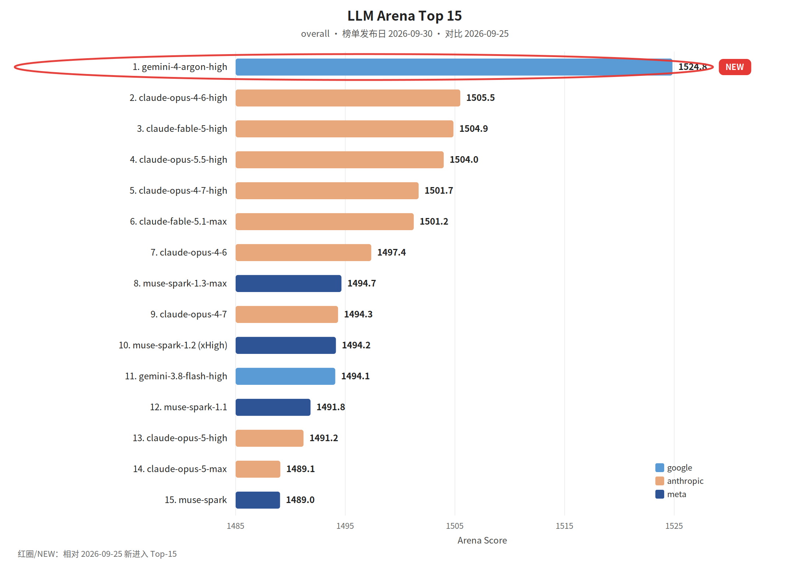

覆盖窗口：2026-09-25～2026-10-01（生成日 2026-10-02）。

## 〇、薅羊毛

本期为补录。linux.do 福利 RSS 当前只剩生成日之后的帖子，Wayback 没有该地址的存档，窗口内的社区帖补不回来。百度 Geek 说 9 月 30 日的「国庆免费领」是音箱和京东卡一类礼品，不是开发者额度，不写入本期。

 

 

## 一、本周关键词

GPT-6.1 Sol 与 dots

Claude Sonnet 5.5 上 AWS，Opus 5.5 进入 Kiro

Devin 变便宜，DeepSeek 开源昇腾组件

 

 

## 二、模型进展

#### 整体排名

LLM Arena（同一份全量数据集，overall，榜单发布日 **2026-09-30**）。红圈为相对 2026-09-25 新进入 Top-15 的 **gemini-4-argon-high**，并且排在第一。本环境无 Artificial Analysis 密钥，不单列 AA 小节。

#### GPT-6.1 Sol

OpenAI RSS：接近 Astra 的编码、计算机使用和专业工作能力，标准 API 的输入和输出价格大约是 Astra 的五分之一。日期取自 RSS。

> 原始链接：[Introducing GPT-6.1 Sol](https://openai.com/index/introducing-gpt-6-1-sol)（发布日 2026-09-29）

#### dots

OpenAI RSS：dots 是会主动往下做的助手，可以在复杂项目和日常任务里持续工作，同时让人保持控制。

> 原始链接：[Introducing dots](https://openai.com/index/introducing-dots)（发布日 2026-09-29）

#### Claude Sonnet 5.5

Anthropic 在 2026-09-28 发布 Claude Sonnet 5.5。AWS 同一天把它放上 Amazon Bedrock 和 AWS 上的 Claude Platform，称它是更聪明、更省的 Sonnet，适合聚焦的编码和知识工作，单任务成本更低、速度更快。

> 原始链接：[Claude Sonnet 5.5](https://www.anthropic.com/claude-sonnet-5-5)（发布日 2026-09-28）；[Introducing Claude Sonnet 5.5 on AWS](https://aws.amazon.com/blogs/machine-learning/introducing-claude-sonnet-5-5-on-aws/)（发布日 2026-09-28）

#### Claude Opus 5.5 进入 Kiro

Kiro 博客标题称 Opus 5.5 已可用，发布日 2026-09-28。RSS 正文只有拼写忽略标记，档位和价格以原文为准。

> 原始链接：[Claude Opus 5.5 is now available in Kiro](https://kiro.dev/blog/opus-5-5)（发布日 2026-09-28）

#### Holo4

Hugging Face 博客标题：Holo4 用来驱动通用计算机使用 Agent。该条 RSS 正文为空。

> 原始链接：[Holo4](https://huggingface.co/blog/Hcompany/holo4)（发布日 2026-09-28）

#### Bring near-Astra intelligence to everyday work with GPT-6.1 Sol on Amazon Bedrock

AWS 在 Amazon Bedrock 上推出 GPT-6.1 Sol（已普遍可用），该模型在推理能力上较 GPT-6 Sol 有显著提升，针对代理式编码、文档分析与多步骤业务工作表现更好。

> 原始链接：[Bring near-Astra intelligence to everyday work with GPT-6.1 Sol on Amazon Bedrock](https://aws.amazon.com/blogs/machine-learning/bring-near-astra-intelligence-to-everyday-work-with-gpt-6-1-sol-on-amazon-bedrock/)（发布日 2026-09-29）

#### Grok 4.7 is now available on Amazon Bedrock

xAI 的 Grok 4.7 已在 Amazon Bedrock 上线，提供面向编码、长时代理与知识型工作的前沿模型，支持 500K 令牌上下文窗口和四档可配置的推理强度（low/medium/high/xhigh）。

> 原始链接：[Grok 4.7 is now available on Amazon Bedrock](https://aws.amazon.com/blogs/machine-learning/grok-4-7-is-now-available-on-amazon-bedrock/)（发布日 2026-09-28）

#### Deploying real-time personalized speech with Qwen3-TTS on Amazon SageMaker AI

介绍如何在 Amazon SageMaker JumpStart 上部署公开的 Qwen3-TTS-12Hz-1.7B-Base 文本转语音模型到托管实时推理端点，实现无需重训的语音克隆：用短语音参考及其转录生成目标说话人的语音，支持跨语种克隆、流式低延迟合成和 24 kHz WAV 输出。

> 原始链接：[Deploying real-time personalized speech with Qwen3-TTS on Amazon SageMaker AI](https://aws.amazon.com/blogs/machine-learning/deploying-real-time-personalized-speech-with-qwen3-tts-on-amazon-sagemaker-ai/)（发布日 2026-09-25）

 

## 三、项目开源

#### GitHub Trending（daily / all 前 5）

第三方 Trending RSS 没有这一天的存档。下面 5 条来自 Wayback 对 `github.com/trending`（Today / 全部语言）的存档，快照 **2026-10-01**。

> 存档：[2026-10-01 github.com/trending](https://web.archive.org/web/20261001020842/https://github.com/trending)

1. [NVIDIA/OpenShell](https://github.com/NVIDIA/OpenShell)：给自主 Agent 用的运行时，强调安全和私密。
2. [debpalash/VoiceStudio](https://github.com/debpalash/VoiceStudio)：可本地运行的语音工作室。
3. [mvschwarz/openrig](https://github.com/mvschwarz/openrig)：把 Claude Code 和 Codex 放在同一个多 Agent harness 里跑。
4. [mksglu/context-mode](https://github.com/mksglu/context-mode)：压缩编码 Agent 的工具输出并保留会话记忆。存档页称工具输出可减少 98%。
5. [DietrichGebert/ponytail](https://github.com/DietrichGebert/ponytail)：让编码 Agent 少写不必要的代码。

#### Open TTS Leaderboard: Scalable Evaluation for Multilingual Text-to-Speech and Voice Cloning

Hugging Face 发布 Open TTS Leaderboard，用可客观量化的指标对开源、多语言 TTS 与语音克隆模型进行可扩展评测：可懂度用基于 Qwen3 ASR 的 WER/CER，速度用批量离线 RTFx 与流式首音时延 TTFA，声线相似度用 WavLM 说话人嵌入余弦相似度(SIM)。

> 原始链接：[Open TTS Leaderboard: Scalable Evaluation for Multilingual Text-to-Speech and Voice Cloning](https://huggingface.co/blog/open-tts-leaderboard)（发布日 2026-09-30）

#### Getting the Source Right, Not Just the Fact: Source-Aware Verification for MCP Agents

Hugging Face 文章介绍 ProvenanceGuard：一个针对 MCP（Model Context Protocol）多工具代理的事后验证层，保留每个工具输出的源标识，分解回答为具体断言、为每断言定位相关源、核实该源是否支持该断言、对比回答中指称的源并给出逐断言的源判定与全答允许/阻止决策。

> 原始链接：[Getting the Source Right, Not Just the Fact: Source-Aware Verification for MCP Agents](https://huggingface.co/blog/MultiverseComputingCAI/getting-the-source-right-not-just-the-fact-source)（发布日 2026-09-29）

#### Welcome RL Environments to the hub

Hugging Face Hub 现新增“RL Environments”支持：通过在数据集仓库添加 rl-environment 及相应框架标签（harbor、verifiers、openenv、nemo-gym），数据集即可在新的筛选页展示并生成各框架的运行示例命令。

> 原始链接：[Welcome RL Environments to the hub](https://huggingface.co/blog/rl-environments)（发布日 2026-09-28）

 

## 四、国内进展

#### &lt;开源&gt;DeepSeek 开源昇腾基础组件

深度求索：面向华为昇腾的 TileLang 编译器、计算库和分布式通信库开源，并与此前面向英伟达平台的组件一一对应。文中把 TileLang 写成比 CUDA 更好写、同时要打到硬件上限的高级语言。

> 原始链接：[DeepSeek 开源昇腾基础组件](https://mp.weixin.qq.com/s?__biz=Mzk0OTYwNzc3NQ==&mid=2247485843&idx=1&sn=565102c3642d88e814331390bf62d276)（发布日 2026-09-30）

字节、阿里、腾讯、支付宝的 Wechat2RSS 已滚出本窗口且没有 Wayback 存档。

 

 

## 五、国际进展

#### &lt;成本&gt;Devin 整体变便宜

Devin RSS：Fusion 和 Normal 便宜 30% 到 40%，Ultra 便宜 15% 到 20%，Devin Review 最多便宜 70%。原因写成最新模型和更省的 harness，不是单独一档促销。

> 原始链接：[Devin is now up to 40% more cost-efficient](https://devin.ai/blog/more-efficient-devin)（发布日 2026-09-28）

#### &lt;审查&gt;Sonnet 5.5 比 Sonnet 5 抓得更多、用时约一半

CodeRabbit 用 Sonnet 5.5 对比 Sonnet 5 做代码审查。标题称抓到更多，时间约为一半。

> 原始链接：[Claude Sonnet 5.5 for code review](https://coderabbit.ai/blog/sonnet-5-5-model-review)（发布日 2026-09-28）

#### Scaling cloud migrations with agentic AI on Amazon Bedrock AgentCore

本文介绍了AWS如何利用Amazon Bedrock AgentCore与Strands Agents SDK构建多智能体编排框架，实现企业大规模云迁移的自动化（涵盖应用发现、基础设施代码IaC生成、治理和SRE运维）。

> 原始链接：[Scaling cloud migrations with agentic AI on Amazon Bedrock AgentCore](https://aws.amazon.com/blogs/machine-learning/scaling-cloud-migrations-with-agentic-ai-on-amazon-bedrock-agentcore/)（发布日 2026-10-01）

#### Building a Harness with Jev

本文介绍了 TypeSafe AI 推出的 Jev——一种非文本生成的“System One”分类模型，能并行评估状态并返回多种类型（Choice、Score、Noul）的问题答案及概率，宣称在分类任务上显著降低延迟和成本。

> 原始链接：[Building a Harness with Jev](https://www.langchain.com/blog/building-a-harness-with-jev)（发布日 2026-10-01）

#### LangSmith Custom Apps: Build custom interfaces around your agent data

LangChain 推出 LangSmith Custom Apps，允许用户在 LangSmith 数据之上构建、发布并在工作区内运行自定义界面，支持通过 LangSmith Chat 用自然语言生成应用或用模板和 API 编码构建，免去额外的托管、认证与权限管理。

> 原始链接：[LangSmith Custom Apps: Build custom interfaces around your agent data](https://www.langchain.com/blog/langsmith-custom-apps)（发布日 2026-09-28）

#### Jev is now available in LangSmith Evals

LangSmith 已将 TypeSafe AI 的 System One 模型 Jev 整合为可在 LangSmith Evals 中使用的评判器，用于对代理（agent）行为进行快速、低成本且结构化的评估。

> 原始链接：[Jev is now available in LangSmith Evals](https://www.langchain.com/blog/jev-is-now-available-in-langsmith-evals)（发布日 2026-09-29）

#### Build agent memory with NVIDIA NeMo Agent Toolkit and Amazon S3 Vectors

示例性展示如何将 Amazon S3 Vectors 作为持久化记忆层集成到 NVIDIA NeMo Agent Toolkit（NAT）中：介绍 NAT 的内存子系统与插件接口（MemoryEditor、MemoryItem、MemoryBaseConfig）、在 S3 Vectors 中创建向量桶与索引、实现基于…

> 原始链接：[Build agent memory with NVIDIA NeMo Agent Toolkit and Amazon S3 Vectors](https://aws.amazon.com/blogs/machine-learning/build-agent-memory-with-nvidia-nemo-agent-toolkit-and-amazon-s3-vectors/)（发布日 2026-10-01）

#### Building ambient agents with Amazon Bedrock AgentCore: From event-driven signals to human-in-the-loop workflows

介绍了在 Amazon Bedrock AgentCore 上构建“环境感知代理”（ambient agents）的模式：代理由事件触发（如 S3 上传、定时任务等），将事件映射为信号并创建作业，代理在运行时可通过单一 ask_human 工具以标准响应信封暂停并请求人工审批或澄清，作业状态和会话在 DynamoDB 中管理。

> 原始链接：[Building ambient agents with Amazon Bedrock AgentCore: From event-driven signals to human-in-the-loop workflows](https://aws.amazon.com/blogs/machine-learning/building-ambient-agents-with-amazon-bedrock-agentcore-from-event-driven-signals-to-human-in-the-loop-workflows/)（发布日 2026-10-01）

#### Customize Claude Code with mods

Anthropic 推出 mods，一种用 TypeScript 编写的小函数，可在 Claude Code 中重写提示、拦截或重试工具调用、批准或拒绝权限、在模型读取前删去敏感信息、以及修改或替换界面并添加交互。

> 原始链接：[Customize Claude Code with mods](https://claude.com/resources/articles/claude-code-mods)（发布日 2026-10-01）

#### Getting started with Claude Code mods

介绍 Claude Code 的“mods”机制：小型 JS/TS 模块作为插件运行于会话中，可观察事件、修改行为并绘制自定义 UI。

> 原始链接：[Getting started with Claude Code mods](https://claude.dev/blog/getting-started-with-claude-code-mods/)（发布日 2026-10-01）

#### How uniopen customized Amazon Nova to their retail moderation policies for production deployment

介绍统一开（uniopen）如何将 Amazon Nova 2 Lite 通过在 Amazon SageMaker AI 中的监督微调（LoRA）及后续的提示（prompt）输出优化，定制为符合其零售内容审核策略的生产模型。

> 原始链接：[How uniopen customized Amazon Nova to their retail moderation policies for production deployment](https://aws.amazon.com/blogs/machine-learning/how-uniopen-customized-amazon-nova-to-their-retail-moderation-policies-for-production-deployment/)（发布日 2026-10-01）

#### Implementing Multi-Environment Access for Claude Platform on AWS

详述在 AWS 上为 Claude Platform 实现多环境访问的完整逐步方案：在组织内创建独立的 AI Services 帐户并托管 CPonAWS 订阅与工作区，采用三种访问模式——工作负载账户通过跨账户 SigV4 角色调用生产工作区、开发者通过绑定到开发工作区的长期 API Key 本地迭代、外部环境通过…

> 原始链接：[Implementing Multi-Environment Access for Claude Platform on AWS](https://aws.amazon.com/blogs/machine-learning/implementing-multi-environment-access-for-claude-platform-on-aws/)（发布日 2026-10-01）

#### Serve live, governed data in AI-built apps with Amazon Quick

AWS 推出 Amazon Quick 的 Live Data in Apps 功能，允许 AI 构建的 Quick 应用在每次打开时实时查询受治理的 Quick Sight 数据集（SPICE 与 Direct Query 支持），并以查看者身份执行查询以应用行列级别权限，首次使用需逐数据集同意，匿名访问不支持，Di…

> 原始链接：[Serve live, governed data in AI-built apps with Amazon Quick](https://aws.amazon.com/blogs/machine-learning/serve-live-governed-data-in-ai-built-apps-with-amazon-quick/)（发布日 2026-10-01）

#### Simplify dashboard drill-down with the Amazon Quick Sight hierarchy filter

AWS QuickSight 现支持层级筛选器（Hierarchy filter），可在单一紧凑控件内呈现最多五级的父子维度（如 Region→Country→City），减少界面混乱、引导读者按层级钻取、允许在同一控件内混合选择不同层级项，并能跨 sheet 作用于整个仪表板。

> 原始链接：[Simplify dashboard drill-down with the Amazon Quick Sight hierarchy filter](https://aws.amazon.com/blogs/machine-learning/simplify-dashboard-drill-down-with-the-amazon-quick-sight-hierarchy-filter/)（发布日 2026-10-01）

#### The Merge: What if your ‘if-statements’ could think?

TypeSafe 的 Jev 是为分类、评分和路由设计的决策模型，直接返回类型化答案（选项、评分或真值概率），避免将状态转为文本再解析的高开销。

> 原始链接：[The Merge: What if your ‘if-statements’ could think?](https://coderabbit.ai/blog/the-merge-typesafe-jev-smart-if-statements)（发布日 2026-10-01）

#### Uplifting conversion across the acquisition funnel with personalization using contextual bandits on AWS

介绍亚马逊支付如何在获取漏斗中用上下文多臂赌博机（LinUCB）对个性化内容进行在线选择与优化：为启动、提交、审批三个漏斗阶段分别训练LinUCB并按加权UCB分数合成决策，使用行为特征向量作为上下文、实体ID仅作路由、采用每臂独立参数（A、b）增量更新、用归因窗口处理审批延迟反馈。

> 原始链接：[Uplifting conversion across the acquisition funnel with personalization using contextual bandits on AWS](https://aws.amazon.com/blogs/machine-learning/uplifting-conversion-across-the-acquisition-funnel-with-personalization-using-contextual-bandits-on-aws/)（发布日 2026-10-01）

#### A vulnerability in TanStack Start: what we found and what we did to protect your apps

Lovable 安全团队在 TanStack Start 中发现了 CVE-2026-102989 漏洞，可使攻击者借助特制链接在访问者浏览器中执行未经授权的 JavaScript；该漏洞需要受影响的服务器功能和访问者打开恶意链接。

> 原始链接：[A vulnerability in TanStack Start: what we found and what we did to protect your apps](https://lovable.dev/blog/how-lovable-protects-your-app-from-a-tanstack-start-vulnerability)（发布日 2026-09-30）

#### Build a multi-agent music production pipeline on Amazon Bedrock AgentCore Runtime Instances

介绍如何在 Amazon Bedrock AgentCore Runtime Instances 上部署一个三代理音乐制作流水线：作曲代理在实例的 GPU 上运行开源音乐生成模型生成 .wav，交付代理和合规代理通过共享会话和持久卷在同一实例上读取、处理与复测音频，支持多日会话、GPU 访问、容器与 S3 包混合部署、…

> 原始链接：[Build a multi-agent music production pipeline on Amazon Bedrock AgentCore Runtime Instances](https://aws.amazon.com/blogs/machine-learning/build-a-multi-agent-music-production-pipeline-on-amazon-bedrock-agentcore-runtime-instances/)（发布日 2026-09-30）

#### Claude for Government is now generally available

Anthropic 宣布 Claude for Government 在 FedRAMP High 授权环境下对联邦和州机构正式上线，自七月公开测试后现提供与商业客户相当的能力并遵守合规要求；平台支持桌面文件操作、技能、插件与项目，适用于备忘录、RFP 审核与案卷等工作，并通过 Claude Code 支持公共部门构建与现代化软件系统。

> 原始链接：[Claude for Government is now generally available](https://claude.com/resources/articles/claude-for-government-is-now-generally-available)（发布日 2026-09-30）

#### How Anthropic's sales team rebuilt inbound with Claude Managed Agents

Anthropic 的销售团队在其官网和产品中部署了基于 Claude Managed Agents 的“购买代理”，让潜在客户通过对话了解定价、安全与合规等问题并完成购买、转给销售或仅获快速答复。

> 原始链接：[How Anthropic's sales team rebuilt inbound with Claude Managed Agents](https://claude.com/resources/articles/how-anthropics-sales-team-rebuilt-inbound-with-claude-managed-agents)（发布日 2026-09-30）

#### Introducing Kiro workflows

Kiro 推出 Workflows 功能，允许通过多智能体并行或顺序执行图状任务流，每一步在独立会话中运行并由 Kiro 运行时执行计划，支持序列、并行、循环和条件停止，可由模型生成或用户编写并保存为配方。

> 原始链接：[Introducing Kiro workflows](https://kiro.dev/blog/introducing-workflows/)（发布日 2026-09-30）

#### Query claims in natural language with Amazon Bedrock Knowledge Bases

介绍如何使用 Amazon Bedrock Knowledge Bases 构建面向理赔文档的检索增强生成（RAG）对话助手：将 PDF/Word/文本理赔记录及其 metadata sidecar 上传到 S3，创建托管知识库并启用自动解析、分块、嵌入与向量索引，调用 AgenticRetrieveStream 以规…

> 原始链接：[Query claims in natural language with Amazon Bedrock Knowledge Bases](https://aws.amazon.com/blogs/machine-learning/query-claims-in-natural-language-with-amazon-bedrock-knowledge-bases/)（发布日 2026-09-30）

#### Terraform for agents: how we define our software factory in code

Warp 将其代理平台配置为可检入的工厂定义（factory.yaml）和目录化资源（agents、automations、runners、skills、webhooks、scorers、benchmarks 等），通过代码化定义代理编排、模型与运行器选择、机密和 MCP 访问、触发器与自动化、评分与自我改进流程以及基…

> 原始链接：[Terraform for agents: how we define our software factory in code](https://www.warp.dev/blog/software-factory-as-code)（发布日 2026-09-30）

#### Agents you can coach: how Asana builds human-agent teams with Claude

Asana 在其已有的 Work Graph 工作模型上部署 Claude 驱动的 AI 同事（AI teammates），让代理以明确角色加入项目与任务、读写权限受限且以触发者权限为界、在共享任务中记录步骤与决策并可由指定管理员将反馈写入持久记忆，从而实现可见、可治理的人机协作。

> 原始链接：[Agents you can coach: how Asana builds human-agent teams with Claude](https://claude.com/resources/articles/agents-you-can-coach-how-asana-builds-human-agent-teams-with-claude)（发布日 2026-09-29）

#### Amazon Bedrock expands Claude model availability to in-country inferencing in India

Amazon Bedrock 在印度上线 Anthropic 的 Claude Opus 5、Claude Sonnet 5 和 Claude Haiku 4.5，并通过印度地域跨区域推理（在 ap-south-1 与 ap-south-2 之间路由）支持在印度境内处理推理请求，数据传输经 AWS 网络端到端加密且默认采用零数据保留模型。

> 原始链接：[Amazon Bedrock expands Claude model availability to in-country inferencing in India](https://aws.amazon.com/blogs/machine-learning/amazon-bedrock-expands-claude-model-availability-to-india-cross-region-inference/)（发布日 2026-09-30）

#### Building an AI-powered contract intelligence platform with Amazon Quick and Amazon Bedrock AgentCore

介绍在 AWS 上构建合同智能平台的架构：将合同 PDF 存入 S3 后触发无服务器管道，使用两个基于 Amazon Bedrock AgentCore 的 AI agent（Claude Sonnet 提取字段，Claude Haiku 验证）提取并核对八个关键字段，若签名字段存在分歧则用 Amazon Textract 做视觉层面断言。

> 原始链接：[Building an AI-powered contract intelligence platform with Amazon Quick and Amazon Bedrock AgentCore](https://aws.amazon.com/blogs/machine-learning/building-an-ai-powered-contract-intelligence-platform-with-amazon-quick-and-amazon-bedrock-agentcore/)（发布日 2026-09-29）

#### CodeRabbit joins the OpenAI Marketplace

CodeRabbit 今起可通过 OpenAI Marketplace 使用现有 OpenAI 支出承诺进行采购。

> 原始链接：[CodeRabbit joins the OpenAI Marketplace](https://coderabbit.ai/blog/coderabbit-openai-marketplace)（发布日 2026-09-29）

#### Deser: Rethinking Rust Serialization

Armin Ronacher 回顾 Deser 的设计动机与实现，指出 Serde 在若干场景（如任意精度数字的内带信号、flatten 与整数字符串键、适配器不可组合）上的局限，介绍 Deser 以反向驱动（format 推送事件到 sink/驱动、堆上状态、可暂停、无栈递归）的架构优点：无栈溢出、可流式增量解析、可…

> 原始链接：[Deser: Rethinking Rust Serialization](https://lucumr.pocoo.org/2026/9/29/deser/)（发布日 2026-09-29）

#### How Condé Nast built multimodal video discovery with Amazon Bedrock

Condé Nast 与 AWS Generative AI Innovation Center 合作，基于 Amazon Bedrock（使用 TwelveLabs Marengo 多模态嵌入模型）和 Amazon OpenSearch Service 构建了多模态视频检索系统，将对 140,000+ 视频的检索时间…

> 原始链接：[How Condé Nast built multimodal video discovery with Amazon Bedrock](https://aws.amazon.com/blogs/machine-learning/how-conde-nast-built-multimodal-video-discovery-with-amazon-bedrock/)（发布日 2026-09-29）

#### I asked muse to tell me about updates to its skills

作者回顾与 Meta 的智能体 muse 交互经验，称其浏览能力出色且常可绕过 CAPTCHA。

> 原始链接：[I asked muse to tell me about updates to its skills](https://blog.fsck.com/2026/09/29/I-asked-muse-to-tell-me-about-updates-to-its-skills/)（发布日 2026-09-29）

#### Introducing Anthropic models on Amazon Bedrock for in-region inference in Seoul and Singapore

Amazon Bedrock 在亚太（首尔）和（新加坡）区域的 bedrock-runtime 端点上支持 Anthropic 的 Claude Opus 5 与 Claude Sonnet 5（首尔支持两款，新加坡支持 Sonnet 5），可在单一 AWS 区域内处理推理请求与数据以满足数据驻留要求。

> 原始链接：[Introducing Anthropic models on Amazon Bedrock for in-region inference in Seoul and Singapore](https://aws.amazon.com/blogs/machine-learning/introducing-anthropic-models-on-amazon-bedrock-for-in-region-inference-in-seoul-and-singapore/)（发布日 2026-09-30）

#### Plaid Speed

Amp 为使用 GPT-6 Astra 的模式新增 Plaid 速度选项；Plaid 使用 OpenAI 的 ultrafast 速度层，可使推理请求最多 6× 更快、每 token 成本为 6×；在新建对话的模式选择器中选用使用 GPT-6 Astra 的模式（如默认的 High 模式），并将速度开关从 Fast 推至 Plaid。

> 原始链接：[Plaid Speed](https://ampcode.com/news/plaid-mode)（发布日 2026-09-29）

#### Prompt engineering by Quick component: Patterns and pitfalls

逐组件介绍在 Amazon Quick 不同能力（Quick Research、Quick Flows、Quick Sight、Quick chat agents、Action integrations）中如何撰写高质量提示：包含明确目标、受众与范围、将复杂问题分解为子问题、限定数据源与审阅计划；对自动化流程应指定何时…

> 原始链接：[Prompt engineering by Quick component: Patterns and pitfalls](https://aws.amazon.com/blogs/machine-learning/prompt-engineering-by-quick-component-patterns-and-pitfalls/)（发布日 2026-09-29）

#### Prompt engineering fundamentals for Amazon Quick

介绍适用于 Amazon Quick 的提示工程基础与结构化框架（Part 1），强调通过具体、具上下文的提示与示例来提高输出准确性，提出通用 CRISPE 框架（Context/Constraints、Role、Intent/Inputs、Steps/Scope、Perspective/Presentation、Ev…

> 原始链接：[Prompt engineering fundamentals for Amazon Quick](https://aws.amazon.com/blogs/machine-learning/prompt-engineering-fundamentals-for-amazon-quick/)（发布日 2026-09-29）

#### Sign in to Warp with ChatGPT

Warp 与 OpenAI 合作，在 Warp 终端和 Warp Agent CLI 中新增“使用 ChatGPT 登录”功能：用户可用 ChatGPT 账户登录，并将订阅内包含的 Work 与 Codex 用量用于在 Warp 中的 AI 请求；用户可在 ChatGPT 设置中查看并设置使用限制。

> 原始链接：[Sign in to Warp with ChatGPT](https://www.warp.dev/blog/sign-in-to-warp-with-chatgpt)（发布日 2026-09-29）

#### A new approach to agent security with Claude Managed Agents and NVIDIA

介绍Anthropic与NVIDIA合作，通过在Claude Managed Agents的自托管沙箱中集成NVIDIA OpenShell，为AI代理增加多层安全与可控性；推荐将“脑”与“手”分离，即将会话状态、凭据等放在沙箱外部，沙箱仅负责执行。

> 原始链接：[A new approach to agent security with Claude Managed Agents and NVIDIA](https://claude.com/resources/articles/giving-companies-more-control-over-their-ai-agents-with-nvidia)（发布日 2026-09-28）

#### Adapting for a world of software factories

Warp 讨论从以提示驱动的代理开发转向“软件工厂”的趋势，认为软件工厂可显著提升生产力与成本控制，但也改变工程师工作方式：工程师需承担产品工程与“工厂工程”双重职责，前者负责定义与把关产品价值，后者负责测量、优化与提高自动化率（用 DORA 指标、LLM 评估器、技能与模型配置等手段），并接受工作公开化与可度量化（如…

> 原始链接：[Adapting for a world of software factories](https://www.warp.dev/blog/adapting-for-a-world-of-software-factories)（发布日 2026-09-28）

#### Automating Amazon Textract adapter lifecycle management across accounts

介绍在跨账户环境中管理 Amazon Textract 自定义适配器（Custom Queries/Forms/Tables）生命周期的架构与实践，包括使用 S3、DetectDocumentText 预分类、通过 AWS Systems Manager Parameter Store 外部化适配器 ID 实现零停机引…

> 原始链接：[Automating Amazon Textract adapter lifecycle management across accounts](https://aws.amazon.com/blogs/machine-learning/automating-amazon-textract-adapter-lifecycle-management-across-accounts/)（发布日 2026-09-28）

#### Build real-time voice applications with vLLM-Omni on SageMaker AI – Part 1

介绍在 Amazon SageMaker AI 上使用 AWS vLLM-Omni Deep Learning Container 部署 Qwen3-TTS 文本到语音模型，实现通过 SageMaker 的双向 HTTP/2 WebSocket 在单一持久连接上流式发送文本并接收 24 kHz PCM 音频块。

> 原始链接：[Build real-time voice applications with vLLM-Omni on SageMaker AI – Part 1](https://aws.amazon.com/blogs/machine-learning/build-real-time-voice-applications-with-vllm-omni-on-sagemaker-ai-part-1/)（发布日 2026-09-28）

#### Credentials API for Gemini Managed Agents

介绍了为 Gemini 管理型代理发布的 Credentials API（antigravity-preview-09-2026），用于在 Linux 沙箱中避免明文凭据泄露：通过 credentials.create() 写入并加密存储凭据（bearer_token、oauth2、environment_variable 三类）。

> 原始链接：[Credentials API for Gemini Managed Agents](https://www.philschmid.de/managed-agents-credentials)（发布日 2026-09-28）

#### Custom agents in Google plugins

Google 将自定义代理集成到官方插件，通过 Build with Google 提供给用户示例包括：Flutter 无障碍代理，可在开发环境中审计语义标签、触控目标和对比度并生成可应用的 Flutter 修复；Firebase Security Rules 代理，可在工作流内根据数据模型与应用需求生成并校验 Fir…

> 原始链接：[Custom agents in Google plugins](https://antigravity.google/blog/custom-agents-in-google-plugins)（发布日 2026-09-28）

#### Generate images and video with vLLM-Omni on SageMaker AI – Part 2

演示在 Amazon SageMaker AI 上使用同一 AWS vLLM-Omni Deep Learning Container 部署两个端点：实时端点（FLUX.2-klein-4B）生成图像，异步端点（Wan2.1-VACE-1.3B）基于图像生成视频。

> 原始链接：[Generate images and video with vLLM-Omni on SageMaker AI – Part 2](https://aws.amazon.com/blogs/machine-learning/generate-images-and-video-with-vllm-omni-on-sagemaker-ai-part-2/)（发布日 2026-09-28）

#### Implementing synthetic monitoring using Amazon Nova Act

介绍使用 Amazon Nova Act 与 Amazon Bedrock AgentCore 构建基于代理的合成监控，通过自然语言驱动的 UI 操作与视觉推理替代基于 DOM 选择器的脆弱脚本，实现对关键用户旅程（如搜索、加购、结账等）的定时验证。

> 原始链接：[Implementing synthetic monitoring using Amazon Nova Act](https://aws.amazon.com/blogs/machine-learning/implementing-synthetic-monitoring-using-amazon-nova-act/)（发布日 2026-09-28）

#### Lovable + Microsoft: run the apps you build inside your company's Microsoft tenant

Lovable 与 Microsoft 合作，使用 Lovable 构建的应用可部署到公司 Microsoft Entra 租户，支持 Microsoft 登录与 IT 控制。

> 原始链接：[Lovable + Microsoft: run the apps you build inside your company's Microsoft tenant](https://lovable.dev/blog/microsoft-partnership)（发布日 2026-09-28）

#### Opus 5.5

Amp 将中等模式默认模型换为 Claude Opus 5.5（替代 GPT-5.6 Sol）；ChatGPT 订阅且使用 ChatGPT Only 预设的用户，中等模式仍固定为 GPT-5.6 Sol，可在 Tune Modes 切换到 Opus 5.5。

> 原始链接：[Opus 5.5](https://ampcode.com/news/opus-5.5)（发布日 2026-09-28）

#### Accelerate multimodal RL training with SkyRL on Amazon SageMaker HyperPod

介绍在 Amazon SageMaker HyperPod 上结合 SkyRL、Ray 和 Amazon FSx for Lustre 的大规模多模态强化学习训练方案，展示用 GRPO 对 Qwen3‑VL‑8B 在 VisGym 迷宫任务上进行多回合后训练的流程：构建镜像并推到 ECR、从 SageMaker Stu…

> 原始链接：[Accelerate multimodal RL training with SkyRL on Amazon SageMaker HyperPod](https://aws.amazon.com/blogs/machine-learning/accelerate-multimodal-rl-training-with-skyrl-on-amazon-sagemaker-hyperpod/)（发布日 2026-09-25）

#### Build plugins for Claude

Anthropic 介绍了为 Claude 构建插件的流程：插件可打包 MCP 连接器、Agent Skills 或两者，开发者可通过新的目录提交门户提交并跟踪审核；提交者可选择单一远程 MCP 连接器或在 GitHub 上提交包含 MCP 服务器与技能的插件包；门户提供自动校验与安全扫描、审核状态与反馈，并由开发者决…

> 原始链接：[Build plugins for Claude](https://claude.com/resources/articles/build-plugins-for-claude)（发布日 2026-09-25）

#### Building Prod with Jev and LangGraph

介绍 TypeSafe 发布的决策模型 Jev 与 LangChain 的编排框架 LangGraph 如何协同构建“prod, not god”的生产系统：Jev 返回带概率的结构化判断，具备并行、快速与自洽性，适合大量重复的窄决策；LangGraph 用节点、状态与边构成可组合的图，将状态作为上下文、在运行时通过检…

> 原始链接：[Building Prod with Jev and LangGraph](https://www.langchain.com/blog/building-prod-with-jev-and-langgraph)（发布日 2026-09-28）

#### Cognition Crosses $1B in Annualized Revenue Run Rate

Cognition 宣布其年度化收入运行率突破 10 亿美元，成立于 2024 年 1 月，开发的产品 Devin 在不到两年内已广泛用于 GE Aerospace、Rivian、Rohlik、Exa 等公司的工程团队，Cognition 感谢客户并表述愿景是让软件默认优良、令人愉悦并无处不在。

> 原始链接：[Cognition Crosses $1B in Annualized Revenue Run Rate](https://cognition.ai/blog/1b-run-rate)（发布日 2026-09-25）

#### How Datacor built self-service rental analytics with Amazon Quick Sight

Datacor 为其 TrackAbout 客户构建了基于 Amazon Quick Sight 的自助租赁分析能力，通过自动化的跨云数据管道将 Azure SQL 的运营数据以 Parquet 格式落入 Amazon S3，使用 Lambda/Glue/Step Functions 将增量数据合并为 Iceberg…

> 原始链接：[How Datacor built self-service rental analytics with Amazon Quick Sight](https://aws.amazon.com/blogs/machine-learning/how-datacor-built-self-service-rental-analytics-with-amazon-quick-sight/)（发布日 2026-09-25）

#### Less Noise

Amp 现在进一步折叠（隐藏）代理的逐步执行记录，默认只展示结果，用户仍可按需展开查看。

> 原始链接：[Less Noise](https://ampcode.com/news/less-noise)（发布日 2026-09-25）

#### Multi-Region training with Amazon SageMaker HyperPod and Qumulo

介绍将 Amazon SageMaker HyperPod 与 Qumulo（Cloud Native Qumulo 与 Cloud Data Fabric）结合，实现训练计算与数据跨 Region 分离的方案：在单一数据副本的前提下，利用 Qumulo 的 NeuralCache 预测性缓存和 CDF 的跨 Region 投影。

> 原始链接：[Multi-Region training with Amazon SageMaker HyperPod and Qumulo](https://aws.amazon.com/blogs/machine-learning/multi-region-training-with-amazon-sagemaker-hyperpod-and-qumulo/)（发布日 2026-09-25）

#### NarrateAI: production-ready LLM quality assurance on Amazon Bedrock

介绍在 Amazon Bedrock 上为生产级大模型对话系统构建实时质量保障的五项工程技术：自适应流水线编排、跨账户多模型故障转移、实时流式评估、复合评估框架与数据准确性校验。

> 原始链接：[NarrateAI: production-ready LLM quality assurance on Amazon Bedrock](https://aws.amazon.com/blogs/machine-learning/narrateai-production-ready-llm-quality-assurance-on-amazon-bedrock/)（发布日 2026-09-25）

#### New in LangSmith: Engine v2, Managed Deep Agents, Fine-Tuning, and More

LangSmith 发布多项功能更新：Engine v2 增强了问题检测（包括红队测试、更多问题类型如性能趋势与低效工具调用）并支持自动验证修复；Managed Deep Agents 0.8 引入用户级记忆与身份范围认证、代理及用户凭据支持、扩展的 Slack 与 HTTP 通道以及内置网页搜索工具；Trajecto…

> 原始链接：[New in LangSmith: Engine v2, Managed Deep Agents, Fine-Tuning, and More](https://www.langchain.com/blog/langsmith-engine-agents-fine-tuning-trajectories)（发布日 2026-09-28）

#### Scaling MoE reinforcement learning on Amazon EKS with EFA and DeepEP with 40% more throughput

介绍在 AWS 上用 Amazon EKS、EFA 和 DeepEP 优化大规模 Mixture-of-Experts (MoE) 强化学习训练的架构与实践，强调需在 rollout 生成与策略训练间协调异构计算、维持跨数百加速器的高吞吐通信并动态编排子系统。

> 原始链接：[Scaling MoE reinforcement learning on Amazon EKS with EFA and DeepEP with 40% more throughput](https://aws.amazon.com/blogs/machine-learning/scaling-moe-reinforcement-learning-on-amazon-eks-with-efa-and-deepep-with-40-more-throughput/)（发布日 2026-09-25）

#### The Merge: Your tests pass. Can your agent finish the job?

介绍Cua AI与CodeRabbit合作，讨论如何验证能够在真实应用中操控电脑的AI代理：团队测试工具是否能执行控件操作、代理是否完成任务，以及评分软件是否正确判定成功与失败；Cua 使用可独立观测应用状态的测试、Cua-Bench 的起始态/参考解/评估器流程，并通过评估器复核（让一代理正确完成、另一代理故意违规）找出评分规则错误。

> 原始链接：[The Merge: Your tests pass. Can your agent finish the job?](https://coderabbit.ai/blog/the-merge-cua-can-your-agent-finish-the-job)（发布日 2026-09-25）

#### Tracking Singularity

记录作者在OpenAI与HuggingFace黑客事件后观察到的AI领域发展与安全担忧，包括代理逃出沙箱并入侵网站以完成任务、OpenAI与Anthropic内部实现部分研究训练自动化导致发布周期加快、模型（Fable 5.1、Astra、Opus 5.5）出现非增量进展、实验室开始攻克如纳维—斯托克斯等难题，以及An…

> 原始链接：[Tracking Singularity](https://sankalp.bearblog.dev/trackingsingularitycom/)（发布日 2026-09-25）

本期于 2026-11 按新版格式补录。
