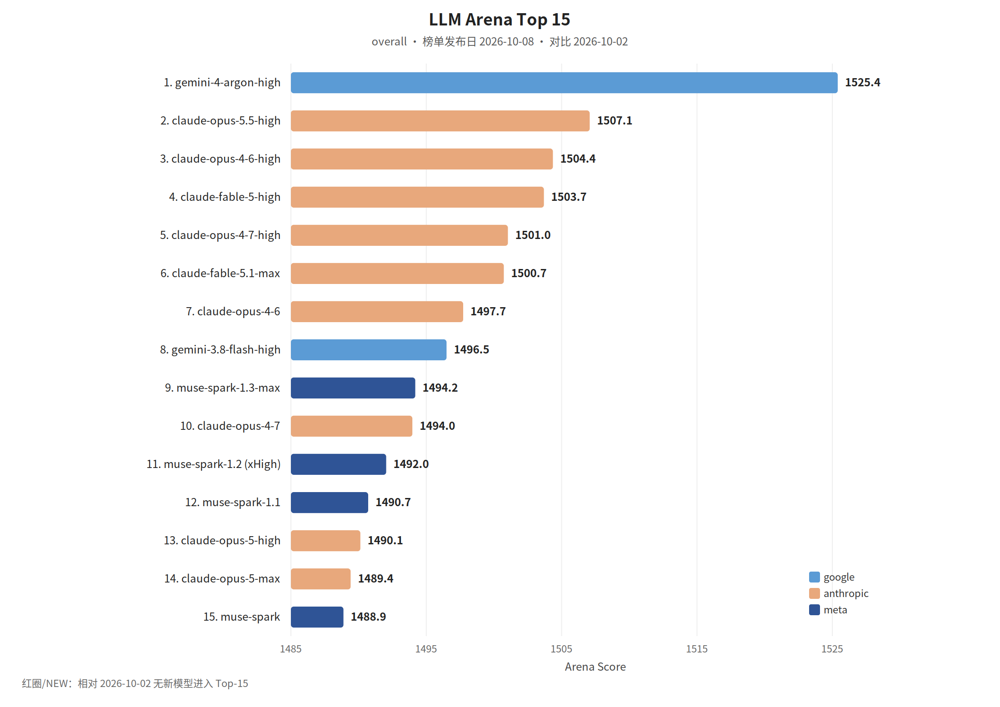

覆盖窗口：2026-10-02～2026-10-08（生成日 2026-10-09）。

## 〇、薅羊毛

#### We’re expanding the Claude Startups program to help founders build

Anthropic 扩大了 Claude Startups 项目，为在 Claude 上构建公司的创始人提供一系列支持，包括一年免费 Claude Team（最多五个 Premium 帐位）、一次性 1,000 美元 API 额度、合作伙伴工具折扣与额度（合计最高可达 45,000 美元）、与 Applied AI 团…

> 原始链接：[We’re expanding the Claude Startups program to help founders build](https://claude.com/resources/articles/were-expanding-the-claude-startups-program-to-help-founders-build)（发布日 2026-10-06）

 

## 一、本周关键词

GPT-6 面向所有人，Claude Haiku 5.5

GPT-6 家族选型指南，Sonnet 5.5 进入 Kiro

独立代码审查，以及 Agent 说做完了但数据库并不同意

 

 

## 二、模型进展

#### 整体排名

榜单发布日 2026-10-08。图中无红圈。

#### GPT-6 与智能界面

OpenAI RSS：GPT-6 在 ChatGPT 里全球铺开，并带上 Intelligent UI，回复更快，还可以直接使用可视化的交互。日期取自 RSS。

> 原始链接：[GPT-6 and Intelligent UI for everyone](https://openai.com/index/gpt-6-for-everyone)（发布日 2026-10-07）

#### GPT-6 家族选型

OpenAI RSS：给创业团队的模型指南，讲怎么在 GPT-6 家族里选型、调推理档位、改提示和技能、协调工具，并把工作流准备到生产。

> 原始链接：[A model guide for the GPT-6 family](https://openai.com/index/practical-guide-building-gpt-6)（发布日 2026-10-02）

#### Claude Haiku 5.5

Anthropic News RSS：Haiku 5.5 是当时最快、能力也最强的小模型，面向摘要、子 Agent 和浏览器使用这类大批量工作。AWS 同一天把它放上 Bedrock 和 Claude Platform，并称多数任务大约比 Haiku 4.5 便宜 75%。

> 原始链接：[Introducing Claude Haiku 5.5](https://www.anthropic.com/claude-haiku-5-5)（发布日 2026-10-07）；[Introducing Claude Haiku 5.5 on AWS](https://aws.amazon.com/blogs/machine-learning/introducing-claude-haiku-5-5-on-aws/)（发布日 2026-10-07）

#### Claude Sonnet 5.5 进入 Kiro

Kiro 博客标题称 Sonnet 5.5 已可用，发布日 2026-10-02。RSS 正文没有功能说明，档位以原文为准。

> 原始链接：[Claude Sonnet 5.5 is now available in Kiro](https://kiro.dev/blog/sonnet-5-5)（发布日 2026-10-02）

#### How Comcast and Booz Allen use Claude Mythos to find exploit chains and secure their codebases

Anthropic 在 Project Glasswing 和扩展的 Cyber Verification Program 中向关键基础设施防护团队提供 Claude Mythos 模型，参与单位报告该模型能跨代码、配置和运行行为保持上下文，识别单文件难以发现的跨系统漏洞与利用链。

> 原始链接：[How Comcast and Booz Allen use Claude Mythos to find exploit chains and secure their codebases](https://claude.com/resources/articles/how-comcast-booz-allen-use-claude-mythos-to-secure-their-codebases)（发布日 2026-10-06）

 

## 三、项目开源

#### GitHub Trending（daily / all 前 5）

快照 2026-10-08（daily / all）。

1. [morluto/rea](https://github.com/morluto/rea)：用 Agent 做逆向，从应用行为到原生二进制。
2. [mattpocock/skills](https://github.com/mattpocock/skills)：作者从自己的 `.agents` 目录拿出的工程技能。
3. [boykopovar/AnyPS5](https://github.com/boykopovar/AnyPS5)：把 PS5 可执行文件移植到 Linux 和 Windows。
4. [ayghri/i-have-adhd](https://github.com/ayghri/i-have-adhd)：一个技能，用来阻止编码 Agent 把答案埋进长文。
5. [cathrynlavery/diagram-design](https://github.com/cathrynlavery/diagram-design)：给多种编码 Agent 用的示意图。当日简介写成 42 种。

#### Agent 说做完了，数据库并不同意

微软在 Hugging Face 用这个标题讨论 Agent 的完成声明和数据库实际状态不一致。该条 RSS 正文为空，步骤以原文为准。

> 原始链接：[The Agent Said It Was Done. The Database Disagreed.](https://huggingface.co/blog/microsoft/thinkingbox)（发布日 2026-10-03）

#### The model that didn't exist, so you made it yourself

Hugging Face 介绍了 ML-intern，一种在 HuggingChat 中可启用的代理，用于按提示规划、测试、训练、评估并在 Hub 上发布小型定制模型。

> 原始链接：[The model that didn't exist, so you made it yourself](https://huggingface.co/blog/building-with-ml-intern)（发布日 2026-10-08）

#### Introducing Falcon ASR

Hugging Face 与阿布扎比技术创新研究所（TII）推出 Falcon‑ASR，一款 1.6B 参数的阿拉伯语语音识别模型，重点针对阿联酋方言并同时支持英语、法语、西班牙语和葡萄牙语；在六个阿语测试集上的平均 WER 为 20.92%，优于该时间点排行榜上公布的最佳 23.17%，在内部阿联酋评估中 WER 为…

> 原始链接：[Introducing Falcon ASR](https://huggingface.co/blog/tiiuae/falcon-asr)（发布日 2026-10-07）

#### Multimodal open d1 decision models for the edge

Hugging Face 的 Liquid AI 团队发布两款开源边缘决策模型：d1-3B（多模态，支持文本与图像）和实验性 d1-omni-600M（支持文本+图像或文本+音频）；d1-3B 在 Decision Index 0.2.1 中以 48.57 成为 10B 以下最佳决策模型，并在七个公开数据集上取得平均…

> 原始链接：[Multimodal open d1 decision models for the edge](https://huggingface.co/blog/LiquidAI/open-d1)（发布日 2026-10-07）

#### One Model Family, Two Gold-Level Results: Fine-Tuning Nemotron for IOI and IMO

NVIDIA 报告基于 Nemotron 3 系列通过监督微调（SFT）、强化学习（RL）和生成-验证-改进推理循环，将通用模型专门化为竞赛级别系统：Nemotron-3-Ultra-CC 在 IOI 2026 非官方实时评测中以 535.4/600 超过金牌线并超越最高人类分，Nemotron 3 Ultra 的 S…

> 原始链接：[One Model Family, Two Gold-Level Results: Fine-Tuning Nemotron for IOI and IMO](https://huggingface.co/blog/nvidia/nemotron-ioi-and-imo-2026)（发布日 2026-10-07）

#### AutoSynthData: Generating Training Data for Enterprise Agents

ServiceNow CoreAI 的 AutoSynthData 把模型在目标企业环境中的失败转化为训练数据：先用诊断评估找出能力缺口，再由更强教师示范可解任务，生成并在环境中验证新任务（包括系统规范、用户提示和验证器），通过样本级正负验证、修复与批次审查保证质量与覆盖，循环微调模型并随之调整生成目标。

> 原始链接：[AutoSynthData: Generating Training Data for Enterprise Agents](https://huggingface.co/blog/ServiceNow-AI/autosynthdata)（发布日 2026-10-02）

 

## 五、国际进展

#### &lt;审查&gt;独立审查才敢收 Agent 的改动

CodeRabbit：编码 Agent 可以在有人看清改动之前就把请求变成 pull request。代码能编译、测试能过、摘要也像那么回事，仍可能一起错。独立审查用的是代码库上下文、沙箱和核验，而不是让生成改动的同一条会话给自己盖章。

> 原始链接：[How independent AI code review builds trust](https://coderabbit.ai/blog/why-agentic-change-management-starts-with-independent-ai-code-review)（发布日 2026-10-05）

#### &lt;云端&gt;Claude Code 的云端会话

Anthropic 在 2026-10-06 发了 Claude Code 云端会话的现场指南。长任务可以离开本机，审查和接管仍要有人能中止。

> 原始链接：[Claude Code in the cloud](https://claude.dev/blog/claude-code-in-the-cloud/)（发布日 2026-10-06）

#### Introducing LangSmith Fine-Tuning

LangChain 发布 LangSmith Fine-Tuning 与 smithtune CLI，实现从 LangSmith 轨迹到端到端监督微调的工作流：从拉取并筛选“黄金”轨迹、生成可审计的数据集、提交到 Fireworks 或 Baseten 进行托管训练（支持 LoRA）、选取最低验证损失检查点、在 Lan…

> 原始链接：[Introducing LangSmith Fine-Tuning](https://www.langchain.com/blog/langsmith-fine-tuning)（发布日 2026-10-08）

#### Managed Deep Agents v0.8: new auth, memory, and channels

LangChain 发布 Managed Deep Agents 0.8，新增用户级与代理级分层持久化内存、支持用户或代理级凭证的连接（Connections）、HTTP 通道和 Slack 文件传输，以及内置由 Parallel 提供的网页搜索工具。

> 原始链接：[Managed Deep Agents v0.8: new auth, memory, and channels](https://www.langchain.com/blog/langsmith-managed-deep-agents-whats-new)（发布日 2026-10-08）

#### Agents that can pay: building Restock with Stripe's Link and Managed Deep Agents

介绍 Restock 示例代理：在 Managed Deep Agents 中运行的 Slack 代理，使用 Zinc 搜索商品、构建购物车并通过支持 Machine Payments Protocol（MPP）的 API 下单，最终由 Stripe 的 Link 钱包完成用户批准的支付，支付凭证由 Link 提供且模型无法看到卡号或秘密。

> 原始链接：[Agents that can pay: building Restock with Stripe's Link and Managed Deep Agents](https://www.langchain.com/blog/agents-that-can-pay-with-stripe-link)（发布日 2026-10-08）

#### Build live dashboards and animate explainers with Claude

Anthropic 推出 Claude Dashboards（付费计划内测）和 Claude Motion（Team 与 Enterprise 内测），可将公司数据平台（如 BigQuery、Snowflake、Databricks、Redshift、ClickHouse）或 Salesforce 连接为可自动刷新、可查看底层查询的仪表盘。

> 原始链接：[Build live dashboards and animate explainers with Claude](https://claude.com/resources/articles/dashboards-and-motion)（发布日 2026-10-08）

#### Open-source reviews on CodeRabbit topped 1 million in a single month

CodeRabbit 在 2026 年 9 月对开源仓库完成 1,049,817 次代码审查，为月度新高，比 8 月增长 14.4%，9 月 30 日单日审查量达 47,585 次；平台评估变更在更大代码库语境中的影响并标记潜在缺陷与安全问题，帮助维护者优先处理 pull request，维护者最终决定是否合并。

> 原始链接：[Open-source reviews on CodeRabbit topped 1 million in a single month](https://coderabbit.ai/blog/one-million-open-source-reviews-september-2026)（发布日 2026-10-08）

#### Pay-per-inference for AI agents: How BlockRun and Incarna use Amazon Bedrock AgentCore payments

介绍了 Amazon Bedrock AgentCore payments 的付费流程与治理能力：AgentCore payments 为运行中的智能体提供受托钱包、处理 x402 支付协议、签名交易并在基础设施层面强制支出上限，使智能体能按单次推理付费。

> 原始链接：[Pay-per-inference for AI agents: How BlockRun and Incarna use Amazon Bedrock AgentCore payments](https://aws.amazon.com/blogs/machine-learning/pay-per-inference-for-ai-agents-how-blockrun-and-incarna-use-amazon-bedrock-agentcore-payments/)（发布日 2026-10-08）

#### Share GPU clusters across teams with isolation and fairness using Amazon SageMaker HyperPod

介绍在 Amazon SageMaker HyperPod 上基于 Amazon EKS 构建多租户 GPU 集群的参考架构，强调用 AWS IAM Identity Center 做集中认证并与外部身份提供者（如 Microsoft Entra ID）联合登录，按团队配置 SageMaker AI 域和专属 IAM…

> 原始链接：[Share GPU clusters across teams with isolation and fairness using Amazon SageMaker HyperPod](https://aws.amazon.com/blogs/machine-learning/share-gpu-clusters-across-teams-with-isolation-and-fairness-using-amazon-sagemaker-hyperpod/)（发布日 2026-10-08）

#### The feature works. But does it belong?

CodeRabbit 与 TRM Labs 创始人讨论了代理（agents）如何改变软件开发：代理能快速生成功能或 PR，使团队必须更早决策；两家公司分别探索在代理开工前加入规划/审批步骤与通过“产品大脑”用设计系统和优先级过滤想法以提高质量；实现与验证被作为同一步骤，目标是自动在 PR 中生成测试证据并对安全敏感改动强制人工复核。

> 原始链接：[The feature works. But does it belong?](https://coderabbit.ai/blog/the-feature-works-does-it-belong)（发布日 2026-10-08）

#### Automate remediation post AWS DevOps Agent investigation

介绍如何结合 AWS DevOps Agent、Amazon EventBridge、AWS Lambda Durable Functions 与 Amazon Bedrock 构建自动化修复工作流：当 DevOps Agent 完成事件调查并发出调查完成事件后，EventBridge 触发 Lambda 包装并调用…

> 原始链接：[Automate remediation post AWS DevOps Agent investigation](https://aws.amazon.com/blogs/machine-learning/automate-remediation-post-aws-devops-agent-investigation/)（发布日 2026-10-07）

#### Beyond hours saved: Building the business case for agentic automation

提出面向“智能代理化自动化”的商业论证框架，指出传统以“节省工时×人工成本—构建成本”为核心的RPA时代ROI模型忽略了代理带来的异常处理、决策质量、变更韧性与运维经济性等价值，并需用“Agentic Value Model”将价值分为已释放产能、避免的异常与误差成本、决策改进收益与避免的重构/停机成本四类，按可实现率…

> 原始链接：[Beyond hours saved: Building the business case for agentic automation](https://aws.amazon.com/blogs/machine-learning/beyond-hours-saved-building-the-business-case-for-agentic-automation/)（发布日 2026-10-07）

#### Building AI builders: Playbook for closing the AI knowledge-capability gap

AWS 描述了一个六周、每周约四小时的实践式项目，面向非工程背景的业务人员，通过工具、导师配对和分阶段训练（招募、组队与目标设定、工具实操、迭代开发与演示）让参与者在可复用架构下构建多代理 AI 原型并能对接生产，报告显示参与者在代理式 AI 能力、自信与工具采纳（如 Strands Agents SDK、Amazon…

> 原始链接：[Building AI builders: Playbook for closing the AI knowledge-capability gap](https://aws.amazon.com/blogs/machine-learning/building-ai-builders-playbook-for-closing-the-ai-knowledge-capability-gap/)（发布日 2026-10-07）

#### How Qlik built grounded, enterprise-scale AI with Amazon Bedrock

Qlik 用分层架构在 Amazon Bedrock 上构建 Qlik Answers，为企业用户提供带来源和验证的自然语言问答，覆盖结构化分析、文档检索、术语表和自动化等路径。

> 原始链接：[How Qlik built grounded, enterprise-scale AI with Amazon Bedrock](https://aws.amazon.com/blogs/machine-learning/how-qlik-built-grounded-enterprise-scale-ai-with-amazon-bedrock/)（发布日 2026-10-07）

#### Introducing collaborative coding: Build together with Slack Code and CodeRabbit Agent for Slack

介绍了以 Slack Code 频道与 CodeRabbit Agent for Slack 实现“协作编码”的工作流：在同一线程里由相关专业人员（如 Salesforce 管理员、产品工程师、基础设施工程师）与 CodeRabbit AI 代理共同制定规范、实现代码、运行测试、生成 PR 并完成人工审批，保持可见性与上下文连续性。

> 原始链接：[Introducing collaborative coding: Build together with Slack Code and CodeRabbit Agent for Slack](https://coderabbit.ai/blog/introducing-collaborative-coding)（发布日 2026-10-07）

#### Managed Deep Agents v0.9: schedules, per-run configuration, and Slack reactions

LangChain 发布 Managed Deep Agents v0.9，新增三项功能：Schedules SDK 允许代理在对话中为用户创建定时或一次性提醒并在原始频道返回结果；按次运行的动态配置使单个部署可在每次运行开始时根据运行上下文选择模型、指令、技能、MCP 服务器和沙箱；Slack 反应功能在代理回复前以…

> 原始链接：[Managed Deep Agents v0.9: schedules, per-run configuration, and Slack reactions](https://www.langchain.com/blog/managed-deep-agents-schedules-per-run-configuration-slack)（发布日 2026-10-07）

#### Rethinking access control for RAG with Amazon Quick and Amazon Bedrock

AWS 介绍了在 RAG 场景中为 Amazon Quick 与 Amazon Bedrock 知识库实现实时 ACL 强制的双层方案：先用索引中缓存的 ACL 做语义检索前过滤，再对候选文档在查询时通过权威源（如 Google Drive 或 SharePoint API）进行实时权限验证，只有经验证的文档片段才传给…

> 原始链接：[Rethinking access control for RAG with Amazon Quick and Amazon Bedrock](https://aws.amazon.com/blogs/machine-learning/rethinking-access-control-for-rag-with-amazon-quick-and-amazon-bedrock/)（发布日 2026-10-07）

#### Revamping Skills in Deep Agents

LangChain 在 Deep Agents 中增强了技能（skill）支持：现在可将工具绑定到技能，工具的 schema 仅在代理读取对应技能时加入上下文；支持在运行时将技能置顶（pinned）以在首次模型调用前把指令放入对话；支持在长线程中重新加载技能以拾取新增、修改或删除的技能。

> 原始链接：[Revamping Skills in Deep Agents](https://www.langchain.com/blog/revamping-skills-in-deep-agents)（发布日 2026-10-08）

#### Warp Factories now works across Microsoft Teams and Azure DevOps

Warp Factories 现已原生支持 Microsoft Teams 与 Azure DevOps Services，团队可在 Teams 频道或线程中通过提及 Warp 应用将会话上下文交付给工厂，触发自动化、跟踪进度并在同一线程返回结果。

> 原始链接：[Warp Factories now works across Microsoft Teams and Azure DevOps](https://www.warp.dev/blog/warp-factories-microsoft-teams-azure-devops)（发布日 2026-10-07）

#### Best practices for Amazon SageMaker HyperPod administration and governance

介绍在 SageMaker Unified Studio 中为共享的 SageMaker HyperPod 集群设计管理与治理的最佳实践，提出组织、项目、集群与工作负载四层控制模型，建议将集群与加速器容量集中在容量账号，采用跨账号访问、命名空间+RBAC（EKS）或 Slurm 计费/QoS 策略、IAM 与资源策略、…

> 原始链接：[Best practices for Amazon SageMaker HyperPod administration and governance](https://aws.amazon.com/blogs/machine-learning/best-practices-for-amazon-sagemaker-hyperpod-administration-and-governance/)（发布日 2026-10-06）

#### Build a voice travel concierge with Amazon Bedrock AgentCore, Managed Knowledge Base and Nova Sonic

介绍在 AWS 上构建语音出行礼宾服务的方案，结合 Amazon Bedrock AgentCore 运行时、AgentCore Gateway（使用 MCP 协议）、Amazon Nova 2.5 Sonic 实时语音模型和 Amazon Bedrock Knowledge Bases，实现双向低延迟语音交互、异步工…

> 原始链接：[Build a voice travel concierge with Amazon Bedrock AgentCore, Managed Knowledge Base and Nova Sonic](https://aws.amazon.com/blogs/machine-learning/build-a-voice-travel-concierge-with-amazon-bedrock-agentcore-managed-knowledge-base-and-nova-sonic/)（发布日 2026-10-06）

#### Building a context-aware AI assistant on AgentCore and OpenClaw

介绍使用开源代理系统 OpenClaw 与 Amazon Bedrock 的 AgentCore runtime 和 AgentCore memory 构建具上下文记忆的个性化助理（示例为园艺助手 Sprout）。

> 原始链接：[Building a context-aware AI assistant on AgentCore and OpenClaw](https://aws.amazon.com/blogs/machine-learning/building-a-context-aware-ai-assistant-on-agentcore-and-openclaw/)（发布日 2026-10-06）

#### Claude now works with Google Docs, Sheets, and Slides

Claude for Google Workspace 已进入付费计划的公测，提供 Google Docs、Sheets、Slides 侧边栏插件与对应连接器（Beta），可在打开的文件中读取内容、识别选区并直接编辑或以建议卡形式提出修改。

> 原始链接：[Claude now works with Google Docs, Sheets, and Slides](https://claude.com/resources/articles/claude-now-works-in-google-docs-sheets-and-slides)（发布日 2026-10-06）

#### How CodeRabbit Security performed on a real-world vulnerability benchmark

CodeRabbit 在真实开源仓库漏洞基准上测试了 CodeRabbit Security 与三款系统的检测能力（基于 100 个漏洞、94 个仓库、11 语言与漏洞家族），报告检测率为 CodeRabbit 86.7%、Devin 73.3%、Codex Security Plugin 62.0%、Claude S…

> 原始链接：[How CodeRabbit Security performed on a real-world vulnerability benchmark](https://coderabbit.ai/blog/security-agent-benchmarks)（发布日 2026-10-06）

#### Manage Amazon SageMaker HyperPod Spaces directly from SageMaker Studio

AWS 在 SageMaker Studio 中新增直接在 HyperPod EKS 集群上创建与管理 SageMaker Spaces 的图形界面，数据科学家可在浏览器内一键创建、启动、停止并打开 JupyterLab 或 Code Editor 空间，支持配置计算、命名空间、存储、模板与任务治理，并可通过 SSH-…

> 原始链接：[Manage Amazon SageMaker HyperPod Spaces directly from SageMaker Studio](https://aws.amazon.com/blogs/machine-learning/manage-amazon-sagemaker-hyperpod-spaces-directly-from-sagemaker-studio/)（发布日 2026-10-06）

#### Many, Many Pucks

Puck 现支持多个独立对话，每个对话各自拥有独立的 Puck。

> 原始链接：[Many, Many Pucks](https://ampcode.com/news/many-many-pucks)（发布日 2026-10-06）

#### Responsible AI governance: How AWS positions customers to align with ISO/IEC 42005:2025

介绍了ISO/IEC 42005:2025关于AI系统影响评估的要点，指出该标准规范了评估内容、生命周期时点、文档与再评估触发条件，提供可嵌入企业既有影响评估流程（附录D）或独立使用的模板（附录E），并强调将评估结果纳入风险管理决策以识别隐私、歧视和性能等影响。

> 原始链接：[Responsible AI governance: How AWS positions customers to align with ISO/IEC 42005:2025](https://aws.amazon.com/blogs/machine-learning/responsible-ai-governance-how-aws-positions-customers-to-align-with-iso-iec-420052025/)（发布日 2026-10-06）

#### What is Codemode

Armin Ronacher 介绍了 Codemode 在 Pi 中的作用：它在受限的 harness 沙箱（QuickJS/WASM）内以 JavaScript 形式运行，允许 LLM 在 harness 侧组织和并发执行复杂操作、发起工具调用、保存会话状态及调用 AI SDK（如图像生成和分类器模型）而不占用 LL…

> 原始链接：[What is Codemode](https://lucumr.pocoo.org/2026/10/6/codemode/)（发布日 2026-10-06）

#### Downgrading user roles in Amazon Quick

介绍在 Amazon Quick 中将用户角色降级的必要性与两种可行方法（手动删除重建与通过 AWS CLI 的分步降级），强调遵循最小权限原则、在降级前先转移或批量转移资产所有权、以及在降级后检查 Limit Profiles 与 Custom Permissions。

> 原始链接：[Downgrading user roles in Amazon Quick](https://aws.amazon.com/blogs/machine-learning/downgrading-user-roles-in-amazon-quick/)（发布日 2026-10-05）

#### Evaluating multi-agent systems for explainability and helpfulness with Amazon Bedrock AgentCore

介绍 Amazon Bedrock AgentCore Evaluations，作为面向多代理系统的托管评估能力，用于在开发与生产中衡量代理的有用性、任务完成率、工具选择、业务约束遵从及可解释性，说明内置评估器与自定义评估器的分层框架（内置评估、业务规则评估、可解释性评估）。

> 原始链接：[Evaluating multi-agent systems for explainability and helpfulness with Amazon Bedrock AgentCore](https://aws.amazon.com/blogs/machine-learning/evaluating-multi-agent-systems-for-explainability-and-helpfulness-with-amazon-bedrock-agentcore/)（发布日 2026-10-05）

#### How Cresta turned CX expertise into an agent builder on the Claude Agent SDK

Cresta 将其面向客服体验的会话智能和工程实践融入 Conductor：一个基于 Claude Agent SDK 的自然语言 agent 构建器，帮助团队将业务上下文转为可生产化的 agent。

> 原始链接：[How Cresta turned CX expertise into an agent builder on the Claude Agent SDK](https://claude.com/resources/articles/how-cresta-turned-cx-expertise-into-an-agent-builder-on-the-claude-agent-sdk)（发布日 2026-10-05）

#### Introducing GLM 5.3 on Amazon Bedrock

AWS 在 Amazon Bedrock 上推出 Z.ai 的开源大模型 GLM 5.3（753B 参数、Mixture-of-Experts），优化了代码生成、长时程智能体任务与安全相关基准表现，并在 Bedrock 上提供跨区域推理、隐式与显式提示缓存、OpenAI 兼容 API（Responses/Chat Co…

> 原始链接：[Introducing GLM 5.3 on Amazon Bedrock](https://aws.amazon.com/blogs/machine-learning/introducing-glm-5-3-on-amazon-bedrock/)（发布日 2026-10-05）

#### Making Amazon Quick enterprise-ready: Automated, auditable cross-account resource promotion

介绍了 Quick Resource Migrator：一个在 Amazon Bedrock AgentCore 上运行的 MCP 服务器，用于自动化将 Amazon Quick 资源（agents、action connectors、knowledge bases、flows、spaces）从开发账号以幂等、可审计方式提升到目标账号。

> 原始链接：[Making Amazon Quick enterprise-ready: Automated, auditable cross-account resource promotion](https://aws.amazon.com/blogs/machine-learning/making-amazon-quick-enterprise-ready-automated-auditable-cross-account-resource-promotion/)（发布日 2026-10-05）

#### New agent skill: Amazon SageMaker optimized generative AI inference for your coding agent

AWS 发布了 aws-ai-ml 技能，通过 Agent Toolkit for AWS 将 SageMaker AI 的推理优化与基准测试能力整合到支持 Model Context Protocol 的编码代理（如 Kiro、Claude Code、Codex）中。

> 原始链接：[New agent skill: Amazon SageMaker optimized generative AI inference for your coding agent](https://aws.amazon.com/blogs/machine-learning/new-agent-skill-amazon-sagemaker-optimized-generative-ai-inference-for-your-coding-agent/)（发布日 2026-10-05）

#### Supercharge regulated workloads with Claude Code and Amazon Bedrock

介绍Anthropic的Claude Opus 5.5、Claude Sonnet 5.5和Claude Sonnet 5现已在Amazon Bedrock的AWS GovCloud (US)上可用，并展示如何在该环境中使用Anthropic的编码代理工具Claude Code以支持受监管工作负载的AI辅助开发。

> 原始链接：[Supercharge regulated workloads with Claude Code and Amazon Bedrock](https://aws.amazon.com/blogs/machine-learning/supercharge-regulated-workloads-with-claude-code-and-amazon-bedrock/)（发布日 2026-10-05）

#### Today at work

作者描述一次合并失误：一项变更（#164 等）在缺乏分支保护与规则集的仓库直接合并，未有强制审批，相关“别合并”的告知主要在 Slack 线程或 PR 草稿状态中，且有的参与者使用 Claude Code 会话看不到全部 Slack，导致信息未被及时注意；Cadence Sen 发起无责备的事故复盘，梳理时间线并建议通…

> 原始链接：[Today at work](https://blog.fsck.com/2026/10/05/today-at-work/)（发布日 2026-10-05）

#### Build the factory. Let it run. Go kayaking.

Warp 团队在萨凡纳举行线下活动，围绕 Warp Factories（面向团队的软件工厂开放基础设施）推进从 Early Access 到通用可用的转型，着重提升可靠性、速度与成本效益；团队将角色从产品工程转为基础设施工程，构建支持多智能体编排与计算使用验证的基础设施，并在过去一个月通过该基础设施将每个 PR 的成本…

> 原始链接：[Build the factory. Let it run. Go kayaking.](https://www.warp.dev/blog/warp-team-offsite-fall-2026)（发布日 2026-10-03）

#### A quick trip to the uncanny valley

介绍了Prime Radiant正在开发名为Sen的“同事”平台，这些Sens有持久身份、使用各自账号并长期与多人协作，类似但不同于代表个人行动的agent。

> 原始链接：[A quick trip to the uncanny valley](https://blog.fsck.com/2026/10/02/a-quick-trip-to-the-uncanny-valley/)（发布日 2026-10-02）

#### Add secure Web Search to Claude Desktop with Amazon Bedrock AgentCore

介绍如何通过 Amazon Bedrock AgentCore 的 AgentCore Gateway 和受管 Web Search 将 Claude Desktop 连接到实时 Web 搜索，解决模型训练截止带来的信息时效性问题。

> 原始链接：[Add secure Web Search to Claude Desktop with Amazon Bedrock AgentCore](https://aws.amazon.com/blogs/machine-learning/add-secure-web-search-to-claude-desktop-with-amazon-bedrock-agentcore/)（发布日 2026-10-02）

#### Fine-tune a search agent with multi-turn RL on Amazon SageMaker AI

介绍在 Amazon SageMaker AI 上使用多回合强化学习（MTRL）对搜索代理进行微调的流程与效果：将 Qwen3.6-27B 在包含 BM25 和向量检索工具的检索环境中用 MTRL 微调，使用 nDCG@10 作为轨迹级奖励并对超时或超出令牌/回合限制的失败情况赋予 -1 惩罚。

> 原始链接：[Fine-tune a search agent with multi-turn RL on Amazon SageMaker AI](https://aws.amazon.com/blogs/machine-learning/fine-tune-a-search-agent-with-multi-turn-rl-on-amazon-sagemaker-ai/)（发布日 2026-10-02）

#### Sweep thousands of leases for compliance using Amazon Quick and the Adjudicated Query pattern

介绍 Adjudicated Query 模式：在可对话的 Amazon Quick 界面与确定性规则引擎之间建立边界，使生成式模型仅将自然语言问题映射为固定的有类型操作并叙述返回结果，而所有合规判定由版本化的规则数据和规则引擎执行，从而保证人口完备性与可辩护性。

> 原始链接：[Sweep thousands of leases for compliance using Amazon Quick and the Adjudicated Query pattern](https://aws.amazon.com/blogs/machine-learning/sweep-thousands-of-leases-for-compliance-using-amazon-quick-and-the-adjudicated-query-pattern/)（发布日 2026-10-02）

本期于 2026-11 按新版格式补录。
