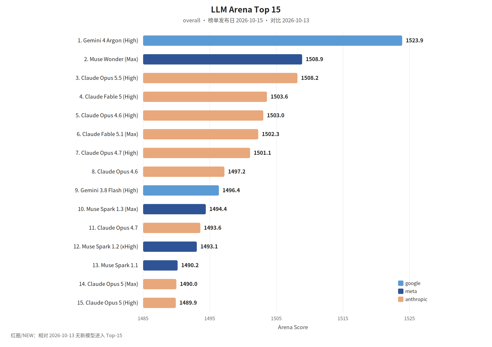

覆盖窗口：2026-10-09～2026-10-15（生成日 2026-10-16）。

## 〇、薅羊毛

本期为补录。linux.do 福利 RSS 当前只剩生成日之后的帖子，Wayback 没有该地址的存档，窗口内的社区帖补不回来。

#### 千问三款模型在 GMI Cloud 继续免费一周

千问 RSS：Qwen3.8-Max、Qwen3.8-Flash 和 Wan3.0 在 GMI Cloud 上再免费 7 天，三个模型的速率限制也提高了。资格和截止以 GMI 与千问的原文为准。

> 原始链接：[A week of free access](https://x.com/Alibaba_Qwen/status/2108401307577090259)（发布日 2026-10-09）

#### Devin 接入 Pylon，新客户 1.5 万美元额度

Cognition 的订阅：Devin 进入 Pylon，用来缩短修复时间中位数；新的 Devin 客户有 1.5 万美元额度。额度条件以原文为准。

> 原始链接：[Introducing Devin in Pylon](https://x.com/cognition/status/2110068304383725720)（发布日 2026-10-13）

#### 在 Amp 里使用已有的 Claude 订阅

Amp：创建线程时选 Claude Code 模式，并关联已有的 Claude 订阅。RSS 称这一模式免费、现在对所有人开放，底层用的是 Claude Agent SDK，而不是再买一份 Amp 的模型额度。

> 原始链接：[Use Your Claude Plan in Amp](https://ampcode.com/news/use-your-claude-plan)（发布日 2026-10-10）

 

 

## 一、本周关键词

Gemini 4 Argon 进入 Antigravity

百度网盘放弃全自动生成代码

QwenGyre 做长程 Agent 训练，Kiro CLI V3 开始铺开

 

 

## 二、模型进展

#### 整体排名

LLM Arena（同一份全量数据集，overall，榜单发布日 **2026-10-15**）。相对 2026-10-13，按归一化名称没有新模型进入 Top-15（展示名改成了带空格的写法），图中不标 NEW。本环境无 Artificial Analysis 密钥，不单列 AA 小节。

#### Gemini 4 Argon 进入 Antigravity

Antigravity 在 2026-10-13 接入 Gemini 4 Argon。该条 RSS 正文为空，和上一期榜单里 Argon 登顶放在一起看，这次是进到编码产品。能力以原文为准。

> 原始链接：[Gemini 4 Argon in Google Antigravity](https://antigravity.google/blog/gemini-4-argon-in-google-antigravity)（发布日 2026-10-13）

#### QwenGyre

千问 RSS：用弹性强化学习训练极长程 Agent。Elastic Scheduler 在 rollout 和训练之间调 GPU，正在跑的执行不被打断。文中称相对 Colocate 最高约 1.85 倍加速。

> 原始链接：[Introducing QwenGyre](https://x.com/Alibaba_Qwen/status/2109633085658808515)（发布日 2026-10-12）

#### Asana 用 GPT-6.1 Sol 把浏览器测试的模型成本降到约 1/76

OpenAI RSS：Asana 在 Codex 里用 GPT-6 Astra 改浏览器 Agent，测试中模型成本降到约七十六分之一，速度约 5 倍，从而给客户开更强的模型。

> 原始链接：[Asana cuts model costs 76x in browser tests with GPT-6.1 Sol](https://openai.com/index/asana-browser-agent)（发布日 2026-10-09）

#### Welcome Muse Spark Open: open-weight frontier multimodal mixture-of-experts model from Meta

Meta 发布 Muse Spark Open，为开源权重的最强多模态专家混合模型，含约816B参数（每令牌约42B激活），支持文本、图像、音频和视频输入、1M 令牌上下文与工具调用，采用256 专家 MoE（每令牌选 8 个）和独立感知/音频编码器，提供 BF16 与针对 NVIDIA Blackwell 的 NVF…

> 原始链接：[Welcome Muse Spark Open: open-weight frontier multimodal mixture-of-experts model from Meta](https://huggingface.co/blog/meta-muse-spark-open)（发布日 2026-10-15）

#### Build long-horizon agents with Grok 4.7 on Amazon Bedrock

SpaceXAI 的 Grok 4.7 在 Amazon Bedrock 可用，具备更长的推理能力与 500K 令牌上下文，并支持可配置的 reasoning_effort、工具调用与结构化输出；在三个需搜索的代理任务上，72 次运行中答对 67 次，xhigh 全对且产出代价最高，low 在成本与正确率间有良好权衡…

> 原始链接：[Build long-horizon agents with Grok 4.7 on Amazon Bedrock](https://aws.amazon.com/blogs/machine-learning/build-long-horizon-agents-with-grok-4-7-on-amazon-bedrock/)（发布日 2026-10-13）

 

## 三、项目开源

#### GitHub Trending（daily / all 前 5）

第三方 Trending RSS 没有这一天的存档。下面 5 条来自 Wayback 对 `github.com/trending`（Today / 全部语言）的存档，快照 **2026-10-15**。

> 存档：[2026-10-15 github.com/trending](https://web.archive.org/web/20261015004025/https://github.com/trending)

1. [morluto/rea](https://github.com/morluto/rea)：用 Agent 做逆向。
2. [debpalash/VoiceStudio](https://github.com/debpalash/VoiceStudio)：可本地运行的语音工作室。
3. [mksglu/context-mode](https://github.com/mksglu/context-mode)：压缩编码 Agent 的工具输出并保留会话记忆。
4. [nvm-sh/nvm](https://github.com/nvm-sh/nvm)：Node 版本管理器。
5. [K-Dense-AI/scientific-agent-skills](https://github.com/K-Dense-AI/scientific-agent-skills)：面向科学工作的 Agent 技能库。存档页称有 177 个可用技能。

#### Apache Auron 从快手实践毕业

快手技术：10 月 14 日 Apache 宣布 Auron 从孵化器毕业，成为顶级项目。它长在快手的大规模数据计算里，2025 年 8 月捐给基金会。

> 原始链接：[Apache Auron 正式毕业](https://mp.weixin.qq.com/s?__biz=Mzg2NzU4MDM0MQ==&mid=2247501480&idx=1&sn=6fe806e6e30f10952002bcb10b3c5bcb)（发布日 2026-10-15）

#### Welcome FLUX.3 Image Klein in Diffusers: The latest open image generation model from Black Forest Labs

Black Forest Labs 发布 FLUX.3 Image Klein，提供蒸馏与基础两版检查点，支持文本到图像、多参考图像编辑与框选布局控制，蒸馏版可在 H100 上 16 步速出 1024×1024 图像并支持量化权重与 LoRA 微调，作为模块化 Diffusers 管线易于替换组件与扩展。

> 原始链接：[Welcome FLUX.3 Image Klein in Diffusers: The latest open image generation model from Black Forest Labs](https://huggingface.co/blog/flux-3)（发布日 2026-10-15）

#### Granite Switch 4.1: Chat, Decisions, and Speech from One Endpoint

Granite Switch 4.1 将决策、聊天与语音转录能力整合在单一端点，包含通用决策 aLoRA、专门的 Guardian aLoRA（在安全决策上平均优于多个对手）及最快的 Granite-Speech-5.0-Turbo-CTC ASR，且这些适配器与基座模型共享 KV 缓存，占用与基座相当的显存，实现更少…

> 原始链接：[Granite Switch 4.1: Chat, Decisions, and Speech from One Endpoint](https://huggingface.co/blog/ibm-granite/granite-switch-4-1)（发布日 2026-10-15）

#### Apertus 1.5 Release Notes

Apertus 1.5 在开放原则下发布，继续对一代模型进行预训练，引入本地多模态理解（图像与音频作为文本间隔标记）、“思考模式”、262,144 代币长上下文窗口、改进的指令遵循与工具调用能力，并公开训练细节、数据源与中间检查点以促进可复现评估与治理对接。

> 原始链接：[Apertus 1.5 Release Notes](https://huggingface.co/blog/swiss-ai/apertus-v15-release-notes)（发布日 2026-10-15）

#### HiRO-ACEv2: Simulating extreme weather at 3 km resolution for a fraction of the cost

HiRO-ACEv2 在 ACE（100 km）与新版下采样器 HiROv2（3 km）基础上改进训练方法，能高精度再现极端降雨、强风与气压事件，并在稀有事件统计上与 X-SHiELD 目标模拟相差不超过 3%。

> 原始链接：[HiRO-ACEv2: Simulating extreme weather at 3 km resolution for a fraction of the cost](https://huggingface.co/blog/allenai/hiro-acev2)（发布日 2026-10-14）

#### Run fast, private agents on-device with LFM2.5-24B-A2B

LFM2.5-24B-A2B 是一款面向设备端运行的推理型 MoE 模型，保持 40 层与 64 专家架构，扩展至 131K 上下文与 128K 词表，训练与蒸馏流程强化链式思考和工具调用，能在 M5 Max 达到 184 tok/s、B300 GPU 超过 21K tok/s，并在多项工具使用与指令跟随评测中领先，适…

> 原始链接：[Run fast, private agents on-device with LFM2.5-24B-A2B](https://huggingface.co/blog/LiquidAI/lfm25-24b-a2b)（发布日 2026-10-13）

 

## 四、国内进展

#### &lt;落地&gt;百度网盘放弃全自动生成代码

百度 Geek 说：网盘团队把 Coding Agent 接进真实研发之后，停掉「一键生成」的流水线，改成多轮的 Agentic Engineering Loop：先澄清需求，再分轮验证，让每次交付可检查、可回溯。文中的原话是，全自动最大的风险不是会犯错，而是错了还自信地往前跑。

> 原始链接：[我们放弃了「全自动生成代码」](https://mp.weixin.qq.com/s?__biz=Mzg5MjU0NTI5OQ==&mid=2247607686&idx=1&sn=a9428c9fdf46957a8cc77ed5ac070368)（发布日 2026-10-13）

#### &lt;推理&gt;美团：延迟约束下的小模型高并发

美团技术博客讨论 SLM 生成式高并发推理引擎，优化的是延迟约束下的有效吞吐，而不是只把批量开大。

> 原始链接：[SLM 生成式高并发推理引擎](https://tech.meituan.com/2026/10/15/Small-Language-Model-in-meituan.html)（发布日 2026-10-15）

字节、阿里、腾讯、支付宝的 Wechat2RSS 已滚出本窗口且没有 Wayback 存档。千问的训练系统和免费额度写在模型进展与薅羊毛。

#### Qoder Fast: Keeping Pace with Your Thoughts

Qoder Desktop 于 10 月将 Performance 升级为 Fast：通过模型路由、代理策略和端到端网络优化，在保持输出质量的前提下把典型响应从 8 秒缩短至 3 秒，Credits 系数从 1.1×降至 0.8×。

> 原始链接：[Qoder Fast: Keeping Pace with Your Thoughts](https://qoder.com/blog/qoder-fast)（发布日 2026-10-14）

 

## 五、国际进展

#### &lt;CLI&gt;Kiro CLI V3 开始作为默认体验铺开

Kiro 在 2026-10-09 写 CLI V3 正在成为默认体验。同一页后文提到 CLI 3.0 于 2026-11-03 发布，那次更新不在本窗口。

> 原始链接：[Kiro CLI V3 is rolling out](https://kiro.dev/blog/cli-3)（发布日 2026-10-09）

#### MCP in LangChain: Stateless Protocol, Elicitation, and More!

LangChain 宣布全面升级对模型上下文协议（MCP）的支持，以适配最新的 2026-07-28 规范。

> 原始链接：[MCP in LangChain: Stateless Protocol, Elicitation, and More!](https://www.langchain.com/blog/mcp-in-langchain-stateless-protocol-elicitation-and-more)（发布日 2026-10-13）

#### How to Build a Model Router in the Harness

LangChain 在 Open SWE 编码智能体中实现了基于任务类型与初始请求的模型路由，将线程按“快速/平衡/性能”三档模型分发；通过在 agent harness 内的中间件用分类器选择最低成本可完成任务的模型，并用 A/B 测试与合并 PR 率和用户反馈评估效果，结果是在质量无显著下降的前提下将中位线程成本降低 64%。

> 原始链接：[How to Build a Model Router in the Harness](https://www.langchain.com/blog/how-to-build-a-model-router-in-the-harness)（发布日 2026-10-09）

#### How Snyk turned an internal support agent into a customer feature

Snyk 将内部支持代理 Snyk Assist 演进为面向付费客户的产品，该代理基于 LangChain 和 LangGraph、在 LangSmith 中进行可观测性与评估，能在多种入口（Slack、Web、API）使用同一运行时，按用户权限动态挂载工具、在 PostgreSQL 中持久化会话状态，并通过离线与在线…

> 原始链接：[How Snyk turned an internal support agent into a customer feature](https://www.langchain.com/blog/how-snyk-turned-an-internal-support-agent-into-a-customer-feature)（发布日 2026-10-09）

#### What financial services marketing teams need to know about data, access, and security before publishing

金融服务市场团队在发布应用前需基于应用风险评估数据类型、受众、可执行操作与后果，决定访问与安全控制。

> 原始链接：[What financial services marketing teams need to know about data, access, and security before publishing](https://lovable.dev/blog/financial-services-marketing-data-access-and-security)（发布日 2026-10-15）

#### The road to self-improving software

作者主张将多个小自动化环路整合为覆盖从任务到交付的大闭环，使代理能主动决定下一个开发工作。

> 原始链接：[The road to self-improving software](https://www.warp.dev/blog/self-improving-software-proactive-agents)（发布日 2026-10-15）

#### The Most Common Questions About Agent Evals, Answered

Agent Evals 通过对代理运行打分来验证其行为。

> 原始链接：[The Most Common Questions About Agent Evals, Answered](https://www.langchain.com/blog/common-questions-about-agent-evals)（发布日 2026-10-15）

#### The AI you already use, now powering the apps you create

Lovable 平台整合多家最新 AI 模型与工具（含 GPT‑Live、Claude、Gemini、Perplexity、Firecrawl、Parallel、Jev 等），可在平台内构建实时语音助理、研究工具、客服收件箱、商品转短片并配乐、网页实时搜索与清洗、工单分类与自动回复等应用，开发者只需描述想要的功能即可由…

> 原始链接：[The AI you already use, now powering the apps you create](https://lovable.dev/blog/ai-models-and-tools-in-lovable)（发布日 2026-10-15）

#### Tactics for rolling out software factories: human and organizational changes

要点是把软件工厂视为团队共享的基础设施，通过先从低风险、工程师视为繁琐的自动化入手，再让在 Slack、Issue 跟代码平台中直接触发工厂变得简单，鼓励而非强制使用，设立负责人调优并用合适指标（如合并 PR 的工厂占比、吞吐量、周期与成本）持续改进，以更快更高效地交付高质量软件。

> 原始链接：[Tactics for rolling out software factories: human and organizational changes](https://www.warp.dev/blog/rolling-out-software-factories)（发布日 2026-10-15）

#### October 2026: LangChain Newsletter

LangChain 在 LangSmith、LangChain 与生态工具上发布多项用于生产化智能体的功能和框架，涵盖语义检索、托管深度智能体、引擎检测与修复、轨迹导航、自定义应用与微调流水线，并提出面向规模化的 Agentic 运营模型与培训活动，助力团队掌控模型、执行与上下文以可靠部署 AI。

> 原始链接：[October 2026: LangChain Newsletter](https://www.langchain.com/blog/october-2026-langchain-newsletter)（发布日 2026-10-15）

#### Kimi K3 model is now available in Kiro

Kiro 平台已接入 Moonshot AI 的 Kimi K3 模型，宣称为开放权重的 2.8 兆参数模型，具备 100 万 token 的超大上下文窗口和高效的专家混合架构，适用于规格驱动、需跨文件和长时程推理的复杂软件开发，并能在验证流程中提升首次实现符合规格的可能性。

> 原始链接：[Kimi K3 model is now available in Kiro](https://kiro.dev/blog/kimi-k3/)（发布日 2026-10-15）

#### Deploy on Azure: keep your Lovable apps in your own subscription

本文介绍三种在微软环境中使用 Lovable 的部署方式，重点说明 Deploy on Azure（私有预览）：将应用与数据保留在客户自有 Azure 订阅中，组件部署在专用 VNet（AKS、Postgres、Blob、Functions 等），通过出站 mTLS 与 Lovable 通信，支持 VNet peeri…

> 原始链接：[Deploy on Azure: keep your Lovable apps in your own subscription](https://lovable.dev/blog/deploy-on-azure)（发布日 2026-10-15）

#### Code Review is now generally available

Code Review 已正式上线并面向 Claude Team 与 Enterprise 发布，提供更快（约3倍）、更高质量且可按仓库调节的三档审查（快速、标准、深度），自动在新 PR 上运行以在发布前捕捉关键缺陷，企业可在 2027-01-15 前申领至少 1 万美元审核额度（领取后 30 天过期）。

> 原始链接：[Code Review is now generally available](https://claude.com/resources/articles/code-review-is-now-generally-available)（发布日 2026-10-15）

#### Local sandboxing in Kiro: keep agent commands within boundaries

Kiro 在本地引入操作系统级别沙箱，限制代理运行的命令对文件和网络的访问，从而保护本地凭证与文件。

> 原始链接：[Local sandboxing in Kiro: keep agent commands within boundaries](https://kiro.dev/blog/local-sandboxing/)（发布日 2026-10-14）

#### How Tamnoon built AI-powered cloud security remediation with Amazon Bedrock

Tamnoon 在 Amazon Bedrock 上构建了名为 Tami 的智能云端修复编排器，通过接入 CNAPP 与云原生工具，自动化调查、判定安全性并生成有回滚与验证的修复方案，同时在执行前设多层保守安全评估与人工审批，90天内显著减少关键暴露且未发生生产故障。

> 原始链接：[How Tamnoon built AI-powered cloud security remediation with Amazon Bedrock](https://aws.amazon.com/blogs/machine-learning/how-tamnoon-built-ai-powered-cloud-security-remediation-with-amazon-bedrock/)（发布日 2026-10-14）

#### Generate presentations with Amazon Bedrock AgentCore

本文介绍通过在Amazon Bedrock AgentCore上部署监督型代理，结合RAG、Titan嵌入、OpenSearch Serverless与多模型（Anthropic、Stability等），实现自动化生成有源文献支撑的企业PPT与摘要，支持REST API集成并提供多层安全与审查机制。

> 原始链接：[Generate presentations with Amazon Bedrock AgentCore](https://aws.amazon.com/blogs/machine-learning/generate-presentations-with-amazon-bedrock-agentcore/)（发布日 2026-10-14）

#### From building your app to growing it: Lovable now helps you find customers

Lovable 在构建应用的同一聊天中新增增长功能：根据应用上下文生成可执行增长计划，覆盖搜索/AI 可索引性、SEO、社媒、Google/Meta 广告投放与跟踪，并能生成创意素材与落地页；所提建议需用户审批，广告计费在原广告账户进行，效果可在分析面板或聊天中查看与调整。

> 原始链接：[From building your app to growing it: Lovable now helps you find customers](https://lovable.dev/blog/introducing-growth-tools)（发布日 2026-10-14）

#### Deploy your Lovable apps in your own AWS account

企业可将 Lovable 应用部署在自己的 AWS 账户中：应用运行于专属 VPC（EKS、Aurora、S3、Lambda 等），数据与访问控制留在客户账户内，Lovable 负责安装、管理与更新并通过 mTLS 与 Lovable 服务通信，支持企业安全治理与审计。

> 原始链接：[Deploy your Lovable apps in your own AWS account](https://lovable.dev/blog/deploy-on-aws)（发布日 2026-10-14）

#### Deploy and evaluate models with Amazon SageMaker JumpStart

本文介绍使用 Amazon SageMaker JumpStart 发现、部署并评估预训练模型的可重复工作流：通过 SageMaker Python SDK 或控制台快速部署模型端点，运行示例输入测量延迟、生成速率与输出长度，并在完成后清理端点；注意不同模型在负载格式、实例类型、EULA 与响应解析上可能需个性化调整。

> 原始链接：[Deploy and evaluate models with Amazon SageMaker JumpStart](https://aws.amazon.com/blogs/machine-learning/deploy-and-evaluate-models-with-amazon-sagemaker-jumpstart/)（发布日 2026-10-14）

#### Context Engineering: How Deep Agents Remember

随着任务变长，代理会累积超出模型上下文窗口的信息导致准确性下降（context rot）。

> 原始链接：[Context Engineering: How Deep Agents Remember](https://www.langchain.com/blog/context-engineering-deep-agents-remember)（发布日 2026-10-14）

#### Agent observability on the Claude Platform

Claude 平台现支持将 Managed Agents、Messages API 与 Claude SDK 的 OpenTelemetry 跟踪发送到任意 OTel 工具，能记录模型调用、工具使用、延迟、token 与 ID，并与现有观测数据在同一仪表板中联动，便于调试、评估与组织级使用监控；该功能现为公测，需在 C…

> 原始链接：[Agent observability on the Claude Platform](https://claude.com/resources/articles/agent-observability-on-the-claude-platform)（发布日 2026-10-14）

#### Uber's CISO on building an insider threat program for AI

Uber信息安全官Philip Martin强调需为AI代理建立类似内部威胁计划，结合实时监测与可观测性来防止意外滥用；Uber用开源工具（如ADR）与Enterprise Frontier Safeguards配合，通过长时上下文、实时检测与干预、LLM网关和数据控制来保护客户数据与系统安全。

> 原始链接：[Uber's CISO on building an insider threat program for AI](https://claude.com/resources/articles/uber-s-ciso-on-building-an-insider-threat-program-for-ai)（发布日 2026-10-13）

#### Take Puck with You

Puck 可通过 MCP 在 ChatGPT、Claude 等代理中使用，能识别 Amp 中项目并将任务路由到对应 orb，支持在同一对话内查看 Amp 工作。

> 原始链接：[Take Puck with You](https://ampcode.com/news/take-puck-with-you)（发布日 2026-10-13）

#### Search agent traces by behavior with AI Search in LangSmith

LangSmith 推出 AI Search，可用自然语言描述行为（如“用户是否挫败”或“是否泄露 PII”），由快速决策模型逐条阅读经 SmithDB 归一化为轨迹的代理记录并返回匹配会话，从而在海量、多模态且重复信息多的轨迹中快速找到需要的实例，支持与现有筛选器联用并通过优先级的 token 预算保持高效检索；未来…

> 原始链接：[Search agent traces by behavior with AI Search in LangSmith](https://www.langchain.com/blog/agent-traces-ai-search-langsmith)（发布日 2026-10-13）

#### Natural language security queries at Orca Security using Amazon Bedrock

Orca Security 在 Amazon Bedrock 上构建了 Discovery AI，将自然语言问题转为 Sonar 查询，通过九阶段管道结合 RAG、模型选择与工具化生成，实现快速语义检索、静态与 API 校验及人类标注闭环，从而将输入 tokens 降低约93%、成本降约90%、延迟降约75%，并提升复…

> 原始链接：[Natural language security queries at Orca Security using Amazon Bedrock](https://aws.amazon.com/blogs/machine-learning/natural-language-security-queries-at-orca-security-using-amazon-bedrock/)（发布日 2026-10-13）

#### Mixture-of-Experts kernel engineering on Amazon SageMaker AI

AWS 在 SageMaker AI 上针对 Mixture-of-Experts (MoE) 模型实施多项 GPU kernel 优化，包括通过转置矩阵以匹配 Hopper WGMMA 硬件布局、在 FP8 量化下改用 Triton 后端以减少全局内存往返、以及避免 Triton 的 JIT 过度重编译，分别带来数百…

> 原始链接：[Mixture-of-Experts kernel engineering on Amazon SageMaker AI](https://aws.amazon.com/blogs/machine-learning/mixture-of-experts-kernel-engineering-on-amazon-sagemaker-ai/)（发布日 2026-10-13）

#### Manage private pricing offers for Amazon Bedrock with managed entitlements

Amazon Bedrock 的受管授权简化了在多账户中应用 AWS Marketplace 私有定价：可在管理账户一次订阅并分发访问权限。

> 原始链接：[Manage private pricing offers for Amazon Bedrock with managed entitlements](https://aws.amazon.com/blogs/machine-learning/manage-private-pricing-offers-for-amazon-bedrock-with-managed-entitlements/)（发布日 2026-10-13）

#### Introducing improved enterprise sign-in controls

Kiro新增企业登录控制，管理员可在受管设备上限制和配置可用登录方式（仅显示组织允许的选项）、预填IAM Identity Center信息、添加支持链接，并在控制台启用或禁用设备代码流，规则通过受保护的managed-settings.json定义，适用于IDE和CLI（需升级到指定版本） 。

> 原始链接：[Introducing improved enterprise sign-in controls](https://kiro.dev/blog/sign-in-controls/)（发布日 2026-10-13）

#### How ShipStation Global built an AI IT help desk on Amazon Bedrock AgentCore

ShipStation Global基于Amazon Bedrock AgentCore在Slack上构建了AI IT客服Deckhand：用Bedrock AgentCore运行Strands agent，结合Bedrock知识库、Lambda工具（Jira、图像分析等）与S3索引的Confluence/内网/已解决Slack线程。

> 原始链接：[How ShipStation Global built an AI IT help desk on Amazon Bedrock AgentCore](https://aws.amazon.com/blogs/machine-learning/how-shipstation-global-built-an-ai-it-help-desk-on-amazon-bedrock-agentcore/)（发布日 2026-10-13）

#### How Orange Business Built Live Intelligence on LangChain and LangSmith

Orange Business 用 LangChain 与 LangSmith 构建 Live Intelligence 平台，包含 Studio、Portal 与 Console 三层，支持跨系统编排、模型中立与欧盟数据主权，借助 LangSmith 提供运行时可观测、回溯与回归评估，并通过 Agent 与 MCP…

> 原始链接：[How Orange Business Built Live Intelligence on LangChain and LangSmith](https://www.langchain.com/blog/how-orange-business-built-live-intelligence-on-langchain-and-langsmith)（发布日 2026-10-13）

#### CodeRabbit brings independent validation to Cursor Origin

CodeRabbit 成为 Cursor Origin 应用市场启动合作伙伴，为原生 Origin 仓库的拉取请求提供独立审查，通过代码内联发现与解释、对话线程和修复验证，帮助团队在保有最终合并决策权的同时对 agent 或开发者提交的代码获得可审计的独立验证与记录。

> 原始链接：[CodeRabbit brings independent validation to Cursor Origin](https://www.coderabbit.ai/blog/coderabbit-independent-validation-cursor-origin)（发布日 2026-10-13）

#### Building Long-Running Agents with ScaleDown and Deep Agents

LangChain 推出与 ScaleDown 的集成，通过专用受限解码模型（CDMs）加速并降低长期运行 Agent 的上下文管理成本，提供摘要、压缩、抽取与分类四类高效模型及对应中间件，可用于历史摘要、工具结果压缩、结构化字段抽取与运行时判定，且支持在 LangSmith 网关中计费与追踪，建议在需要高频、结构化决…

> 原始链接：[Building Long-Running Agents with ScaleDown and Deep Agents](https://www.langchain.com/blog/building-long-running-agents-with-scaledown-and-deep-agents)（发布日 2026-10-13）

#### Building agents that transact with Anchor Browser and AgentCore payments

AWS 与合作伙伴推出 Anchor Browser 联动 Amazon Bedrock AgentCore payments 的机对机支付解决方案，使 AI 代理在遇到 HTTP 402 挑战时能在同一浏览器会话内由托管服务完成支付、签名与重试，从而避免将私钥、支付逻辑与预算管理暴露于代理运行时，保障可观测性、限额与…

> 原始链接：[Building agents that transact with Anchor Browser and AgentCore payments](https://aws.amazon.com/blogs/machine-learning/building-agents-that-transact-with-anchor-browser-and-agentcore-payments/)（发布日 2026-10-13）

#### You've Got Comments

Amp 增强了对所开 GitHub PR 的跟踪能力，评论、审查与 CI 结果会出现在同一线程。

> 原始链接：[You've Got Comments](https://ampcode.com/news/github-listeners)（发布日 2026-10-12）

#### Run multi-node inference workloads using Ray LLM Deep Learning Containers

介绍使用 Ray LLM Deep Learning Containers 在 Amazon EKS 上将一个大模型拆分为两个 GPU 节点运行预填（prefill）和解码（decode）阶段，通过 NIXL 与 EFA 传输 KV 缓存并暴露 OpenAI 兼容端点，实现相互独立扩展与性能优化，省去手工组装 GPU/…

> 原始链接：[Run multi-node inference workloads using Ray LLM Deep Learning Containers](https://aws.amazon.com/blogs/machine-learning/run-multi-node-inference-workloads-using-ray-llm-deep-learning-containers/)（发布日 2026-10-12）

#### First Things First, Faster

Changes 窗格现在会自动按智能顺序排列文件：Amp 会读取差异、识别对变更最关键的文件并优先显示；当差异更新时不会强行重排当前查看顺序，而是在智能排序按钮上显示蓝点，用户可点击以应用更新的顺序。

> 原始链接：[First Things First, Faster](https://ampcode.com/news/first-things-first-faster)（发布日 2026-10-12）

#### EU inference: control where AI processes your requests

Lovable 推出的 EU inference 可将受支持的模型请求路由到指定欧洲端点，覆盖在 Lovable 内构建与已发布应用中使用内建 Lovable AI 的请求，若无可用端点则请求失败，从而帮助企业评估和满足区域 AI 处理要求，但不等同于数据驻留承诺且部分功能与模型、外部直连或网页搜索等仍按其他地区处理…

> 原始链接：[EU inference: control where AI processes your requests](https://lovable.dev/blog/eu-inference)（发布日 2026-10-12）

#### Deploy decision models with llama.cpp on Amazon SageMaker AI

本文介绍在 Amazon SageMaker AI 上使用 AWS DLC for llama.cpp 部署决策模型，并可选扩展 SemIf 以直接返回已声明选项的概率和原始 logits；文章说明标准路径用于 OpenAI 兼容聊天生成，SemIf 需构建子镜像并保留 DLC 编译库，比较了 CPU 与 GPU 在延…

> 原始链接：[Deploy decision models with llama.cpp on Amazon SageMaker AI](https://aws.amazon.com/blogs/machine-learning/deploy-decision-models-with-llama-cpp-on-amazon-sagemaker-ai/)（发布日 2026-10-12）

#### Accessing OpenAI GPT models on Amazon Bedrock with global cross-Region inference in Thailand, Malaysia, Singapore, Indonesia, and Taiwan

Amazon Bedrock 在泰国、马来西亚、新加坡、印尼和台湾支持通过全球跨区域推理调用 OpenAI GPT-6 系列（GPT-6 Sol、GPT-6 Luna，全区；GPT-6 Astra 自新加坡），在源区域传入请求并由 Bedrock 选择处理区域，计费、配额与监控留在源区域；需配置对应 IAM 权限或 S…

> 原始链接：[Accessing OpenAI GPT models on Amazon Bedrock with global cross-Region inference in Thailand, Malaysia, Singapore, Indonesia, and Taiwan](https://aws.amazon.com/blogs/machine-learning/accessing-openai-gpt-models-on-amazon-bedrock-with-global-cross-region-inference-in-thailand-malaysia-singapore-indonesia-and-taiwan/)（发布日 2026-10-12）

#### Picks and Shovels

作者介绍其域名 picksandshovels.org 并说明用 Claude Opus 5.5 在该站构建了一款灵感来自作者、画风仿 eboy 的 3D 浏览器游戏，游戏主题围绕 AI 行业，结合金矿热潮、自驾车事故、实验室泄漏、黑客、货币操纵、模型失控与社会崩溃等情节，目标可能是阻止“灭亡概率”达 100%，并包含…

> 原始链接：[Picks and Shovels](https://blog.fsck.com/2026/10/11/picks-and-shovels/)（发布日 2026-10-11）

#### What a year

Superpowers 一周年推出 7.0，重建了头脑风暴体验，更擅长帮助用户理解与阐述产品，也在用户明确需求时更好地交由编码代理执行。

> 原始链接：[What a year](https://blog.fsck.com/2026/10/09/what-a-year/)（发布日 2026-10-09）

#### ICYMI: What landed for AI builders in September 2026

九月更新强化企业AI基础：Bedrock扩展模型选择并支持OpenAI模型与审计、AgentCore优化运行时降低冷启动与成本、Strands提供更高效开源agent与本地决策模型，Managed Knowledge Base增添自动同步与更多原生连接器。

> 原始链接：[ICYMI: What landed for AI builders in September 2026](https://aws.amazon.com/blogs/machine-learning/icymi-what-landed-for-ai-builders-in-september-2026/)（发布日 2026-10-09）

#### How Postman runs Agent Mode for 40 million developers on Amazon Bedrock

Postman 基于 Amazon Bedrock 为 4000 万开发者部署 Agent Mode，将代理深度整合入成熟产品，解决工具过多、上下文缺失和界面耦合等工程问题；采取按需暴露工具、以架构化 schema 提供查询、构建专用上下文处理器、RAG 知识库与多层提示缓存，并利用 Bedrock 的模型切换、跨区域…

> 原始链接：[How Postman runs Agent Mode for 40 million developers on Amazon Bedrock](https://aws.amazon.com/blogs/machine-learning/how-postman-runs-agent-mode-for-40-million-developers-on-amazon-bedrock/)（发布日 2026-10-09）

#### Build great out-of-the-box user experiences with Managed Deep Agents

LangChain 推出针对 Managed Deep Agents 的新 reactions SDK，可为 Slack 频道添加动态表情反馈与加载态，支持传入静态 emoji 或决策模型（如 Jev）动态选择表情，用于向用户确认任务已接收并展示进度与上下文解读，还支持置信度阈值回退与自定义 Shortcode 表情…

> 原始链接：[Build great out-of-the-box user experiences with Managed Deep Agents](https://www.langchain.com/blog/slack-sdk-managed-deep-agents)（发布日 2026-10-09）

本期于 2026-11 按新版格式补录。
