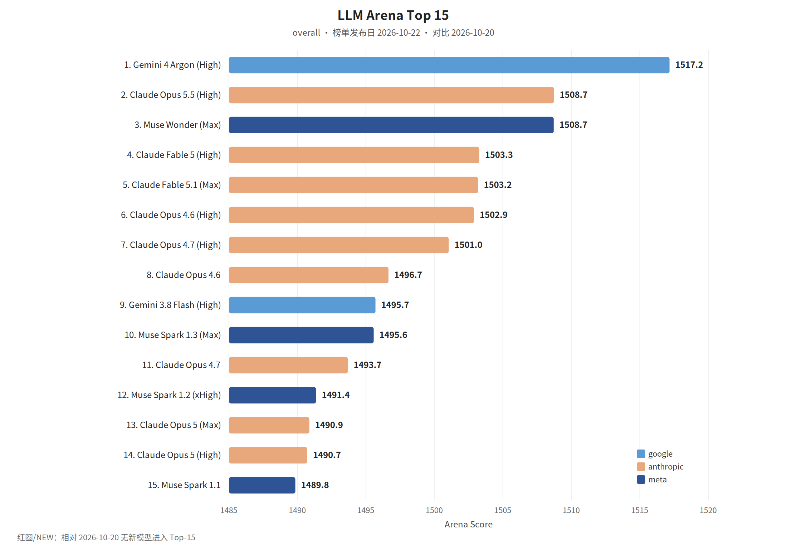

覆盖窗口：2026-10-16～2026-10-22（生成日 2026-10-23）。

## 〇、薅羊毛

本期为补录。linux.do 福利 RSS 当前只剩生成日之后的帖子，Wayback 没有该地址的存档，窗口内的社区帖补不回来。订阅里没有核对到落在本窗口的开发者额度或订阅优惠。

 

## 一、本周关键词

MiniMax M3.1 Flash，DeepSeek V4.1 Flash

Reflection Beam 上 AWS，Claude Duet 开始候补

天猫数字员工，美团的 AutoResearch

 

## 二、模型进展

#### 整体排名

LLM Arena（同一份全量数据集，overall，榜单发布日 **2026-10-22**）。相对 2026-10-20 没有新模型进入 Top-15，图中不标 NEW。本环境无 Artificial Analysis 密钥，不单列 AA 小节。

#### MiniMax M3.1 Flash

MiniMax 公众号：M3.1 Flash 正式更新。文中称此前匿名处理超过 200T token 的 Space Bunny 是它的早期版本。Agent 任务、编程、计算机使用和网络安全有代际提升，线上推理速度约到原来的 3 倍，使用成本降低 70%。

> 原始链接：[MiniMax M3.1 Flash](https://mp.weixin.qq.com/s?__biz=MzE5MTA3NzcxMQ==&mid=2247489196&idx=1&sn=4c8b969db8bd136f47d7b1a7650790c4)（发布日 2026-10-19）

#### DeepSeek V4.1 Flash 1017

深度求索：网页、App 和 API 已切到 V4.1-Flash-1017。相对上一版，基准提升的同时缩短了任务时间和输出长度，并同步开放自研搜索 API。文中称在多个 Harness 下走到新的性能–费用帕累托前沿。

> 原始链接：[DeepSeek V4.1 Flash 新版本](https://mp.weixin.qq.com/s?__biz=Mzk0OTYwNzc3NQ==&mid=2247485876&idx=1&sn=2606d3fa9ac085f94290ddd1d94649cc)（发布日 2026-10-17）

#### Reflection Beam

AWS 机器学习博客（Wayback 补回的历史 RSS，当前 feed 只剩 11 月的约 20 篇）：Reflection 的 Beam 是面向 Agent 编码和长任务的开放权重模型。可以先用 SageMaker JumpStart 做实时端点，或用 HyperPod Inference 配合 JumpStart、SGLang、vLLM 做 Kubernetes 上的分布式 GPU。

> 原始链接：[Introducing Reflection Beam on AWS](https://aws.amazon.com/blogs/machine-learning/introducing-reflection-beam-an-open-weight-model-for-agentic-coding-on-aws/)（发布日 2026-10-16）

 

## 三、项目开源

#### GitHub Trending（daily / all 前 5）

第三方 Trending RSS 没有这一天的存档。下面 5 条来自 Wayback 对 `github.com/trending`（Today / 全部语言）的存档，快照 **2026-10-22**。

> 存档：[2026-10-22 github.com/trending](https://web.archive.org/web/20261022014611/https://github.com/trending)

1. [cloudflare/security-audit-skill](https://github.com/cloudflare/security-audit-skill)：给编码 Agent 用的分阶段安全审计技能。
2. [vllm-project/vllm](https://github.com/vllm-project/vllm)：高吞吐、省内存的大模型推理引擎。
3. [stablyai/orca](https://github.com/stablyai/orca)：并行跑多种编码 Agent 的环境。当日简介举例包括 Grok Bot 和 Claude Code。
4. [headroomlabs-ai/headroom](https://github.com/headroomlabs-ai/headroom)：在工具输出、日志和检索片段进模型之前先压缩。存档页称编码 Agent 可少用约 20% 的 token。
5. [DietrichGebert/ponytail](https://github.com/DietrichGebert/ponytail)：让编码 Agent 少写不必要的代码。

#### DeepSeek 开源推理框架 DeepInfer

深度求索：在已开源的模型、TileLang 和算子库之外，把内部推理框架 DeepInfer 开源，用来调度大规模调用时的算力和电耗。

> 原始链接：[DeepSeek 开源推理框架](https://mp.weixin.qq.com/s?__biz=Mzk0OTYwNzc3NQ==&mid=2247485884&idx=1&sn=d457981abe7db1f1b5d600fc109dc836)（发布日 2026-10-20）

 

## 四、国内进展

#### &lt;协作&gt;天猫数字员工

大淘宝技术：数字员工以钉钉群为入口，和产品、开发、测试共享同一份需求上下文，从 PRD 走到发布复盘。文章把解法分成「协作」和「资产」，用来减少传递失真和隐性知识流失。

> 原始链接：[天猫数字员工（协作篇）](https://mp.weixin.qq.com/s?__biz=MzAxNDEwNjk5OQ==&mid=2650546508&idx=1&sn=2b2b8c196cc45f7043b59d2c5c3ce81c)（发布日 2026-10-21）

#### &lt;研究&gt;美团：从 LOOP 到图探索的 AutoResearch

美团技术博客：从 Karpathy 的 AutoResearch 出发，经过三次重构，做成能在企业云上训练的算法研究自进化系统。单线程 LOOP 换成 CyclicGraph Engine，用状态机维持长周期，并用业务知识库、真实闭环和经验沉淀让系统越用越好。

> 原始链接：[从 LOOP 到图探索](https://tech.meituan.com/2026/10/22/LOOP-AutoResearch.html)（发布日 2026-10-22）

#### &lt;组织&gt;快手：从工程师到全员的企业 AI

快手技术写企业 AI 生产力如何从工程师扩到全员、从个人扩到组织。同窗口还有 iWork 和 QCon 两篇分享合集，这里只记这一篇作为组织侧的入口。

> 原始链接：[从工程师到全员，从个体到组织](https://mp.weixin.qq.com/s?__biz=Mzg2NzU4MDM0MQ==&mid=2247501508&idx=1&sn=1cf0c6dfe048cc4a660ee64cdd114c89)（发布日 2026-10-20）

字节、阿里、腾讯、支付宝的 Wechat2RSS 已滚出本窗口且没有 Wayback 存档。模型发布写在「模型进展」。

 

## 五、国际进展

#### &lt;产品&gt;Claude Duet

研究预览从即日起开放候补，先从美国的 Pro 和 Max 订阅者开始。RSS 摘要没有展开产品边界。

> 原始链接：[Introducing Claude Duet](https://claude.com/resources/articles/claude-duet)（发布日 2026-10-21）

#### &lt;工单&gt;在 Linear 里把问题派给 Amp

把 Linear 问题指派给 Amp 会开一条 Agent 会话并拉起 orb，也可以提及 @Amp。Amp 把回复送回同一条会话。

> 原始链接：[Assign It To Amp](https://ampcode.com/news/assign-it-to-amp)（发布日 2026-10-19）

#### &lt;语言&gt;低资源编程语言上的编码

OpenAI RSS：改进 ChatGPT 在低资源编程语言上的表现，并加上软件工程、SQLite 和 COBOL 迁移的新评测。

> 原始链接：[Advancing coding in low-resource programming languages](https://openai.com/index/low-resource-programming-languages)（发布日 2026-10-19）

 

本期于 2026-11 按新版格式补录。
