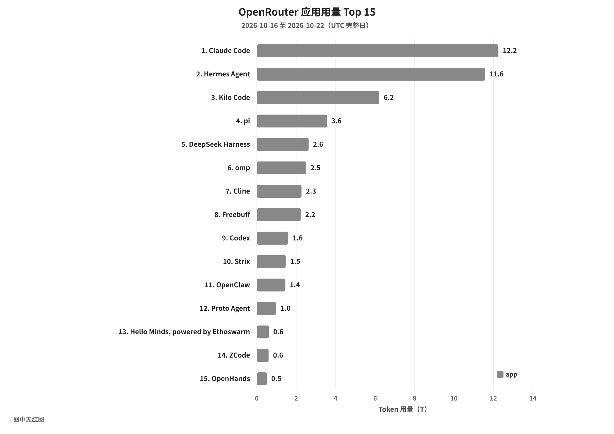

覆盖窗口：2026-10-16 00:00:00 至 2026-10-22 23:59:59（UTC；生成日 2026-10-23，不含当天）。

<!-- provenance
{"rules":{"repo":"VirusPC/edges-brain-viruspc","commit":"f800a6055b75ae4a22859d370a1af9d3cd4fdce8","routine":".edges/routines/weekly-ai-blogs-digest/INDEX.md","skill":"skills/managed/weekly-ai-blogs-digest/SKILL.md"},"data":{"repo":"VirusPC/ai-news-data","commit":"ca169d949f7b1b42cd8a9328923b90077e2507fe","path":"issues/2026-10-23","kind":"tree"}}
-->

## 二、模型进展

### LLM Arena

第一是 Gemini 4 Argon (High)。

<!-- chart-meta
榜单发布日 2026-10-22。图中无红圈。
-->

### OpenRouter

用量第一是 DeepSeek V4.1 Flash，其次是 DeepSeek V4.1 Flash 1017。

<!-- chart-meta
红圈：minimax/minimax-m3.1-flash-20261019:free。
-->

这是编程场景的 token 用量，不是质量排名。第一是 DeepSeek V4.1 Flash。

<!-- chart-meta
图中无红圈。
-->

公开应用用量第一是 Claude Code。

<!-- chart-meta
图中无红圈。
-->

#### [MiniMax M3.1 Flash](https://mp.weixin.qq.com/s?__biz=MzE5MTA3NzcxMQ==&mid=2247489196&idx=1&sn=4c8b969db8bd136f47d7b1a7650790c4)

<aside class="info-card">

<svg class="info-card-icon" xmlns="http://www.w3.org/2000/svg" viewBox="0 0 24 24" fill="none" stroke="currentColor" stroke-width="2" stroke-linecap="round" stroke-linejoin="round" aria-hidden="true"><path d="M8 6h13"></path><path d="M8 12h13"></path><path d="M8 18h13"></path><path d="M3 6h.01"></path><path d="M3 12h.01"></path><path d="M3 18h.01"></path></svg>发布要点

<ul>
<li><strong>上线</strong> 10 月 19 日更新。匿名处理过 200T token 的 Space Bunny 是它的早期版本。</li>
<li><strong>定位</strong> 面向 Agent 任务、编程、Computer Use 和网络安全的 Flash 模型。</li>
<li><strong>成绩</strong> 线上推理速度约到原来的 <mark class="note-card-hl">3 倍</mark>，使用成本降低 70%。DeepSWE v1.1 为 73.7%。</li>
<li><strong>可用</strong> 输入每百万 token 1 元，输出 4 元。名次没有写。</li>
</ul>

来源：<a href="https://mp.weixin.qq.com/s?__biz=MzE5MTA3NzcxMQ==&mid=2247489196&idx=1&sn=4c8b969db8bd136f47d7b1a7650790c4">MiniMax M3.1 Flash</a>

</aside>

#### [DeepSeek V4.1 Flash 1017](https://mp.weixin.qq.com/s?__biz=Mzk0OTYwNzc3NQ==&mid=2247485876&idx=1&sn=2606d3fa9ac085f94290ddd1d94649cc)

<aside class="info-card">

<svg class="info-card-icon" xmlns="http://www.w3.org/2000/svg" viewBox="0 0 24 24" fill="none" stroke="currentColor" stroke-width="2" stroke-linecap="round" stroke-linejoin="round" aria-hidden="true"><path d="M8 6h13"></path><path d="M8 12h13"></path><path d="M8 18h13"></path><path d="M3 6h.01"></path><path d="M3 12h.01"></path><path d="M3 18h.01"></path></svg>发布要点

<ul>
<li><strong>上线</strong> 10 月 17 日网页、App 和 API 切到 V4.1-Flash-1017。</li>
<li><strong>定位</strong> 基准提升的同时缩短任务时间和输出长度。</li>
<li><strong>成绩</strong> 文中称在多个 Harness 下走到新的性能–费用帕累托前沿，并开放自研搜索 API。</li>
<li><strong>可用</strong> 建议把 DeepSeek Harness 升到 0.2.1-rc.1 及以上。单价和速度名次没有写。</li>
</ul>

来源：<a href="https://mp.weixin.qq.com/s?__biz=Mzk0OTYwNzc3NQ==&mid=2247485876&idx=1&sn=2606d3fa9ac085f94290ddd1d94649cc">DeepSeek V4.1 Flash 新版本</a>

</aside>

#### [Reflection Beam](https://aws.amazon.com/blogs/machine-learning/introducing-reflection-beam-an-open-weight-model-for-agentic-coding-on-aws/)

<aside class="info-card">

<svg class="info-card-icon" xmlns="http://www.w3.org/2000/svg" viewBox="0 0 24 24" fill="none" stroke="currentColor" stroke-width="2" stroke-linecap="round" stroke-linejoin="round" aria-hidden="true"><path d="M8 6h13"></path><path d="M8 12h13"></path><path d="M8 18h13"></path><path d="M3 6h.01"></path><path d="M3 12h.01"></path><path d="M3 18h.01"></path></svg>发布要点

<ul>
<li><strong>上线</strong> AWS 机器学习博客介绍 Reflection 的 Beam，Hugging Face 页写 10 月 16 日发布。</li>
<li><strong>定位</strong> 面向 Agent 编码和长任务的开放权重模型，运行和部署由使用方自己管。</li>
<li><strong>可用</strong> 许可是 Apache 2.0。价格、速度和智力指数没有数字。</li>
</ul>

来源：<a href="https://aws.amazon.com/blogs/machine-learning/introducing-reflection-beam-an-open-weight-model-for-agentic-coding-on-aws/">Introducing Reflection Beam</a>

</aside>

## 三、项目开源

#### GitHub Trending（weekly / all 前 5）

#### [morluto/rea](https://github.com/morluto/rea)

用 Agent 做逆向，从应用行为一直拆到<mark>原生二进制</mark>。

来源里只有这些。

#### [anthropics/claude-plugins-official](https://github.com/anthropics/claude-plugins-official)

Anthropic 维护的 Claude Code 插件目录。

来源里只有这些。

#### [ruvnet/ruflo](https://github.com/ruvnet/ruflo)

协调多 Agent 工作流的 harness。简介称它是最早的那一版。

来源里只有这些。

#### [android/skills](https://github.com/android/skills)

这一条在归档榜上没有简介。

来源里只有这些。

#### [K-Dense-AI/scientific-agent-skills](https://github.com/K-Dense-AI/scientific-agent-skills)

给 Agent 用的科学技能库。简介写有 177 个可直接用的技能。

来源里只有这些。

## 四、精选文章

### 国内模型厂

#### &lt;开源&gt;&lt;DeepSeek&gt;[DeepSeek 开源推理框架：走向真正普惠的未来](https://mp.weixin.qq.com/s?__biz=Mzk0OTYwNzc3NQ==&mid=2247485884&idx=1&sn=d457981abe7db1f1b5d600fc109dc836)

把内部推理框架 <mark>DeepInfer</mark> 开源，用来调度大规模调用时的算力和电耗。

完整总结

<strong>解决什么问题：</strong>模型能力之外，超大规模服务的成本和耗电取决于推理框架。

<strong>如何解决：</strong>在已开源的模型、TileLang 和算子库之外，公开 DeepInfer，并附上与官方 API 对齐的 token 编解码组件。

<strong>效果怎样：</strong>文中称已用它提供 V4.1 Flash 的高吞吐、低延迟服务。没有给出新的对照数字。

<strong>洞察与启发：</strong>开源的是调度层，不是再发一个聊天模型。

<strong>相关工作：</strong>同一窗口的 V4.1-Flash-1017 是它现在在跑的模型。

### 国外模型厂

#### &lt;架构&gt;&lt;Anthropic&gt;[Building agents: When to fold subagents into your main agent loop](https://claude.com/resources/articles/building-agents-when-to-fold-subagents-into-your-main-agent-loop)

子 Agent 少一些，把上下文和工具<mark>逐步展开</mark>，质量和延迟可以一起好。

完整总结

<strong>解决什么问题：</strong>主循环里堆太多子 Agent，成本和延迟上去，质量却不一定更好。

<strong>如何解决：</strong>用一份迁移流程判断哪些子 Agent 该折回主循环，并带一个可试的 demo。

<strong>效果怎样：</strong>文中的主张是质量和成本、延迟可以同时改善。没有统一的百分比。

<strong>洞察与启发：</strong>子 Agent 是结构选择，不是默认越多越好。

<strong>相关工作：</strong>同期的 Claude Code 评审文也在省人的注意力，而不是再加一层 Agent。

#### &lt;开源&gt;&lt;Anthropic&gt;[Donating Agent Skills to the Agentic AI Foundation](https://www.anthropic.com/news/donating-agent-skills-to-the-agentic-ai-foundation)

把 Agent Skills 这套开放标准捐给 Agentic AI Foundation。

完整总结

<strong>解决什么问题：</strong>Agent 的专用知识和流程需要一个跨产品的标准。

<strong>如何解决：</strong>Anthropic 把 2025 年 12 月发布的 Agent Skills 捐给基金会。

<strong>效果怎样：</strong>文中称已有 70 多个平台接入，包括 ChatGPT、Cursor、GitHub Copilot 和 VS Code。

<strong>相关工作：</strong>本周 GitHub 周榜上的 skills 仓库，是这套标准的公开目录。

#### &lt;产品&gt;&lt;Anthropic&gt;[Introducing Claude Duet](https://claude.com/resources/articles/claude-duet)

研究预览里的主动 Agent：人离开之后它还接着做，动手前先问你。

完整总结

<strong>解决什么问题：</strong>对话式助手要等人开口，做不了会自己找上来的长任务。

<strong>如何解决：</strong>Duet 把需要人看的事送过来，完成交代的任务，离开期间继续，执行前再确认。

<strong>效果怎样：</strong>先对美国的 Pro、Max、Ultra 开候补。没有公开的任务成绩。

<strong>洞察与启发：</strong>主动和确认是一起设计的。

<strong>相关工作：</strong>代码评审文把人的时间当成稀缺资源，Duet 是产品侧的同一判断。

#### &lt;实践&gt;&lt;Anthropic&gt;[How the Claude Code team does code review](https://claude.dev/blog/solving-code-review-at-anthropic/)

覆盖和深度够了之后，优化的是<mark>人还要看多久</mark>，同时不让回滚和事故变多。

完整总结

<strong>解决什么问题：</strong>Agent 写出的变更量，人按原来的方式逐行看不完。

<strong>如何解决：</strong>先把覆盖和评审做深，再把人的时间压到不增加 revert 和事故的下限。

<strong>效果怎样：</strong>这是团队自己的流程说明，没有新的事故率数字。

<strong>洞察与启发：</strong>评审缺的是人的注意力，不是再接一个评审模型。

<strong>相关工作：</strong>子 Agent 那篇是在减循环里的角色；这篇是在减人还要看的部分。

#### &lt;架构&gt;&lt;Anthropic&gt;[Redesigning source control at Anthropic](https://www.anthropic.com/engineering/redesigning-source-control)

单体仓库每天的合并从大约 2500 次涨到 30000 次以上之后，他们做了给<mark>常驻 Agent</mark> 用的版本控制系统 Scion，并在五个月内迁离 git。

订阅源里只有这些。

#### &lt;产品&gt;&lt;Anthropic&gt;[Claude Security now scans continuously and tracks fixes](https://claude.com/resources/articles/claude-security-now-scans-continuously-and-tracks-fixes)

Claude Security 改成跟着仓库<mark>持续扫</mark>，并把发现一直跟到修好。

完整总结

<strong>解决什么问题：</strong>公开测试以来要等人手动开扫，修没修也接不上。

<strong>如何解决：</strong>代码一变就扫，跟踪修复，并使用团队补上的环境上下文。可以用 API 和 MCP 接现有工具。企业客户公开测试，模型包括 Claude Mythos，不要求 Cyber Verification Program。

<strong>效果怎样：</strong>文中称自 4 月公开测试以来，数千家组织用它找出超过一百万个漏洞。企业每月有 25000 美元免费额度，给两个月。这是他们自己的数。

<strong>洞察与启发：</strong>扫描从一次任务变成跟着仓库走的状态。

<strong>相关工作：</strong>同一窗口的代码评审文在减人要看的时间。这篇是漏洞发现不要等人记得去点。

#### &lt;实践&gt;&lt;OpenAI&gt;[Advancing coding in low-resource programming languages](https://openai.com/index/low-resource-programming-languages)

COBOL、Fortran、Visual Basic 这类<mark>训练语料少</mark>的语言，模型被拿去写和迁移关键系统里的代码。

完整总结

<strong>解决什么问题：</strong>这些语言的代码和文档比 Python、JavaScript 少，编码模型经常不会。

<strong>如何解决：</strong>按企业和开发者的反馈，补这些语言上的编写和迁移。

<strong>效果怎样：</strong>文中写 COBOL 仍支撑超过 40% 的网上银行、80% 的现场刷卡和 95% 的 ATM。这是语言还在用的范围，不是这次的成绩。

<strong>洞察与启发：</strong>这篇标成研究发布，写的是还在跑关键系统的语言，不是新的聊天模型。

<strong>相关工作：</strong>Decisions API 把小决策做成接口。这篇是让编码模型碰到旧语言时还能干活。

#### &lt;产品&gt;&lt;OpenAI&gt;[Build more responsive apps with the Decisions API](https://openai.com/index/decisions-api)

工作流里分类、分流、下一步怎么走的小决策，收成一个<mark>有界答案</mark>的接口。

完整总结

<strong>解决什么问题：</strong>单个决策很简单，次数一多，延迟和费用就叠起来。

<strong>如何解决：</strong>Decisions API 正式发布，用 GPT-6 Luna，只回答划定范围的问题。支持文本、图像和结构化输入。

<strong>效果怎样：</strong>文中称比走 Responses API 的 GPT-6 Luna 快最多 10 倍。输入 0.10 美元/百万 token，缓存输入 0.01 美元，不收输出 token 费用。

<strong>洞察与启发：</strong>快是因为问题被收成概率、选择或打分，不是把整个助手再调一遍。

<strong>相关工作：</strong>低资源语言那篇补的是编码能力。这篇补的是 Agent 路径上的小决策。

### 国内非模型厂

#### &lt;实践&gt;&lt;快手&gt;[从工程师到全员，从个体到组织：快手企业AI生产力实践](https://mp.weixin.qq.com/s?__biz=Mzg2NzU4MDM0MQ==&mid=2247501508&idx=1&sn=1cf0c6dfe048cc4a660ee64cdd114c89)

快手把 AI 从工程师手里的工具往组织协同推，先量 <mark>L2</mark> 任务级覆盖，不把全链路 L3 当成群体要求。

完整总结

<strong>解决什么问题：</strong>研发效能卡在最慢的协作环节，只给个人加速不够。

<strong>如何解决：</strong>先有人持续实践，把做法固化，再从组织往下推。L1 是改片段，L2 是交一个任务，L3 是把 PRD 或 Spec 交给 AI 走完。当时基模和 Harness 还不够，所以不把 L3 当群体指标，用 L2 覆盖，目标 2026 年底 80%。

<strong>效果怎样：</strong>这是 QECon 演讲整理，没有新的对照实验。

<strong>洞察与启发：</strong>他们成立企业 AI 生产力（iWork），是因为系统会被最慢的模块拖住。

<strong>相关工作：</strong>美团这篇把研究迭代放到云端。快手这篇把度量从个人代码提到组织交接。

#### &lt;架构&gt;&lt;美团&gt;[从 LOOP 到图探索：算法模型的 AutoResearch](https://tech.meituan.com/2026/10/22/LOOP-AutoResearch.html)

把算法研究从单线程 LOOP 改成能在云端训练平台上跑的<mark>图探索</mark>。

完整总结

<strong>解决什么问题：</strong>改代码、等训练、看日志占掉判断时间，一天往往只有两三次实质迭代。

<strong>如何解决：</strong>从 Karpathy 的 AutoResearch 出发，做成 CyclicGraph Engine，用状态机稳住长周期，并把业务知识和失败经验写回系统。

<strong>效果怎样：</strong>文中写两个业务项目的单任务耗时比人工基线少约 85% 和 83%。这是他们自己的回放。

<strong>洞察与启发：</strong>两个项目结构不同，增益被归到同一套架构。

<strong>相关工作：</strong>同期 Anthropic 那篇在减主循环里的子 Agent。这篇把长周期研究放到云端训练平台上跑。

#### &lt;产品&gt;&lt;Qoder&gt;[Every Tenth of a Second Counts](https://blog.qoder.com/qoder-fasttech)

Qoder Fast 把首个可见回复从 8 秒压到 <mark>3 秒</mark>，并把 Credits 乘数从 1.1 倍降到 0.8 倍。

完整总结

<strong>解决什么问题：</strong>命令执行、来回修改和边界清楚的小任务，等待比推理更打乱节奏。

<strong>如何解决：</strong>冷启动把用不到的能力延后，结果先交、无关工作放到后台。桌面端这个解耦把冷启动时间降了 60% 以上。工具侧减少加载和往返，部分搜索类工具的执行时间降了 50% 以上。并行之后，Fast 档的并行工具使用率提高 50% 以上。System One 先做任务分类，再配模型和推理力度。首包另走专用网络，大载荷的 p95 降了 50% 以上。

<strong>效果怎样：</strong>这些百分比是他们自己的测量。分类要几百毫秒，单次模型调用能省 200 毫秒以上。端到端是否划算，要把分类时间算进去。

<strong>洞察与启发：</strong>更快的单次调用如果带来更多返工，总时间不会短。

<strong>相关工作：</strong>低资源语言那篇在补模型会不会写。这篇在补 harness 和路径上的等待。

### 国外非模型厂

#### &lt;产品&gt;&lt;Cursor&gt;[Introducing the Agent SDK](https://cursor.com/blog/agent-sdk)

用他们做 Bugbot 的那套框架，把<mark>按事件干活</mark>的 Agent 定义成代码。

完整总结

<strong>解决什么问题：</strong>有用的 Agent 要贴着团队自己的流程，现成产品往往是别人的流程。

<strong>如何解决：</strong>Agent SDK 把评审、合规、事故调查这类由事件触发的 Agent 做成可连接工作现场的代码。

<strong>效果怎样：</strong>文中举的例子是他们自己的 Bugbot 和 Security。没有第三方成绩。

<strong>洞察与启发：</strong>托管 Agent 和自建框架被收成同一套 SDK。

<strong>相关工作：</strong>Kiro 同一窗口加上的记忆，解决的是重复解释上下文；这里解决的是谁来定义 Agent。

#### &lt;产品&gt;&lt;Amp&gt;[Assign It To Amp](https://ampcode.com/news/assign-it-to-amp)

在 Linear 里把 issue 派给 Amp，会开一个 <mark>Agent Session</mark>，并拉起一个 orb。

完整总结

<strong>解决什么问题：</strong>任务在 Linear 里，Agent 却在另一个窗口。

<strong>如何解决：</strong>安装 Amp agent，把账号接到 Linear MCP。派工或 @Amp 都会开会话，回复回到同一条，Amp 侧边栏也能看见。

<strong>效果怎样：</strong>这是功能说明，没有时长数字。

<strong>洞察与启发：</strong>会话是 Linear 和 Amp 共用的一条，不是把结论贴回去就算完。

<strong>相关工作：</strong>自托管 orb 解决的是机器在谁的机房。这篇解决的是任务从哪进来。

#### &lt;产品&gt;&lt;Amp&gt;[Self-Hosted Orbs](https://ampcode.com/news/self-hosted-orbs)

机器自己出，Amp 把能快速启动、休眠和恢复的计算收成 <mark>orb</mark>。

完整总结

<strong>解决什么问题：</strong>orb 原先只能跑在 Amp 的计算上。

<strong>如何解决：</strong>在自己的环境里跑 amp orb provider，由你提供的程序处理 spawn、pause 和 delete。示例包括 Docker、E2B 和 Kubernetes。

<strong>效果怎样：</strong>文中没有给出启动时间。

<strong>洞察与启发：</strong>托管体验和机器归属被拆开了。

<strong>相关工作：</strong>Linear 派工仍会拉起 orb。这篇决定这个 orb 跑在哪。

#### &lt;产品&gt;&lt;LangChain&gt;[LangSmith LLM Gateway: Runtime Controls for Agents](https://www.langchain.com/blog/langsmith-llm-gateway-runtime-controls-for-production-agents)

一个网关管多家模型，在运行时限花费、做回退，并把敏感字段挡在模型外面。

完整总结

<strong>解决什么问题：</strong>生产 Agent 换供应商、限流和挡住密钥，不该散落在每次调用里。

<strong>如何解决：</strong>LLM Gateway 以公开测试提供统一入口、花费和速率限制、模型回退，以及把 PII 和密钥从请求里抹掉。

<strong>效果怎样：</strong>文中没有给出延迟或费用的对照数字。

<strong>洞察与启发：</strong>控制面放在运行时，而不是再包一层只能选一家模型的 SDK。

<strong>相关工作：</strong>Cursor 的 Agent SDK 管 Agent 怎么定义；这篇管模型调用怎么被拦住。

#### &lt;产品&gt;&lt;AWS&gt;[Introducing memory in Kiro IDE and CLI](https://kiro.dev/blog/memory-in-ide-cli)

Kiro 记住你的做法、仓库命令和已经否掉的路，下次<mark>不用再解释一遍</mark>。

完整总结

<strong>解决什么问题：</strong>每次会话都要把偏好、命令和已经试过的错路再说一次。

<strong>如何解决：</strong>IDE 和 CLI 记下工作方式、仓库约定、纠正和调试结论，相关时再带出来。

<strong>效果怎样：</strong>文中没有量化少花了多少轮。

<strong>洞察与启发：</strong>记忆写在编码产品里，而不是另做一个笔记应用。

<strong>相关工作：</strong>美团那篇把研究经验写回系统；这里把个人纠正写回 IDE。

#### &lt;实践&gt;&lt;AWS&gt;[How Kiro fixes itself, and how we keep the fixes honest](https://kiro.dev/blog/how-kiro-fixes-itself)

一句错误的工具说明被送到模型 <mark>61742</mark> 次。Kiro 在改这种没人会提单的 harness 问题，但不让自评分直接决定能不能发。

完整总结

<strong>解决什么问题：</strong>工具描述里的假话没有用户票，自评分又可能被单次侥幸带偏。

<strong>如何解决：</strong>他们几乎发出一个看起来任务更多、token 更少的修复。按主机拆开之后，增益几乎来自一次碰巧跳出循环的运行。去掉那台主机，修复更慢、更贵、更不准。

<strong>效果怎样：</strong>61742 次是这句说明在几百个会话里被送到模型的次数。那个差点发出的修复没有发出。

<strong>洞察与启发：</strong>会给自己打分的循环，会把这次运气当成改进。

<strong>相关工作：</strong>同一窗口的 Kiro 记忆是让它记住纠正。这篇是纠正本身要经得起拆开看。

#### &lt;架构&gt;&lt;AWS&gt;[Discover tools at runtime with AWS Agent Registry](https://aws.amazon.com/blogs/machine-learning/discover-tools-at-runtime-with-aws-agent-registry/)

工具写死在编排器里，几十个还能用，上百个内部 API 就会让模型把 token 花在<mark>分辨名字</mark>上。

完整总结

<strong>解决什么问题：</strong>每加一个能力就要改编排器、重新部署，还得跟别的团队对齐发布。

<strong>如何解决：</strong>Agent Registry 作为托管服务登记和发现 MCP 服务器与 Agent，让编排器在运行时再找相关工具。

<strong>效果怎样：</strong>文中没有给出 token 下降的测量。

<strong>洞察与启发：</strong>瓶颈从模型不会选工具，变成目录是在编译期焊死的。

<strong>相关工作：</strong>LangSmith 网关管的是模型调用。这篇管的是工具目录。

#### &lt;架构&gt;&lt;AWS&gt;[5 production challenges in multi-agent systems](https://aws.amazon.com/blogs/machine-learning/5-production-challenges-in-multi-agent-systems-and-how-deep-insight-solved-them/)

多 Agent 做出演示很容易，一进真实业务就会漏掉<mark>校验和边界</mark>，改提示也带不走。

完整总结

<strong>解决什么问题：</strong>Agent 不按固定步骤走，只靠指令不够。

<strong>如何解决：</strong>Deep Insight 把问题放在怎么设计 Agent 的判断，包括它何时校验，而不是继续换模型和加示例。

<strong>效果怎样：</strong>文中没有给出可单独引用的总成绩。

<strong>洞察与启发：</strong>同样的失败反复出现，是因为判断方式没变。

<strong>相关工作：</strong>Agent Registry 解决工具目录。这篇解决进生产之后判断本身站不住。

#### &lt;架构&gt;&lt;AWS&gt;[Adaptive agentic intelligence framework using Strands Agents](https://aws.amazon.com/blogs/machine-learning/adaptive-agentic-intelligence-framework-using-strands-agents/)

例行查询也走一次大模型，费用和延迟都不稳，还做不了<mark>离线</mark>。

完整总结

<strong>解决什么问题：</strong>状态检查和复杂分析共用一个大模型。

<strong>如何解决：</strong>AAIF 用 Strands Agents。小模型在本地处理例行任务，更复杂的请求再经 Amazon Bedrock 到云上的模型。

<strong>效果怎样：</strong>文中没有给出费用降幅。

<strong>洞察与启发：</strong>他们引用的观点是：很多 Agent 调用用小模型就够，也更合适、更省。

<strong>相关工作：</strong>Decisions API 把小决策收成有界接口。这篇是按请求难度换模型。

#### &lt;架构&gt;&lt;AWS&gt;[Building trust in AI agents](https://aws.amazon.com/blogs/machine-learning/building-trust-in-ai-agents-a-production-ready-evaluation-framework-with-amazon-bedrock-agentcore/)

Agent 出错往往<mark>不报错</mark>，答案看起来完整，却是错的。

完整总结

<strong>解决什么问题：</strong>演示能跑，不等于每次发布、每个子 Agent、每条流程都还对。

<strong>如何解决：</strong>这篇给出一套放在 Bedrock AgentCore 上的生产评测，用来证明 Agent 还在正常工作，而不是只证明它曾经成功过。

<strong>效果怎样：</strong>文中没有给出一套统一的分数。

<strong>洞察与启发：</strong>传统软件失败得很响，Agent 失败得很轻。

<strong>相关工作：</strong>Kiro 改自己的工具说明时，也拒绝只看一次变好的总分。

## 五、精选推文

## 六、精选播客
