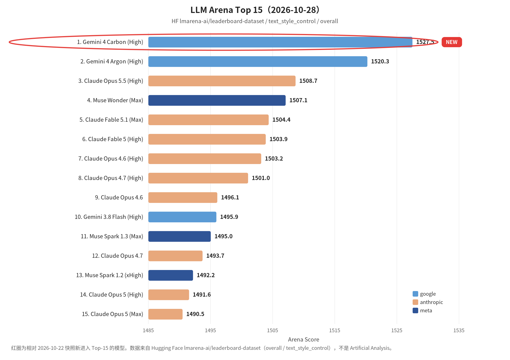

覆盖窗口：2026-10-23～2026-10-29（生成日 2026-10-30）。

## 〇、薅羊毛

本次重拉 linux.do 福利 RSS 时，源里只剩下 2026-11-10 当天的条目（共 25 条，且已被截断），**窗口 10-23～10-29 内的社区帖已不在当前 RSS 中**，故未收录 linux.do 帖。下列两条来自同期官方博客，发布日已核对。

#### Kiro：首次升级付费计划赠 500 试用额度

自 2026 年 11 月 1 日起，首次从免费版升级 Kiro 付费计划，首月剩余时间免费，并获 500 点试用额度（12 个月内可用，计划额度用尽后扣除）。费用与计划额度按升级时剩余秒数比例折算。

> 原始链接：[Kiro’s new free trial gives you 500 extra credits](https://kiro.dev/blog/kiros-new-free-trial-gives-you-500-extra-credits)

#### Kiro for Students：再扩 41 所大学，一年免费

学生计划新增 41 所大学；符合条件的学生可免费使用一年，每月 1,000 积分，覆盖 IDE、CLI、Web 和 Crew，需 SheerID 验证。

> 原始链接：[Kiro for Students expands to 41 more universities](https://kiro.dev/blog/41-more-universities)

 

## 一、本周关键词

Cursor 扩展供应链后门

软件工厂 / Spec 稳定交付

Managed Deep Agents：Browser Use、异步子代理、Schedules

GPT-6.1 Terra（computer use）、Mistral Large 4、Nemotron 3.5 Transcribe、LFM3

高可靠系统里的 AI Coding 边界、Agent harness / 上下文工程

 

## 二、模型进展

#### 整体排名

LLM Arena（Hugging Face 数据集 `lmarena-ai/leaderboard-dataset`，overall，榜单发布日 **2026-10-28**，落在本窗口内）。红圈为相对上一份可核验快照（2026-10-22）新进入 Top-15 的模型，本期仅 **Gemini 4 Carbon (High)**。本环境无 Artificial Analysis 密钥，不单列 AA 小节。

#### GPT-6.1 Terra（computer use）

OpenAI 发布 GPT-6.1 Terra，主打更快更强的 computer use；桌面 / 浏览器自动化场景应重跑基准。同周亦见相关模型在安全与缺陷检测产品中的落地案例。

> 原始链接：[Introducing GPT-6.1 Terra](https://openai.com/index/introducing-gpt-6-1-terra)

#### Mistral Large 4（Le Chonk）

约 1T 总参数、49B 激活参数的多模态 MoE；支持文本与图像输入、最长约 1M token 上下文。已上架 Hugging Face，可通过 Transformers、vLLM、llama.cpp 推理，用 TRL 微调。

> 原始链接：[Welcome Le Chonk: Mistral Large 4 on Hugging Face](https://huggingface.co/blog/mistral-large4)

#### Claude Haiku 5.5 登陆 Kiro

在 Kiro IDE、CLI、Web、Crew 向指定付费用户实验性开放；自适应思考、约 100 万 token 上下文。起始费用倍率较低，适合高吞吐、低延迟与并行审查子代理。

> 原始链接：[Claude Haiku 5.5 is now available in Kiro](https://kiro.dev/blog/haiku-5-5)

#### NVIDIA Nemotron 3.5 Transcribe + Granary v2

开放权重语音模型：多语转写、说话人归属、翻译与音频问答；可用自然语言提示及 NeMo Speech 微调。Granary v2 提供覆盖更多语言的整理流程与清单。

> 原始链接：[NVIDIA Nemotron 3.5 Transcribe and Granary v2](https://huggingface.co/blog/nvidia/nemotron-transcribe-granary)

#### LFM3：边缘专用多模态系列

Liquid AI 发布约 2B 参数量级的文本 / 视觉 / 音频 / 全模态 / 决策等模型，共用骨干，可单 GPU 微调并部署边缘；最长约 256K 上下文。

> 原始链接：[Build specialized multimodal models with LFM3](https://huggingface.co/blog/LiquidAI/lfm3)

#### 其他短讯

- **Granite Switch 4.1.1**（IBM）：像更新软件一样热切换模型组件，基础模型未重算。[链接](https://huggingface.co/blog/ibm-granite/granite-switch-4-1-1)
- **FrontierCode 2.0**（Cognition）：更难编码基准，最高分仅约 45%，暴露自主理解意图与控改动范围仍难。[链接](https://cognition.com/blog/frontier-code-2.0)

 

## 三、项目开源

#### GitHub Trending

约定源 mshibanami/GitHubTrendingRSS 的当前 RSS 只保留当天快照（本次拉取为 **2026-11-10**），其仓库的 generated-feeds 分支也是覆盖发布，**未能取回 10-23～10-29 的 daily/all 历史 XML**，故本期不列「前 5」，以免用后期数据或无法核验的名次冒充当时榜单。

#### Content Studio — LangChain 设计 Agent

LangChain 介绍在 Slack 中构建并开源的设计 Agent：以设计原则、反馈推理和自动检查传递品牌判断，配合持久化沙箱、视频与图像工具及团队协作流程。

> 原始链接：[How We Built Our Design Agent](https://www.langchain.com/blog/design-agent)

#### AnySpeechRecognizer / AnyDecisionModel（Apple 平台）

Hugging Face 发布面向 Apple 的 Swift 包：统一 Speech API 并支持 Core ML 语音识别与说话人分离；决策包以类型化结果和概率回答问题，支持设备端及托管后端。

> 原始链接：[Introducing AnySpeechRecognizer and AnyDecisionModel](https://huggingface.co/blog/anydecisionmodel)

#### Project ProtoStar — 让公共资助科学 AI-Ready

Hugging Face 联合高校与开放科学组织，推动公开资助的科学数据集 / 模型 / 代码以便于机器处理的格式发布。

> 原始链接：[Announcing Project ProtoStar](https://huggingface.co/blog/announcing-project-protostar)

#### Taobao3D 拓扑生成算法开源

淘宝技术团队开源 Taobao3D 相关拓扑生成能力，面向高保真 3D 商品轻量化建模与多端实时渲染。

> 原始链接：[Taobao3D 拓扑生成算法开源！让高保真 3D 更轻量](https://mp.weixin.qq.com/s?__biz=MzAxNDEwNjk5OQ==&mid=2650546617&idx=1&sn=70b04510e22050f467b360b1e971db3d)

#### OpenWiki + Graphs：证据可追溯的 Agent 记忆

LangChain 介绍用开源 wiki 编译器 OpenWiki 与证据图构建可追溯 Agent 记忆；知识库 Agent 可借鉴证据节点而非纯向量黑盒。

> 原始链接：[How to build evidence-grounded agent memory with OpenWiki and Graphs](https://www.langchain.com/blog/building-agent-memory-openwiki-graphs)

 

## 四、国内进展

#### &lt;高可靠&gt;美团：在「不能出错」的分布式存储里用 AI Coding

本期美团技术博客 RSS 拉取失败（SSL 中断）。下列条目与链接来自 2026-11-01 演示周报中已核对的 10-29 原文。文章讨论高可靠系统中 AI Coding 的边界：提效会放大缺陷绝对量，必须把评审与验证抬得更高。

> 原始链接：[如何在“不能出错”的系统里使用 AI Coding？分布式存储实践与边界](https://tech.meituan.com/2026/10/29/AI-Coding-IN-Distributed-Storage-System.html)

#### &lt;Agent实践&gt;阿里：淘宝闪购店铺装修选品 Agent（RSI）

店装橱窗位有限、商品差异大；介绍基于 RSI 架构持续、自动化找更好选法，并以可控成本验证「确实更好」的实践。

> 原始链接：[基于 RSI 架构的淘宝闪购店铺装修选品 Agent 实践](https://mp.weixin.qq.com/s?__biz=Mzg4NTczNzg2OA==&mid=2247512312&idx=1&sn=21231fab634b576f13b966e8a5f44cbd)

#### &lt;数据分析&gt;腾讯：灯塔 AI 一句话生成看板

腾讯灯塔面向外部的 AI 通用数据分析：接入数据、一句话生成看板，到在线编辑与分享发布的从 0 到 1 指南。

> 原始链接：[一句话生成看板｜灯塔AI数据分析从0到1完整指南](https://mp.weixin.qq.com/s?__biz=MjM5ODYwMjI2MA==&mid=2649804990&idx=1&sn=ab7cc44dcb144528b83bc90c81eb6321)

#### &lt;AI交付&gt;百度：好看视频鸿蒙端 AI 研发交付流程

用「完整、正确、可验证、可持续」等标准衡量鸿蒙迁移：行为建模、语义映射、分层测试，降低对个人经验的依赖。

> 原始链接：[好看视频鸿蒙端AI研发交付流程的建设思考与实践](https://mp.weixin.qq.com/s?__biz=Mzg5MjU0NTI5OQ==&mid=2247607730&idx=1&sn=f7ae4efd3270278f46340fc01e4abab9)

#### &lt;数字员工&gt;天猫：多角色场景下的 AI 研发流转效能

编码人工介入下降后，交付周期缩短仍可能有限，瓶颈在轮次交接等待；讨论产物标准化、质量门禁自动接续，以及仍需人工判断环节的协作调度。

> 原始链接：[天猫数字员工（效能篇）- 多角色场景下的 AI 研发流转效能分析](https://mp.weixin.qq.com/s?__biz=MzAxNDEwNjk5OQ==&mid=2650546616&idx=1&sn=6de3cd4134e01fc868640284f93f0eac)

#### &lt;Personal Agent&gt;腾讯：分身如何真正跑起来

腾讯侧分享 Personal Agent 从 0 到 1 的实战搭建与日常用法，适合对照自建个人助手的落地路径。

> 原始链接：[你的Personal Agent 如何真正跑起来？Agent实战指南](https://mp.weixin.qq.com/s?__biz=MjM5ODYwMjI2MA==&mid=2649804831&idx=1&sn=bcfae266ff83331edd3f2a72643592d3)

#### &lt;企业安全&gt;字节：豆包工作进入企业，安全如何跟上

围绕敏感数据是否进入个人账号、高风险操作、生成文档离站后是否仍受保护，介绍豆包工作原生保障与企业办公环境的补充防护。

> 原始链接：[豆包工作进入企业，安全如何跟上每一步？](https://mp.weixin.qq.com/s?__biz=MzI1MzYzMjE0MQ==&mid=2247523707&idx=2&sn=388edfd9218469809125b6916eef3c35)

#### &lt;开发体验&gt;苏千：从 cnpm 到 Vite+，AI 时代的开发者体验演进

讨论工具链与开发者体验在 AI 编码时代的变化，可对照前端基建如何被 Agent 工作流改写。

> 原始链接：[苏千｜从 cnpm 到 Vite+：AI 时代的开发者体验演进](https://mp.weixin.qq.com/s?__biz=Mzg2OTYyODU0NQ==&mid=2247521505&idx=1&sn=155d3450df1145c6b01d3e9b77d2c67f)

 

## 五、国际进展

#### &lt;安全&gt;Cursor：扩展市场恶意 Claude Code 插件

非官方 Claude Code 扩展（约 2.1.312 / 2.1.313）试图植入后门；市场一度下线重建。若在窗口内安装过，应按官网 remediation 清理，勿只卸载扩展。IDE 扩展供应链须纳入安全基线。

> 原始链接：[Security notice — malicious Claude Code extension in Cursor marketplace](https://cursor.com/blog/claude-code-extension-security-notice)

#### &lt;软件工厂&gt;Warp：构建软件工厂的 7 项基础能力

Warp 将软件工厂定义为集中管理团队 Agent 的配置与运行方式，提出代码化配置、统一会话记录、基于团队数据的模型基准、跨平台交互、产物追踪、计算机使用验证与完整操作时间线等能力。

> 原始链接：[7 core components for building a software factory](https://www.warp.dev/blog/7-ways-to-build-a-software-factory)

#### &lt;软件工厂&gt;Kiro：每周约 1,000 个 PR 下保持稳定

以分级、多角色 AI 评审、测试与统一就绪信号构建自动化质量体系，让 Agent 自动修复至 CI 通过，再用真实产品测试、安全扫描和功能分级控制长期质量。

> 原始链接：[Keeping a software factory stable at 1,000 PRs a week](https://kiro.dev/blog/software-factory-stability)

#### &lt;Agent平台&gt;LangChain：Managed Deep Agents v0.10 — Browser Use 与异步子代理

公测新增浏览器工具与异步子代理：可操作无 API 的网站，登录时可交由用户接管；子代理可后台运行并在完成后唤醒主代理。同窗口还有 Schedules SDK 等文，可对照自建 harness。

> 原始链接：[Managed Deep Agents v0.10](https://www.langchain.com/blog/managed-deep-agents-browser-use-and-asynchronous-subagents)；[Browser Use](https://www.langchain.com/blog/browser-use-in-managed-deep-agents)；[Schedules SDK](https://www.langchain.com/blog/proactive-agents)

#### &lt;安全&gt;OpenAI：检测失配 + 更新 Model Spec

以激活探针、模型审查器、调查 Agent 与遥测构成多层失配监测；Model Spec 以价值观重组行为准则。

> 原始链接：[How we detect frontier model misalignment](https://openai.com/index/how-we-detect-frontier-model-misalignment)；[An updated Model Spec](https://openai.com/index/updated-model-spec)

#### &lt;安全&gt;Cognition：Devin Security + Corridor 加入

Devin Security 结合网络安全模型做深度扫描，按可利用性与潜在损害评估，并可复现、修复。Corridor 加入 Cognition，共同推进对 Agent 攻击链与安全债务的应对。

> 原始链接：[Devin Security](https://cognition.com/blog/devin-security)；[Devin Security 2.0](https://devin.ai/blog/devin-security-2)

#### &lt;安全&gt;CodeRabbit：跨仓持续猎洞 + 用 AI 对抗 AI 风险

Secure 可跨仓库、在合并之外持续追猎漏洞；另文指出测试与依赖扫描仍可能漏掉应用特有漏洞，主张用 AI 覆盖业务语义风险。

> 原始链接：[CodeRabbit Secure cross-repository](https://coderabbit.ai/blog/coderabbit-secure-cross-repository-security)；[Fighting AI with AI](https://coderabbit.ai/blog/fighting-ai-with-ai)

#### &lt;企业合作&gt;OpenAI × ServiceNow / Oracle

与 ServiceNow 扩大合作：模型与 Agent 进入企业工作流。与 Oracle 扩大合作：业务应用与数据进入 ChatGPT。

> 原始链接：[OpenAI and ServiceNow](https://openai.com/index/openai-servicenow-partnership-expansion)；[Oracle apps in ChatGPT](https://openai.com/index/oracle-apps-in-chatgpt)

#### &lt;开发工具&gt;Amp：macOS Satellites / Android / Visualize / 自托管 Orbs

线程可按需启云端 Mac 测 iOS；推出 Android 客户端；线程内可视化；支持个人自托管 Orbs。

> 原始链接：[macOS Satellites](https://ampcode.com/news/macos-satellites)；[Amp on Android](https://ampcode.com/news/amp-on-android)；[Visualize This](https://ampcode.com/news/visualize-this)；[Personal self-hosted Orbs](https://ampcode.com/news/personal-self-hosted-orbs)

#### &lt;Agent实践&gt;Google Antigravity：Gemini 4 Argon + Plugin Marketplace

Gemini 4 Argon 在 Antigravity 上提升长上下文 Agent，并展示大规模图与定制 TPU kernel 案例；同期上线 Plugin Marketplace。

> 原始链接：[How Gemini 4 Argon Upleveled Agents on Antigravity](https://antigravity.google/blog/gemini-4-argon-trillion-edge-graphs-and-tpu-kernels)；[Plugin Marketplace in Antigravity](https://antigravity.google/blog/plugin-marketplace-in-antigravity)

 
