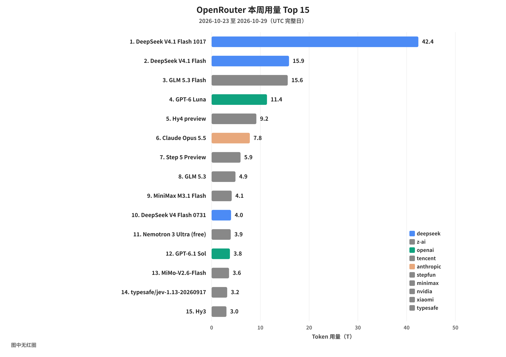
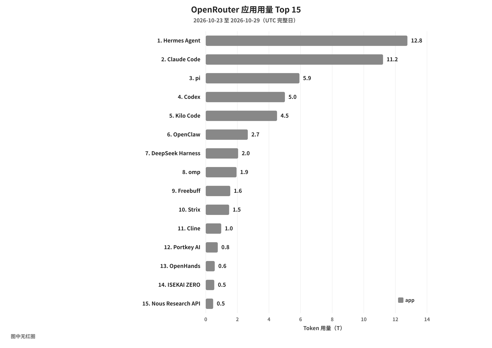

覆盖窗口：2026-10-23 00:00:00 至 2026-10-29 23:59:59（UTC；生成日 2026-10-30，不含当天）。

<!-- provenance
{"rules":{"repo":"VirusPC/edges-brain-viruspc","commit":"f800a6055b75ae4a22859d370a1af9d3cd4fdce8","routine":".edges/routines/weekly-ai-blogs-digest/INDEX.md","skill":"skills/managed/weekly-ai-blogs-digest/SKILL.md"},"data":{"repo":"VirusPC/ai-news-data","commit":"ca169d949f7b1b42cd8a9328923b90077e2507fe","path":"issues/2026-10-30","kind":"tree"}}
-->

## 一、本周关键词

<!-- keywords-cloud
[
  {
    "word": "software factory",
    "kind": "concept",
    "score": 3,
    "mentions": 2,
    "sources": 2,
    "weight": 2.8,
    "theme": true
  },
  {
    "word": "FrontierCode 2.0",
    "kind": "product",
    "score": 4,
    "mentions": 2,
    "sources": 1,
    "weight": 2.2
  },
  {
    "word": "AnyDecisionModel",
    "kind": "product",
    "score": 4,
    "mentions": 1,
    "sources": 1,
    "weight": 1.4
  },
  {
    "word": "AnySpeechRecognizer",
    "kind": "product",
    "score": 4,
    "mentions": 1,
    "sources": 1,
    "weight": 1.4
  },
  {
    "word": "Devin Security 2.0",
    "kind": "product",
    "score": 4,
    "mentions": 1,
    "sources": 1,
    "weight": 1.4
  },
  {
    "word": "GPT-6.1 Terra",
    "kind": "model",
    "score": 5,
    "mentions": 1,
    "sources": 1,
    "weight": 1.4
  },
  {
    "word": "Granite Switch 4.1.1",
    "kind": "model",
    "score": 5,
    "mentions": 1,
    "sources": 1,
    "weight": 1.4
  },
  {
    "word": "Kimi K3.1 Pro",
    "kind": "model",
    "score": 5,
    "mentions": 1,
    "sources": 1,
    "weight": 1.4
  },
  {
    "word": "LFM3",
    "kind": "model",
    "score": 5,
    "mentions": 1,
    "sources": 1,
    "weight": 1.4
  },
  {
    "word": "Lumma-Fev-v2",
    "kind": "model",
    "score": 5,
    "mentions": 1,
    "sources": 1,
    "weight": 1.4
  },
  {
    "word": "Mistral Large 4",
    "kind": "model",
    "score": 5,
    "mentions": 1,
    "sources": 1,
    "weight": 1.4
  },
  {
    "word": "Nemotron 3.5 Transcribe",
    "kind": "model",
    "score": 5,
    "mentions": 1,
    "sources": 1,
    "weight": 1.4
  },
  {
    "word": "Project ProtoStar",
    "kind": "product",
    "score": 4,
    "mentions": 1,
    "sources": 1,
    "weight": 1.4
  },
  {
    "word": "Qwen3-TTS",
    "kind": "model",
    "score": 5,
    "mentions": 1,
    "sources": 1,
    "weight": 1.4
  }
]
-->

## 二、模型进展

### LLM Arena

第一换成 Gemini 4 Carbon (High)。

<!-- chart-meta
榜单发布日 2026-10-28。红圈：Gemini 4 Carbon (High)。
-->

### OpenRouter

用量第一换成 DeepSeek V4.1 Flash 1017。

<!-- chart-meta
图中无红圈。
-->

这是编程场景的 token 用量，不是质量排名。第一换成 DeepSeek V4.1 Flash 1017。

<!-- chart-meta
图中无红圈。
-->

公开应用用量第一换成 Hermes Agent。

<!-- chart-meta
图中无红圈。
-->

#### [GPT-6.1 Terra](https://openai.com/index/introducing-gpt-6-1-terra)

<aside class="info-card">

<svg class="info-card-icon" xmlns="http://www.w3.org/2000/svg" viewBox="0 0 24 24" fill="none" stroke="currentColor" stroke-width="2" stroke-linecap="round" stroke-linejoin="round" aria-hidden="true"><path d="M8 6h13"></path><path d="M8 12h13"></path><path d="M8 18h13"></path><path d="M3 6h.01"></path><path d="M3 12h.01"></path><path d="M3 18h.01"></path></svg>发布要点

<ul>
<li><strong>上线</strong> 10 月 26 日发布。</li>
<li><strong>定位</strong> 这一窗口的新模型。</li>
<li><strong>可用</strong> 标准 API 是每百万 token 输入 <mark class="note-card-hl">1 美元</mark>、缓存输入 0.05 美元、输出 5 美元。价格名次没有写。</li>
</ul>

来源：<a href="https://openai.com/index/introducing-gpt-6-1-terra">Introducing GPT-6.1 Terra</a>

</aside>

#### [Kimi K3.1 Pro](https://mp.weixin.qq.com/s?__biz=MzcwMjM3ODEzOA==&mid=2247487748&idx=1&sn=ceec50327d6be7c1e07203c9306c9ebc)

<aside class="info-card">

<svg class="info-card-icon" xmlns="http://www.w3.org/2000/svg" viewBox="0 0 24 24" fill="none" stroke="currentColor" stroke-width="2" stroke-linecap="round" stroke-linejoin="round" aria-hidden="true"><path d="M8 6h13"></path><path d="M8 12h13"></path><path d="M8 18h13"></path><path d="M3 6h.01"></path><path d="M3 12h.01"></path><path d="M3 18h.01"></path></svg>发布要点

<ul>
<li><strong>上线</strong> 10 月 23 日在 kimi.com、App、Work、Code 和 API 可用。权重说将在 11 月 4 日前公开。</li>
<li><strong>定位</strong> K3.1 系列第一个模型。文中称约 3 万亿参数、100 万上下文，另有输出更快的高速版。</li>
<li><strong>成绩</strong> 代码、3D、金融研究和长程 Agent 被写成提升最大的几项。</li>
<li><strong>可用</strong> 未命中缓存的输入是每百万 token 13 元，输出 68 元。名次没有写。</li>
</ul>

来源：<a href="https://mp.weixin.qq.com/s?__biz=MzcwMjM3ODEzOA==&mid=2247487748&idx=1&sn=ceec50327d6be7c1e07203c9306c9ebc">Kimi K3.1 Pro</a>

</aside>

#### [MiniMax M3.1 Flash 开源权重](https://mp.weixin.qq.com/s?__biz=MzE5MTA3NzcxMQ==&mid=2247489204&idx=1&sn=bc21e172929a366edfe02c720bef9208)

<aside class="info-card">

<svg class="info-card-icon" xmlns="http://www.w3.org/2000/svg" viewBox="0 0 24 24" fill="none" stroke="currentColor" stroke-width="2" stroke-linecap="round" stroke-linejoin="round" aria-hidden="true"><path d="M8 6h13"></path><path d="M8 12h13"></path><path d="M8 18h13"></path><path d="M3 6h.01"></path><path d="M3 12h.01"></path><path d="M3 18h.01"></path></svg>发布要点

<ul>
<li><strong>上线</strong> 10 月 23 日公开权重，总参数 428B，激活 23B。</li>
<li><strong>定位</strong> 上一窗口已经更新的 Flash，这一窗口放出可部署的权重。</li>
<li><strong>成绩</strong> 文中称上线 72 小时真实用户处理超过 <mark class="note-card-hl">100 万亿</mark> token。</li>
<li><strong>可用</strong> 单价和速度名次没有写。</li>
</ul>

来源：<a href="https://mp.weixin.qq.com/s?__biz=MzE5MTA3NzcxMQ==&mid=2247489204&idx=1&sn=bc21e172929a366edfe02c720bef9208">MiniMax M3.1 Flash 开源</a>

</aside>

## 三、项目开源

#### GitHub Trending（weekly / all 前 5）

#### [cloudflare/security-audit-skill](https://github.com/cloudflare/security-audit-skill)

给编码 Agent 用的分阶段安全审计。发现要能被机器再核一遍。

来源里只有这些。

#### [php/php-src](https://github.com/php/php-src)

PHP 解释器本身。

来源里只有这些。

#### [AgriciDaniel/claude-seo](https://github.com/AgriciDaniel/claude-seo)

给 Claude Code 用的 SEO 技能。简介写有 26 个子技能和 19 个子 Agent。

来源里只有这些。

#### [pbakaus/impeccable](https://github.com/pbakaus/impeccable)

给编码 Agent 的设计词表，用来在合入前抓住 AI 味的界面。

来源里只有这些。

#### [multica-ai/andrej-karpathy-skills](https://github.com/multica-ai/andrej-karpathy-skills)

一份从 Karpathy 对 LLM 写代码的观察整理出来的 CLAUDE.md。

来源里只有这些。

## 四、精选文章

### 国内模型厂

#### &lt;模型&gt;&lt;Kimi&gt;[Kimi K3.1 Pro：智能前沿，更进一步](https://mp.weixin.qq.com/s?__biz=MzcwMjM3ODEzOA==&mid=2247487748&idx=1&sn=ceec50327d6be7c1e07203c9306c9ebc)

K3 的后训练版本，高速版输出大约 <mark>2 到 3 倍</mark>，权重还没放出来。

完整总结

<strong>解决什么问题：</strong>长程 Agent、代码和多模态要更强，同时又要一个更快的档。

<strong>如何解决：</strong>加大后训练算力，并改 RL、长上下文、沙箱和调度。高速版保持同一智能、提高输出速度。

<strong>效果怎样：</strong>文中把代码、3D、金融研究和长程 Agent 写成提升最大的几项。完整榜在他们的博客。

<strong>洞察与启发：</strong>先上产品，权重晚几天。

<strong>相关工作：</strong>MiniMax 这一窗口做的是相反的一步：把已经上线的 Flash 权重放开。

#### &lt;开源&gt;&lt;MiniMax&gt;[MiniMax M3.1 Flash 开源](https://mp.weixin.qq.com/s?__biz=MzE5MTA3NzcxMQ==&mid=2247489204&idx=1&sn=bc21e172929a366edfe02c720bef9208)

公开 428B 总参数、23B 激活的权重，并用稀疏注意力和量化把推理再压一截。

完整总结

<strong>解决什么问题：</strong>上一周的能力更新还不能在别人的集群上部署。

<strong>如何解决：</strong>放出权重，把前三层全注意力换成稀疏注意力，专家量化到 W4A4，再按功耗调度算力。

<strong>效果怎样：</strong>文中称 72 小时真实用户处理超过 100 万亿 token。这是他们自己的计数。

<strong>相关工作：</strong>和 Kimi 相反：这边是先有产品，这一窗口补权重。

### 国外模型厂

#### &lt;架构&gt;&lt;Google&gt;[How Gemini 4 Argon upleveled agents on Antigravity](https://antigravity.google/blog/gemini-4-argon-trillion-edge-graphs-and-tpu-kernels)

Argon 被写进 Antigravity 的 Agent，用来处理万亿边的图和定制 TPU kernel。

订阅源里只有这些。

### 国外非模型厂

#### &lt;产品&gt;&lt;Cognition&gt;[Devin Security 2.0](https://devin.ai/blog/devin-security-2)

扫描之后还要能排出该修什么，并自己开出可以审的 PR。

完整总结

<strong>解决什么问题：</strong>漏洞发现变快，并不等于风险下降。

<strong>如何解决：</strong>用前沿模型扫描，按代码、基础设施和威胁模型排序，再把修复变成 PR。

<strong>效果怎样：</strong>文中另有面向企业的额度，用来配 Claude Mythos 做扫描。没有公开的修复率。

<strong>洞察与启发：</strong>安全产品被写成扫描、排序、修复三步，缺一步就不算做完。

<strong>相关工作：</strong>周榜上的 security-audit-skill 做的是审计技能，不是这条托管修复链。

#### &lt;架构&gt;&lt;LangChain&gt;[How We Built Our Design Agent](https://www.langchain.com/blog/design-agent)

设计 Agent 要拿到设计师的原则和反馈理由，并且每条 Slack 线程有自己的沙箱。

完整总结

<strong>解决什么问题：</strong>模型已经能写界面代码，但写出来不像这个团队的设计。

<strong>如何解决：</strong>把设计原则、反 AI 味的约束和反馈理由交给 Agent。每条线程一个沙箱，跨视频、图像和画布，并检查自己的渲染。

<strong>效果怎样：</strong>文中没有给出采纳率。

<strong>洞察与启发：</strong>补模型短板的规则会过期，模型变强之后要删。

<strong>相关工作：</strong>同一周的 OpenWiki 文解决记忆有没有证据；这篇解决品味从哪来。

#### &lt;架构&gt;&lt;LangChain&gt;[Evidence-grounded agent memory with OpenWiki and graphs](https://www.langchain.com/blog/building-agent-memory-openwiki-graphs)

先给 Agent 一份编译好的 wiki，再让引用变成可以顺着走的图。

完整总结

<strong>解决什么问题：</strong>只靠检索，跨来源的问题每次都要重新拼上下文。

<strong>如何解决：</strong>OpenWiki 当记忆层，并把引用做成图上的边。

<strong>效果怎样：</strong>文中写跨来源问题上比只用 grep 准确约 5 倍；加上证据图后，同一证据的引用更稳，准确率再高 27%。这是他们自己的对照。

<strong>洞察与启发：</strong>记忆如果不能回到原文，就只是另一段不可核对的摘要。

<strong>相关工作：</strong>Kiro 上一周的记忆记的是个人偏好；这篇记的是可回溯的领域证据。

#### &lt;架构&gt;&lt;Warp&gt;[7 core components for building a software factory](https://www.warp.dev/blog/7-ways-to-build-a-software-factory)

软件工厂被定义成把大家的 Agent <mark>收成同一套</mark>，而不是每人一份本机配置。

完整总结

<strong>解决什么问题：</strong>Agent 的跑法如果停在个人电脑上，安全和效果都没法当团队系统来改。

<strong>如何解决：</strong>像约定 CI 一样约定 Agent 怎么跑，把定义放在一处。

<strong>效果怎样：</strong>文中列的收益是安全管理、ROI 和团队一起改效率，没有统一的加速比。

<strong>洞察与启发：</strong>工厂是运行约定，不是再买一个编码插件。

<strong>相关工作：</strong>词云里的 software factory 来自这篇和 Kiro 那篇同时出现。

#### &lt;架构&gt;&lt;AWS&gt;[Keeping a software factory stable at 1,000 PRs a week](https://kiro.dev/blog/software-factory-stability)

同一套工厂要在每周大约一千个 PR 的量级上还稳得住。

订阅源里只有这些。

#### &lt;实践&gt;&lt;lucumr&gt;[Custom voices with Qwen3-TTS](https://lucumr.pocoo.org/2026/10/29/qwen3-custom-voices/)

用 Qwen3-TTS 的声纹向量做旁白，避开每家都一样的默认音色。

完整总结

<strong>解决什么问题：</strong>做游戏旁白时，不想用所有人都在用的那套合成声。

<strong>如何解决：</strong>选用带 voice embedding 的 Qwen3-TTS，并记下实际能调出的用法。

<strong>效果怎样：</strong>这是一篇用法笔记，没有评测表。

<strong>相关工作：</strong>词云里的 Qwen3-TTS 就是这篇在讲的模型，不是新的权重发布。

## 五、精选推文

## 六、精选播客
