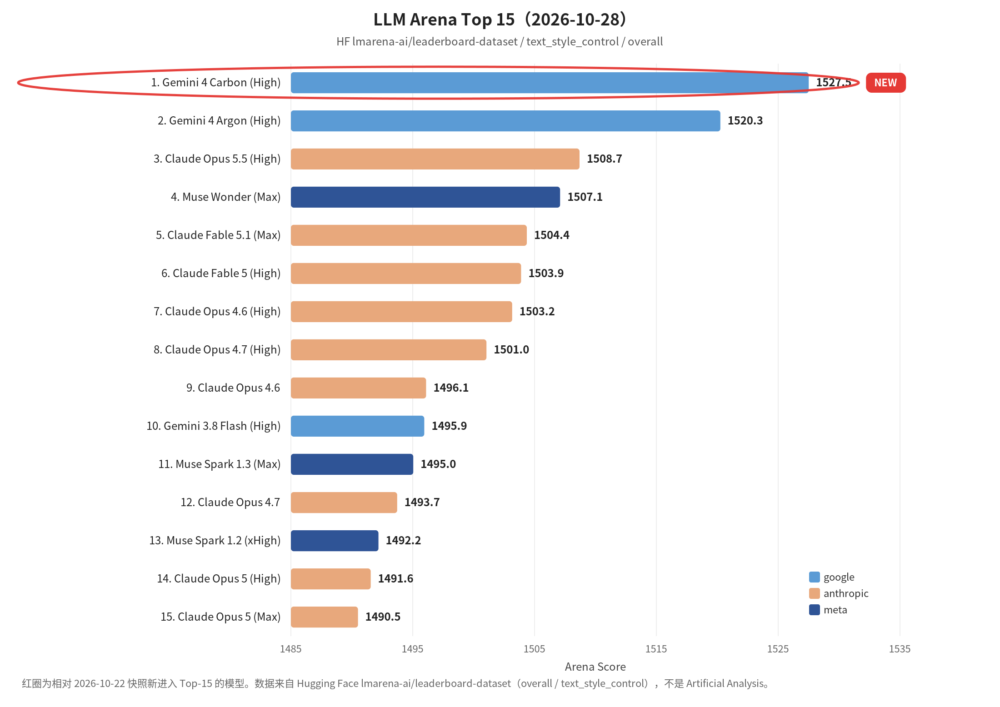
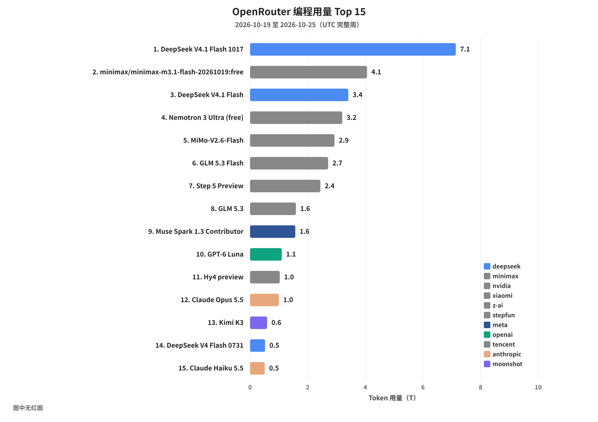

覆盖窗口：2026-10-23 00:00:00 至 2026-10-29 23:59:59（UTC；生成日 2026-10-30，不含当天）。

<!-- provenance
{"rules":{"repo":"VirusPC/edges-brain-viruspc","commit":"f800a6055b75ae4a22859d370a1af9d3cd4fdce8","routine":".edges/routines/weekly-ai-blogs-digest/INDEX.md","skill":"skills/managed/weekly-ai-blogs-digest/SKILL.md"},"data":{"repo":"VirusPC/ai-news-data","commit":"ca169d949f7b1b42cd8a9328923b90077e2507fe","path":"issues/2026-10-30","kind":"tree"}}
-->

## 一、本周关键词

<!-- keywords-cloud
[
  {
    "word": "software factory",
    "kind": "concept",
    "score": 3,
    "mentions": 2,
    "sources": 2,
    "weight": 2.8,
    "theme": true
  },
  {
    "word": "FrontierCode 2.0",
    "kind": "product",
    "score": 4,
    "mentions": 2,
    "sources": 1,
    "weight": 2.2
  },
  {
    "word": "AnyDecisionModel",
    "kind": "product",
    "score": 4,
    "mentions": 1,
    "sources": 1,
    "weight": 1.4
  },
  {
    "word": "AnySpeechRecognizer",
    "kind": "product",
    "score": 4,
    "mentions": 1,
    "sources": 1,
    "weight": 1.4
  },
  {
    "word": "Devin Security 2.0",
    "kind": "product",
    "score": 4,
    "mentions": 1,
    "sources": 1,
    "weight": 1.4
  },
  {
    "word": "GPT-6.1 Terra",
    "kind": "model",
    "score": 5,
    "mentions": 1,
    "sources": 1,
    "weight": 1.4
  },
  {
    "word": "Granite Switch 4.1.1",
    "kind": "model",
    "score": 5,
    "mentions": 1,
    "sources": 1,
    "weight": 1.4
  },
  {
    "word": "Kimi K3.1 Pro",
    "kind": "model",
    "score": 5,
    "mentions": 1,
    "sources": 1,
    "weight": 1.4
  },
  {
    "word": "LFM3",
    "kind": "model",
    "score": 5,
    "mentions": 1,
    "sources": 1,
    "weight": 1.4
  },
  {
    "word": "Lumma-Fev-v2",
    "kind": "model",
    "score": 5,
    "mentions": 1,
    "sources": 1,
    "weight": 1.4
  },
  {
    "word": "Mistral Large 4",
    "kind": "model",
    "score": 5,
    "mentions": 1,
    "sources": 1,
    "weight": 1.4
  },
  {
    "word": "Nemotron 3.5 Transcribe",
    "kind": "model",
    "score": 5,
    "mentions": 1,
    "sources": 1,
    "weight": 1.4
  },
  {
    "word": "Project ProtoStar",
    "kind": "product",
    "score": 4,
    "mentions": 1,
    "sources": 1,
    "weight": 1.4
  },
  {
    "word": "Qwen3-TTS",
    "kind": "model",
    "score": 5,
    "mentions": 1,
    "sources": 1,
    "weight": 1.4
  }
]
-->

## 二、模型进展

### LLM Arena

第一换成 Gemini 4 Carbon (High)。

<!-- chart-meta
榜单发布日 2026-10-28。红圈：Gemini 4 Carbon (High)。
-->

### OpenRouter

用量第一换成 DeepSeek V4.1 Flash 1017。

<!-- chart-meta
图中无红圈。
-->

这是编程场景的 token 用量，不是质量排名。第一换成 DeepSeek V4.1 Flash 1017。

<!-- chart-meta
图中无红圈。
-->

公开应用用量第一换成 Hermes Agent。

<!-- chart-meta
图中无红圈。
-->

#### [GPT-6.1 Terra](https://openai.com/index/introducing-gpt-6-1-terra)

<aside class="info-card">

<svg class="info-card-icon" xmlns="http://www.w3.org/2000/svg" viewBox="0 0 24 24" fill="none" stroke="currentColor" stroke-width="2" stroke-linecap="round" stroke-linejoin="round" aria-hidden="true"><path d="M8 6h13"></path><path d="M8 12h13"></path><path d="M8 18h13"></path><path d="M3 6h.01"></path><path d="M3 12h.01"></path><path d="M3 18h.01"></path></svg>发布要点

<ul>
<li><strong>上线</strong> 10 月 26 日发布。</li>
<li><strong>定位</strong> 这一窗口的新模型。</li>
<li><strong>可用</strong> 标准 API 是每百万 token 输入 <mark class="note-card-hl">1 美元</mark>、缓存输入 0.05 美元、输出 5 美元。价格名次没有写。</li>
</ul>

来源：<a href="https://openai.com/index/introducing-gpt-6-1-terra">Introducing GPT-6.1 Terra</a>

</aside>

#### [Kimi K3.1 Pro](https://mp.weixin.qq.com/s?__biz=MzcwMjM3ODEzOA==&mid=2247487748&idx=1&sn=ceec50327d6be7c1e07203c9306c9ebc)

<aside class="info-card">

<svg class="info-card-icon" xmlns="http://www.w3.org/2000/svg" viewBox="0 0 24 24" fill="none" stroke="currentColor" stroke-width="2" stroke-linecap="round" stroke-linejoin="round" aria-hidden="true"><path d="M8 6h13"></path><path d="M8 12h13"></path><path d="M8 18h13"></path><path d="M3 6h.01"></path><path d="M3 12h.01"></path><path d="M3 18h.01"></path></svg>发布要点

<ul>
<li><strong>上线</strong> 10 月 23 日在 kimi.com、App、Work、Code 和 API 可用。权重说将在 11 月 4 日前公开。</li>
<li><strong>定位</strong> K3.1 系列第一个模型。文中称约 3 万亿参数、100 万上下文，另有输出更快的高速版。</li>
<li><strong>成绩</strong> 代码、3D、金融研究和长程 Agent 被写成提升最大的几项。</li>
<li><strong>可用</strong> 未命中缓存的输入是每百万 token 13 元，输出 68 元。名次没有写。</li>
</ul>

来源：<a href="https://mp.weixin.qq.com/s?__biz=MzcwMjM3ODEzOA==&mid=2247487748&idx=1&sn=ceec50327d6be7c1e07203c9306c9ebc">Kimi K3.1 Pro</a>

</aside>

#### [MiniMax M3.1 Flash 开源权重](https://mp.weixin.qq.com/s?__biz=MzE5MTA3NzcxMQ==&mid=2247489204&idx=1&sn=bc21e172929a366edfe02c720bef9208)

<aside class="info-card">

<svg class="info-card-icon" xmlns="http://www.w3.org/2000/svg" viewBox="0 0 24 24" fill="none" stroke="currentColor" stroke-width="2" stroke-linecap="round" stroke-linejoin="round" aria-hidden="true"><path d="M8 6h13"></path><path d="M8 12h13"></path><path d="M8 18h13"></path><path d="M3 6h.01"></path><path d="M3 12h.01"></path><path d="M3 18h.01"></path></svg>发布要点

<ul>
<li><strong>上线</strong> 10 月 23 日公开权重，总参数 428B，激活 23B。</li>
<li><strong>定位</strong> 上一窗口已经更新的 Flash，这一窗口放出可部署的权重。</li>
<li><strong>成绩</strong> 文中称上线 72 小时真实用户处理超过 <mark class="note-card-hl">100 万亿</mark> token。</li>
<li><strong>可用</strong> 单价和速度名次没有写。</li>
</ul>

来源：<a href="https://mp.weixin.qq.com/s?__biz=MzE5MTA3NzcxMQ==&mid=2247489204&idx=1&sn=bc21e172929a366edfe02c720bef9208">MiniMax M3.1 Flash 开源</a>

</aside>

## 三、项目开源

#### GitHub Trending（weekly / all 前 5）

#### [cloudflare/security-audit-skill](https://github.com/cloudflare/security-audit-skill)

给编码 Agent 用的分阶段安全审计。发现要能被机器再核一遍。

来源里只有这些。

#### [php/php-src](https://github.com/php/php-src)

PHP 解释器本身。

来源里只有这些。

#### [AgriciDaniel/claude-seo](https://github.com/AgriciDaniel/claude-seo)

给 Claude Code 用的 SEO 技能。简介写有 26 个子技能和 19 个子 Agent。

来源里只有这些。

#### [pbakaus/impeccable](https://github.com/pbakaus/impeccable)

给编码 Agent 的设计词表，用来在合入前抓住 AI 味的界面。

来源里只有这些。

#### [multica-ai/andrej-karpathy-skills](https://github.com/multica-ai/andrej-karpathy-skills)

一份从 Karpathy 对 LLM 写代码的观察整理出来的 CLAUDE.md。

来源里只有这些。

## 四、精选文章

### 国内模型厂

#### &lt;模型&gt;&lt;Kimi&gt;[Kimi K3.1 Pro：智能前沿，更进一步](https://mp.weixin.qq.com/s?__biz=MzcwMjM3ODEzOA==&mid=2247487748&idx=1&sn=ceec50327d6be7c1e07203c9306c9ebc)

K3 的后训练版本，高速版输出大约 <mark>2 到 3 倍</mark>，权重还没放出来。

完整总结

<strong>解决什么问题：</strong>长程 Agent、代码和多模态要更强，同时又要一个更快的档。

<strong>如何解决：</strong>加大后训练算力，并改 RL、长上下文、沙箱和调度。高速版保持同一智能、提高输出速度。

<strong>效果怎样：</strong>文中把代码、3D、金融研究和长程 Agent 写成提升最大的几项。完整榜在他们的博客。

<strong>洞察与启发：</strong>先上产品，权重晚几天。

<strong>相关工作：</strong>MiniMax 这一窗口做的是相反的一步：把已经上线的 Flash 权重放开。

#### &lt;开源&gt;&lt;MiniMax&gt;[MiniMax M3.1 Flash 开源](https://mp.weixin.qq.com/s?__biz=MzE5MTA3NzcxMQ==&mid=2247489204&idx=1&sn=bc21e172929a366edfe02c720bef9208)

公开 428B 总参数、23B 激活的权重，并用稀疏注意力和量化把推理再压一截。

完整总结

<strong>解决什么问题：</strong>上一周的能力更新还不能在别人的集群上部署。

<strong>如何解决：</strong>放出权重，把前三层全注意力换成稀疏注意力，专家量化到 W4A4，再按功耗调度算力。

<strong>效果怎样：</strong>文中称 72 小时真实用户处理超过 100 万亿 token。这是他们自己的计数。

<strong>相关工作：</strong>和 Kimi 相反：这边是先有产品，这一窗口补权重。

### 国外模型厂

#### &lt;产品&gt;&lt;OpenAI&gt;[OpenAI and ServiceNow expand partnership across enterprise workflows](https://openai.com/index/openai-servicenow-partnership-expansion)

ChatGPT 接到自己的 ServiceNow 实例之后，可以在<mark>同一段对话</mark>里查类似事件、评估变更风险，并改一条记录。

完整总结

<strong>解决什么问题：</strong>查事故和处理下一步原来要离开对话，进到另一套系统。

<strong>如何解决：</strong>客户选择开放哪些能力。Action Fabric 沿用实例里已有的业务规则和权限。值班工程师可以在 ChatGPT 里看关联告警、最近变更和受影响的服务，再分给对应的团队。MCP 插件已经在 OpenAI 市场。Codex 进 AI Workflow Factory、联合安全和语音评估还在计划里。

<strong>效果怎样：</strong>文中没有给出处理时长。语音预计 2027 年一季度，安全能力预计 2027 年 1 月早期访问。

<strong>洞察与启发：</strong>能做的动作取决于这家公司已经配好的权限，不是模型自己决定。

<strong>相关工作：</strong>Oracle 那篇把应用和数据接进 ChatGPT。这篇把事故处理的下一步写进了同一段对话。

#### &lt;产品&gt;&lt;OpenAI&gt;[OpenAI expands partnership with Oracle to bring its apps to ChatGPT](https://openai.com/index/oracle-apps-in-chatgpt)

Oracle 把应用、数据和一批用 OpenAI 模型做的新产品接进 ChatGPT，<mark>权限</mark>仍按每家公司自己的审批。

完整总结

<strong>解决什么问题：</strong>业务系统里的操作进不了正在用的对话。

<strong>如何解决：</strong>Oracle AI Workspace 打算让人在 ChatGPT 里查成本、采购和月结还缺什么。AI Security Mesh 用 OpenAI 的安全模型在客户授权范围内找漏洞，测试环境由 Oracle 管。App Composer 用 Codex 做应用，连到获准的数据和流程，部署在 OCI，带公司自己的权限。美国客户可以在 Oracle Marketplace 用已有采购流程买 API、Codex 和 ChatGPT Work。

<strong>效果怎样：</strong>文中称 Oracle 有 13 万活跃 ChatGPT 用户、超过 9.5 万活跃 Codex 用户。招聘团队用 ChatGPT Work 做市场研究，准备时间从两到四天变成 15 到 20 分钟。这是 Oracle 报的数。

<strong>洞察与启发：</strong>已经能买到的是市场里的账号和接口。Workspace、安全网格和 Composer 写的是要做的产品，不是已经全部上线的成绩。

<strong>相关工作：</strong>ServiceNow 那篇写的是事故记录怎么在对话里改。这篇是 Oracle 自己的应用和权限怎么接进来。

#### &lt;架构&gt;&lt;Google&gt;[How Gemini 4 Argon upleveled agents on Antigravity](https://antigravity.google/blog/gemini-4-argon-trillion-edge-graphs-and-tpu-kernels)

Argon 被写进 Antigravity 的 Agent，用来处理万亿边的图和定制 TPU kernel。

订阅源里只有这些。

#### &lt;产品&gt;&lt;Google&gt;[Plugin Marketplace in Antigravity](https://antigravity.google/blog/plugin-marketplace-in-antigravity)

Antigravity 把 MCP、环境变量、技能和子 Agent 收成可以点一下安装的<mark>插件包</mark>。

完整总结

<strong>解决什么问题：</strong>接外部系统要在每个仓库里手工配这些东西。

<strong>如何解决：</strong>Plugin Marketplace 在 App 和 CLI 里提供目录。插件是带 plugin.json 的版本化包。终端用 agy plugin install。

<strong>效果怎样：</strong>文中没有安装耗时。当天开始在 App 和 CLI 铺开。

<strong>洞察与启发：</strong>验证过的包替代散落的配置，权限范围跟着包走。

<strong>相关工作：</strong>Argon 那篇是模型如何抬高 Antigravity 里的 Agent。这篇是 Agent 怎么接到团队已经在用的系统。

### 国内非模型厂

#### &lt;实践&gt;&lt;阿里&gt;[天猫数字员工（效能篇）](https://mp.weixin.qq.com/s?__biz=MzAxNDEwNjk5OQ==&mid=2650546616&idx=1&sn=6de3cd4134e01fc868640284f93f0eac)

编码环节已经少用人，交付周期却没缩短那么多，时间耗在<mark>轮次交接</mark>。

完整总结

<strong>解决什么问题：</strong>数字员工做完一轮，接手的人可能正在别的需求上。

<strong>如何解决：</strong>产物标准化和质量门禁让能自动接上的环节自己走。还要人判断的地方，用卡点私聊、群里补上下文和个人日报去推。入口在钉钉场景群。

<strong>效果怎样：</strong>文中称已在天猫技术全部业务线推广，月均活跃需求交付 100 条以上。这是他们自己的计数。

<strong>洞察与启发：</strong>评估单元从阶段改成轮，才能看见每次交付之后的等待。

<strong>相关工作：</strong>快手上一周把度量放到组织。这篇把等待定位到交接。

#### &lt;实践&gt;&lt;腾讯&gt;[你的 Personal Agent 如何真正跑起来](https://mp.weixin.qq.com/s?__biz=MjM5ODYwMjI2MA==&mid=2649804831&idx=1&sn=bcfae266ff83331edd3f2a72643592d3)

分身要能在电脑和手机上接着上次做。背景、取舍和没做完的事放进同一个仓库，近期状态另记一份叫 <mark>live</mark>。

完整总结

<strong>解决什么问题：</strong>离开电脑再回来，原来的会话往往只剩一个简略结论，另一台设备上的分身也不知道刚才否定了什么。

<strong>如何解决：</strong>电脑前可以讨论、改文件、跑实验；离开后从企微或 HTalk 继续。稳定的背景和重点放在 USER，冲突时更在意什么放在 SOUL，具体任务写成 SOP 或 Skill。各分身把刚处理了什么、哪里没结束写进 live。作者还用一句「洗澡时刻」让分身先找最近工作之间没连上的关系，而不是赶着交付。

<strong>效果怎样：</strong>这是个人用法，没有对照实验。

<strong>洞察与启发：</strong>几个分身都同意，也可能是读了同一份有问题的摘要。还在讨论的推断不能先写成已经确认的结论。

<strong>相关工作：</strong>Kiro 记的是 IDE 里的偏好。这篇把未完成的判断留给下一台设备上的分身。

#### &lt;实践&gt;&lt;美团&gt;[如何在“不能出错”的系统里使用 AI Coding](https://tech.meituan.com/2026/10/29/AI-Coding-IN-Distributed-Storage-System.html)

分布式存储里 AI 写得更快，缺陷率哪怕持平，一个版本里的缺陷<mark>绝对数</mark>仍会涨。

完整总结

<strong>解决什么问题：</strong>一致性、恢复和性能经不起局部改动，出了问题影响的是上层数据。

<strong>如何解决：</strong>评审、测试、调试和受控自动化一起建。评审能看见跨文件的名字对不上，例如 ENABLE_UNITTEST 在 CMake 迁移里被换成 WITH_UNITTEST。设计背景仍要人判断。

<strong>效果怎样：</strong>文中没有给出缺陷率下降的总数字。

<strong>洞察与启发：</strong>目标不是多写代码，是让代码和结论经得起验证。

<strong>相关工作：</strong>好看视频用用例证明迁移。这篇用评审和验证守住不能出错的系统。

#### &lt;实践&gt;&lt;百度&gt;[好看视频鸿蒙端AI研发交付流程的建设思考与实践](https://mp.weixin.qq.com/s?__biz=Mzg5MjU0NTI5OQ==&mid=2247607730&idx=1&sn=f7ae4efd3270278f46340fc01e4abab9)

鸿蒙迁移没有文档基线，得从源码里自己界定行为，再用四条标准证明<mark>迁对了</mark>。

完整总结

<strong>解决什么问题：</strong>AI 写得更快之后，识别全部行为、核对源端、验证表现仍靠个人记得住。

<strong>如何解决：</strong>标准是完整、正确、可验证、可持续。做法是行为建模、语义映射、分层测试，加上状态落盘和迁移飞轮。

<strong>效果怎样：</strong>文中用「随听频道」验证：52 个行为点、65 条用例。

<strong>洞察与启发：</strong>迁移的对象是行为，源码只是还原行为的依据。

<strong>相关工作：</strong>天猫那篇把等待从阶段改成轮。这篇把迁对了从个人经验改成用例。

### 国外非模型厂

#### &lt;其他&gt;&lt;Cursor&gt;[Security notice — malicious Claude Code extension](https://cursor.com/blog/claude-code-extension-security-notice)

Cursor 扩展市场里 Anthropic.claude-code 的 2.1.312 和 2.1.313 被换成恶意包，会尝试装 <mark>SSH 后门</mark>。

完整总结

<strong>解决什么问题：</strong>这两个版本不是 Anthropic 发的，Windows 和 macOS 都有。

<strong>如何解决：</strong>公告写明大约从当天 2:27 到 13:35（太平洋时间）可被下载。包会收集主机名、用户名、系统、Git 邮箱和公网 IP，并尝试写入攻击者控制的 SSH 后门。

<strong>效果怎样：</strong>文中称不影响从 cursor.com/marketplace 下载的其他扩展，也不影响 Grok Bot、Grok 和其他 SpaceXSI 产品。

<strong>洞察与启发：</strong>扩展市场本身成了供应链入口。

<strong>相关工作：</strong>Devin Security 2.0 在找仓库里的漏洞。这篇是分发渠道被掉包。

#### &lt;产品&gt;&lt;Cognition&gt;[Devin Security 2.0](https://devin.ai/blog/devin-security-2)

扫描之后还要能排出该修什么，并自己开出可以审的 PR。

完整总结

<strong>解决什么问题：</strong>漏洞发现变快，并不等于风险下降。

<strong>如何解决：</strong>用前沿模型扫描，按代码、基础设施和威胁模型排序，再把修复变成 PR。

<strong>效果怎样：</strong>文中另有面向企业的额度，用来配 Claude Mythos 做扫描。没有公开的修复率。

<strong>洞察与启发：</strong>安全产品被写成扫描、排序、修复三步，缺一步就不算做完。

<strong>相关工作：</strong>周榜上的 security-audit-skill 做的是审计技能，不是这条托管修复链。

#### &lt;产品&gt;&lt;Amp&gt;[macOS Satellites](https://ampcode.com/news/macos-satellites)

线程仍在 Linux orb 上，另外挂一台 <mark>Mac</mark>，让 Amp 编译、测试并操作 iOS 和 Mac 应用。

完整总结

<strong>解决什么问题：</strong>orb 是 Linux，做不了要在 Mac 上编译和点按的应用。

<strong>如何解决：</strong>Mac 作为第二台机器接到 orb。Amp 可以自己拉起 Mac，跑构建，并在设备上检查。

<strong>效果怎样：</strong>文中用自己的线程举例，没有时长数字。

<strong>洞察与启发：</strong>计算还在 orb，能看见屏幕的那台机器是另接的。

<strong>相关工作：</strong>上一周的自托管 orb 决定机器在谁的机房。这篇是再接一台 Mac。

#### &lt;产品&gt;&lt;Amp&gt;[Amp on Android](https://ampcode.com/news/amp-on-android)

Amp 有了 <mark>Android</mark> 应用，线程、Portals 和变更可以在手机上看。

订阅源里只有这些。

#### &lt;产品&gt;&lt;Amp&gt;[Visualize this](https://ampcode.com/news/visualize-this)

可以让 Amp 在线程里直接画出图表、时间线和能点的<mark>草图</mark>。

完整总结

<strong>解决什么问题：</strong>要看一张图或一个草图时，还得离开正在写代码的线程。

<strong>如何解决：</strong>在同一条线程里生成图表、时间线、示意图和可点击的草图。

<strong>效果怎样：</strong>文中的例子要打开原页才能点。没有生成耗时。

<strong>洞察与启发：</strong>可视化被放进线程，而不是另开一个画图工具。

<strong>相关工作：</strong>macOS Satellites 解决的是要在 Mac 上跑的应用。这篇是线程里就能看见的图。

#### &lt;产品&gt;&lt;Amp&gt;[Personal self-hosted orbs](https://ampcode.com/news/personal-self-hosted-orbs)

个人设置里也能加<mark>自托管</mark> orb provider，不必先当工作区管理员。

订阅源里只有这些。

#### &lt;架构&gt;&lt;LangChain&gt;[How We Built Our Design Agent](https://www.langchain.com/blog/design-agent)

设计 Agent 要拿到设计师的原则和反馈理由，并且每条 Slack 线程有自己的沙箱。

完整总结

<strong>解决什么问题：</strong>模型已经能写界面代码，但写出来不像这个团队的设计。

<strong>如何解决：</strong>把设计原则、反 AI 味的约束和反馈理由交给 Agent。每条线程一个沙箱，跨视频、图像和画布，并检查自己的渲染。

<strong>效果怎样：</strong>文中没有给出采纳率。

<strong>洞察与启发：</strong>补模型短板的规则会过期，模型变强之后要删。

<strong>相关工作：</strong>同一周的 OpenWiki 文解决记忆有没有证据；这篇解决品味从哪来。

#### &lt;架构&gt;&lt;LangChain&gt;[Evidence-grounded agent memory with OpenWiki and graphs](https://www.langchain.com/blog/building-agent-memory-openwiki-graphs)

先给 Agent 一份编译好的 wiki，再让引用变成可以顺着走的图。

完整总结

<strong>解决什么问题：</strong>只靠检索，跨来源的问题每次都要重新拼上下文。

<strong>如何解决：</strong>OpenWiki 当记忆层，并把引用做成图上的边。

<strong>效果怎样：</strong>文中写跨来源问题上比只用 grep 准确约 5 倍；加上证据图后，同一证据的引用更稳，准确率再高 27%。这是他们自己的对照。

<strong>洞察与启发：</strong>记忆如果不能回到原文，就只是另一段不可核对的摘要。

<strong>相关工作：</strong>Kiro 上一周的记忆记的是个人偏好；这篇记的是可回溯的领域证据。

#### &lt;架构&gt;&lt;Warp&gt;[7 core components for building a software factory](https://www.warp.dev/blog/7-ways-to-build-a-software-factory)

软件工厂被定义成把大家的 Agent <mark>收成同一套</mark>，而不是每人一份本机配置。

完整总结

<strong>解决什么问题：</strong>Agent 的跑法如果停在个人电脑上，安全和效果都没法当团队系统来改。

<strong>如何解决：</strong>像约定 CI 一样约定 Agent 怎么跑，把定义放在一处。

<strong>效果怎样：</strong>文中列的收益是安全管理、ROI 和团队一起改效率，没有统一的加速比。

<strong>洞察与启发：</strong>工厂是运行约定，不是再买一个编码插件。

<strong>相关工作：</strong>词云里的 software factory 来自这篇和 Kiro 那篇同时出现。

#### &lt;架构&gt;&lt;AWS&gt;[Keeping a software factory stable at 1,000 PRs a week](https://kiro.dev/blog/software-factory-stability)

同一套工厂要在每周大约一千个 PR 的量级上还稳得住。

订阅源里只有这些。

#### &lt;产品&gt;&lt;CodeRabbit&gt;[CodeRabbit Secure now hunts across repos](https://coderabbit.ai/blog/coderabbit-secure-cross-repository-security)

Deep Scan 可以顺着<mark>关联仓库</mark>追一条风险，不再停在单个仓库的合并点。

完整总结

<strong>解决什么问题：</strong>漏洞从公开到被利用的窗口变短，攻击方也在用 Agent。

<strong>如何解决：</strong>CodeRabbit Secure 的 Deep Scan 跨关联仓库追风险，并且不把检查停在合并当时。

<strong>效果怎样：</strong>文中的更新说明原先的一百万美元活动已结束。没有新的检出率。

<strong>洞察与启发：</strong>防御被写成和攻击一样，要能跨仓库追，而不是等合并前的一次扫描。

<strong>相关工作：</strong>恶意扩展那篇是分发渠道。这篇是已提交代码里的跨仓风险。

#### &lt;产品&gt;&lt;CodeRabbit&gt;[Why it’s time to fight AI with AI](https://coderabbit.ai/blog/fighting-ai-with-ai)

单函数和依赖扫描都过了，漏洞仍可能藏在整条流程的<mark>假设</mark>里。

完整总结

<strong>解决什么问题：</strong>测试、补丁和每次 PR 的扫描会漏掉只有把流程走完才看得见的问题。

<strong>如何解决：</strong>Deep Scan 读不熟悉的代码，顺着路径追作者的假设，独立核对自己的发现，再把证据交给开发者。

<strong>效果怎样：</strong>文中没有检出率。更新说明里的额度活动已经结束。

<strong>洞察与启发：</strong>攻击方也能把模型对准多年没人碰的代码。

<strong>相关工作：</strong>跨仓那篇把追击范围扩到别的仓库。这篇说单仓库里也要顺着流程追。

#### &lt;实践&gt;&lt;lucumr&gt;[Custom voices with Qwen3-TTS](https://lucumr.pocoo.org/2026/10/29/qwen3-custom-voices/)

用 Qwen3-TTS 的声纹向量做旁白，避开每家都一样的默认音色。

完整总结

<strong>解决什么问题：</strong>做游戏旁白时，不想用所有人都在用的那套合成声。

<strong>如何解决：</strong>选用带 voice embedding 的 Qwen3-TTS，并记下实际能调出的用法。

<strong>效果怎样：</strong>这是一篇用法笔记，没有评测表。

<strong>相关工作：</strong>词云里的 Qwen3-TTS 就是这篇在讲的模型，不是新的权重发布。

## 五、精选推文

## 六、精选播客
