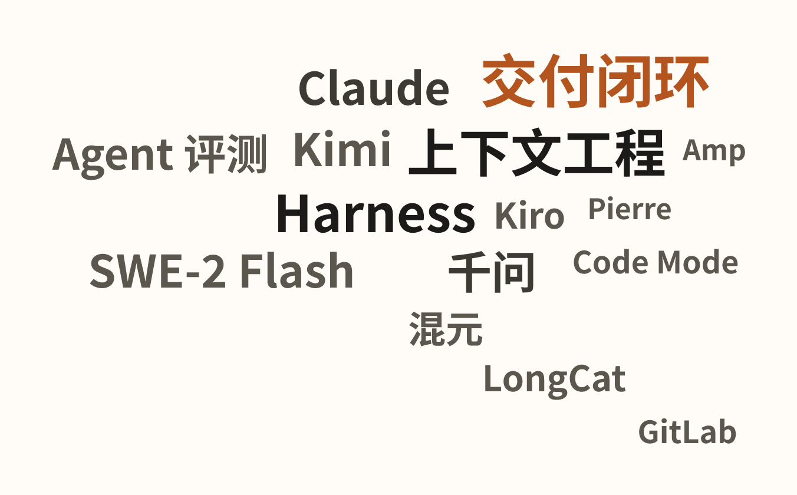
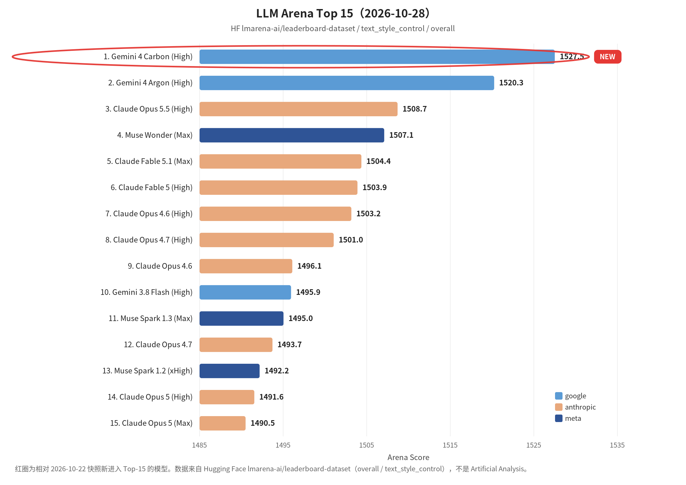

覆盖窗口：2026-10-30～2026-11-05（生成日 2026-11-06）。

## 〇、薅羊毛

#### [Kiroween 黑客松：报名可领约 4000 积分](https://kiroween.devpost.com)

万圣节黑客松活动，报名参赛可领约 4000 积分（社区反馈需 KYC、审核约 2 个工作日）；12 月 1 日前申请，积分有效期至 12 月 31 日。以官方 Devpost 页面为准。 [社区帖](https://linux.do/t/topic/3101137)

#### [Zed：学生认证一年会员，每月约 $10 额度](https://zed.dev/education)

`.edu.cn` 实测可认证；需注册超过 30 天的 GitHub 账号。月额度约 10 美元 token，可用于多款模型。 [社区帖](https://linux.do/t/topic/3101117)

#### [BOTKEEP：3 个月免费托管](https://linux.do/t/topic/3102454)

限时 0 欧元领 3 个月 Bot / 应用 / 静态站托管，无需绑卡；约 3 个服务席位，支持 Node.js、Python 等。

 

## 一、本周关键词

交付闭环：OpenAI 收购 Pierre，Amp 接入 GitLab

<!-- keywords-cloud
[
  {"word":"交付闭环","score":5,"mentions":2,"sources":2,"weight":4.1},
  {"word":"上下文工程","score":5,"mentions":1,"sources":1,"weight":3.6},
  {"word":"Harness","score":4,"mentions":2,"sources":2,"weight":3.5},
  {"word":"千问","score":4,"mentions":1,"sources":1,"weight":3.0},
  {"word":"SWE-2 Flash","score":4,"mentions":1,"sources":1,"weight":3.0},
  {"word":"Claude","score":4,"mentions":1,"sources":1,"weight":3.0},
  {"word":"Kimi","score":4,"mentions":1,"sources":1,"weight":3.0},
  {"word":"Agent 评测","weight":2.8},
  {"word":"混元","score":3,"mentions":1,"sources":1,"weight":2.4},
  {"word":"Kiro","weight":2.2},
  {"word":"LongCat","weight":2.2},
  {"word":"GitLab","weight":1.8},
  {"word":"Code Mode","weight":1.8},
  {"word":"Pierre","weight":1.6},
  {"word":"Amp","weight":1.6}
]
-->

上下文工程分层、Claude 消息线程、Code Mode

Kimi Hosted Agents（Harness as a Service）、Kiro Crew Bots

SWE-2 Flash、混元 Hy4、LongCat-2.5

千问接入 Apple 智能、Agent 评测如何上生产

 

## 二、模型进展

#### 整体排名

较上周无新榜。榜单发布日 2026-10-28。红圈：Gemini 4 Carbon (High)。

#### [SWE-2 Flash](https://cognition.ai/blog/swe-2-flash)

Cognition 发布更快的编码模型 SWE-2 Flash，称在多项评测上表现接近更大模型；当期对 Devin 的 Pro / Max / Teams 用户有限期免费。基座表述为 Thinking Machines 的 Inkling-Small。选型时应看官方博文与本仓库回归，而不是只看宣传分。

#### [腾讯混元 Hy4](https://mp.weixin.qq.com/s?__biz=MjM5ODYwMjI2MA==&mid=2649808030&idx=1&sn=b1a1332f38f89c2d4cc91899900ddf33)

腾讯混元发布 Hy4，文中称其首次进入最强开源模型之列。国内开源主力又多一个可对比的选项，编码与 Agent 场景需单独复测。

#### [美团 LongCat-2.5](https://tech.meituan.com/2026/11/02/Meituan-LongCat-2.5.html)

美团发布 LongCat-2.5，定位为面向智能体任务的原生多模态模型。可与同窗口的混元 Hy4、SWE-2 Flash 一并纳入 Agent 任务对比，而不是只看聊天榜。

#### [Gemini Omni 1.2 Flash](https://blog.google/innovation-and-ai/technology/developers-tools/introducing-gemini-omni-1-2-flash/)

Google 发布更偏速度与成本的 Omni 1.2 Flash，并加长可处理片段。适合对延迟和价格敏感的多模态管线，先做小流量对照再决定是否替换。

#### 其他短讯

- **[OpenAI Images 2.6](https://openai.com/index/introducing-images-2-6)**：图像生成更新。
- **[Phonon TTS](https://huggingface.co/blog/phonon-tts)**（Gradium）：端侧高质量语音合成，体积较小，许可需单独核对。

 

## 三、项目开源

#### [CWE-bench v2](https://huggingface.co/blog/cwe-bench)

Hugging Face 介绍 CWE-bench v2：更高覆盖、质量和透明度的漏洞评测，适合安全 Agent 与代码审查模型做可复现对比。

#### [Palette：按设计语言生成演示文稿](https://huggingface.co/blog/ibm-research/palette-deck-building)

IBM Research 用较小模型学习团队的设计语言并生成幻灯片，是「小模型 + 强约束工作流」的一个具体例子。

#### [Transformers Model Integration Contracts](https://huggingface.co/blog/transformers-mic)

Hugging Face 为 Transformers 模型接入约定提供更明确的合同式说明，降低把新模型接进现有推理栈时的接口摩擦。

#### [Dharma Field Extractor](https://huggingface.co/blog/Dharma-AI/dharma-field-extractor)

从任意文档抽取结构化字段并输出 JSON 的开源尝试，适合文档 Agent 的落地评测，而不是只看演示效果。

 

## 四、国内进展

#### &lt;产品合作&gt;[阿里：千问集成至 Apple 智能](https://mp.weixin.qq.com/s?__biz=Mzg4NTczNzg2OA==&mid=2247512318&idx=1&sn=9969e18a672d01b5c803a20991f2846e)

阿里巴巴与 Apple 合作，将千问接入中国区 Apple 智能：Siri、写作工具及视觉智能可调用千问的文本 / 图像理解与生成。计划随 iOS 开发者 Beta 开放测试，再随正式版面向中国用户推出。

#### &lt;架构迁移&gt;[淘宝：从 AI Friendly 架构到可复制的 AI 迁移能力](https://mp.weixin.qq.com/s?__biz=MzAxNDEwNjk5OQ==&mid=2650546649&idx=1&sn=2976d10c9e33ceab48cd6ba5a82ead51)

淘宝直播搜推面对大规模多框架并存代码，先人工迁移建验收基线，再沉淀可复制的 AI 迁移能力。

#### &lt;Agent评测&gt;[字节：AgentKit 技能评测让 Skill 敢上生产](https://mp.weixin.qq.com/s?__biz=MzI1MzYzMjE0MQ==&mid=2247523892&idx=1&sn=f210923b89308ffa03e248ab36043d7b)

以电商客服为例：通关分数高仍可能违反业务规则且不报错；强调「好不好用 / 问题在哪 / 怎么改」与轨迹可观测，才能把 Skill 推上生产。

#### &lt;推荐系统&gt;[腾讯：TGR 以生成式范式重塑推荐](https://mp.weixin.qq.com/s?__biz=MjM5ODYwMjI2MA==&mid=2649807946&idx=1&sn=bddba91dc62036b312dfb28c529fb9bf)

从生成式排序、端到端生成到大模型推理增强，讨论级联架构的规模饱和、整屏质量难刻画、冷启 / 长尾弱等结构性瓶颈。

#### &lt;翻译Agent&gt;[阿里：MaaS 团队 WMT26 — 从模型优化到智能体协同](https://mp.weixin.qq.com/s?__biz=Mzg4NTczNzg2OA==&mid=2247512313&idx=1&sn=d8564332f58af0201a766cc017da8529)

介绍专项翻译模型与多模型协同 Agent 两套参赛系统，讨论复杂翻译需求下应继续抠模型还是拼系统。

#### &lt;大促交付&gt;[支付宝：当 AI 接管大促交付，模型之外还要建什么](https://mp.weixin.qq.com/s?__biz=Mzg4NTczNzg2OA==&mid=2247512420&idx=1&sn=9cbbdf991c3fb80c11592f078ad64f0b)

双 11 背景下讨论 AI 接管交付时，除模型外还需要哪些工程与组织配套，避免只把模型换成新版本。

#### &lt;Agent实践&gt;[天猫国际：一句话到可投放会场的建场 Agent](https://mp.weixin.qq.com/s?__biz=MzAxNDEwNjk5OQ==&mid=2650546731&idx=1&sn=89c7e13972a8f1650003dba6cb46a967)

介绍从一句话生成可投放会场页面的智能建场 Agent 工程实践，重点在约束、验收和可投放，而不是演示生成。

#### &lt;Harness&gt;[Kimi：Hosted Agents 正式发布](https://mp.weixin.qq.com/s?__biz=MzcwMjM3ODEzOA==&mid=2247487927&idx=1&sn=6a811d29568ba749ef866f908d1b8d1c)

Kimi 发布 Hosted Agents，定位 Harness as a Service，把托管的 Agent 运行时当成产品而不是一次对话。自建 harness 的团队可对照其边界与计费方式。

#### &lt;Data Agent&gt;[高德：从业务问题到可信数据与决策](https://mp.weixin.qq.com/s?__biz=Mzg4NTczNzg2OA==&mid=2247512389&idx=1&sn=ce00de88385556da121f3cf2ebe8396b)

分上下篇介绍 Data Agent：先把业务问题落到可信数据，再从数字走到业务决策。数据 Agent 落地的关键仍是可信与可追溯。 [从数字到业务决策（下篇）](https://mp.weixin.qq.com/s?__biz=Mzg4NTczNzg2OA==&mid=2247512389&idx=2&sn=acd04fef032852acffc169f4a50acb7a)

#### &lt;Agent路径&gt;[腾讯：从 OpenClaw 怎么走到 Super Agent](https://mp.weixin.qq.com/s?__biz=MjM5ODYwMjI2MA==&mid=2649807992&idx=1&sn=821997daaf7926936b0b4f59fd82ceb0)

回顾从 OpenClaw 走到 Super Agent 的产品与技术路径，适合对照国内团队对「超级助手」的取舍。

 

## 五、国际进展

#### &lt;交付闭环&gt;[OpenAI 收购 Pierre](https://openai.com/index/openai-to-acquire-pierre)

OpenAI 拟收购 Pierre，将代码存储、差异审查等开发者工具并入 Codex 一侧，仓库状态正在变成 Agent 的核心上下文，而不是外围集成。

#### &lt;开发工具&gt;[Amp：GitLab 集成](https://ampcode.com/news/gitlab)

Amp 让 GitLab 合并请求评论和失败 CI 回到原线程，有利于把评审与修复留在同一条 Agent 工作流里。

#### &lt;Agent平台&gt;[LangChain：Agents Are Going Async](https://www.langchain.com/blog/agents-are-going-async)

讨论 Agent 走向异步：把构建、测试和审查拆成可管理的后台任务。前端与平台团队应优先补齐状态查询、取消、产物回流和审批边界，而不是只增加并行数量。 [Managed Deep Agents](https://www.langchain.com/blog/introducing-managed-deep-agents)

#### &lt;Agent产品&gt;[Kiro Crew Bots + 用 Lean 证明自身 harness](https://kiro.dev/blog/crew-bots)

Kiro 为 Crew 引入 bots，把构建、测试和审查拆给可管理的机器人；另文用 Lean 证明并证伪自身 harness 的候选性质，把「harness 是否可靠」从口嗨变成可检验对象。 [Kiro proves properties of its own harness in Lean](https://kiro.dev/blog/harness-properties-in-lean)

#### &lt;上下文&gt;[Claude：消息线程加快长时 Agent](https://claude.com/resources/articles/message-threads)

用消息线程减少重复上传，但不减少模型实际读取的 token。优化对象是传输与会话组织，不是上下文窗口本身。同窗口philschmid 的 Code Mode 则主张让 Agent 主要使用「一个编程工具」来编排其它能力。 [Why Agents Are Soon Only Going to Have 1 Tool](https://www.philschmid.de/code-mode)

#### &lt;软件工厂&gt;[Warp：审查瓶颈，以及不要 vibe code 软件工厂](https://www.warp.dev/blog/agent-code-review-bottleneck)

讨论 Agent 代码审查如何成为瓶颈，并提醒软件工厂不能只靠「感觉能跑」来维持生产质量。 [Don’t vibe code your software factory](https://www.warp.dev/blog/build-production-software-factory)

#### &lt;安全&gt;[Kiro：把安全需求写进 Spec](https://kiro.dev/blog/spec-it-safe)

主张在 Spec-driven 流程里把安全要求前移（Specify → Plan → Execute），而不是等生成后再补扫描。

#### &lt;代码评审&gt;[Devin Review 2.0 + 分层预算](https://devin.ai/blog/devin-review-2)

Devin Review 2.0 强调更快、更便宜的 PR 审查，并提供 Autofix；另文介绍按公司组织方式管理 AI 花费的分层预算。 [Hierarchical budgets](https://devin.ai/blog/hierarchical-budgets)

#### &lt;上下文工程&gt;[AWS Deep Insight：生产 Agent 的四层上下文](https://aws.amazon.com/blogs/machine-learning/four-layers-of-context-engineering-for-production-ai-agents-how-deep-insight-applies-them-in-working-code/)

用工作代码说明生产 Agent 的四层上下文工程，适合对照自建 harness 时「传输、编排、状态、可靠性」分别优化什么。

#### &lt;产品&gt;[Lovable：为什么我们一直在重建](https://lovable.dev/blog/how-we-built-lovable-and-why-we-keep-rebuilding-it)

Lovable 回顾产品与技术是如何被反复重建的，对「生成式开发工具要不要为质量推倒重来」很有参考价值。

#### &lt;安全&gt;[CodeRabbit：运行时验证 + GPT-6 安全评测](https://coderabbit.ai/blog/runtime-verification-in-coderabbit-secure)

介绍 Secure 中的运行时验证如何把「模型说没问题」变成可复现证据；另发 GPT-6 网络安全评测，提醒告警数量不等于真实漏洞数。 [GPT-6 Cyber Security Evaluation](https://coderabbit.ai/blog/gpt-6-cyber-security-evaluation)

 
