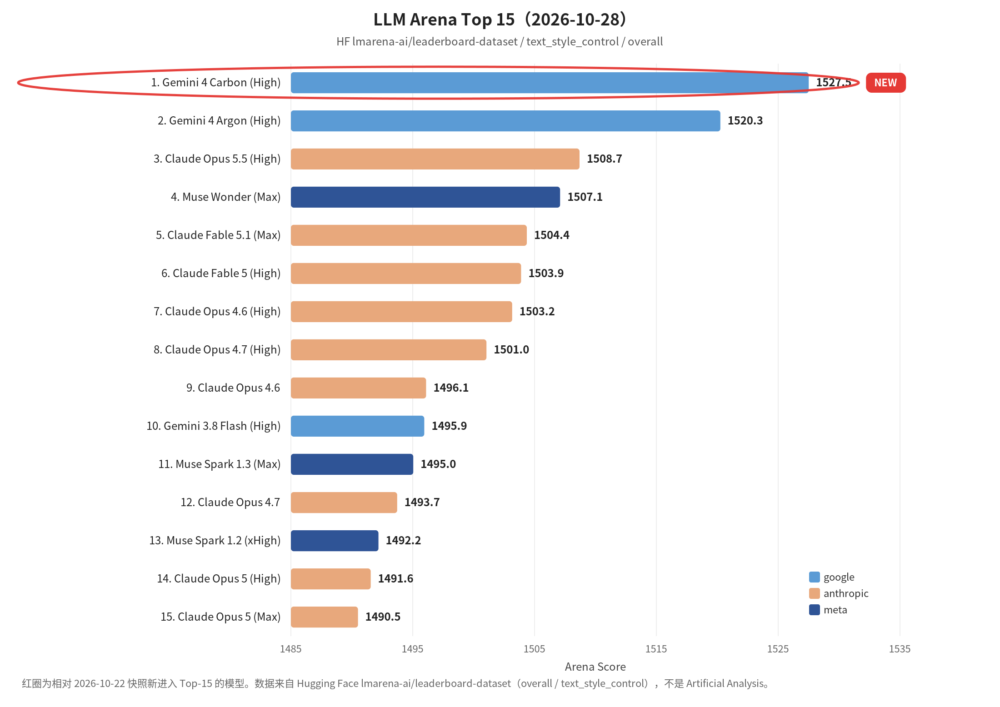
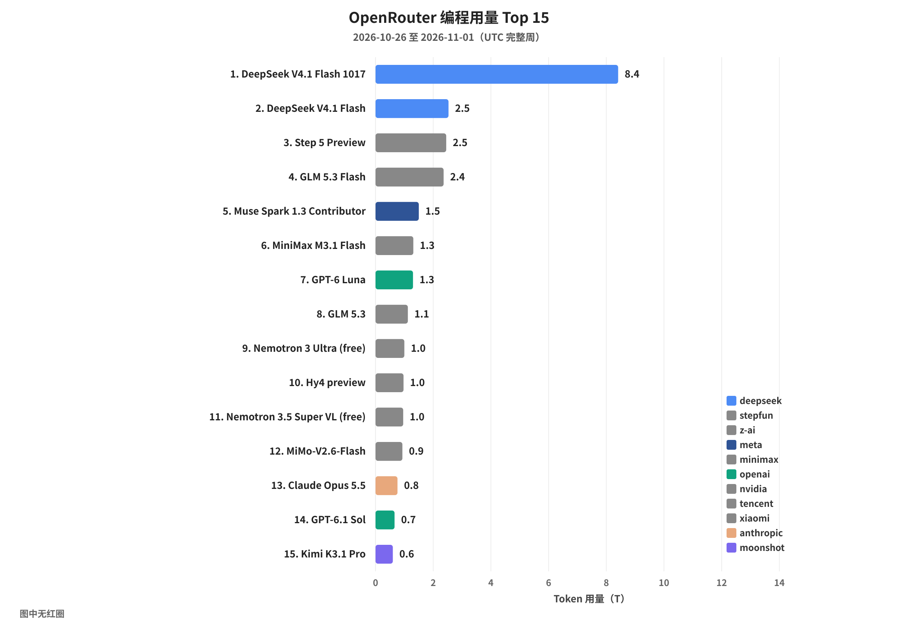
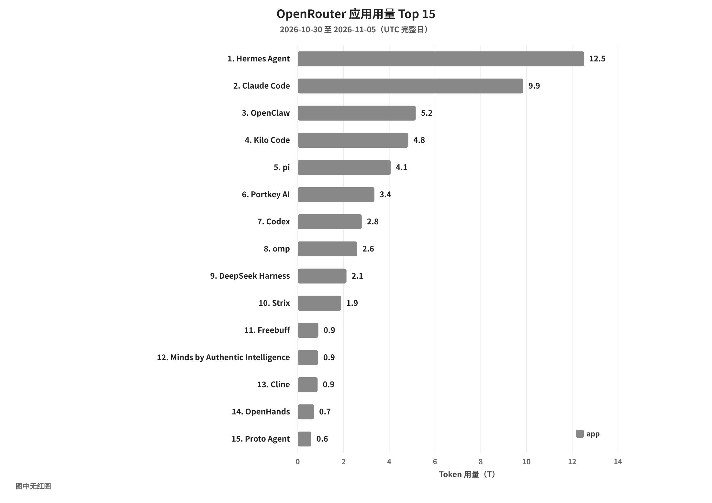

覆盖窗口：2026-10-30 00:00:00 至 2026-11-05 23:59:59（UTC；生成日 2026-11-06，不含当天）。

<!-- provenance
{"rules":{"repo":"VirusPC/edges-brain-viruspc","commit":"f800a6055b75ae4a22859d370a1af9d3cd4fdce8","routine":".edges/routines/weekly-ai-blogs-digest/INDEX.md","skill":"skills/managed/weekly-ai-blogs-digest/SKILL.md"},"data":{"repo":"VirusPC/ai-news-data","commit":"ca169d949f7b1b42cd8a9328923b90077e2507fe","path":"issues/2026-11-06","kind":"tree"}}
-->

## 一、本周关键词

<!-- keywords-cloud
[
  {
    "word": "Deep Agents",
    "kind": "concept",
    "score": 3,
    "mentions": 2,
    "sources": 2,
    "weight": 2.8,
    "theme": true
  },
  {
    "word": "SWE-2 Flash",
    "kind": "model",
    "score": 5,
    "mentions": 3,
    "sources": 1,
    "weight": 3
  },
  {
    "word": "Devin Review 2.0",
    "kind": "product",
    "score": 4,
    "mentions": 2,
    "sources": 2,
    "weight": 2.8
  },
  {
    "word": "Gemini Omni 1.2 Flash",
    "kind": "model",
    "score": 5,
    "mentions": 1,
    "sources": 1,
    "weight": 1.4
  },
  {
    "word": "GPT-6 Cyber",
    "kind": "model",
    "score": 5,
    "mentions": 1,
    "sources": 1,
    "weight": 1.4
  },
  {
    "word": "Hy4",
    "kind": "model",
    "score": 5,
    "mentions": 1,
    "sources": 1,
    "weight": 1.4
  },
  {
    "word": "Images 2.6",
    "kind": "model",
    "score": 5,
    "mentions": 1,
    "sources": 1,
    "weight": 1.4
  },
  {
    "word": "LongCat-2.5",
    "kind": "model",
    "score": 5,
    "mentions": 1,
    "sources": 1,
    "weight": 1.4
  },
  {
    "word": "Step 5 Preview",
    "kind": "model",
    "score": 5,
    "mentions": 1,
    "sources": 1,
    "weight": 1.4
  }
]
-->

## 二、模型进展

### LLM Arena

较上周无新榜。第一仍是 Gemini 4 Carbon (High)。

<!-- chart-meta
榜单发布日 2026-10-28。图中无红圈。
-->

### OpenRouter

用量第一仍是 DeepSeek V4.1 Flash 1017。

<!-- chart-meta
红圈：Hy4。
-->

这是编程场景的 token 用量，不是质量排名。第一仍是 DeepSeek V4.1 Flash 1017。

<!-- chart-meta
图中无红圈。
-->

公开应用用量第一仍是 Hermes Agent。

<!-- chart-meta
图中无红圈。
-->

#### [SWE-2 Flash](https://cognition.com/blog/swe-2-flash)

<aside class="info-card">

<svg class="info-card-icon" xmlns="http://www.w3.org/2000/svg" viewBox="0 0 24 24" fill="none" stroke="currentColor" stroke-width="2" stroke-linecap="round" stroke-linejoin="round" aria-hidden="true"><path d="M8 6h13"></path><path d="M8 12h13"></path><path d="M8 18h13"></path><path d="M3 6h.01"></path><path d="M3 12h.01"></path><path d="M3 18h.01"></path></svg>发布要点

<ul>
<li><strong>上线</strong> 11 月 4 日进入 Devin Desktop 和 CLI。基座被写成 Thinking Machines 的 Inkling-Small。</li>
<li><strong>定位</strong> 更快的编码模型。公告称在若干评测上超过体量大 3 倍的美国开放权重模型。</li>
<li><strong>成绩</strong> 价格是更大的 SWE-2 的 <mark class="note-card-hl">五分之一</mark>，速度是 3 倍。这是厂商自己的比较。</li>
<li><strong>可用</strong> 当月内对 Devin 的 Pro、Max、Teams 免费。智力指数和速度名次没有写。</li>
</ul>

来源：<a href="https://cognition.com/blog/swe-2-flash">Introducing SWE-2 Flash</a>

</aside>

#### [GPT-6 Cyber](https://openai.com/index/introducing-gpt-6-cyber)

<aside class="info-card">

<svg class="info-card-icon" xmlns="http://www.w3.org/2000/svg" viewBox="0 0 24 24" fill="none" stroke="currentColor" stroke-width="2" stroke-linecap="round" stroke-linejoin="round" aria-hidden="true"><path d="M8 6h13"></path><path d="M8 12h13"></path><path d="M8 18h13"></path><path d="M3 6h.01"></path><path d="M3 12h.01"></path><path d="M3 18h.01"></path></svg>发布要点

<ul>
<li><strong>上线</strong> 11 月 5 日。面向研究人员划定范围内的漏洞发现和验证。</li>
<li><strong>定位</strong> 相对 GPT-5.6 Cyber 的安全研究模型，强调留在设定范围内。</li>
<li><strong>成绩</strong> 文中写 ExploitGym 相对上一代有 51% 的相对提升。单价没有写出。</li>
<li><strong>可用</strong> 系统卡链接在原文里。速度和智力指数名次没有写。</li>
</ul>

来源：<a href="https://openai.com/index/introducing-gpt-6-cyber">GPT-6 Cyber</a>

</aside>

#### [腾讯混元 Hy4](https://mp.weixin.qq.com/s?__biz=MjM5ODYwMjI2MA==&mid=2649808030&idx=1&sn=b1a1332f38f89c2d4cc91899900ddf33)

<aside class="info-card">

<svg class="info-card-icon" xmlns="http://www.w3.org/2000/svg" viewBox="0 0 24 24" fill="none" stroke="currentColor" stroke-width="2" stroke-linecap="round" stroke-linejoin="round" aria-hidden="true"><path d="M8 6h13"></path><path d="M8 12h13"></path><path d="M8 18h13"></path><path d="M3 6h.01"></path><path d="M3 12h.01"></path><path d="M3 18h.01"></path></svg>发布要点

<ul>
<li><strong>上线</strong> 11 月 4 日发布。权重说将于近期开源，并写系统卡。</li>
<li><strong>定位</strong> 相对 Hy4 preview 扩大了预训练和后训练，加上视觉理解和电脑操作。</li>
<li><strong>成绩</strong> WorkBuddy 评测里平均效果 <mark class="note-card-hl">83.18</mark> 分，任务通过率 96.15%。这是他们自己的办公场景表。</li>
<li><strong>可用</strong> 单价和速度名次没有写。</li>
</ul>

来源：<a href="https://mp.weixin.qq.com/s?__biz=MjM5ODYwMjI2MA==&mid=2649808030&idx=1&sn=b1a1332f38f89c2d4cc91899900ddf33">腾讯混元发布 Hy4</a>

</aside>

#### [美团 LongCat-2.5](https://tech.meituan.com/2026/11/02/Meituan-LongCat-2.5.html)

<aside class="info-card">

<svg class="info-card-icon" xmlns="http://www.w3.org/2000/svg" viewBox="0 0 24 24" fill="none" stroke="currentColor" stroke-width="2" stroke-linecap="round" stroke-linejoin="round" aria-hidden="true"><path d="M8 6h13"></path><path d="M8 12h13"></path><path d="M8 18h13"></path><path d="M3 6h.01"></path><path d="M3 12h.01"></path><path d="M3 18h.01"></path></svg>发布要点

<ul>
<li><strong>上线</strong> 11 月 2 日。总参数 1.6 万亿，每个 token 激活约 480 亿。</li>
<li><strong>定位</strong> 面向长程智能体任务的原生多模态模型，视觉和文本走同一套 token。</li>
<li><strong>成绩</strong> 文中把提升归到更多长程轨迹和长程强化学习。没有写进智力指数名次。</li>
<li><strong>可用</strong> 单价和速度名次没有写。</li>
</ul>

来源：<a href="https://tech.meituan.com/2026/11/02/Meituan-LongCat-2.5.html">美团 LongCat-2.5</a>

</aside>

#### [Gemini Omni 1.2 Flash](https://blog.google/innovation-and-ai/technology/developers-tools/introducing-gemini-omni-1-2-flash/)

<aside class="info-card">

<svg class="info-card-icon" xmlns="http://www.w3.org/2000/svg" viewBox="0 0 24 24" fill="none" stroke="currentColor" stroke-width="2" stroke-linecap="round" stroke-linejoin="round" aria-hidden="true"><path d="M8 6h13"></path><path d="M8 12h13"></path><path d="M8 18h13"></path><path d="M3 6h.01"></path><path d="M3 12h.01"></path><path d="M3 18h.01"></path></svg>发布要点

<ul>
<li><strong>上线</strong> 11 月 5 日发布。</li>
<li><strong>定位</strong> 相对 Omni 1.1 的视频价格下降。</li>
<li><strong>可用</strong> 720p 视频是每秒 <mark class="note-card-hl">0.07 美元</mark>，比 1.1 低 30%。token 单价和速度名次没有写。</li>
</ul>

来源：<a href="https://blog.google/innovation-and-ai/technology/developers-tools/introducing-gemini-omni-1-2-flash/">Gemini Omni 1.2 Flash</a>

</aside>

## 三、项目开源

#### GitHub Trending（weekly / all 前 5）

#### [thedotmack/claude-mem](https://github.com/thedotmack/claude-mem)

把 Agent 每次会话做了什么压成记忆，下次再注回去。

来源里只有这些。

#### [Nutlope/hallmark](https://github.com/Nutlope/hallmark)

给 Claude Code、Cursor 和 Codex 用的反 AI 味设计技能。

来源里只有这些。

#### [pingdotgg/t3code](https://github.com/pingdotgg/t3code)

这一条在归档榜上没有简介。

来源里只有这些。

#### [anthropics/skills](https://github.com/anthropics/skills)

Agent Skills 的公开仓库。

来源里只有这些。

#### [HKUDS/DeepTutor](https://github.com/HKUDS/DeepTutor)

面向长期个人辅导的 DeepTutor。简介里有项目页。

来源里只有这些。

## 四、精选文章

### 国内模型厂

#### &lt;产品&gt;&lt;Kimi&gt;[Kimi Hosted Agents 正式发布：Harness as a Service](https://mp.weixin.qq.com/s?__biz=MzcwMjM3ODEzOA==&mid=2247487927&idx=1&sn=6a811d29568ba749ef866f908d1b8d1c)

把跑 Agent 的 Harness 做成云上的服务，企业不用自己养一套运行环境。

完整总结

<strong>解决什么问题：</strong>上生产要先花几个月做执行环境、会话、工具、权限和中断恢复，上线后还得继续养。

<strong>如何解决：</strong>Hosted Agents 提供 7×24 的托管环境、独立沙箱、网络边界、可中止的会话和审计导出。

<strong>效果怎样：</strong>文中没有给出迁过去之后少花了多少周。开始用的地址写在 platform.kimi.com。

<strong>洞察与启发：</strong>卖的是运行底座，不是再发一个模型。

<strong>相关工作：</strong>词云里的 Deep Agents 是另一家把 harness 托管出去的做法。Kiro 用 Lean 证明自己的 harness，是同一层问题的另一端。

### 国外模型厂

#### &lt;架构&gt;&lt;Anthropic&gt;[Make long-running agents faster with message threads](https://claude.com/resources/articles/message-threads)

长会话不用每轮重发全部历史，API 只接收这一轮新的部分。

完整总结

<strong>解决什么问题：</strong>编码 Agent 一轮会话几百次调用，每次都重发之前的消息和工具结果，上下文一大延迟就上去。

<strong>如何解决：</strong>Messages API 的 message threads 在公开测试里让对话只发送一次，之后只传增量。

<strong>效果怎样：</strong>文中没有给出统一的延迟降幅。

<strong>相关工作：</strong>同一期 Kimi 把 harness 托管出去，Managed Deep Agents 也在托管运行环境。这篇是在 API 层少重发已经说过的历史。

#### &lt;模型&gt;&lt;OpenAI&gt;[GPT-6 Cyber](https://openai.com/index/introducing-gpt-6-cyber)

用来在研究人员划定的范围内找漏洞、验证能不能利用，并尽量不越界。

完整总结

<strong>解决什么问题：</strong>安全模型变强之后，更要留在委托的范围里。

<strong>如何解决：</strong>GPT-6 Cyber 针对可利用漏洞的发现和修复训练，并单独测是否越出范围。

<strong>效果怎样：</strong>文中写 ExploitGym 相对 GPT-5.6 Cyber 有 51% 的相对提升。

<strong>相关工作：</strong>Devin Security 2.0 用的是另一家的扫描和修复链，不是这个模型本身。

### 国内非模型厂

#### &lt;架构&gt;&lt;阿里&gt;[从 AI Friendly 架构到可复制的 AI 迁移能力](https://mp.weixin.qq.com/s?__biz=MzAxNDEwNjk5OQ==&mid=2650546649&idx=1&sn=2976d10c9e33ceab48cd6ba5a82ead51)

362 万行、多框架多分支的直播搜推，先收成有限且能校验的编排，再把迁移做成 <mark>Skill</mark>。

完整总结

<strong>解决什么问题：</strong>算法直接改 Java UDF 和图配置，换来实验速度，也留下互相分叉的行为。

<strong>如何解决：</strong>公共能力放进可复用组件，场景差异用声明式编排。先人工迁移立下行为基线和验收，再把步骤、工具和规则做成 Skill，让 AI 做转换，并用确定性校验和新旧链路对比。

<strong>效果怎样：</strong>文中称性能平稳过渡。没有单独的延迟表。

<strong>洞察与启发：</strong>他们说 AI Friendly 是给 AI 一块有限、显式、可验证的工程空间。

<strong>相关工作：</strong>天猫国际的建场 Agent 也是用确定性机制圈住模型能做的事。

#### &lt;产品&gt;&lt;阿里&gt;[天猫国际 AI 智能建场 Agent](https://mp.weixin.qq.com/s?__biz=MzAxNDEwNjk5OQ==&mid=2650546731&idx=1&sn=89c7e13972a8f1650003dba6cb46a967)

「七夕轻奢箱包会场」不会直接变成 JSON。模型用 <mark>ReAct</mark> 决策，状态机和任务账本圈住它能写什么。

完整总结

<strong>解决什么问题：</strong>一句话里没有价格、品牌、分层和坑位。模型自己补就是替运营做决定。逐项追问又把 AI 变回表单。中间还有要等 MetaQ 回调的圈品。

<strong>如何解决：</strong>状态机管执行权限，字段级生产计划和业务坐标决定写到哪，任务账本负责失败后恢复。前端用 SSE 和 AG-UI 收文本、工具事件和业务卡片。

<strong>效果怎样：</strong>文中没有给出搭建耗时的对照。

<strong>洞察与启发：</strong>异步圈品在对话结束后还能把任务事实写回来。

<strong>相关工作：</strong>直播搜推那篇先把架构收成可校验的空间。这篇是在这个空间里跑一条会场生产线。

#### &lt;实践&gt;&lt;阿里&gt;[双11：当 AI 接管支付宝大促交付](https://mp.weixin.qq.com/s?__biz=Mzg4NTczNzg2OA==&mid=2247512420&idx=1&sn=9cbbdf991c3fb80c11592f078ad64f0b)

大促不能延期。模型开始写代码之后，仍要有一套撑住交付的 <mark>harness</mark>。

完整总结

<strong>解决什么问题：</strong>618 和双 11 的窗口按周倒排，优惠和资金出了问题会被放大。

<strong>如何解决：</strong>2024 年把快定义成随时可发布：小 PR 进主干，发布从一周一次到一天一次，单次变更控制在 800 行以内，覆盖率到 90% 才能合入。2025 年把签到、抽奖、发奖、弹窗收成可配置模块，当年省下约 106 人日，并用 CodeFuse 做补全和单测，AI 生成代码占比到 30%。

<strong>效果怎样：</strong>文中称第一次按这套标准做的大促是线上 0 故障。这是他们自己的记录。

<strong>洞察与启发：</strong>人日和补全占比上去之后，问题变成模型之外还要建什么。

<strong>相关工作：</strong>天猫数字员工把等待定位到交接。这篇把质量定义成可发布的小变更。

#### &lt;架构&gt;&lt;阿里&gt;[高德 Data Agent：从业务问题到可信数据（上篇）](https://mp.weixin.qq.com/s?__biz=Mzg4NTczNzg2OA==&mid=2247512389&idx=1&sn=ce00de88385556da121f3cf2ebe8396b)

能跑通 SQL 的 Data Agent 很多，能回答「这个月目标有没有<mark>风险</mark>」的很少。

完整总结

<strong>解决什么问题：</strong>一句业务话要先降成查询，再把数字升回判断。多数系统停在取数。

<strong>如何解决：</strong>高德把一次分析看成这两段翻译，并在日常里跑。

<strong>效果怎样：</strong>文中称 WAU 约 450 人，L2 智能问数准确率稳定在 85% 以上。离好用还有距离。

<strong>洞察与启发：</strong>准确取数和回答业务问题不是同一层。

<strong>相关工作：</strong>下篇接的是把数字升回判断。

#### &lt;架构&gt;&lt;阿里&gt;[高德 Data Agent：从数字到业务决策（下篇）](https://mp.weixin.qq.com/s?__biz=Mzg4NTczNzg2OA==&mid=2247512389&idx=2&sn=acd04fef032852acffc169f4a50acb7a)

上篇把业务问题降成可信数字，下篇把数字<mark>升回</mark>「今天到底发生了什么」。

完整总结

<strong>解决什么问题：</strong>Agent 容易把一屏数字念完，听的人仍不知道重点。

<strong>如何解决：</strong>先做减法，只留少数值得说的数，再配上参照：高了还是低了、离目标差多少。

<strong>效果怎样：</strong>文中没有单独的准确率。上篇的 85% 是问数，不是这一段判断。

<strong>洞察与启发：</strong>孤零零的数字不会说话。

<strong>相关工作：</strong>上篇是降维。这篇是升维。

#### &lt;模型&gt;&lt;腾讯&gt;[腾讯混元发布 Hy4](https://mp.weixin.qq.com/s?__biz=MjM5ODYwMjI2MA==&mid=2649808030&idx=1&sn=b1a1332f38f89c2d4cc91899900ddf33)

Hy4 加上视觉理解和电脑操作，并写进 WorkBuddy 的办公场景。

完整总结

<strong>解决什么问题：</strong>预览版之后，办公和长程任务还缺视觉、工具和电脑操作。

<strong>如何解决：</strong>扩大预训练和后训练，加入视觉理解、推理、工具调用，并对 Blender、CAD 这类软件做专项训练。

<strong>效果怎样：</strong>WorkBuddy 自评平均 83.18 分，任务通过率 96.15%，12 个场景里 9 个排国内第一。这是他们自己的表。

<strong>相关工作：</strong>美团同一窗口的 LongCat-2.5 也在做原生视觉和长程 Agent，路线是统一 token，不是办公套件。

#### &lt;架构&gt;&lt;腾讯&gt;[从OpenClaw，怎么走到了Super Agent？](https://mp.weixin.qq.com/s?__biz=MjM5ODYwMjI2MA==&mid=2649807992&idx=1&sn=821997daaf7926936b0b4f59fd82ceb0)

Agent 要干好活，就得靠近人的<mark>工作现场</mark>。人用顺了，又希望随时能找到它。

完整总结

<strong>解决什么问题：</strong>年初的 Bot 好找，但不知道你今天在做什么、文件是不是最新的。桌面 Agent 能干，却把人拴在电脑前。

<strong>如何解决：</strong>文章顺着 OpenClaw 到 WorkBuddy，再写到两边互相补工作台和手机入口。文中把 DeepSeek Harness 当作一个新变化：搭建环境和接通能力，也可以让 Agent 自己参加。

<strong>效果怎样：</strong>这是观察，没有一张对照表。

<strong>洞察与启发：</strong>看起来绕回 Bot，其实是靠近工作和随时能找到这两件事同时要。

<strong>相关工作：</strong>Kimi 这一期把 harness 做成托管服务。这篇解释的是入口和工作现场为什么会互相长出来。

#### &lt;实践&gt;&lt;字节&gt;[以电商客服为例，看 AgentKit 技能评测如何让 Skill 敢上生产](https://mp.weixin.qq.com/s?__biz=MzI1MzYzMjE0MQ==&mid=2247523892&idx=1&sn=f210923b89308ffa03e248ab36043d7b)

一个打到 95.8 分的 Skill 仍不敢上生产，因为分数答不了好不好用、<mark>错在哪</mark>、改完有没有变好。

完整总结

<strong>解决什么问题：</strong>Agent 可以看起来做完了，同时违反业务规则，系统还不报错。

<strong>如何解决：</strong>火山引擎 AgentKit 用裁判 Agent 查轨迹、读产物、跑脚本。六个预置维度，也可以自定义。失分能指到文件和行。同一评测集上做新旧版本、有无 Skill 的对照。演示用的是电商退款：签收超过 7 天不予退款，40 条真实任务。

<strong>效果怎样：</strong>文中没有写这次演示改完之后分数升了多少。

<strong>洞察与启发：</strong>评测要能复测，否则模型一换，Skill 还在不在就不知道。

<strong>相关工作：</strong>高德 Data Agent 在问数准确率之外还要能下判断。这篇是 Skill 进生产前的复测闭环。

#### &lt;模型&gt;&lt;美团&gt;[美团正式发布 LongCat-2.5](https://tech.meituan.com/2026/11/02/Meituan-LongCat-2.5.html)

面向长程智能体任务的原生多模态模型，视觉和文本走同一套 token。

完整总结

<strong>解决什么问题：</strong>长程代码和完整项目需要视觉理解，又不能把视觉当成外挂编码器。

<strong>如何解决：</strong>把视觉压成多层离散 token，加长程轨迹和长程强化学习，并把真实 Agent 的失败轨迹做成可复现的训练任务。

<strong>效果怎样：</strong>文中用 GPT-5.5、GPT-5.6-Sol 和 Claude Opus 做对照表。这里不转抄那张表的名次。

<strong>洞察与启发：</strong>失败轨迹被当成训练数据，而不是只留在日志里。

<strong>相关工作：</strong>模型进展里的参数量来自这篇。

### 国外非模型厂

#### &lt;产品&gt;&lt;Cognition&gt;[Devin Review 2.0](https://devin.ai/blog/devin-review-2)

和 Devin 一起写代码时，PR 评审默认走 Devin Review，单次费用被压到几毛美元。

完整总结

<strong>解决什么问题：</strong>代码写得越快，评审越成为瓶颈。

<strong>如何解决：</strong>把 Devin Review 设成和 Devin 协作时的默认评审，并改成本结构。

<strong>效果怎样：</strong>文中称自 8 月以来单次 PR 评审成本降了 82%，一次大约 0.25 到 0.75 美元。修掉一个 bug 的客户平均成本约 2.25 美元。这是他们自己的账。

<strong>洞察与启发：</strong>评审被当成每条 PR 都跑得起的步骤，而不是贵的抽查。

<strong>相关工作：</strong>词云里的 Devin Review 2.0 就是这一条。SWE-2 Flash 是同一周的编码模型，不是这个评审器。

#### &lt;产品&gt;&lt;Amp&gt;[GitLab Integration](https://ampcode.com/news/gitlab)

Amp 接上 GitLab 之后，orb 以你的身份克隆和推送，并能打开<mark>合并请求</mark>。

完整总结

<strong>解决什么问题：</strong>评审意见和挂掉的流水线如果进不了写代码的那条线程，上下文就断了。

<strong>如何解决：</strong>支持 gitlab.com 和自建实例。glab 已登录。Amp 可以订阅自己打开的合并请求上的评论和 CI。也可以为每个新合并请求或 issue 拉一个新 orb。

<strong>效果怎样：</strong>文中没有迁过去的仓库数。

<strong>洞察与启发：</strong>后来的评论回到写这段代码的同一条线程。

<strong>相关工作：</strong>10 月 23 日那期的 Linear 派工是另一个入口。这篇是 Git 托管这边。

#### &lt;架构&gt;&lt;LangChain&gt;[Managed Deep Agents](https://www.langchain.com/blog/introducing-managed-deep-agents)

Deep Agents 这套开源 harness 放到 LangSmith 上跑。你写 Agent 做什么，平台负责生产环境。

完整总结

<strong>解决什么问题：</strong>开源 harness 还是要自己部署记忆、沙箱和日程。

<strong>如何解决：</strong>Agent 是一个项目目录。本地用 mda dev，上线用 mda deploy。持久记忆、沙箱和日程是加进项目的文件。

<strong>效果怎样：</strong>文中写公开测试在 LangSmith Cloud。没有迁徙耗时的数字。帖子在 11 月 2 日更新过。

<strong>洞察与启发：</strong>托管的是 harness，不是把 Agent 逻辑藏进一个只能点选的后台。

<strong>相关工作：</strong>Kimi Hosted Agents 是另一家的托管运行环境。主题词 Deep Agents 来自这一条和别的标题同时出现。

#### &lt;架构&gt;&lt;Warp&gt;[Don’t vibe code your software factory](https://www.warp.dev/blog/build-production-software-factory)

用一串提示把云 Agent 串起来，撑不起要审计、要测、要能改的工厂。

完整总结

<strong>解决什么问题：</strong>看起来用提示就能搭起软件工厂，客户做完发现不能扩展。

<strong>如何解决：</strong>要求工厂有韧性、可改、低延迟，接进现有工具，并且有配置、测量、审计和安全保证。

<strong>效果怎样：</strong>这是经验判断，没有一张对照表。

<strong>洞察与启发：</strong>工厂要按产品的生产标准来做，而不是按演示标准。

<strong>相关工作：</strong>上一期 Warp 把工厂定义成共享的 Agent 运行约定。这篇是在说这个约定不能靠感觉搭。

#### &lt;实践&gt;&lt;Warp&gt;[Addressing the code review bottleneck](https://www.warp.dev/blog/agent-code-review-bottleneck)

Agent 的 PR 堆着的时候，先让评审 Agent <mark>互相找问题</mark>，人再看剩下的。

完整总结

<strong>解决什么问题：</strong>人还是要看，但不能每条都从零看。

<strong>如何解决：</strong>人看之前先跑对抗式评审。用模拟环境和自动检查把用户路径走完。给每条 PR 算合并风险，并用 /merge-risk 标出该看哪里。

<strong>效果怎样：</strong>文中没有统一的评审时间降幅。

<strong>洞察与启发：</strong>作者写明现在还不把合并交给 bot。

<strong>相关工作：</strong>同一期「不要靠感觉搭软件工厂」说的是工厂要有审计。这篇是审计里人的时间怎么少花。

#### &lt;实践&gt;&lt;Lovable&gt;[How we built Lovable, and why we keep rebuilding it](https://lovable.dev/blog/how-we-built-lovable-and-why-we-keep-rebuilding-it)

计划还在，模型的自由、抓错的速度，以及它干活的那台电脑能不能<mark>分叉</mark>，都被重新想过。

完整总结

<strong>解决什么问题：</strong>一开始帮得上忙的工程选择，模型和环境变了之后会变成阻碍。

<strong>如何解决：</strong>先把问题收成新建应用：生成代码并一键托管。再收成一套固定技术栈，拿掉早期让人选前端栈的开关。这样库、代码结构和运行环境都在自己手里。

<strong>效果怎样：</strong>文中称代码库后来超过 10 万个 PR，用户创建超过 7000 万个项目。这是他们自己的计数。

<strong>洞察与启发：</strong>收窄到新建项目，是为了避开已有代码库、依赖和环境的全部差异。

<strong>相关工作：</strong>Kiro 这篇在证明自己的 harness。Lovable 这篇是在问模型的自由和它干活的环境要怎么重做。

#### &lt;实践&gt;&lt;AWS&gt;[Kiro proves properties of its own harness in Lean](https://kiro.dev/blog/harness-properties-in-lean)

让 Kiro 把一部分自己的代码做成 Lean 模型，证明一些性质，再拿去对真实代码。

完整总结

<strong>解决什么问题：</strong>Agent harness 的性质如果只靠口说，藏着的 bug 不会自己露出来。

<strong>如何解决：</strong>自动把部分代码建模成 Lean，证明定理，再对 TypeScript、Rust 或 Python 核对。

<strong>效果怎样：</strong>先在 Kiro 自己身上跑：96 个候选性质里证明了 70 个，18 个在模型里被证伪并能在代码里复现。

<strong>洞察与启发：</strong>证伪和证明一样算结果。被证伪的那 18 个才是抓到的问题。

<strong>相关工作：</strong>Kimi 把 harness 托管出去；Kiro 这篇是在证明自己这份 harness 的性质。

#### &lt;产品&gt;&lt;AWS&gt;[Introducing bots in Kiro Crew](https://kiro.dev/blog/crew-bots)

Kiro Crew 里可以同时拉开多条 <mark>Agent 会话</mark>，各自去做重构、修测试、写迁移计划和值班总结。

订阅源里只有这些。

#### &lt;实践&gt;&lt;AWS&gt;[Spec it safe](https://kiro.dev/blog/spec-it-safe)

规格只写功能时，安全漏洞不会自己暴露，Agent 就退回框架的<mark>默认行为</mark>。

完整总结

<strong>解决什么问题：</strong>登录坏了有人发现。注入和越权可以在功能全过的时候还开着。

<strong>如何解决：</strong>在 Specify、Plan、Execute 里把误用场景写进规格，让 Agent 有安全目标可以对着改。

<strong>效果怎样：</strong>文中没有漏洞下降的数字。

<strong>洞察与启发：</strong>功能需求自己会证明自己，安全需求不会。

<strong>相关工作：</strong>Kiro 用 Lean 证明 harness 的性质。这篇是在规格里先写它必须挡住什么。

#### &lt;架构&gt;&lt;AWS&gt;[Four layers of context engineering](https://aws.amazon.com/blogs/machine-learning/four-layers-of-context-engineering-for-production-ai-agents-how-deep-insight-applies-them-in-working-code/)

生产 Agent 做数据分析和写报告时，<mark>20 万 token</mark> 的窗口几分钟就能用完。

完整总结

<strong>解决什么问题：</strong>上下文一满，任务会做到一半失败，或者更贵、更不准。

<strong>如何解决：</strong>Deep Insight 把做法收成四层：架构上隔离上下文，用提示控制它，把内容外放到文件系统，再用独立 Agent 核对。参考实现里，一个写完就执行的工具把每段脚本带进上下文的 token 减了大约 95%。按需加载技能把系统提示缩小大约 97%。

<strong>效果怎样：</strong>这两个百分比来自文中的参考实现，不是所有客户的平均数。

<strong>洞察与启发：</strong>单看某一条技巧不够，四层一起用才有文中的差别。

<strong>相关工作：</strong>10 月 23 日那期写过多 Agent 进生产之后判断站不住。这篇是上下文这一层的具体做法。

#### &lt;产品&gt;&lt;CodeRabbit&gt;[How Runtime Verification works in CodeRabbit Secure](https://coderabbit.ai/blog/runtime-verification-in-coderabbit-secure)

怀疑一个接口能越权读别人的文档时，请求还没到那一行，失败<mark>说明不了什么</mark>。

完整总结

<strong>解决什么问题：</strong>要测这个判断，得有两个已登录用户、一份属于其中一人的文档，以及正在跑的应用。

<strong>如何解决：</strong>CodeRabbit Secure 的运行时验证先给一份 Reproducer Guide，写清准备、步骤和什么样的观察支持或推翻发现。可以在自己的环境里做，也可以在准备好的 CodeRabbit 环境里跑。

<strong>效果怎样：</strong>文中没有误报率。

<strong>洞察与启发：</strong>验证的是请求到达目标代码之后发生了什么，不是请求有没有发出去。

<strong>相关工作：</strong>GPT-6 Cyber 的评测是模型加进组合之后多找出什么。这篇是某条发现能不能被重放。

#### &lt;实践&gt;&lt;CodeRabbit&gt;[GPT-6 Cyber in CodeRabbit Secure](https://coderabbit.ai/blog/gpt-6-cyber-security-evaluation)

CodeRabbit 在同一组 33 个基准上比较加不加 <mark>GPT-6 Cyber</mark>。

完整总结

<strong>解决什么问题：</strong>扫描标出漏洞之后，还要判断它值不值得查。

<strong>如何解决：</strong>把 GPT-6 Cyber 加进现有模型组合，看报告会多出什么。

<strong>效果怎样：</strong>文中称加上之后，组合抓到 22 个选定问题，不加是 19 个。高危和中危发现多了 66%。

<strong>洞察与启发：</strong>多找出来的是值得查的问题，不是把报告无差别加长。

<strong>相关工作：</strong>GPT-6 Cyber 的模型说明在这一期的模型卡里。这篇是它进到 Secure 的组合之后有什么变化。

#### &lt;架构&gt;&lt;philschmid&gt;[Why Agents Are Soon Only Going to Have 1 Tool](https://www.philschmid.de/code-mode)

Agent 的工具目录正在收成一个 <mark>exec</mark>：模型写一小段代码，在沙箱里把动作串起来。

完整总结

<strong>解决什么问题：</strong>标准工具调用一轮只能做一次动作，或者一批互不相干的调用。

<strong>如何解决：</strong>Code Mode 给模型一个 exec(code)。它写 TypeScript 或 Python，在隔离沙箱里组合、等待和调用。

<strong>效果怎样：</strong>文中没有统一的 token 降幅。

<strong>洞察与启发：</strong>工具搜索解决的是目录太长。这篇说就算按需加载，一轮一个动作仍然不够。

<strong>相关工作：</strong>Agent Registry 是运行时发现工具。这篇是发现之后不要一轮只调一个。

## 五、精选推文

## 六、精选播客
