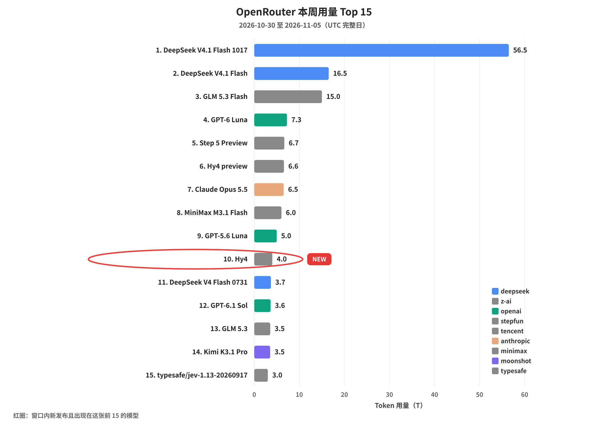

覆盖窗口：2026-10-30 00:00:00 至 2026-11-05 23:59:59（UTC；生成日 2026-11-06，不含当天）。

<!-- provenance
{"rules":{"repo":"VirusPC/edges-brain-viruspc","commit":"f800a6055b75ae4a22859d370a1af9d3cd4fdce8","routine":".edges/routines/weekly-ai-blogs-digest/INDEX.md","skill":"skills/managed/weekly-ai-blogs-digest/SKILL.md"},"data":{"repo":"VirusPC/ai-news-data","commit":"ca169d949f7b1b42cd8a9328923b90077e2507fe","path":"issues/2026-11-06","kind":"tree"}}
-->

## 一、本周关键词

<!-- keywords-cloud
[
  {
    "word": "Deep Agents",
    "kind": "concept",
    "score": 3,
    "mentions": 2,
    "sources": 2,
    "weight": 2.8,
    "theme": true
  },
  {
    "word": "SWE-2 Flash",
    "kind": "model",
    "score": 5,
    "mentions": 3,
    "sources": 1,
    "weight": 3
  },
  {
    "word": "Devin Review 2.0",
    "kind": "product",
    "score": 4,
    "mentions": 2,
    "sources": 2,
    "weight": 2.8
  },
  {
    "word": "Gemini Omni 1.2 Flash",
    "kind": "model",
    "score": 5,
    "mentions": 1,
    "sources": 1,
    "weight": 1.4
  },
  {
    "word": "GPT-6 Cyber",
    "kind": "model",
    "score": 5,
    "mentions": 1,
    "sources": 1,
    "weight": 1.4
  },
  {
    "word": "Hy4",
    "kind": "model",
    "score": 5,
    "mentions": 1,
    "sources": 1,
    "weight": 1.4
  },
  {
    "word": "Images 2.6",
    "kind": "model",
    "score": 5,
    "mentions": 1,
    "sources": 1,
    "weight": 1.4
  },
  {
    "word": "LongCat-2.5",
    "kind": "model",
    "score": 5,
    "mentions": 1,
    "sources": 1,
    "weight": 1.4
  },
  {
    "word": "Step 5 Preview",
    "kind": "model",
    "score": 5,
    "mentions": 1,
    "sources": 1,
    "weight": 1.4
  }
]
-->

## 二、模型进展

### LLM Arena

较上周无新榜。第一仍是 Gemini 4 Carbon (High)。

<!-- chart-meta
榜单发布日 2026-10-28。图中无红圈。
-->

### OpenRouter

用量第一仍是 DeepSeek V4.1 Flash 1017。

<!-- chart-meta
红圈：Hy4。
-->

这是编程场景的 token 用量，不是质量排名。第一仍是 DeepSeek V4.1 Flash 1017。

<!-- chart-meta
图中无红圈。
-->

公开应用用量第一仍是 Hermes Agent。

<!-- chart-meta
图中无红圈。
-->

#### [SWE-2 Flash](https://cognition.com/blog/swe-2-flash)

<aside class="info-card">

<svg class="info-card-icon" xmlns="http://www.w3.org/2000/svg" viewBox="0 0 24 24" fill="none" stroke="currentColor" stroke-width="2" stroke-linecap="round" stroke-linejoin="round" aria-hidden="true"><path d="M8 6h13"></path><path d="M8 12h13"></path><path d="M8 18h13"></path><path d="M3 6h.01"></path><path d="M3 12h.01"></path><path d="M3 18h.01"></path></svg>发布要点

<ul>
<li><strong>上线</strong> 11 月 4 日进入 Devin Desktop 和 CLI。基座被写成 Thinking Machines 的 Inkling-Small。</li>
<li><strong>定位</strong> 更快的编码模型。公告称在若干评测上超过体量大 3 倍的美国开放权重模型。</li>
<li><strong>成绩</strong> 价格是更大的 SWE-2 的 <mark class="note-card-hl">五分之一</mark>，速度是 3 倍。这是厂商自己的比较。</li>
<li><strong>可用</strong> 当月内对 Devin 的 Pro、Max、Teams 免费。智力指数和速度名次没有写。</li>
</ul>

来源：<a href="https://cognition.com/blog/swe-2-flash">Introducing SWE-2 Flash</a>

</aside>

#### [GPT-6 Cyber](https://openai.com/index/introducing-gpt-6-cyber)

<aside class="info-card">

<svg class="info-card-icon" xmlns="http://www.w3.org/2000/svg" viewBox="0 0 24 24" fill="none" stroke="currentColor" stroke-width="2" stroke-linecap="round" stroke-linejoin="round" aria-hidden="true"><path d="M8 6h13"></path><path d="M8 12h13"></path><path d="M8 18h13"></path><path d="M3 6h.01"></path><path d="M3 12h.01"></path><path d="M3 18h.01"></path></svg>发布要点

<ul>
<li><strong>上线</strong> 11 月 5 日。面向研究人员划定范围内的漏洞发现和验证。</li>
<li><strong>定位</strong> 相对 GPT-5.6 Cyber 的安全研究模型，强调留在设定范围内。</li>
<li><strong>成绩</strong> 文中写 ExploitGym 相对上一代有 51% 的相对提升。单价没有写出。</li>
<li><strong>可用</strong> 系统卡链接在原文里。速度和智力指数名次没有写。</li>
</ul>

来源：<a href="https://openai.com/index/introducing-gpt-6-cyber">GPT-6 Cyber</a>

</aside>

#### [腾讯混元 Hy4](https://mp.weixin.qq.com/s?__biz=MjM5ODYwMjI2MA==&mid=2649808030&idx=1&sn=b1a1332f38f89c2d4cc91899900ddf33)

<aside class="info-card">

<svg class="info-card-icon" xmlns="http://www.w3.org/2000/svg" viewBox="0 0 24 24" fill="none" stroke="currentColor" stroke-width="2" stroke-linecap="round" stroke-linejoin="round" aria-hidden="true"><path d="M8 6h13"></path><path d="M8 12h13"></path><path d="M8 18h13"></path><path d="M3 6h.01"></path><path d="M3 12h.01"></path><path d="M3 18h.01"></path></svg>发布要点

<ul>
<li><strong>上线</strong> 11 月 4 日发布。权重说将于近期开源，并写系统卡。</li>
<li><strong>定位</strong> 相对 Hy4 preview 扩大了预训练和后训练，加上视觉理解和电脑操作。</li>
<li><strong>成绩</strong> WorkBuddy 评测里平均效果 <mark class="note-card-hl">83.18</mark> 分，任务通过率 96.15%。这是他们自己的办公场景表。</li>
<li><strong>可用</strong> 单价和速度名次没有写。</li>
</ul>

来源：<a href="https://mp.weixin.qq.com/s?__biz=MjM5ODYwMjI2MA==&mid=2649808030&idx=1&sn=b1a1332f38f89c2d4cc91899900ddf33">腾讯混元发布 Hy4</a>

</aside>

#### [美团 LongCat-2.5](https://tech.meituan.com/2026/11/02/Meituan-LongCat-2.5.html)

<aside class="info-card">

<svg class="info-card-icon" xmlns="http://www.w3.org/2000/svg" viewBox="0 0 24 24" fill="none" stroke="currentColor" stroke-width="2" stroke-linecap="round" stroke-linejoin="round" aria-hidden="true"><path d="M8 6h13"></path><path d="M8 12h13"></path><path d="M8 18h13"></path><path d="M3 6h.01"></path><path d="M3 12h.01"></path><path d="M3 18h.01"></path></svg>发布要点

<ul>
<li><strong>上线</strong> 11 月 2 日。总参数 1.6 万亿，每个 token 激活约 480 亿。</li>
<li><strong>定位</strong> 面向长程智能体任务的原生多模态模型，视觉和文本走同一套 token。</li>
<li><strong>成绩</strong> 文中把提升归到更多长程轨迹和长程强化学习。没有写进智力指数名次。</li>
<li><strong>可用</strong> 单价和速度名次没有写。</li>
</ul>

来源：<a href="https://tech.meituan.com/2026/11/02/Meituan-LongCat-2.5.html">美团 LongCat-2.5</a>

</aside>

#### [Gemini Omni 1.2 Flash](https://blog.google/innovation-and-ai/technology/developers-tools/introducing-gemini-omni-1-2-flash/)

<aside class="info-card">

<svg class="info-card-icon" xmlns="http://www.w3.org/2000/svg" viewBox="0 0 24 24" fill="none" stroke="currentColor" stroke-width="2" stroke-linecap="round" stroke-linejoin="round" aria-hidden="true"><path d="M8 6h13"></path><path d="M8 12h13"></path><path d="M8 18h13"></path><path d="M3 6h.01"></path><path d="M3 12h.01"></path><path d="M3 18h.01"></path></svg>发布要点

<ul>
<li><strong>上线</strong> 11 月 5 日发布。</li>
<li><strong>定位</strong> 相对 Omni 1.1 的视频价格下降。</li>
<li><strong>可用</strong> 720p 视频是每秒 <mark class="note-card-hl">0.07 美元</mark>，比 1.1 低 30%。token 单价和速度名次没有写。</li>
</ul>

来源：<a href="https://blog.google/innovation-and-ai/technology/developers-tools/introducing-gemini-omni-1-2-flash/">Gemini Omni 1.2 Flash</a>

</aside>

## 三、项目开源

#### GitHub Trending（weekly / all 前 5）

#### [thedotmack/claude-mem](https://github.com/thedotmack/claude-mem)

把 Agent 每次会话做了什么压成记忆，下次再注回去。

来源里只有这些。

#### [Nutlope/hallmark](https://github.com/Nutlope/hallmark)

给 Claude Code、Cursor 和 Codex 用的反 AI 味设计技能。

来源里只有这些。

#### [pingdotgg/t3code](https://github.com/pingdotgg/t3code)

这一条在归档榜上没有简介。

来源里只有这些。

#### [anthropics/skills](https://github.com/anthropics/skills)

Agent Skills 的公开仓库。

来源里只有这些。

#### [HKUDS/DeepTutor](https://github.com/HKUDS/DeepTutor)

面向长期个人辅导的 DeepTutor。简介里有项目页。

来源里只有这些。

## 四、精选文章

### 国内模型厂

#### &lt;产品&gt;&lt;Kimi&gt;[Kimi Hosted Agents 正式发布：Harness as a Service](https://mp.weixin.qq.com/s?__biz=MzcwMjM3ODEzOA==&mid=2247487927&idx=1&sn=6a811d29568ba749ef866f908d1b8d1c)

把跑 Agent 的 Harness 做成云上的服务，企业不用自己养一套运行环境。

完整总结

<strong>解决什么问题：</strong>上生产要先花几个月做执行环境、会话、工具、权限和中断恢复，上线后还得继续养。

<strong>如何解决：</strong>Hosted Agents 提供 7×24 的托管环境、独立沙箱、网络边界、可中止的会话和审计导出。

<strong>效果怎样：</strong>文中没有给出迁过去之后少花了多少周。开始用的地址写在 platform.kimi.com。

<strong>洞察与启发：</strong>卖的是运行底座，不是再发一个模型。

<strong>相关工作：</strong>词云里的 Deep Agents 是另一家把 harness 托管出去的做法。Kiro 用 Lean 证明自己的 harness，是同一层问题的另一端。

### 国外模型厂

#### &lt;架构&gt;&lt;Anthropic&gt;[Make long-running agents faster with message threads](https://claude.com/resources/articles/message-threads)

长会话不用每轮重发全部历史，API 只接收这一轮新的部分。

完整总结

<strong>解决什么问题：</strong>编码 Agent 一轮会话几百次调用，每次都重发之前的消息和工具结果，上下文一大延迟就上去。

<strong>如何解决：</strong>Messages API 的 message threads 在公开测试里让对话只发送一次，之后只传增量。

<strong>效果怎样：</strong>文中没有给出统一的延迟降幅。

<strong>相关工作：</strong>同一期 Kimi 把 harness 托管出去，Managed Deep Agents 也在托管运行环境。这篇是在 API 层少重发已经说过的历史。

#### &lt;模型&gt;&lt;OpenAI&gt;[GPT-6 Cyber](https://openai.com/index/introducing-gpt-6-cyber)

用来在研究人员划定的范围内找漏洞、验证能不能利用，并尽量不越界。

完整总结

<strong>解决什么问题：</strong>安全模型变强之后，更要留在委托的范围里。

<strong>如何解决：</strong>GPT-6 Cyber 针对可利用漏洞的发现和修复训练，并单独测是否越出范围。

<strong>效果怎样：</strong>文中写 ExploitGym 相对 GPT-5.6 Cyber 有 51% 的相对提升。

<strong>相关工作：</strong>Devin Security 2.0 用的是另一家的扫描和修复链，不是这个模型本身。

### 国内非模型厂

#### &lt;模型&gt;&lt;腾讯&gt;[腾讯混元发布 Hy4](https://mp.weixin.qq.com/s?__biz=MjM5ODYwMjI2MA==&mid=2649808030&idx=1&sn=b1a1332f38f89c2d4cc91899900ddf33)

Hy4 加上视觉理解和电脑操作，并写进 WorkBuddy 的办公场景。

完整总结

<strong>解决什么问题：</strong>预览版之后，办公和长程任务还缺视觉、工具和电脑操作。

<strong>如何解决：</strong>扩大预训练和后训练，加入视觉理解、推理、工具调用，并对 Blender、CAD 这类软件做专项训练。

<strong>效果怎样：</strong>WorkBuddy 自评平均 83.18 分，任务通过率 96.15%，12 个场景里 9 个排国内第一。这是他们自己的表。

<strong>相关工作：</strong>美团同一窗口的 LongCat-2.5 也在做原生视觉和长程 Agent，路线是统一 token，不是办公套件。

#### &lt;模型&gt;&lt;美团&gt;[美团正式发布 LongCat-2.5](https://tech.meituan.com/2026/11/02/Meituan-LongCat-2.5.html)

面向长程智能体任务的原生多模态模型，视觉和文本走同一套 token。

完整总结

<strong>解决什么问题：</strong>长程代码和完整项目需要视觉理解，又不能把视觉当成外挂编码器。

<strong>如何解决：</strong>把视觉压成多层离散 token，加长程轨迹和长程强化学习，并把真实 Agent 的失败轨迹做成可复现的训练任务。

<strong>效果怎样：</strong>文中用 GPT-5.5、GPT-5.6-Sol 和 Claude Opus 做对照表。这里不转抄那张表的名次。

<strong>洞察与启发：</strong>失败轨迹被当成训练数据，而不是只留在日志里。

<strong>相关工作：</strong>模型进展里的参数量来自这篇。

### 国外非模型厂

#### &lt;产品&gt;&lt;Cognition&gt;[Devin Review 2.0](https://devin.ai/blog/devin-review-2)

和 Devin 一起写代码时，PR 评审默认走 Devin Review，单次费用被压到几毛美元。

完整总结

<strong>解决什么问题：</strong>代码写得越快，评审越成为瓶颈。

<strong>如何解决：</strong>把 Devin Review 设成和 Devin 协作时的默认评审，并改成本结构。

<strong>效果怎样：</strong>文中称自 8 月以来单次 PR 评审成本降了 82%，一次大约 0.25 到 0.75 美元。修掉一个 bug 的客户平均成本约 2.25 美元。这是他们自己的账。

<strong>洞察与启发：</strong>评审被当成每条 PR 都跑得起的步骤，而不是贵的抽查。

<strong>相关工作：</strong>词云里的 Devin Review 2.0 就是这一条。SWE-2 Flash 是同一周的编码模型，不是这个评审器。

#### &lt;架构&gt;&lt;LangChain&gt;[Managed Deep Agents](https://www.langchain.com/blog/introducing-managed-deep-agents)

Deep Agents 这套开源 harness 放到 LangSmith 上跑。你写 Agent 做什么，平台负责生产环境。

完整总结

<strong>解决什么问题：</strong>开源 harness 还是要自己部署记忆、沙箱和日程。

<strong>如何解决：</strong>Agent 是一个项目目录。本地用 mda dev，上线用 mda deploy。持久记忆、沙箱和日程是加进项目的文件。

<strong>效果怎样：</strong>文中写公开测试在 LangSmith Cloud。没有迁徙耗时的数字。帖子在 11 月 2 日更新过。

<strong>洞察与启发：</strong>托管的是 harness，不是把 Agent 逻辑藏进一个只能点选的后台。

<strong>相关工作：</strong>Kimi Hosted Agents 是另一家的托管运行环境。主题词 Deep Agents 来自这一条和别的标题同时出现。

#### &lt;架构&gt;&lt;Warp&gt;[Don’t vibe code your software factory](https://www.warp.dev/blog/build-production-software-factory)

用一串提示把云 Agent 串起来，撑不起要审计、要测、要能改的工厂。

完整总结

<strong>解决什么问题：</strong>看起来用提示就能搭起软件工厂，客户做完发现不能扩展。

<strong>如何解决：</strong>要求工厂有韧性、可改、低延迟，接进现有工具，并且有配置、测量、审计和安全保证。

<strong>效果怎样：</strong>这是经验判断，没有一张对照表。

<strong>洞察与启发：</strong>工厂要按产品的生产标准来做，而不是按演示标准。

<strong>相关工作：</strong>上一期 Warp 把工厂定义成共享的 Agent 运行约定。这篇是在说这个约定不能靠感觉搭。

#### &lt;实践&gt;&lt;AWS&gt;[Kiro proves properties of its own harness in Lean](https://kiro.dev/blog/harness-properties-in-lean)

让 Kiro 把一部分自己的代码做成 Lean 模型，证明一些性质，再拿去对真实代码。

完整总结

<strong>解决什么问题：</strong>Agent harness 的性质如果只靠口说，藏着的 bug 不会自己露出来。

<strong>如何解决：</strong>自动把部分代码建模成 Lean，证明定理，再对 TypeScript、Rust 或 Python 核对。

<strong>效果怎样：</strong>先在 Kiro 自己身上跑：96 个候选性质里证明了 70 个，18 个在模型里被证伪并能在代码里复现。

<strong>洞察与启发：</strong>证伪和证明一样算结果。被证伪的那 18 个才是抓到的问题。

<strong>相关工作：</strong>Kimi 把 harness 托管出去；Kiro 这篇是在证明自己这份 harness 的性质。

## 五、精选推文

## 六、精选播客
