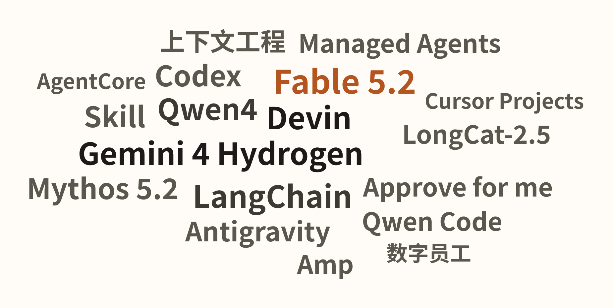
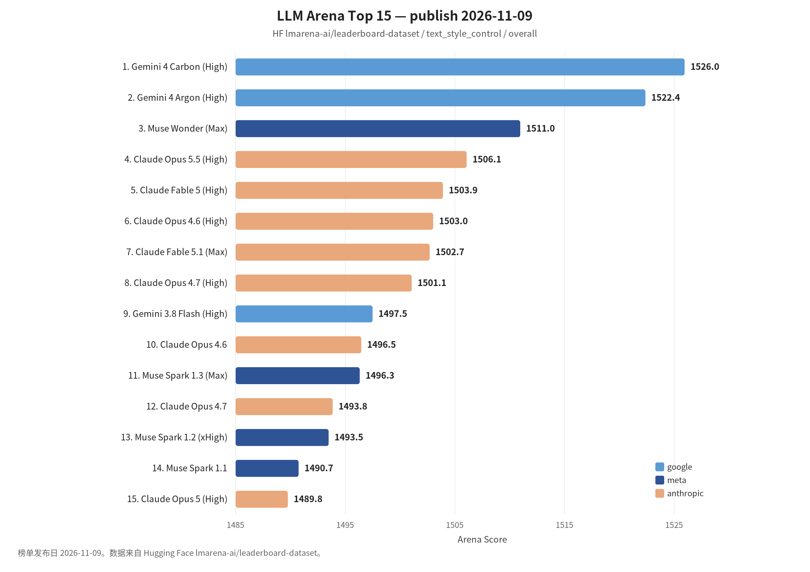

覆盖窗口：2026-11-06～2026-11-12（生成日 2026-11-13）。

## 〇、薅羊毛

#### [超算互联网：新客 0.1 元购 5000 万 Tokens](https://www.scnet.cn/home/subject/maas/index.html)

国家超算互联网 MaaS 特惠页写明：活动期间新注册用户可用 0.1 元购买 DeepSeek-V4.1-Flash-1017 或 GLM-5.3-Flash 的 5000 万 Tokens 量包（页面标注截止 11 月 14 日，每天 10:00 开抢，量包 30 天有效）；注册另有 1000 万 Tokens 尝鲜包。资格、库存与是否仍在进行以官方页面为准。 [社区帖](https://linux.do/t/topic/3164597)

#### [ChatGPT Plus：退役军人与现役可领一年](https://openai.com/index/chatgpt-plus-for-veterans)

OpenAI 称已有超过 2 万名退役及转业军人领取一年免费 ChatGPT Plus，用于准备转业后的工作。资格与领取入口以官方页面为准。

#### [Devin for Startups：最高约 6.5 万美元额度](https://devin.ai/startups)

Cognition 扩大 Devin for Startups：符合条件的团队可申请最高约 6.5 万美元额度及配套支持。另，Teams 方案升级含每名用户可使用 Devin Desktop、由 SWE-2 驱动的免费会话等，细则以官方说明为准。 [Devin Teams 方案](https://devin.ai/blog/devin-teams-plan)

 

## 一、本周关键词

Claude Fable 5.2、Qwen4-Max 与 Amp Spaces

<!-- keywords-cloud
[
  {
    "word": "Fable 5.2",
    "score": 5,
    "mentions": 1,
    "sources": 3,
    "weight": 4.1
  },
  {
    "word": "Devin",
    "score": 3,
    "mentions": 4,
    "sources": 3,
    "weight": 3.8
  },
  {
    "word": "Gemini 4 Hydrogen",
    "score": 5,
    "mentions": 1,
    "sources": 2,
    "weight": 3.8
  },
  {
    "word": "LangChain",
    "score": 4,
    "mentions": 2,
    "sources": 3,
    "weight": 3.8
  },
  {
    "word": "Qwen4",
    "score": 5,
    "mentions": 1,
    "sources": 1,
    "weight": 3.6
  },
  {
    "word": "Codex",
    "score": 3,
    "mentions": 3,
    "sources": 3,
    "weight": 3.5
  },
  {
    "word": "Mythos 5.2",
    "score": 4,
    "mentions": 1,
    "sources": 3,
    "weight": 3.5
  },
  {
    "word": "Skill",
    "score": 3,
    "mentions": 3,
    "sources": 3,
    "weight": 3.5
  },
  {
    "word": "Antigravity",
    "score": 3,
    "mentions": 2,
    "sources": 3,
    "weight": 3.2
  },
  {
    "word": "Amp",
    "score": 4,
    "mentions": 1,
    "sources": 1,
    "weight": 3.0
  },
  {
    "word": "Approve for me",
    "score": 4,
    "mentions": 1,
    "sources": 1,
    "weight": 3.0
  },
  {
    "word": "LongCat-2.5",
    "score": 4,
    "mentions": 1,
    "sources": 1,
    "weight": 3.0
  },
  {
    "word": "Managed Agents",
    "score": 4,
    "mentions": 1,
    "sources": 1,
    "weight": 3.0
  },
  {
    "word": "Qwen Code",
    "score": 4,
    "mentions": 1,
    "sources": 1,
    "weight": 3.0
  },
  {
    "word": "上下文工程",
    "score": 4,
    "mentions": 1,
    "sources": 1,
    "weight": 3.0
  },
  {
    "word": "AgentCore",
    "score": 3,
    "mentions": 1,
    "sources": 1,
    "weight": 2.4
  },
  {
    "word": "Cursor Projects",
    "score": 3,
    "mentions": 1,
    "sources": 1,
    "weight": 2.4
  },
  {
    "word": "数字员工",
    "score": 3,
    "mentions": 1,
    "sources": 1,
    "weight": 2.4
  }
]
-->

Gemini 4 Hydrogen 进入 Devin 与 Antigravity

上下文工程、Self-hosted Agents、Approve for me

LongCat-2.5 开源、Qwen Code 1.0 Preview

 

## 二、模型进展

#### 整体排名

榜单发布日 2026-11-09。

#### [Claude Fable 5.2 与 Claude Mythos 5.2](https://www.anthropic.com/claude-fable-and-mythos-5-2)

Anthropic 发布 Fable 5.2 与 Mythos 5.2，定位高难度技术工作。Fable 5.2 在 Devin 的 FrontierCode 2.0 上拿到 49.1%（Fable 5.1 为 32.4%），并成为 Claude Code 的默认 Fable 模型（1M 上下文）。选型应对照官方说明与自己的回归，而不是只看宣传分。 [Devin 接入](https://devin.ai/blog/claude-fable-5-2) [Claude Code 2.1.321](https://code.claude.com/docs/en/changelog#2-1-321)

#### [Qwen4-Max 预览版与 Qwen Code 1.0 Preview](https://mp.weixin.qq.com/s?__biz=Mzg4NTczNzg2OA==&mid=2247512488&idx=1&sn=8a921e6683912e7b07038d4b16e25f58)

阿里宣布 Qwen4-Max 预览版上线 Token Plan，并同步开源 Qwen Code 1.0 Preview。官方强调更深的知识理解以及 Coding / Agentic 能力，适合拿来做一轮编码与前端任务对照，再决定是否进入日常工具链。

#### [Gemini 4 Hydrogen](https://devin.ai/blog/gemini-4-hydrogen)

Google 的 Gemini 4 Hydrogen 进入 Devin Desktop / CLI，以及 Antigravity（并带 Orchestrator）。Devin 称其在 FrontierCode 2.0 上为 38.2%，接近 GPT-6.1 Sol，单任务成本低于 Gemini 4 Carbon。同窗口 Carbon 也进入了 Devin 与 Antigravity 的 /swarm。先看官方数字，再在自己的仓库回归。 [Antigravity：Hydrogen 与 Orchestrator](https://antigravity.google/blog/gemini-4-hydrogen-in-google-antigravity) [Devin：Gemini 4 Carbon](https://devin.ai/blog/gemini-4-carbon)

#### [美团 LongCat-2.5 正式开源](https://tech.meituan.com/2026/11/10/Meituan-LongCat-2.5-Open-Source.html)

美团按 MIT 协议开源上期发布的 LongCat-2.5：原生多模态、面向长程智能体，总参数 1.6 万亿、每 token 激活约 480 亿，支持 100 万上下文，允许商用与二次训练。适合作为国内开源 Agent 基座的对比项，而不是只看发布会分数。

#### 其他短讯

- **[MiniMax H3-Image](https://mp.weixin.qq.com/s?__biz=MzE5MTA3NzcxMQ==&mid=2247489228&idx=1&sn=7611a433102ca91044ef5e71f19ee291)**：开源 4K 图像生成与编辑权重，官方称约 10 秒出图。
- **[淘宝 MNN-Pocket-0.3B](https://mp.weixin.qq.com/s?__biz=MzAxNDEwNjk5OQ==&mid=2650546792&idx=1&sn=de39dc3d838f9aeb9cfbf92196d6ca1c)**：面向手机应用原生部署的 0.3B 模型，官方称在 iPhone 18 Pro 上离线约 350 token/s。
- **[Gemini Decisions API](https://blog.google/innovation-and-ai/technology/developers-tools/gemini-decisions-api/)**：面向快速、可校准的多模态决策，而不是通用聊天。

 

## 三、项目开源

#### GitHub Trending（daily / all 前 5）

快照日期 2026-11-12（源更新时间 07:55 UTC）。只列 daily / all 前 5。

1. **[meta/astryx](https://github.com/meta/astryx)**：面向人与 Agent 协作的开源设计系统（Beta，基于 React 19+）。
2. **[ZhuLinsen/daily_stock_analysis](https://github.com/ZhuLinsen/daily_stock_analysis)**：LLM 驱动的多市场股票分析与推送。
3. **[GoogleChrome/modern-web-guidance-src](https://github.com/GoogleChrome/modern-web-guidance-src)**：Modern Web Guidance 的源仓库，含编写、校准与评测技能的材料。
4. **[shadcn/improve](https://github.com/shadcn/improve)**：用更强模型审计代码库、再为更便宜的模型写出执行计划的 Agent Skill。
5. **[addyosmani/agent-skills](https://github.com/addyosmani/agent-skills)**：面向编码 Agent 的工程技能集，把质量门禁和工作流写成可复用 Skill。

#### [OpenAI Codex Security](https://github.com/openai/codex-security)

OpenAI 开源 Codex Security 的 CLI 与 TypeScript SDK，用于发现、验证和修复安全漏洞，适合接到现有 Codex / 评审流水线里做回归，而不是只看演示扫描。

 

## 四、国内进展

#### &lt;研发提效&gt;[阿里：对企业级 AI 研发提效的思考与实践](https://mp.weixin.qq.com/s?__biz=Mzg4NTczNzg2OA==&mid=2247512492&idx=1&sn=2134349b220aff2dc128808e7324f391)

讨论团队在 Cursor / Claude Code / Codex 进入日常后，如何避免「人肉给 AI 打工」（内网文档读不到、规范进不去）。重点是把可复制的提效能力沉淀到业务域，而不是只换模型。

#### &lt;多Agent&gt;[百度：研发 Loop 的上下文优化与多 Agent 协作](https://mp.weixin.qq.com/s?__biz=Mzg5MjU0NTI5OQ==&mid=2247607822&idx=1&sn=aff3817a60d009e1427b8ea14823c07a)

针对每轮重装上下文、压缩损伤操作规范的问题，从上下文优化、Skill 结构和 Subagent 拆分改造 Loop，并用研发测试交付全流程做验证。对自建 harness 时「何时压缩、何时拆代理」有直接参考。

#### &lt;数据研发&gt;[淘宝：基于本体的 AI 数据研发落地](https://mp.weixin.qq.com/s?__biz=MzAxNDEwNjk5OQ==&mid=2650546794&idx=1&sn=4a05c51d28bfb52c31c69c4e5f23a353)

把散落在生产代码和经验里的业务规则做成 AI 可读、可追溯的本体，再给 AI 写 SQL。核心不是让模型更快出语句，而是先提供精确、口径一致的输入。

#### &lt;知识工程&gt;[腾讯视频：从 Working、Coding 到 Oncall，让知识流动起来](https://mp.weixin.qq.com/s?__biz=MjM5ODYwMjI2MA==&mid=2649808124&idx=1&sn=24e1795f9b37a52914a395ced0ec6c7f)

在业务、交付和运维三条线上讨论 AI 原生知识沉淀：有了模型并不等于有可流动的知识库，文档与 Oncall 经验仍要能被后续 Agent 复用。

#### &lt;工程治理&gt;[腾讯：AI 编程的加速陷阱](https://mp.weixin.qq.com/s?__biz=MjM5ODYwMjI2MA==&mid=2649808120&idx=1&sn=b007fdc7119e2018ef1a0ffda9a41b0a)

代码提交量上去之后，原先只存在于口头约定、未写入 PRD 的边界更容易丢失，整条链的可控性下降。提醒要把隐含约束显式写进给 Agent 的规格和验收，而不是只追求吞吐量。

#### &lt;协作&gt;[腾讯：多 Agent 协作的下一场竞争在上下文](https://mp.weixin.qq.com/s?__biz=MjM5ODYwMjI2MA==&mid=2649808052&idx=1&sn=b3d44a9aff307ff725a3300d14efe314)

以司内工具 Siboot 为例，讨论人与 Agent 协作时上下文如何在群里流动、隔离和接力。竞争点不在再堆一个执行 Agent，而在协作层能不能把上下文传对。

#### &lt;组织&gt;[天猫：数字员工与 AI Native 新流水线](https://mp.weixin.qq.com/s?__biz=MzAxNDEwNjk5OQ==&mid=2650546793&idx=1&sn=9e814b9f097ad6ebde8a9b7998835084)

主张先建好人与 AI 之间的协同流水线，而不是先堆执行层 Agent。数字员工被写成以业务单元为边界、随时在线的「PM」角色，负责对齐目标与分派任务。

#### &lt;决策模型&gt;[阿里：从淘小蜜分流实践看 Jev 与 System One](https://mp.weixin.qq.com/s?__biz=Mzg4NTczNzg2OA==&mid=2247512476&idx=1&sn=071544b548af1892af197b38f330d562)

用客服分流模型的数据、训练和部署经验对照近期热门的 Jev / 决策模型，讨论上线前如何调阈值与概率，避免直接拿原始输出当判决。同窗口另有一篇关于决策模型上生产的实验与公式整理。 [决策模型如何上生产](https://mp.weixin.qq.com/s?__biz=Mzg4NTczNzg2OA==&mid=2247512450&idx=1&sn=65ef4a129320212fc63ac325a5e96786)

 

## 五、国际进展

#### &lt;Agent产品&gt;[Amp：Spaces、Boxes，以及取消 Dial](https://ampcode.com/news/spaces)

Amp 本周连续发布：Spaces 让一个协调 Agent 去生成和调度子 Agent；Boxes 是可部署产物的常开小计算机（最低约 18 美元 / 30 天）；模型选择器取代原来的 Dial 四档；本地 Runner 也可用 Portals。重点是把多 Agent 协作和部署收进同一产品，而不是再开一堆手动线程。 [Boxes](https://ampcode.com/news/boxes) [取消 Dial](https://ampcode.com/news/bye-bye-dial) [Runner 上的 Portals](https://ampcode.com/news/runner-portals)

#### &lt;开发工具&gt;[Cursor Projects 支持多人](https://cursor.com/blog/projects-multiplayer)

Cursor 的 Projects 改为可多人协作，适合把共享的 Agent 工作区、规则和任务从「个人配置」升级成团队资产。

#### &lt;Agent平台&gt;[Claude：在安全边界内自托管 Managed Agents](https://claude.com/resources/articles/self-hosted-claude-managed-agents)

Anthropic 推出自托管 Claude Managed Agents：Agent、凭证和会话历史放在自有云或机房，并可选请求发往何处。同窗口还加入 Whiteboards / Sheets / Data，以及可把合作方应用嵌进 Claude 的 Interactive Connectors。企业落地要先看托管边界，再看新画布功能。 [Sheets、Whiteboards 与 Data](https://claude.com/resources/articles/sheets-whiteboards-data) [Interactive Connectors](https://claude.com/resources/articles/interactive-connectors-full-tool)

#### &lt;权限&gt;[Kiro：Approve for me](https://kiro.dev/blog/introducing-approve-for-me)

Kiro 在 IDE / CLI / Web 上线 “Approve for me”：规则未覆盖的动作不再只能在「每步审批」和「全部放行」之间二选一。同窗口还介绍 Auto 的模型级联（先用较便宜模型，必要时升级），并接入 Grok 4.7。 [模型级联](https://kiro.dev/blog/model-cascade) [Grok 4.7](https://kiro.dev/blog/grok-4-7)

#### &lt;上下文&gt;[LangChain：上下文工程从检索开始](https://www.langchain.com/blog/context-engineering-starts-with-retrieval)

两篇连续讨论：先把检索做对，再谈如何在长时 Agent 里卸上下文、做摘要、用 Skill / Subagent / Memory，而不是把所有东西塞进窗口。同窗口 Managed Deep Agents v0.10 加入浏览器使用和异步子 Agent；Stripe 的 Kai、Workday 的内部平台也基于 Deep Agents / LangGraph 分享了落地节奏。 [如何记住而不堆上下文](https://www.langchain.com/blog/context-engineering-deep-agents-remember) [v0.10：浏览器与异步子 Agent](https://www.langchain.com/blog/managed-deep-agents-browser-use-and-asynchronous-subagents) [Stripe 一周做出 Kai](https://www.langchain.com/blog/how-stripe-built-their-knowledge-ai-platform-on-deep-agents)

#### &lt;企业落地&gt;[Devin：Teams 方案升级，并与麦肯锡合作](https://devin.ai/blog/devin-teams-plan)

Teams 方案把 Devin Desktop、免费会话、SSO 和费用控制打包给团队；Cognition 还与麦肯锡结盟，把增加的工程产能对到可衡量的业务结果。额度类信息见「薅羊毛」。 [与麦肯锡合作](https://devin.ai/blog/cognition-mckinsey-alliance)

#### &lt;产品&gt;[Lovable 收购 Radish AI 团队](https://lovable.dev/blog/radish-ai-team-joins-lovable)

Lovable 收购 agentic 基础设施公司 Radish AI 的团队，联合创始人加入伦敦和斯德哥尔摩工程组，为产品补 Agent 能力与基础设施。

#### &lt;云平台&gt;[Amazon Bedrock：Codex 与新一代 AgentCore](https://aws.amazon.com/blogs/machine-learning/openai-codex-on-amazon-bedrock/)

AWS 介绍如何在 Bedrock 上提供 Codex，避免另建一套模型访问与身份栈；同时发布下一代 AgentCore runtime，面向可运行数小时的多步 Agent，并提供 AgentCore 上的 Web Search API。平台团队应先统一入口和费用归属，再谈给全员开编码 Agent。 [新一代 AgentCore runtime](https://aws.amazon.com/blogs/machine-learning/run-agents-securely-and-efficiently-with-the-next-generation-agentcore-runtime/) [Web Search API](https://aws.amazon.com/blogs/machine-learning/introducing-the-web-search-api-on-amazon-bedrock-agentcore/)

#### 其他短讯

- **[JPMorganChase 扩大 Claude Code](https://claude.com/resources/articles/jpmorganchase-expands-claude-code)**：向更多员工推广 Claude Code。
- **[CodeRabbit 与 Google Antigravity](https://coderabbit.ai/blog/agentic-software-development-coderabbit-google-antigravity)**：在生成速度上来后，用评审与验证跟上交付；另文介绍跨仓库安全分析。 [跨仓库安全分析](https://coderabbit.ai/blog/multi-repository-security-analysis-with-coderabbit-secure)
- **[LangSmith BYOC 在 AWS 正式可用](https://www.langchain.com/blog/langsmith-byoc-is-now-generally-available-on-aws)**：把观测、评测和部署放在自有 VPC。
- **[Antigravity 语音模式与知识工作](https://antigravity.google/blog/antigravity-voice-mode)**：补充语音入口，并讨论面向知识工作的用法。 [面向知识工作](https://antigravity.google/blog/antigravity-for-knowledge-work)

 
