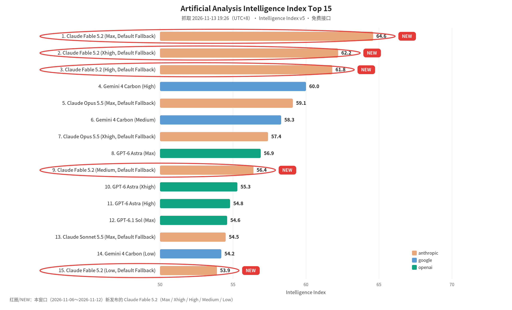
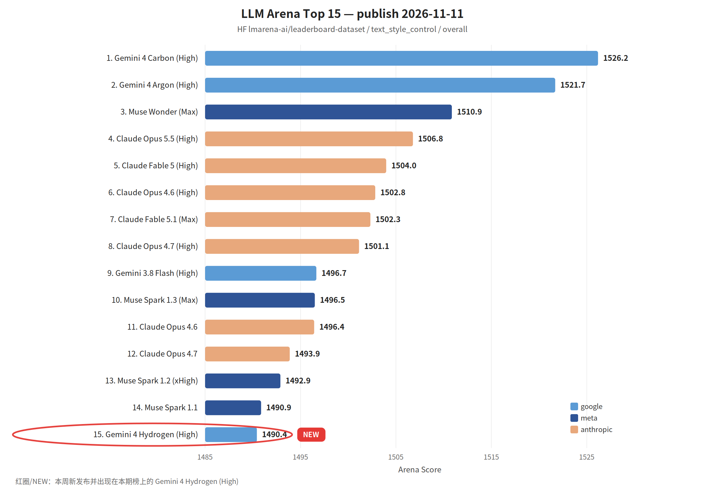
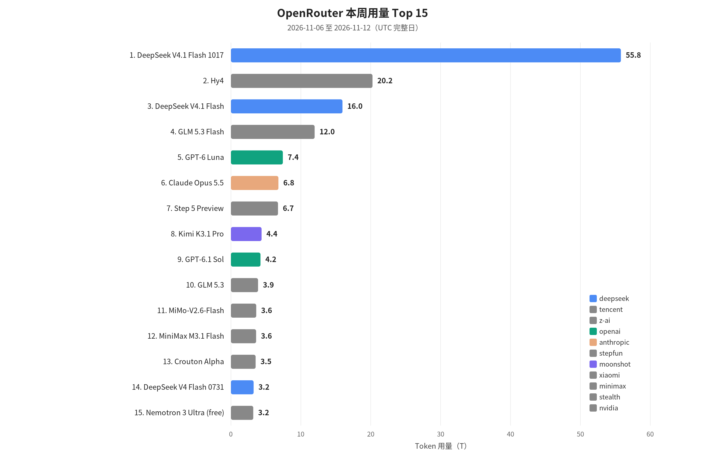
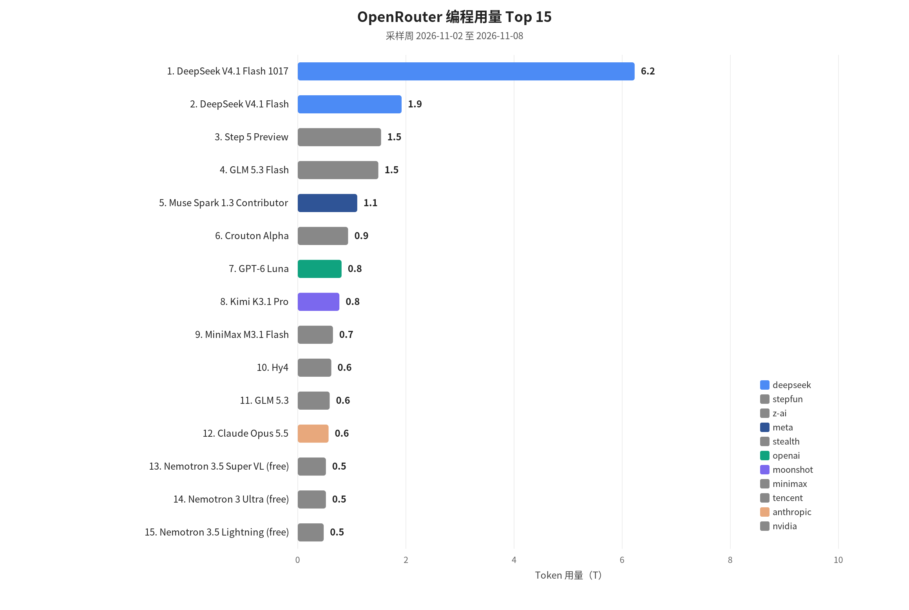
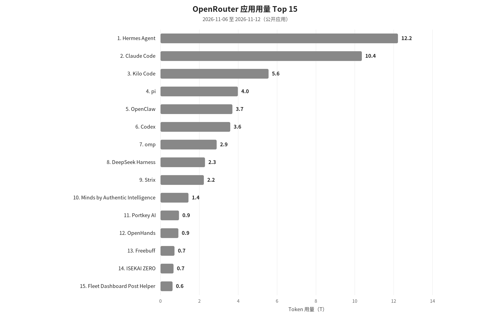

覆盖窗口：2026-11-06 00:00:00 至 2026-11-12 23:59:59（UTC；生成日 2026-11-13，不含当天）。

<!-- provenance
{"rules":{"repo":"VirusPC/edges-brain-viruspc","commit":"f800a6055b75ae4a22859d370a1af9d3cd4fdce8","routine":".edges/routines/weekly-ai-blogs-digest/INDEX.md","skill":"skills/managed/weekly-ai-blogs-digest/SKILL.md"},"data":{"repo":"VirusPC/ai-news-data","commit":"ca169d949f7b1b42cd8a9328923b90077e2507fe","path":"issues/2026-11-13","kind":"tree"}}
-->

## 一、本周关键词

<!-- keywords-cloud
[
  {
    "word": "Agent Memory",
    "kind": "concept",
    "score": 3,
    "mentions": 4,
    "sources": 4,
    "weight": 5,
    "theme": true
  },
  {
    "word": "Claude Fable 5.2",
    "kind": "model",
    "score": 5,
    "mentions": 8,
    "sources": 6,
    "weight": 5
  },
  {
    "word": "Gemini 4 Hydrogen",
    "kind": "model",
    "score": 5,
    "mentions": 4,
    "sources": 4,
    "weight": 5
  },
  {
    "word": "Claude Mythos 5.2",
    "kind": "model",
    "score": 5,
    "mentions": 3,
    "sources": 3,
    "weight": 4.2
  },
  {
    "word": "Deep Agents",
    "kind": "concept",
    "score": 3,
    "mentions": 8,
    "sources": 1,
    "weight": 3.8
  },
  {
    "word": "Qwen4-Max",
    "kind": "model",
    "score": 5,
    "mentions": 2,
    "sources": 2,
    "weight": 2.8
  },
  {
    "word": "Context Engineering",
    "kind": "concept",
    "score": 3,
    "mentions": 2,
    "sources": 1,
    "weight": 2.2
  },
  {
    "word": "Claude Data",
    "kind": "product",
    "score": 4,
    "mentions": 1,
    "sources": 1,
    "weight": 1.4
  },
  {
    "word": "Claude Meetings",
    "kind": "product",
    "score": 4,
    "mentions": 1,
    "sources": 1,
    "weight": 1.4
  },
  {
    "word": "Claude Sheets",
    "kind": "product",
    "score": 4,
    "mentions": 1,
    "sources": 1,
    "weight": 1.4
  },
  {
    "word": "Claude Whiteboards",
    "kind": "product",
    "score": 4,
    "mentions": 1,
    "sources": 1,
    "weight": 1.4
  },
  {
    "word": "MiniMax H3-Image",
    "kind": "model",
    "score": 5,
    "mentions": 1,
    "sources": 1,
    "weight": 1.4
  },
  {
    "word": "Qwen Code 1.0 Preview",
    "kind": "product",
    "score": 4,
    "mentions": 1,
    "sources": 1,
    "weight": 1.4
  }
]
-->

## 二、模型进展

### Artificial Analysis

这张智力指数最前面的是 11 月 9 日发布的 Claude Fable 5.2。

<!-- chart-meta
红圈：窗口内新发布且进入前 15 的 Claude Fable 5.2 各档。
-->

### LLM Arena

第一仍是 Gemini 4 Carbon (High)。

<!-- chart-meta
榜单发布日 2026-11-11。图中无红圈。
-->

### OpenRouter

用量第一是 DeepSeek V4.1 Flash，其次是 Hy4。

<!-- chart-meta
图中无红圈。
-->

这是编程场景的 token 用量，不是质量排名。

<!-- chart-meta
图中无红圈。
-->

公开应用用量第一是 Hermes Agent。

<!-- chart-meta
图中无红圈。
-->

#### [Claude Fable 5.2 与 Claude Mythos 5.2](https://www.anthropic.com/claude-fable-and-mythos-5-2)

<aside class="info-card">

<svg class="info-card-icon" xmlns="http://www.w3.org/2000/svg" viewBox="0 0 24 24" fill="none" stroke="currentColor" stroke-width="2" stroke-linecap="round" stroke-linejoin="round" aria-hidden="true"><path d="M8 6h13"></path><path d="M8 12h13"></path><path d="M8 18h13"></path><path d="M3 6h.01"></path><path d="M3 12h.01"></path><path d="M3 18h.01"></path></svg>发布要点

<ul>
<li><strong>上线</strong> 公告写 11 月 9 日。Fable 和 Mythos 同一篇发布。</li>
<li><strong>定位</strong> 标准档降价。另有更贵的 fast mode。</li>
<li><strong>成绩</strong> 智力指数这张榜最前面是 Fable 5.2。</li>
<li><strong>可用</strong> 输入每百万 token <mark class="note-card-hl">8 美元</mark>，输出 40 美元。fast mode 是 16 和 80。价格和速度名次没有写。</li>
</ul>

来源：<a href="https://www.anthropic.com/claude-fable-and-mythos-5-2">Claude Fable 5.2 and Claude Mythos 5.2</a>

</aside>

#### [Gemini 4 Hydrogen](https://antigravity.google/blog/gemini-4-hydrogen-in-google-antigravity)

<aside class="info-card">

<svg class="info-card-icon" xmlns="http://www.w3.org/2000/svg" viewBox="0 0 24 24" fill="none" stroke="currentColor" stroke-width="2" stroke-linecap="round" stroke-linejoin="round" aria-hidden="true"><path d="M8 6h13"></path><path d="M8 12h13"></path><path d="M8 18h13"></path><path d="M3 6h.01"></path><path d="M3 12h.01"></path><path d="M3 18h.01"></path></svg>发布要点

<ul>
<li><strong>上线</strong> 11 月 12 日进入 Antigravity，并带 Orchestrator。</li>
<li><strong>定位</strong> 和同一周的 Carbon、/swarm 一起出现在 Antigravity 的产品文里。</li>
<li><strong>可用</strong> 官方 token 单价没有写出。</li>
</ul>

来源：<a href="https://antigravity.google/blog/gemini-4-hydrogen-in-google-antigravity">Gemini 4 Hydrogen and Orchestrator</a>

</aside>

#### [Qwen4-Max 预览](https://x.com/Alibaba_Qwen/status/2120335993643684315)

<aside class="info-card">

<svg class="info-card-icon" xmlns="http://www.w3.org/2000/svg" viewBox="0 0 24 24" fill="none" stroke="currentColor" stroke-width="2" stroke-linecap="round" stroke-linejoin="round" aria-hidden="true"><path d="M8 6h13"></path><path d="M8 12h13"></path><path d="M8 18h13"></path><path d="M3 6h.01"></path><path d="M3 12h.01"></path><path d="M3 18h.01"></path></svg>发布要点

<ul>
<li><strong>上线</strong> 11 月 11 日的预览。</li>
<li><strong>定位</strong> 公告写更深的知识、更强的编程和 Agent，先在 Token Plan、QwenWork、Qoder、Qwen APP 和 QwenStudio 试用。</li>
<li><strong>可用</strong> 单价没有写出。</li>
</ul>

来源：<a href="https://x.com/Alibaba_Qwen/status/2120335993643684315">Qwen4-Max preview</a>

</aside>

## 三、项目开源

#### GitHub Trending（weekly / all 前 5）

#### [anthropics/skills](https://github.com/anthropics/skills)

Agent Skills 的公开仓库。

来源里只有这些。

#### [milind-soni/OpenMausBot](https://github.com/milind-soni/OpenMausBot)

开源的 Grok Bot 替代，带一台机器人能用的虚拟机。

来源里只有这些。

#### [vercel-labs/agent-browser](https://github.com/vercel-labs/agent-browser)

给 AI Agent 用的浏览器自动化命令行。

来源里只有这些。

#### [NVIDIA/auto-ontology](https://github.com/NVIDIA/auto-ontology)

在数据上建语义图，让查询和检索可以解释。简介是这么写的。

来源里只有这些。

#### [cloudflare/security-audit-skill](https://github.com/cloudflare/security-audit-skill)

给编码 Agent 用的分阶段安全审计。上一周它也在周榜上。

来源里只有这些。

## 四、精选文章

### 国外模型厂

#### &lt;产品&gt;&lt;Google&gt;[Gemini 4 Hydrogen and Orchestrator](https://antigravity.google/blog/gemini-4-hydrogen-in-google-antigravity)

Hydrogen 进入 Antigravity，并带上 Orchestrator。同一周还有 Carbon 和 /swarm。

订阅源里只有这些。

### 国内非模型厂

#### &lt;模型&gt;&lt;阿里&gt;[Qwen4-Max 预览](https://x.com/Alibaba_Qwen/status/2120335993643684315)

Qwen4-Max 先在 Token Plan 和千问的几款产品里预览。正式上线不在这个窗口。

完整总结

<strong>解决什么问题：</strong>编程、知识工作和前端之外，还要一个能做专业软件流程的预览档。

<strong>如何解决：</strong>预览放在 Token Plan、QwenWork、Qoder、Qwen APP 和 QwenStudio。

<strong>效果怎样：</strong>这条公告没有评测数字。

<strong>相关工作：</strong>同一期 Hydrogen 进了 Antigravity。这篇是预览公告，没有评测数字。

#### &lt;实践&gt;&lt;腾讯&gt;[WorkBuddy 值得装的 7 个 Skill](https://mp.weixin.qq.com/s?__biz=MjM5ODYwMjI2MA==&mid=2649808160&idx=1&sn=330f5030d5f14f0a2676f9e681fd5bc4)

差的不是模型，是技能。名单里有浏览器操作、找技能，以及让它记住你的 Agent Memory。

订阅源里只有这些。

#### &lt;架构&gt;&lt;百度&gt;[研发 Loop 的上下文优化与多 Agent 协作](https://mp.weixin.qq.com/s?__biz=Mzg5MjU0NTI5OQ==&mid=2247607822&idx=1&sn=aff3817a60d009e1427b8ea14823c07a)

Loop 每轮都重装上下文，压缩还会伤到操作规范。他们从上下文、Skill 和子任务三处改。

完整总结

<strong>解决什么问题：</strong>需求到验证的闭环里，每一步都把 PRD、代码、测试和历史思考再装进同一个窗口。

<strong>如何解决：</strong>从上下文、Skill 结构和 Subagent 拆任务三处改。文中写优化前一轮排查要带 84k token，配额是 256k。

<strong>效果怎样：</strong>文中用一条无人介入的研发测试交付做演示，没有给出全体任务的加速比。

<strong>洞察与启发：</strong>固定成本每轮都付，削掉之后每一轮都受益。

<strong>相关工作：</strong>上一期 Anthropic 的 message threads 是在 API 层停止重发历史。这篇是研发流程层还在重装。

### 国外非模型厂

#### &lt;架构&gt;&lt;LangChain&gt;[Context engineering starts with retrieval](https://www.langchain.com/blog/context-engineering-starts-with-retrieval)

Agent 把时间耗在笨搜索、过大的结果和过期数据上。Deep Agents 的检索是为了把该进上下文的东西找准。

订阅源里只有这些。

#### &lt;架构&gt;&lt;LangChain&gt;[How to remember without keeping everything in context](https://www.langchain.com/blog/context-engineering-deep-agents-remember)

长跑的 Agent 会因为上下文堆满而变差。卸载、摘要、技能、子 Agent 和记忆用来把窗口留住。

订阅源里只有这些。

## 五、精选推文

## 六、精选播客
