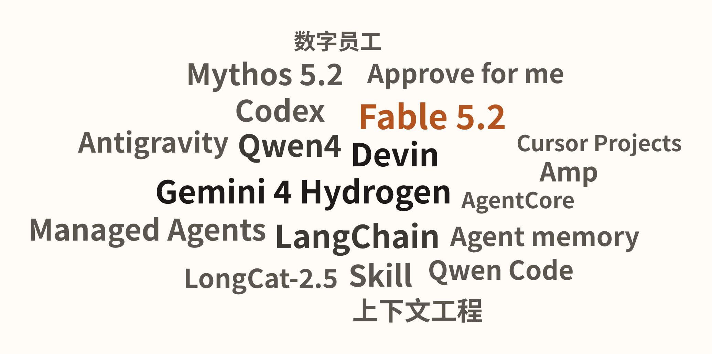
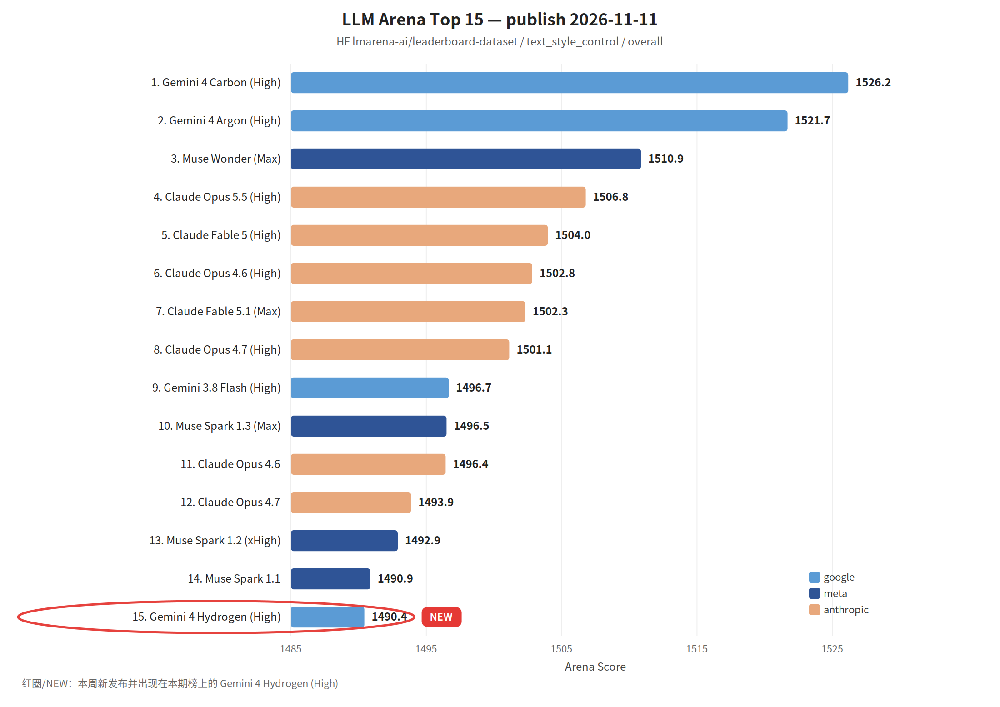

覆盖窗口：2026-11-06～2026-11-12（生成日 2026-11-13）。

## 〇、薅羊毛

#### [K-EXAONE 2.5 模型 API 对所有人免费](https://linux.do/t/topic/3145490)

LG AI 研究院 11 月 9 日起免费开放 K-EXAONE 2.5 API，开发者、企业、研究机构都可用；帖内称 SWE-Bench Pro 等评测与 DeepSeek-V4.1-Flash、GLM-5.3 相当。

#### [智谱周末限定再发 5 亿 token](https://linux.do/t/topic/3133253)

智谱继此前的 3 亿 token 晚间活动后，又开了周末限定的 5 亿 token 领取，这次有效期更长。

#### [Kiroween 黑客松报名送 Kiro 4000 积分](https://linux.do/t/topic/3130215)

报名 Kiro 万圣节黑客松并填表，约 2 个工作日到账 4000 积分；12 月 1 日前申请，积分 12 月 31 日到期，需要 KYC。

#### [Qoder 送 2000 Credits](https://linux.do/t/topic/3136663)

Qoder 账户可领 2000 Credits，楼主实测对应模型疑似 GPT-6 Astra。

#### [超算互联网新用户一毛钱买 5000 万 DeepSeek token](https://linux.do/t/topic/3158753)

超算互联网 MaaS 新用户活动，0.1 元购 5000 万 DeepSeek token。

#### [MLH Builders Week 送 Grok Premium 一个月](https://linux.do/t/topic/3152335)

参加 MLH Global Hack Week 可拿 Grok Premium 一个月优惠码（MLH 账号需满 30 天），活动 11 月 12 日结束，码 12 月 1 日前有效。

#### [Perch AI 每月约 20 美元免费额度](https://linux.do/t/topic/3137866)

通用 Agent 工具 Perch AI 的免费 Starter 免信用卡，每月约 2 万 PT，可用 DeepSeek V4.1 Flash、GLM 5.3 Flash 等。

#### [两个免费模型 API：书生·端砚与小红书 dots](https://linux.do/t/topic/3132248)

书生·端砚科研模型有免费额度，小红书 dots API 可免费调用；另有 MOSS 平台 Nex-N2.6 免费可用：[Nex-N2.6模型免费用](https://linux.do/t/topic/3157530)。

#### [Devin：初创团队最高 6.5 万美元额度](https://x.com/cognition/status/2120626703546626050)

Devin for Startups 扩大申请，入选团队最高拿 6.5 万美元额度；另拿出 1 亿美元以上额度给 Devin Security 的 Mythos 5.2 漏洞扫描：[Claude Mythos 5.2 is now available in Devin’s managed security scans](https://x.com/cognition/status/2120227474223292477)。

#### [双十一云主机：联通云、阿里云 99 计划、腾讯云](https://linux.do/t/topic/3155038)

联通云新用户免费 4C8G 云桌面一个月、2C4G ECS 6 个月 11.11 元；阿里云 99 计划 2C2G 改按量带宽后约 50 元一年：[【长期】穷哥们的性价比神机 阿里云2C2G 100M 50CNY/年](https://linux.do/t/topic/3153681)；[腾讯云双十一活动](https://linux.do/t/topic/3157156)。

 

## 一、本周关键词

Claude Fable 5.2、Gemini 4 Hydrogen、多 Agent 编排、Qwen Code 1.0、LongCat-2.5、上下文工程

<!-- keywords-cloud
[{"word":"Claude Fable 5.2","score":5,"mentions":1,"sources":3},{"word":"Gemini 4 Hydrogen","score":4,"mentions":2,"sources":2},{"word":"多 Agent 编排","score":4,"mentions":4,"sources":3},{"word":"Qwen Code 1.0","score":3,"mentions":2,"sources":3},{"word":"LongCat-2.5","score":3,"mentions":1,"sources":1},{"word":"上下文工程","score":3,"mentions":4,"sources":3},{"word":"Gemini 4 Carbon","score":3,"mentions":1,"sources":2},{"word":"Qwen4-Max","score":3,"mentions":2,"sources":3},{"word":"自托管 Agent","score":2,"mentions":1,"sources":1},{"word":"决策模型","score":2,"mentions":1,"sources":2},{"word":"研发提效","score":2,"mentions":2,"sources":1},{"word":"浏览器 Agent","score":2,"mentions":1,"sources":1},{"word":"免费额度","score":2,"mentions":4,"sources":3},{"word":"Devin","score":2,"mentions":4,"sources":3},{"word":"Kiro","score":2,"mentions":2,"sources":2}]
-->

 

## 二、模型进展

#### 整体排名

榜单发布日 2026-11-11。红圈：Gemini 4 Hydrogen (High)。相对上一期正文采用的 2026-10-28 榜，Muse Spark 1.1 也新进入 Top 15，这是名次变化，不圈。

#### [Introducing Claude Fable 5.2 and Claude Mythos 5.2](https://www.anthropic.com/claude-fable-and-mythos-5-2)

Fable 与 Mythos 同一底座，Mythos 需申请。输出快至多 30%，降到 $8/$40 每百万 token，可选 2.5 倍快速模式。Claude Code 2.1.321 设为默认 Fable 模型；Devin 测得 FrontierCode 2.0 第一（49.1%）。11 月 9 日也可在 Amazon Bedrock 与 Claude Platform on AWS 调用。[2.1.321](https://code.claude.com/docs/en/changelog#2-1-321)、[Claude Fable 5.2 is now available in Devin](https://devin.ai/blog/claude-fable-5-2)、[Introducing Claude Fable 5.2 on AWS](https://aws.amazon.com/blogs/machine-learning/introducing-claude-fable-5-2-on-aws/)

#### [Gemini 4 Hydrogen and Orchestrator](https://antigravity.google/blog/gemini-4-hydrogen-in-google-antigravity)

Hydrogen 进入 Antigravity，Terminal-Bench 4.1 得 57%。新选项 Orchestrator 让 Carbon 规划、Hydrogen 执行，接近 Carbon 成功率，省 24% 额度。Carbon 同周上线并带来多 Agent 的 /swarm。对研发：日常改动用 Orchestrator，大迁移再开 swarm。[Gemini 4 Carbon and /swarm](https://antigravity.google/blog/gemini-4-carbon-in-google-antigravity)、[Gemini 4 Hydrogen is now available in Devin](https://devin.ai/blog/gemini-4-hydrogen)

#### [Qwen4-Max 预览版上线，Qwen Code 1.0 Preview 发布](https://mp.weixin.qq.com/s?__biz=Mzg4NTczNzg2OA==&mid=2247512488&idx=1&sn=8a921e6683912e7b07038d4b16e25f58)

新一代 Qwen4 的 Max 预览版首发阿里 Token Plan，主打编程与 Agent 能力，千问办公、Qoder、千问 APP 已接入。[Qwen4 is coming](https://x.com/Alibaba_Qwen/status/2120335993643684315)

#### [美团 LongCat-2.5 正式开源：从看见，到抵达](https://tech.meituan.com/2026/11/10/Meituan-LongCat-2.5-Open-Source.html)

MIT 协议，1.6 万亿总参、每 token 激活约 480 亿，1M 上下文，面向长程 Agent 与 Visual Coding。训练里把真实 Agent 的失败轨迹转成可验证任务，并用断网、清 git 历史防止钻空子；针对国产算力做了部署优化。

#### [MiniMax H3-Image 开源：让 4K 图像生成进入 10 秒时代](https://mp.weixin.qq.com/s?__biz=MzE5MTA3NzcxMQ==&mid=2247489228&idx=1&sn=7611a433102ca91044ef5e71f19ee291)

开放权重的图像模型，10 秒出 4096×4096 图，支持最多 16 张参考图；也可经 MiniMax 开放平台和 MiniMax Code 调用。

#### [Gemini Decisions API: Fast, calibrated multimodal decisions](https://blog.google/innovation-and-ai/technology/developers-tools/gemini-decisions-api/)

新模型 Gemini Decision 1 不逐 token 生成，一次前向给多达 1000 个封闭问题打概率，端到端 150–250 ms，输入 $0.10/百万 token、输出不计费。对 Agent：适合工具选择、模型路由和策略检查。Transformers 也加了 decision pipeline：[Decision Models in Hugging Face](https://huggingface.co/blog/decision)

#### [Introducing Kimi K3.1 Pro on Amazon Bedrock](https://aws.amazon.com/blogs/machine-learning/introducing-kimi-k3-1-pro-on-amazon-bedrock/)

Kimi K3.1 Pro Highspeed 11 月 10 日上 Amazon Bedrock。Moonshot 称后训练针对长程 Agent，输出速度约为 Kimi K3.1 Pro 的 2–3 倍；工具调用和图像输入沿用 Kimi K3 的接口。

#### [NVIDIA Nemotron 3.5 Super VL is now available in Amazon SageMaker JumpStart](https://aws.amazon.com/blogs/machine-learning/nvidia-nemotron-3-5-super-vl-is-now-available-in-amazon-sagemaker-jumpstart/)

11 月 9 日上 JumpStart。120B MoE、约 12B 激活，1M 上下文，输入图像、视频和文本，面向文档理解与 GUI / computer-use。

 

## 三、项目开源

#### GitHub Trending（daily / all 前 5）

快照 2026-11-12 15:55（UTC+8），daily / all。

1. [meta/astryx](https://github.com/meta/astryx)：面向人和 Agent 一起做界面的开源设计系统，基于 React 19+，目前 Beta。
2. [ZhuLinsen/daily_stock_analysis](https://github.com/ZhuLinsen/daily_stock_analysis)：LLM 驱动的多市场股票分析与定时推送。
3. [GoogleChrome/modern-web-guidance-src](https://github.com/GoogleChrome/modern-web-guidance-src)：把现代 Web 最佳实践和兼容数据做成编码 Agent 的 skill。
4. [shadcn/improve](https://github.com/shadcn/improve)：用强模型审代码库、写计划，交给便宜模型执行。
5. [addyosmani/agent-skills](https://github.com/addyosmani/agent-skills)：覆盖 spec 到 ship 的编码 Agent 工程 skill。

#### [QwenLM/qwen-code](https://github.com/QwenLM/qwen-code)

Qwen Code 1.0 Preview 合并 Qoder 与 Qwen Code 的 harness 并开源，以「事件」驱动任务，用户要求、工具结果和系统反馈都进入对应任务。对研发：可把它当 Agent 运行时嵌进自家产品和流程。[Qwen4-Max 预览版上线，Qwen Code 1.0 Preview 发布](https://mp.weixin.qq.com/s?__biz=Mzg4NTczNzg2OA==&mid=2247512488&idx=1&sn=8a921e6683912e7b07038d4b16e25f58)

#### [淘宝MNN团队开源0.3B手机模型，iPhone 18 Pro上离线跑出350 token/s](https://mp.weixin.qq.com/s?__biz=MzAxNDEwNjk5OQ==&mid=2650546792&idx=1&sn=de39dc3d838f9aeb9cfbf92196d6ca1c)

MNN-Pocket-0.3B 从零训练，面向 App 内嵌：峰值内存低于 300MB，按业务场景对标 8B 效果，模型结构、词表、量化和推理引擎一起优化。

 

## 四、国内进展

#### &lt;研发提效&gt;[授人以鱼不如授人以渔：我对企业级 AI 研发提效的思考与实践](https://mp.weixin.qq.com/s?__biz=Mzg4NTczNzg2OA==&mid=2247512492&idx=1&sn=2134349b220aff2dc128808e7324f391)

阿里团队针对「人肉给 AI 打工」：让 Cursor、Claude Code 等工具自己读内网文档、自己验证、自己看日志。对研发：先补齐 Agent 的内网读写和验证通道，比换模型更见效。

#### &lt;Harness&gt;[研发Loop的上下文优化与多Agent协作实践](https://mp.weixin.qq.com/s?__biz=Mzg5MjU0NTI5OQ==&mid=2247607822&idx=1&sn=aff3817a60d009e1427b8ea14823c07a)

百度从上下文优化、Skill 结构优化、Subagent 拆分三方面改造「需求→方案→实现→测试→评审」循环，避免每轮重装上下文和压缩后丢失操作规范，做到研发测试交付全程无人工介入。

#### &lt;数据研发&gt;[基于本体的AI数据研发落地：淘宝行业经营分析实战](https://mp.weixin.qq.com/s?__biz=MzAxNDEwNjk5OQ==&mid=2650546794&idx=1&sn=4a05c51d28bfb52c31c69c4e5f23a353)

用本体从生产代码里抽出隐性业务规则和指标口径，变成 AI 可读、可追溯的知识，给 AI 写 SQL 提供精确输入。对研发：数据开发里先把口径结构化，再让模型写 SQL。

#### &lt;知识工程&gt;[AI从Working、Coding到Oncall：腾讯视频如何让知识流动起来？](https://mp.weixin.qq.com/s?__biz=MjM5ODYwMjI2MA==&mid=2649808124&idx=1&sn=24e1795f9b37a52914a395ced0ec6c7f)

腾讯视频技术部把业务、交付、运维三类工作的知识沉淀做成 AI 原生流程，从个人提效转向组织提效。

#### &lt;观点&gt;[AI 编程的加速陷阱](https://mp.weixin.qq.com/s?__biz=MjM5ODYwMjI2MA==&mid=2649808120&idx=1&sn=b007fdc7119e2018ef1a0ffda9a41b0a)

腾讯 Agent 开发者：提交量涨了几十倍，可控性却整链下降。人会默认「这个边界先不用管」，AI 会把它展开成十几个状态。对研发：评审时把被有意放弃的边界写进需求。

#### &lt;协同&gt;[数字员工：有关AI Native新流水线的思考](https://mp.weixin.qq.com/s?__biz=MzAxNDEwNjk5OQ==&mid=2650546793&idx=1&sn=9e814b9f097ad6ebde8a9b7998835084)

天猫认为稀缺的不是执行 Agent，而是对齐目标、串联上下文的协同层，数字员工应是常驻群里的「PM」。腾讯 Siboot 讲群聊里上下文如何流动、隔离和接力：[多Agent协作的下一场竞争，不在模型，而在上下文](https://mp.weixin.qq.com/s?__biz=MjM5ODYwMjI2MA==&mid=2649808052&idx=1&sn=b3d44a9aff307ff725a3300d14efe314)

 

## 五、国际进展

#### &lt;Agent 平台&gt;[Operate Claude Managed Agents inside your security perimeter](https://claude.com/resources/articles/self-hosted-claude-managed-agents)

Claude Managed Agents 可自托管：Agent、凭据和会话历史放在自家云或机房，请求发往哪里也由企业决定。对研发：合规要求高的团队可以不出边界跑托管 Agent。

#### &lt;产品&gt;[Your apps can now open in Claude, and Claude can work in them](https://claude.com/resources/articles/interactive-connectors-full-tool)

合作方应用可整页嵌进 Claude，人和 Claude 在同一界面操作。同周上线 Sheets、Whiteboards、Data，以及进视频会议边听边起草文档的 Claude Meetings（公测）。[Introducing Claude Whiteboards, Claude Sheets, and Claude Data](https://claude.com/resources/articles/sheets-whiteboards-data)、[Introducing Claude Meetings](https://claude.com/resources/articles/claude-meetings)

#### &lt;编码工具&gt;[Cursor Projects is now multiplayer](https://cursor.com/blog/projects-multiplayer)

Projects 支持多人：队友各自和协调 Agent 对话，同时共享需求文档、规格、记忆和任务看板，不同人的 Agent 之间也能通信。对研发：值班交接可以直接把进行中的 Agent 上下文交给下一个人。

#### &lt;编码工具&gt;[Spaces](https://ampcode.com/news/spaces)

Amp 推出 Spaces：一个空间里由单个 Agent 负责派生和协调多个线程，团队在同一处讨论。同周还有常驻小主机 Boxes（最低 $18/30 天，自带 Agent）和本机 Runner 上的 Portals。[Boxes](https://ampcode.com/news/boxes)、[Portals on Your Runner](https://ampcode.com/news/runner-portals)

#### &lt;编码工具&gt;[Introducing “Approve for me” in Kiro](https://kiro.dev/blog/introducing-approve-for-me)

规则没覆盖的操作交给 LLM 审查：常规的自动批准，危险的拦下，不确定的再问人。Auto 模式用模型级联，后台检查发现需要时才换更强模型，DeepSWE 上约五分之四任务不需要换。Kiro 同周接入 Grok 4.7。[How Kiro Auto uses model cascading to match the model to the work](https://kiro.dev/blog/model-cascade)、[Grok 4.7 is now available in Kiro](https://kiro.dev/blog/grok-4-7)

#### &lt;编码工具&gt;[Devin's new Teams plan](https://devin.ai/blog/devin-teams-plan)

Teams 版每人可用 Devin Desktop，不另收席位费；每人两个由自研 SWE-2 驱动的免费并发会话，并加上 SSO 和成本管控。

#### &lt;Harness&gt;[Managed Deep Agents v0.10: Browser Use and Async Subagents](https://www.langchain.com/blog/managed-deep-agents-browser-use-and-asynchronous-subagents)

LangChain 托管 Deep Agents 加入浏览器（可把窗口交给人登录）和异步子 Agent，主 Agent 在后台任务跑时仍能响应。浏览器工具比了七套后选 Stagehand。[Agents Are Going Async](https://www.langchain.com/blog/agents-are-going-async)、[How We Optimized Browser Use for Deep Agents](https://www.langchain.com/blog/how-we-optimized-browser-use-for-deep-agents)

#### &lt;上下文工程&gt;[The components of agent memory](https://www.anthropic.com/research/components-of-agent-memory)

Anthropic 讲 Claude 如何决定记什么，并用「dreaming」整理记忆、纠错。LangChain 讲检索、卸载、摘要和子 Agent 如何控制长任务上下文。[Context Engineering (Agent Memory) for AI Agents Starts with Retrieval](https://www.langchain.com/blog/context-engineering-starts-with-retrieval)、[Context Engineering with Deep Agents: How To Remember Without Keeping Everything In Context](https://www.langchain.com/blog/context-engineering-deep-agents-remember)

#### &lt;企业落地&gt;[OpenAI Codex on Amazon Bedrock](https://aws.amazon.com/blogs/machine-learning/openai-codex-on-amazon-bedrock/)

Codex 仍跑在开发机上，推理走 Bedrock，沿用现有 IAM 和观测规范，建议从最小权限试点。AgentCore 同周推出新一代运行时和 Web Search API。[Run agents securely and efficiently with the next generation AgentCore runtime](https://aws.amazon.com/blogs/machine-learning/run-agents-securely-and-efficiently-with-the-next-generation-agentcore-runtime/)、[Introducing the Web Search API on Amazon Bedrock AgentCore](https://aws.amazon.com/blogs/machine-learning/introducing-the-web-search-api-on-amazon-bedrock-agentcore/)

#### &lt;代码审查&gt;[Multi-Repository Security Analysis with CodeRabbit Secure](https://coderabbit.ai/blog/multi-repository-security-analysis-with-coderabbit-secure)

CodeRabbit Secure 跨仓库分析：网关鉴权、下游服务和部署配置分在不同仓库时，也能发现可绕过网关直连服务的漏洞。

#### &lt;工程&gt;[How we moved our frontend off Firestore and built Lovable Realtime](https://lovable.dev/blog/lovable-realtime-service)

Lovable 用 Go + NATS 自建实时服务替换前端 Firestore 监听，带响应式鉴权和服务端裁剪的数据，承载 206 万个在线订阅。
