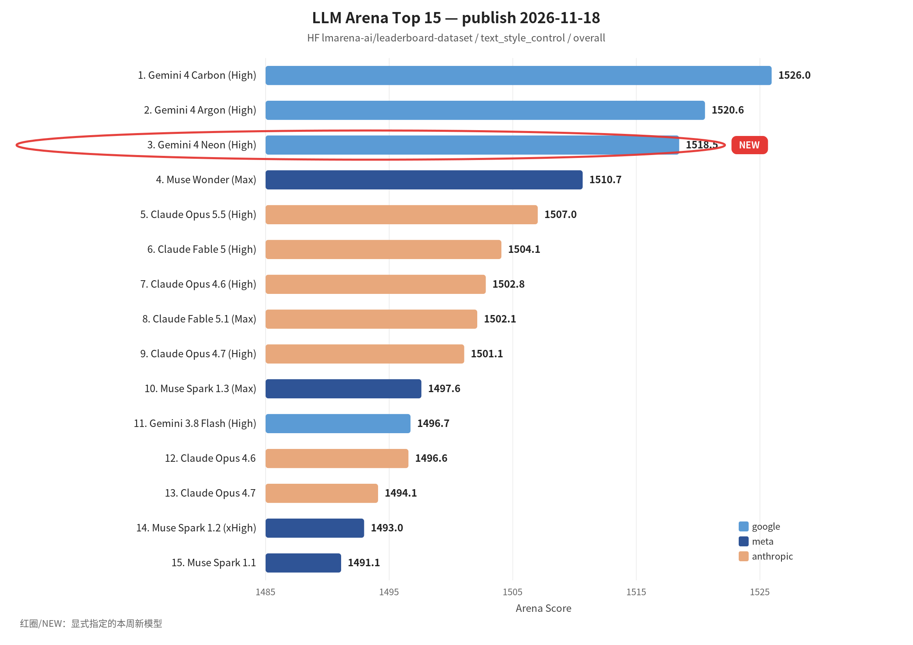

覆盖窗口：2026-11-13～2026-11-19（生成日 2026-11-20）。

## 〇、薅羊毛

#### [百度搭子 AI Pro 订阅 0.01 元（京东秒杀）](https://linux.do/t/topic/3170690)

京东 App 秒杀搜「百度搭子」，首月 Pro 订阅 0.01 元（原价 9.9 元），含 25000 积分，文心快码权益同享，帖内称可选 DeepSeek、GLM 等模型；共 2000 份，每个京东账号限购一次。11 月 13 日的帖子，名额可能已发完。

#### [Envato 限免 MiniMax H3 视频生成](https://linux.do/t/topic/3204368)

Envato 官方活动，免费账号也能用 MiniMax H3 生成视频，不需要订阅。北京时间 11 月 19 日 21:00 开始，11 月 20 日 21:00 结束，官方称不限次数但受公平使用政策约束。

#### [OpenGame Game Jam 报名送 50 美元 fal 额度](https://linux.do/t/topic/3200220)

用邮箱在 OpenGame 报名参加第一届 Game Jam，页面里点 fal coupon 即可领 50 美元 fal 额度，另有一个月 ElevenLabs Creator 可领。比赛下周正式开始，目前是报名 / 签到阶段。

#### [免费联网搜索 API 汇总与 Tavily 8000 积分](https://linux.do/t/topic/3186113)

帖主整理了可循环白嫖的搜索 API：Keenable 每号每月 10 万次，知乎开放平台全网搜索和知乎搜索各 5000 次每天，agent.tinyfish.ai 每分钟 30 次。另有 [Tavily 8000 积分](https://linux.do/t/topic/3175414)：在优惠码入口兑换 GEEKROOM。对研发：给 Agent 接联网搜索时可以先用这些免费额度。

#### [中国电信 TeleAgent 送 4 核 8G 云电脑](https://linux.do/t/topic/3201913)

手机号登录 TeleAgent，进云电脑领取免费权益，不用绑卡。磁盘约 140GB，称长期有效，可同时跑 3 个任务，另送 6000 积分（首登 3000 积分到 2027 年 2 月）。另有 [instabox 免费 4 核 8G VPS](https://linux.do/t/topic/3169823)，现在无需邀请码即可注册。

#### [日区 / 土区 Google AI Pro 学生价](https://linux.do/t/topic/3205988)

帖子教程：在 Google 付款资料里加日本资料、换国内万事达卡，订阅页会出现 720 日元（约 30 元）的学生价，称可续费 4 年。另有 [土耳其区学生价约 25 元每月](https://linux.do/t/topic/3182793)。区域与资格由 Google 判定，存在风控风险，帖内也有人反馈学生验证被风控。

 

## 一、本周关键词

Gemini 4 Neon、GPT-6.2 Astra / Sol、Qwen4-Max、Devin Bots、常驻 Agent、软件工厂、Skill 自进化与评测、工具检索

<!-- keywords-cloud
[{"word":"Gemini 4 Neon","score":5,"mentions":2,"sources":3},{"word":"GPT-6.2 Astra / Sol","score":5,"mentions":1,"sources":2},{"word":"Qwen4-Max","score":4,"mentions":1,"sources":2},{"word":"Devin Bots","score":4,"mentions":2,"sources":2},{"word":"常驻 Agent","score":3,"mentions":2,"sources":3},{"word":"软件工厂","score":3,"mentions":2,"sources":2},{"word":"Skill 自进化与评测","score":3,"mentions":3,"sources":2},{"word":"工具检索","score":3,"mentions":2,"sources":3},{"word":"验证闭环","score":3,"mentions":3,"sources":3},{"word":"Super-agent","score":3,"mentions":2,"sources":1},{"word":"本体","score":2,"mentions":2,"sources":2},{"word":"Cursor 安全事件","score":3,"mentions":1,"sources":1},{"word":"DeepSeek 应用 API","score":3,"mentions":1,"sources":1},{"word":"llama.cpp v1.0","score":2,"mentions":1,"sources":1},{"word":"免费额度","score":2,"mentions":4,"sources":1}]
-->

 

## 二、模型进展

### LLM Arena

榜单发布日 2026-11-18。红圈：Gemini 4 Neon (High)（本周新发布，排第 3）。相对上一期正文采用的 2026-11-11 榜：Neon 新进 Top 15；上期末位的 Gemini 4 Hydrogen (High) 掉到第 16，跌出图外；Muse Spark 1.1 由第 14 滑到第 15。这些是名次变化，只有 Neon 是本周新模型。

### 模型发布

#### [Introducing GPT-6.2 Astra and Sol](https://openai.com/index/introducing-gpt-6-2-astra-sol)

OpenAI 11 月 17 日发布，官方称在专业产出、编码、computer use 和效率上提升，成本更低，覆盖 ChatGPT Work、Codex 和 API。CodeRabbit 的复测：Astra 6.2 在 83 个已知问题中抓到 58 个（上代 51 个），API 价格降到每百万 token 输入 8 美元、输出 40 美元，但评论量从 331 条涨到 847 条，精度从 21.7% 降到 12.2%，更吵；Sol 6.2 高推理抓到 60/81（Sol 6.1 为 58/81），单次评审成本约高 48%。CodeRabbit 自己说这些结果不能算纯模型提升。对研发：做代码评审先看噪声和成本，别只看抓到几个。[GPT-6.2 Sol and Astra review: should you switch?](https://coderabbit.ai/blog/gpt-6-2-sol-and-astra-review)

#### [Gemini 4 Neon in Google Antigravity](https://antigravity.google/blog/gemini-4-neon-in-google-antigravity)

11 月 18 日上线，定位在 Carbon（长程深度）与 Hydrogen（日常快速）之间，有 Low 到 Extra High 四档思考。Google 称它在 Artificial Analysis Intelligence Index 上 Extra High 档 61 分、排第 3，并在 Artificial Analysis Coding Agent Index 拿到第 1（58.6）。Orchestrator 现在支持 Neon 当规划者、Hydrogen 当执行者，Hydrogen 卡住时交还给 Neon 修计划。向付费的 AI Pro / Ultra 订阅者开放，覆盖桌面应用、CLI 和 IDE 扩展。Devin 的 FrontierCode 2.0 测得 46.2%、每任务 4.38 美元，比 Claude Opus 5.5 低约 1 分，成本约三分之一：[Gemini 4 Neon is now available in Devin](https://devin.ai/blog/gemini-4-neon)。

#### [Qwen4-Max 正式上线](https://qwen.ai/blog?id=qwen4-max)

阿里 11 月 16 日发布，2.4 万亿参数的 MoE，原生视觉，百万 token 上下文。官方内部评测称比 Qwen3.8-Max 最多少用约 50% token、单任务成本降 60% 以上；定价每百万 token 输入 1.5 美元、输出 4.5 美元、隐式缓存 0.075 美元。Vals AI 称它是 Vals Index 上最强的中国模型（总榜第 11）。可从千问 AI 平台 API、阿里 Token Plan、Qoder 调用，也已上线 OpenRouter 和 Vercel AI Gateway；中小尺寸会陆续开源。[Qwen4-Max 正式上线！](https://mp.weixin.qq.com/s?__biz=Mzg4NTczNzg2OA==&mid=2247512505&idx=1&sn=1c20deef6f26aaa98b23cfc483c123ca)、[Qwen4-Max is live on @OpenRouter](https://x.com/Alibaba_Qwen/status/2122171875573068153)、[Vercel AI Gateway](https://x.com/Alibaba_Qwen/status/2122248112479907848)、[Vals Index](https://x.com/Alibaba_Qwen/status/2122175103115075709)

 

## 三、项目开源

#### GitHub Trending（daily / all 前 5）

快照：mshibanami/GitHubTrendingRSS 的 daily/all 订阅源，更新于 2026-11-19 16:10（UTC+8）。第三方抓页，不是 GitHub 官方榜单。

1. [cursor/plugins](https://github.com/cursor/plugins)：Cursor 插件规范和官方插件集合，每个插件是仓库根目录下带 `.cursor-plugin/plugin.json` 的独立目录。
2. [HKUDS/CLI-Anything](https://github.com/HKUDS/CLI-Anything)：让各类软件对 Agent 原生可用的 CLI 方案，附 CLI-Hub。
3. [mvanhorn/last30days-skill](https://github.com/mvanhorn/last30days-skill)：Agent skill，跨 Reddit、X、YouTube、HN、Polymarket 和网页调研一个主题并汇总。
4. [getarcaneapp/arcane](https://github.com/getarcaneapp/arcane)：Docker 管理界面，main 分支现在是 v3。
5. [NVIDIA/SkillEvaluator](https://github.com/NVIDIA/SkillEvaluator)：评估 Agent skill 和插件的多层框架，含质量门禁、安全扫描、合成评测集生成和真实 Agent 评测。对研发：可参考它怎么给 skill 做回归评测。

#### [llama.cpp v1.0.0：本地 AI 生态更稳的底座](https://huggingface.co/blog/ggml-org/llama-cpp-v1)

llama.cpp 和 ggml 的库接口发布 v1.0.0，强调给下游开发者一个灵活但稳定的 API。对研发：自己嵌 llama.cpp 的项目现在可以按版本约束接口。

 

## 四、国内进展

#### [DeepSeek 发布全家桶应用 API](https://mp.weixin.qq.com/s?__biz=Mzk0OTYwNzc3NQ==&mid=2247485910&idx=1&sn=529f50ba3b37e39319dad1faf7a122cf)

把 DeepSeek App 的联网搜索、文件输入、读链接等能力放进原有 API：V4.1-Flash（deepseek-flash）在 Messages、Responses、Chat Completions 接口下，开启 `deepseek_web_search` 等参数后，工具调用和上下文拼接由服务端完成；OCR、ASR、TTS 另有独立接口。对研发：不用再自己接搜索和文件解析。

#### [登上 GitHub Trending｜腾讯开源 LoopForge](https://mp.weixin.qq.com/s?__biz=MjM5ODYwMjI2MA==&mid=2649808207&idx=1&sn=2e8dc64891bdc8488ea11e48c33711b4)

腾讯轻量云团队开源的云端自进化研发平台：7×24 小时云端工作区、多角色共享会话、工程级 SOP 流水线、无人值守自动化。称已服务内部 20+ 业务，单月自动交付 200+ 需求和日常单据。同一周腾讯另有两篇：[用 Super-agent 的理念拆解 Octop 团队模式](https://mp.weixin.qq.com/s?__biz=MjM5ODYwMjI2MA==&mid=2649808189&idx=1&sn=bde97fbc46f8cb2e118267dce763042c)（主持人 Agent 拆任务、多个专家 Agent 并行，对照 DeepSeek 的 Router 加 Worker 设计）、[不只是 Memory：Ontology 如何让 Coding Agent 越用越懂项目](https://mp.weixin.qq.com/s?__biz=MjM5ODYwMjI2MA==&mid=2649808188&idx=1&sn=9493b80e2a1e4c6ab409e77f2ac57584)（本体表达项目知识，RSI 利用执行反馈）。

#### [AI 写代码越来越快，谁来守住章法？](https://mp.weixin.qq.com/s?__biz=Mzg4NTczNzg2OA==&mid=2247512530&idx=1&sn=8b68130297282a0c27a8648c649b22e4)

阿里技术的文章，引 Uncle Bob 的观点：AI 写得快，但制造混乱更快。解法是给 AI 套确定性约束：用 CRAP 分数和环复杂度卡质量，用变异测试检验测试本身够不够硬，再搭多代理流水线。对研发：把质量门禁写成可执行的规则，别靠提示词。

#### [Skill 自进化：基于执行轨迹与评测反馈的多代优化实践](https://mp.weixin.qq.com/s?__biz=MzAxNDEwNjk5OQ==&mid=2650547008&idx=1&sn=88ed890da980cee1caa6c9c21b90e773)

淘宝营销与交易技术团队：用黄金评测集、Ground Truth 和执行轨迹产生反馈，让模型提出受控的 SKILL.md 修改，再靠全量评测决定是否保留，避免修好一个场景弄坏另一个。同类的评测实践还有美团：[《Agent评测白皮书》系列02](https://tech.meituan.com/2026/11/17/Agent-Evaluation-White-Paper-02.html)，以商家广告助手巡检为例，讲业务 Benchmark、评测器校准、错误分析，并用图灵平台做持续回归和模型选型。

#### [从代码生成到需求交付：DarkFactory 的工程实践](https://mp.weixin.qq.com/s?__biz=Mzg5MjU0NTI5OQ==&mid=2247607833&idx=1&sn=46122dcf464df97a601d62e805c5e617)

百度以研发任务为中心组织多 Agent、执行环境和结果验证。文中称算子迁移效率提升约 5 倍，Test Runner 对缺陷的前置拦截率为 79%。

#### [淘宝闪购本体平台：让人与 AI Agent 共用一份实时可信的业务知识](https://mp.weixin.qq.com/s?__biz=Mzg4NTczNzg2OA==&mid=2247512538&idx=1&sn=e647beb5607a2116473bddad4cb04719)

用本体统一指标口径，让人和 Agent 看到同一份业务知识。同一团队此前的 [基于本体的 AI 数据研发落地](https://mp.weixin.qq.com/s?__biz=Mzg4NTczNzg2OA==&mid=2247512497&idx=1&sn=82924a5a7f2f62006617c12080a83fc2) 讲了本体怎样给 AI 写 SQL 提供精确输入：同名字段含义不同、规则只存在于历史代码里。

#### [把 80+ 项音视频能力装进 Claude Code 后，我合上了 FFmpeg 手册](https://mp.weixin.qq.com/s?__biz=MzI1MzYzMjE0MQ==&mid=2247524506&idx=1&sn=0d9dab639998e69bde48db3e1dadf652)

火山引擎 AI MediaKit Skill 的开发者投稿精选：在 Claude Code 里用 skill 调音视频能力。文中价格、耗时、效果均为作者在特定素材下的实测，不代表通用表现。

 

## 五、国际进展

#### [Introducing Devin Bots: from tasks to outcomes](https://devin.ai/blog/introducing-devin-bots)

Devin Bot 是带记忆和工具的常驻 Agent，可以并行带多个 Devin，自己调查、派活、评估结果，只把需要人判断的决定交给你，能跨会话保留上下文。对研发：适合交给它长期维护仓库、对齐 Android 与 iOS、管发布。同一周 [Introducing Devin Apps](https://devin.ai/blog/devin-apps)（11 月 13 日）让 Devin 在自己的云电脑上托管私有的网页应用。

#### [An update on our recent security incident](https://cursor.com/blog/security-incident-update)

Cursor 11 月 13 日披露 10 月 29 日事件的调查结果：攻击从 Fireworks 泄露的访问密钥开始，攻击者复制了共享存储桶里的少量编码 Agent 轨迹（多为 2025 年、非隐私模式），其中少量未脱敏的凭据（不到 0.01% 的客户）被用来进入部分 SaaS 工具；随后用被盗凭据在扩展市场缓存里放了恶意的 Claude Code 扩展副本，至多 5000 名用户可能拿到，约 11 小时后下架。不是 Anthropic 产品的漏洞，Open VSX 源未受影响。对研发：给 Agent 的凭据要有范围和轮换，轨迹数据里先脱敏。

#### [How the Claude Code team thinks about verification](https://claude.dev/blog/how-the-claude-code-team-thinks-about-verification/)

Claude Code 团队约 90% 的代码由 Claude 写并评审，所以让 Agent 用证据验证自己的产出是关键：有验证闭环才能并行跑几十上百个，端到端、性质和差分测试是重点。对研发：先给 Agent 配可执行的验证，再加并行度。[Using a "chaos loop" to harden the Claude Docs launch](https://claude.dev/blog/chaos-loop-claude-docs-launch/)：Claude 花两周对预发集群压测，故意把 Claude Docs 服务搞坏并修复，上线时十亿级请求只出现 60 次服务端错误。

#### [Building always-on agents](https://claude.com/resources/articles/building-always-on-agents)

Anthropic 的指南：常驻 Agent 持续运行，自己决定何时、怎样行动，文中讲核心原语和组合方式。LangChain 同周三篇相关：[Goal Engineering](https://www.langchain.com/blog/goal-engineering)（Agent 承接开放目标并推进到完成）、[What We've Learned Building Proactive Agents](https://www.langchain.com/blog/what-weve-learned-building-proactive-agents)、[New context engineering challenges in late 2026](https://www.langchain.com/blog/context-engineering-challenges-late-2026)。

#### [LangSmith Tool Gateway: Secure, governed tool use for agents](https://www.langchain.com/blog/langsmith-tool-gateway)

公测，统一处理每次 Agent 工具调用的凭据、身份和访问，带策略、审批和追踪。对研发：把工具权限从各 Agent 里抽到一层网关。另一个角度的 [Introducing Tool Retrieval in the Gemini API](https://blog.google/innovation-and-ai/technology/developers-tools/gemini-api-tool-retrieval/)：预览版，在 Interactions API 里加 `tool_search` 工具并设 `defer_loading` 为 true，按需加载工具参数模式，减少输入 token。

#### [Becoming a factory engineer](https://www.warp.dev/blog/factory-engineering-software-factories)

Warp 提出软件工程正变成「工厂工程」：关注软件工厂是什么、优化什么、看哪些指标。同期推出免费课程 [Introducing Warp Learn: Build your first software factory](https://www.warp.dev/blog/warp-learn-software-factory-course)，带着做、量、改一个自改进的软件工厂；另有 [Overcoming challenges in software factory adoption](https://www.warp.dev/blog/software-factory-adoption-challenges)。

#### [Lessons learned from one million evaluations](https://kiro.dev/blog/1m-evals-lessons)

Kiro 复盘编码 Agent 评测：固定任务集加二元通过率，会随模型变强而饱和，剩下的差距常是基准噪声而不是能力差异。对研发：内部评测集要持续更新。

#### [Inside the Codex sandbox](https://openai.com/index/inside-the-codex-sandbox)

OpenAI 解释 Codex 如何在本机跑命令，同时在 macOS、Linux、Windows 上执行你设定的文件系统和网络限制。

#### [Hugging Face and OpenRouter join forces to make open-weight models easy to run](https://huggingface.co/blog/openrouter)

Hugging Face 把 Inference Providers 的路由从自家换成 OpenRouter：请求按实时价格、速度和可靠性在 80 多家提供商间选，失败自动重试；Hub 上提供商支持的开源权重模型，都能用 Hugging Face token 调用。

#### [Amazon Bedrock AgentCore harness adds Strands harness defaults, built-in tools, and lifecycle hooks](https://aws.amazon.com/blogs/machine-learning/amazon-bedrock-agentcore-harness-adds-strands-harness-defaults-built-in-tools-and-lifecycle-hooks/)

AgentCore harness 升级为基于开源的 Strands harness（Apache 2.0），并加入生命周期钩子，用来在 Agent 执行退款这类关键动作前设护栏、管理长会话的上下文增长。

#### 其他短讯

- **[Amp for Windows](https://ampcode.com/news/amp-for-windows)**：Amp 推出 Windows 原生应用。
- **[Lovable Drafts](https://lovable.dev/blog/introducing-drafts)**：团队可以并行探索项目的不同版本，线上应用不受影响。
- **[Linked billing on the Claude Platform](https://claude.com/resources/articles/linked-billing-on-claude-platform)**：Claude Platform 支持关联计费，[Warp 同步支持](https://www.warp.dev/blog/warp-now-supports-linked-billing-with-claude-platform)。
