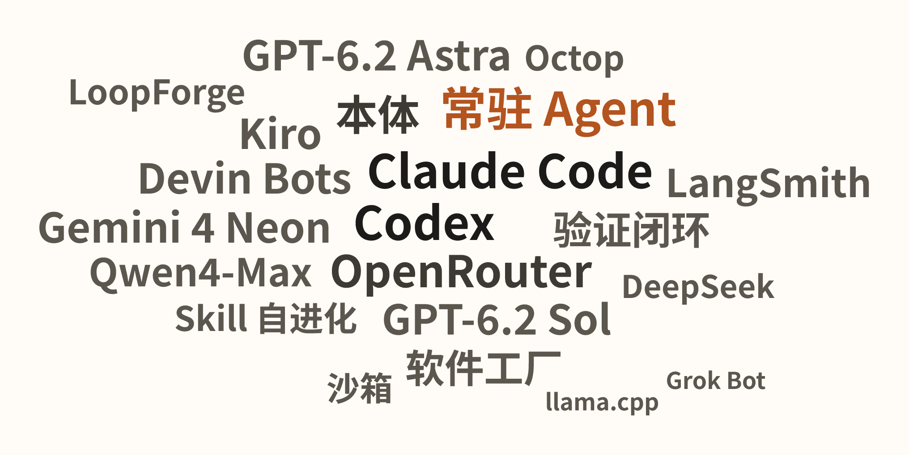
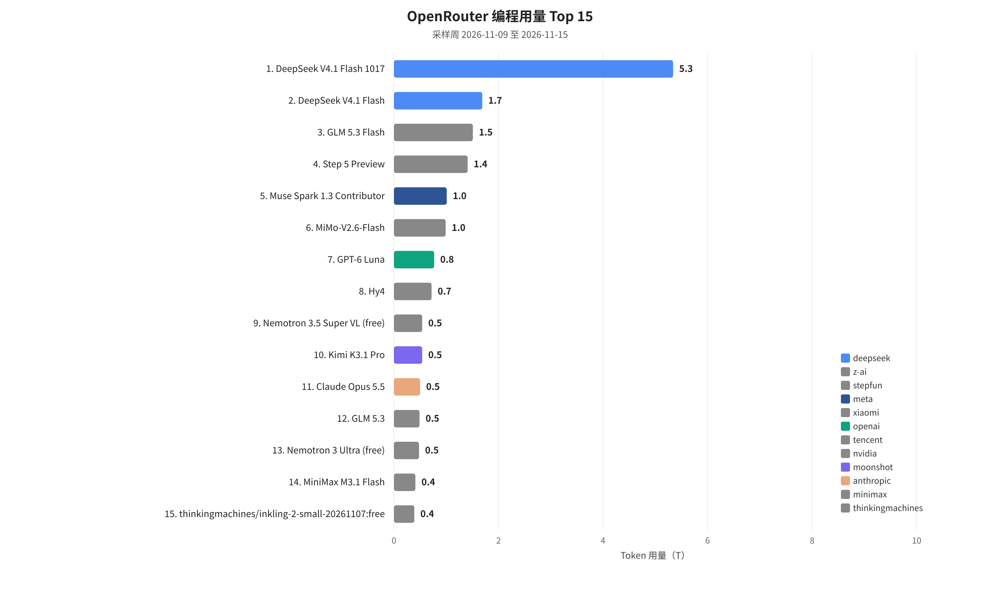

覆盖窗口：2026-11-13 00:00:00 至 2026-11-19 23:59:59（UTC；生成日 2026-11-20，不含当天）。

## 一、本周关键词

Gemini 4 Neon、GPT-6.2 Astra / Sol、Qwen4-Max、Devin Bots、常驻 Agent、软件工厂、Skill 自进化与评测、工具检索

<!-- keywords-cloud
[{"word":"Gemini 4 Neon","score":5,"mentions":2,"sources":3},{"word":"GPT-6.2 Astra / Sol","score":5,"mentions":1,"sources":2},{"word":"Qwen4-Max","score":4,"mentions":1,"sources":2},{"word":"Devin Bots","score":4,"mentions":2,"sources":2},{"word":"常驻 Agent","score":3,"mentions":2,"sources":3},{"word":"软件工厂","score":3,"mentions":2,"sources":2},{"word":"Skill 自进化与评测","score":3,"mentions":3,"sources":2},{"word":"工具检索","score":3,"mentions":2,"sources":3},{"word":"验证闭环","score":3,"mentions":3,"sources":3},{"word":"Super-agent","score":3,"mentions":2,"sources":1},{"word":"本体","score":2,"mentions":2,"sources":2},{"word":"Cursor 安全事件","score":3,"mentions":1,"sources":1},{"word":"DeepSeek 应用 API","score":3,"mentions":1,"sources":1},{"word":"llama.cpp v1.0","score":2,"mentions":1,"sources":1},{"word":"免费额度","score":2,"mentions":4,"sources":1}]
-->

 

## 二、模型进展

### Artificial Analysis

数据取自 [Artificial Analysis](https://artificialanalysis.ai/)，抓取于 2026-11-20 17:10（UTC+8）。红圈：GPT-6.2 Astra（Max / Xhigh / High / Medium）、Gemini 4 Neon（Xhigh / High）、GPT-6.2 Sol (Max)。

### LLM Arena

榜单发布日 2026-11-18。红圈：Gemini 4 Neon (High)（本周新发布，排第 3）。相对上一期正文采用的 2026-11-11 榜：Neon 新进 Top 15；上期末位的 Gemini 4 Hydrogen (High) 掉到第 16，跌出图外；Muse Spark 1.1 由第 14 滑到第 15。这些是名次变化，只有 Neon 是本周新模型。

### OpenRouter

数据取自 [OpenRouter](https://openrouter.ai/rankings)，统计窗口 2026-11-13 至 2026-11-19（UTC 完整日）。红圈：Hy4 flash。

数据取自 [OpenRouter](https://openrouter.ai/rankings) 的 Programming 分类，采样周 2026-11-09 至 2026-11-15。按 token 用量（周估计），不是质量榜。本期 Top 15 没有覆盖窗口内新发布的模型，不圈。

数据取自 [OpenRouter](https://openrouter.ai/apps)，统计窗口 2026-11-13 至 2026-11-19，公开应用按 token 用量。不圈。

### 模型发布

#### [Introducing GPT-6.2 Astra and Sol](https://openai.com/index/introducing-gpt-6-2-astra-sol)

OpenAI 11 月 17 日发布，官方称在专业产出、编码、computer use 和效率上提升，成本更低，覆盖 ChatGPT Work、Codex 和 API。CodeRabbit 的复测：Astra 6.2 在 83 个已知问题中抓到 58 个（上代 51 个），API 价格降到每百万 token 输入 8 美元、输出 40 美元，但评论量从 331 条涨到 847 条，精度从 21.7% 降到 12.2%，更吵；Sol 6.2 高推理抓到 60/81（Sol 6.1 为 58/81），单次评审成本约高 48%。CodeRabbit 自己说这些结果不能算纯模型提升。对研发：做代码评审先看噪声和成本，别只看抓到几个。[GPT-6.2 Sol and Astra review: should you switch?](https://coderabbit.ai/blog/gpt-6-2-sol-and-astra-review)

#### [Gemini 4 Neon in Google Antigravity](https://antigravity.google/blog/gemini-4-neon-in-google-antigravity)

11 月 18 日上线，定位在 Carbon（长程深度）与 Hydrogen（日常快速）之间，有 Low 到 Extra High 四档思考。Google 称它在 Artificial Analysis Intelligence Index 上 Extra High 档 61 分、排第 3，并在 Artificial Analysis Coding Agent Index 拿到第 1（58.6）。Orchestrator 现在支持 Neon 当规划者、Hydrogen 当执行者，Hydrogen 卡住时交还给 Neon 修计划。向付费的 AI Pro / Ultra 订阅者开放，覆盖桌面应用、CLI 和 IDE 扩展。Devin 的 FrontierCode 2.0 测得 46.2%、每任务 4.38 美元，比 Claude Opus 5.5 低约 1 分，成本约三分之一：[Gemini 4 Neon is now available in Devin](https://devin.ai/blog/gemini-4-neon)。

#### [Qwen4-Max 正式上线](https://qwen.ai/blog?id=qwen4-max)

阿里 11 月 16 日发布，2.4 万亿参数的 MoE，原生视觉，百万 token 上下文。官方内部评测称比 Qwen3.8-Max 最多少用约 50% token、单任务成本降 60% 以上；定价每百万 token 输入 1.5 美元、输出 4.5 美元、隐式缓存 0.075 美元。Vals AI 称它是 Vals Index 上最强的中国模型（总榜第 11）。可从千问 AI 平台 API、阿里 Token Plan、Qoder 调用，也已上线 OpenRouter 和 Vercel AI Gateway；中小尺寸会陆续开源。[Qwen4-Max 正式上线！](https://mp.weixin.qq.com/s?__biz=Mzg4NTczNzg2OA==&mid=2247512505&idx=1&sn=1c20deef6f26aaa98b23cfc483c123ca)、[Qwen4-Max is live on @OpenRouter](https://x.com/Alibaba_Qwen/status/2122171875573068153)、[Vercel AI Gateway](https://x.com/Alibaba_Qwen/status/2122248112479907848)、[Vals Index](https://x.com/Alibaba_Qwen/status/2122175103115075709)

 

## 三、项目开源

#### GitHub Trending（daily / all 前 5）

快照：mshibanami/GitHubTrendingRSS 的 daily/all 订阅源，更新于 2026-11-19 16:10（UTC+8）。第三方抓页，不是 GitHub 官方榜单。

1. [cursor/plugins](https://github.com/cursor/plugins)：Cursor 插件规范和官方插件集合，每个插件是仓库根目录下带 `.cursor-plugin/plugin.json` 的独立目录。
2. [HKUDS/CLI-Anything](https://github.com/HKUDS/CLI-Anything)：让各类软件对 Agent 原生可用的 CLI 方案，附 CLI-Hub。
3. [mvanhorn/last30days-skill](https://github.com/mvanhorn/last30days-skill)：Agent skill，跨 Reddit、X、YouTube、HN、Polymarket 和网页调研一个主题并汇总。
4. [getarcaneapp/arcane](https://github.com/getarcaneapp/arcane)：Docker 管理界面，main 分支现在是 v3。
5. [NVIDIA/SkillEvaluator](https://github.com/NVIDIA/SkillEvaluator)：评估 Agent skill 和插件的多层框架，含质量门禁、安全扫描、合成评测集生成和真实 Agent 评测。对研发：可参考它怎么给 skill 做回归评测。

#### [llama.cpp v1.0.0：本地 AI 生态更稳的底座](https://huggingface.co/blog/ggml-org/llama-cpp-v1)

llama.cpp 和 ggml 的库接口发布 v1.0.0，强调给下游开发者一个灵活但稳定的 API。对研发：自己嵌 llama.cpp 的项目现在可以按版本约束接口。

 

## 四、国内进展

#### &lt;产品&gt;&lt;DeepSeek&gt;[DeepSeek 发布全家桶应用 API](https://mp.weixin.qq.com/s?__biz=Mzk0OTYwNzc3NQ==&mid=2247485910&idx=1&sn=529f50ba3b37e39319dad1faf7a122cf)

把 App 里的联网搜索、读文件和读链接放进原有 API，由服务端完成工具调用。

微信原文这次没打开，页面只有壳，所以没有写完整总结。

#### &lt;开源&gt;&lt;腾讯&gt;[登上 GitHub Trending｜腾讯开源 LoopForge](https://mp.weixin.qq.com/s?__biz=MjM5ODYwMjI2MA==&mid=2649808207&idx=1&sn=2e8dc64891bdc8488ea11e48c33711b4)

腾讯开源一个云端、可无人值守的研发平台。

微信原文这次没打开，页面只有壳，所以没有写完整总结。

#### &lt;Agent 与 Harness&gt;&lt;腾讯&gt;[用 Super-agent 的理念拆解 Octop 团队模式](https://mp.weixin.qq.com/s?__biz=MjM5ODYwMjI2MA==&mid=2649808189&idx=1&sn=bde97fbc46f8cb2e118267dce763042c)

主持人 Agent 拆任务，多个专家 Agent 并行。

微信原文这次没打开，页面只有壳，所以没有写完整总结。

#### &lt;Agent 与 Harness&gt;&lt;腾讯&gt;[不只是 Memory：Ontology 如何让 Coding Agent 越用越懂项目](https://mp.weixin.qq.com/s?__biz=MjM5ODYwMjI2MA==&mid=2649808188&idx=1&sn=9493b80e2a1e4c6ab409e77f2ac57584)

用本体记下项目知识，再用执行反馈更新。

微信原文这次没打开，页面只有壳，所以没有写完整总结。

#### &lt;工程实践&gt;&lt;阿里&gt;[AI 写代码越来越快，谁来守住章法？](https://mp.weixin.qq.com/s?__biz=Mzg4NTczNzg2OA==&mid=2247512530&idx=1&sn=8b68130297282a0c27a8648c649b22e4)

AI 写得快，也更容易把代码写乱，要用可执行的质量门禁卡住。

微信原文这次没打开，页面只有壳，所以没有写完整总结。

#### &lt;Agent 与 Harness&gt;&lt;淘宝&gt;[Skill 自进化：基于执行轨迹与评测反馈的多代优化实践](https://mp.weixin.qq.com/s?__biz=MzAxNDEwNjk5OQ==&mid=2650547008&idx=1&sn=88ed890da980cee1caa6c9c21b90e773)

用评测和执行轨迹决定 skill 改动留不留，避免修好一处弄坏另一处。

微信原文这次没打开，页面只有壳，所以没有写完整总结。

#### &lt;Agent 与 Harness&gt;&lt;美团&gt;[《Agent评测白皮书》系列02](https://tech.meituan.com/2026/11/17/Agent-Evaluation-White-Paper-02.html)

商家广告助手不能只看回答像不像对，要验证整段任务有没有做完。

完整总结

<strong>在解决什么问题：</strong>广告助手要读真实账户、调多个工具、守投放规则，有时还直接改计划。只看最终回答，看不出意图、工具和账户状态对不对。

<strong>怎么解决：</strong>以巡检任务做业务 Benchmark，校准评测器并做错误分析，再用图灵平台做持续回归和模型选型。评测体系和 Agent 互相推动。

<strong>效果怎样：</strong>文章给出的是这套落地方法，没有另报一组总成绩。

<strong>后续可以怎么做：</strong>做 agent infra 时把评测器校准和回归放进同一条流水线。做业务时先定「任务做完」的标准，再让 Agent 改计划。

<strong>和最近的进展：</strong>这和本期淘宝 skill 自进化、Kiro 对评测饱和的复盘是同一类问题：评测本身要跟着 Agent 一起改。

#### &lt;Agent 与 Harness&gt;&lt;百度&gt;[从代码生成到需求交付：DarkFactory 的工程实践](https://mp.weixin.qq.com/s?__biz=Mzg5MjU0NTI5OQ==&mid=2247607833&idx=1&sn=46122dcf464df97a601d62e805c5e617)

以研发任务为中心组织多 Agent、执行环境和结果验证。

微信原文这次没打开，页面只有壳，所以没有写完整总结。

#### &lt;工程实践&gt;&lt;淘宝&gt;[淘宝闪购本体平台：让人与 AI Agent 共用一份实时可信的业务知识](https://mp.weixin.qq.com/s?__biz=Mzg4NTczNzg2OA==&mid=2247512538&idx=1&sn=e647beb5607a2116473bddad4cb04719)

用本体把指标口径收成一份，人和 Agent 看同一份业务知识。

微信原文这次没打开，页面只有壳，所以没有写完整总结。

#### &lt;工程实践&gt;&lt;淘宝&gt;[基于本体的 AI 数据研发落地](https://mp.weixin.qq.com/s?__biz=Mzg4NTczNzg2OA==&mid=2247512497&idx=1&sn=82924a5a7f2f62006617c12080a83fc2)

本体给 AI 写 SQL 提供精确输入，避免同名字段各说各话。

微信原文这次没打开，页面只有壳，所以没有写完整总结。

#### &lt;Agent 与 Harness&gt;&lt;火山引擎&gt;[把 80+ 项音视频能力装进 Claude Code 后，我合上了 FFmpeg 手册](https://mp.weixin.qq.com/s?__biz=MzI1MzYzMjE0MQ==&mid=2247524506&idx=1&sn=0d9dab639998e69bde48db3e1dadf652)

在 Claude Code 里用 skill 调音视频能力，文中实测不代表通用表现。

微信原文这次没打开，页面只有壳，所以没有写完整总结。

 

## 五、国际进展

#### &lt;产品&gt;&lt;Cognition&gt;[Introducing Devin Bots: from tasks to outcomes](https://devin.ai/blog/introducing-devin-bots)

Devin Bot 是带记忆的常驻 Agent，自己调查、派活、验收，只把要人判断的决定交回来。

完整总结

<strong>在解决什么问题：</strong>编码 Agent 把任务做完以后，找下一个问题、调查方案、检查改动有没有用，这些仍压在人身上。

<strong>怎么解决：</strong>Bot 持有目标和记忆，并行带着多个 Devin。人给的是要守住的结果，不是一张任务单。它用测试、录屏和每日报告自己判断下一步，只有需要人拍板时才来问。

<strong>效果怎样：</strong>文中用 Android 应用、页面跳动和游戏工作室三个内部例子说明它能长期守住一件事。具体产量以原文为准，这里不另引数字。

<strong>后续可以怎么做：</strong>做 agent infra 时先定义「怎样算成功」和 Bot 能改哪些系统。做业务时把长期维护、双端对齐或发布交给它，自己只处理 Needs You。

<strong>和最近的进展：</strong>这和 LangChain 的目标工程、Anthropic 的常驻 Agent 是同一类：从派任务改成交结果。

#### &lt;产品&gt;&lt;Cognition&gt;[Introducing Devin Apps](https://devin.ai/blog/devin-apps)

Devin 在自己的云电脑上托管私有网页应用，团队用链接打开。

完整总结

<strong>在解决什么问题：</strong>内部小工具往往要单独找地方托管，还接不上已有的代码和集成。

<strong>怎么解决：</strong>你描述要什么，Devin 在自己的机器上建好并给一个稳定链接。应用能用已有的 MCP、集成和代码库。机器空闲就休眠，有人打开再醒。更新不换网址，新版本起不来就继续用上一版。

<strong>效果怎样：</strong>适合内部工具、仪表盘和预发副本，不适合高流量的正式服务。

<strong>后续可以怎么做：</strong>做 agent infra 时把内部面板放在 Agent 同一台机器上，少接一套部署。做业务时用它替换共享表格，数据源仍走现有集成。

<strong>和最近的进展：</strong>它把 Devin Bot 守住的结果做成团队能打开的页面，而不是只留在会话里。

#### &lt;行业&gt;&lt;Cursor&gt;[An update on our recent security incident](https://cursor.com/blog/security-incident-update)

攻击从 Fireworks 泄露的访问密钥开始，后来有人拿到恶意的 Claude Code 扩展副本。

完整总结

<strong>在解决什么问题：</strong>10 月 29 日的事件需要说清攻击怎么进来、碰到了什么、哪些没有碰到。

<strong>怎么解决：</strong>攻击者用 Fireworks 侧暴露的密钥，复制了共享存储桶里的少量编码 Agent 轨迹，多为 2025 年、非隐私模式，其中少量凭据未脱敏。随后用被盗凭据进入部分 SaaS，并在扩展市场缓存里放了恶意扩展副本。Cursor 停用密钥、轮换凭据，并下架该副本。Open VSX 源没有这份恶意包，也不是 Anthropic 产品的漏洞。

<strong>效果怎样：</strong>原文写受影响面很小，并已直接通知相关客户。隐私模式的提示和代码不在暴露范围内。具体比例和时间以原文为准。

<strong>后续可以怎么做：</strong>做 agent infra 时给厂商密钥划范围并轮换，轨迹先脱敏。做业务时核对有没有收到通知，装过那两天扩展缓存的按安全通告处理。

<strong>和最近的进展：</strong>这和 Codex 沙箱是同一件事的两面：Agent 的凭据和轨迹都要有边界。

#### &lt;工程实践&gt;&lt;Anthropic&gt;[How the Claude Code team thinks about verification](https://claude.dev/blog/how-the-claude-code-team-thinks-about-verification/)

Agent 要能用证据验证自己的产出，才能并行跑很多个。

完整总结

<strong>在解决什么问题：</strong>Claude Code 团队大部分代码由 Claude 写并评审。没有验证闭环时，人只能同时看着一两个 Agent。

<strong>怎么解决：</strong>优先做端到端、性质和差分测试。端到端看整条用户路径，性质测试用随机输入找不变量，差分测试拿旧系统当对照。改动不能改判定自己的检查。检查失败几轮仍过不了，就交给人。

<strong>效果怎样：</strong>文中说有验证才能并行跑很多个，内部一次对照里单独评分能抬高较难任务的成功率。具体幅度以原文为准。

<strong>后续可以怎么做：</strong>做 agent infra 时先写一个快且稳的 verify skill，再加并行。做业务时让失败的检查说明为什么找你，而不是再堆一个更贵的评审。

<strong>和最近的进展：</strong>Kiro 同期也在说二元通过率会饱和，两边都是把评测从「过没过」改成能指导改动。

#### &lt;工程实践&gt;&lt;Anthropic&gt;[Using a "chaos loop" to harden the Claude Docs launch](https://claude.dev/blog/chaos-loop-claude-docs-launch/)

上线前让 Claude 在预发集群上持续压测、搞坏再修好。

完整总结

<strong>在解决什么问题：</strong>Claude Docs 上线前只在单机上给内部少数人用，不知道正式流量会不会把它压垮。

<strong>怎么解决：</strong>大约两周里，Claude Code 会话在镜像生产的预发集群上选场景、读遥测、改完再跑。难撤回的改动，例如表结构，会停下来等人。服务用 Rust、少依赖，好让测到的内存和延迟能对上自己写的代码。

<strong>效果怎样：</strong>原文写上线后十亿级请求里服务端错误很少，而且没有回滚。具体次数以原文为准。

<strong>后续可以怎么做：</strong>做 agent infra 时给 Agent 遥测和可重复的压测，并写明不能破的不变量。做业务时把「打开要快、确认过的编辑不能丢」这类标准先写下来再放它跑。

<strong>和最近的进展：</strong>这是验证闭环的一个长程例子：Agent 连续多日对着同一目标修，而不是等人逐条派活。

#### &lt;Agent 与 Harness&gt;&lt;Anthropic&gt;[Building always-on agents](https://claude.com/resources/articles/building-always-on-agents)

常驻 Agent 大部分时间在睡，被事件或计时器叫醒后再干活。

完整总结

<strong>在解决什么问题：</strong>用户感觉它一直在线，实现上却不能真的不关机，否则事件会丢、两次运行会打架。

<strong>怎么解决：</strong>五个原语：事件收件箱、计时器、记忆、权限、发件箱。来源把事件写入收件箱，由一个工人取出跑一轮，再把要给人的话放进发件箱。记忆只存别处查不到的东西。高风险动作可以先挂起，等用户回复变成新事件。

<strong>效果怎样：</strong>这是架构说明，没有报一组上线成绩。

<strong>后续可以怎么做：</strong>做 agent infra 时收件箱先保证至少一次、同时只有一个工人。做业务时让它先少发消息，用评测再决定可以多吵一点。

<strong>和最近的进展：</strong>Devin Bot 和 LangChain 的主动 Agent 都在做这件事，这篇把零件拆开了。

#### &lt;Agent 与 Harness&gt;&lt;LangChain&gt;[Goal Engineering](https://www.langchain.com/blog/goal-engineering)

目标要划成容易给人复核的一块，Agent 才能从反馈里学。

完整总结

<strong>在解决什么问题：</strong>Agent 开始承接开放目标。指错方向会浪费很多调用，而最难补的上下文往往没写在文档里，只能靠人的反馈。

<strong>怎么解决：</strong>把目标划成同一类、好一起复核的工作。Actively AI 先按客户账号各放一个 Agent，销售要在不同账号间来回切换，经验也难共享。后来改成「动作」：外联或早期商机各自一条，同类任务放在一起复核，账号背景另由后台 Agent 去收集。

<strong>效果怎样：</strong>文章讲的是这次改范围之后更好教，没有另给一组成绩。

<strong>后续可以怎么做：</strong>做 agent infra 时把复核界面和目标边界一起设计。做业务时不要按「一个客户一个 Agent」切，按销售重复做的那一类动作切。

<strong>和最近的进展：</strong>Devin Bot 把任务改成要守住的结果，这篇补的是结果要方便人批改。

#### &lt;Agent 与 Harness&gt;&lt;LangChain&gt;[What We've Learned Building Proactive Agents](https://www.langchain.com/blog/what-weve-learned-building-proactive-agents)

主动 Agent 在后台朝目标推进，记忆和复核界面决定它什么时候来打扰你。

完整总结

<strong>在解决什么问题：</strong>Agent 已经能像新同事一样从清清楚楚的小任务走到开放目标，但每次来问都占掉你的注意力。

<strong>怎么解决：</strong>触发可以是外部事件、人定的日程，或 Agent 自己定的跟进。LangChain 内部用销售 Agent 和工程 Agent 试。记忆来自过去的先例、当下的修改和事后的结果。复核要快，并且出现在人已经在用的 Slack 里。

<strong>效果怎样：</strong>文章认为记忆加上少而准的打扰，能让它越来越少犯已改过的错。没有单独的总成绩。

<strong>后续可以怎么做：</strong>做 agent infra 时把「什么值得记、什么已过期」做成定时整理，而不是只追加文件。做业务时先让它少发，再按你真正处理过的提醒加权限。

<strong>和最近的进展：</strong>Anthropic 的常驻 Agent 把收件箱和发件箱拆开，这篇讲的是发件箱里该放什么。

#### &lt;Agent 与 Harness&gt;&lt;LangChain&gt;[New context engineering challenges in late 2026](https://www.langchain.com/blog/context-engineering-challenges-late-2026)

常驻、奔着目标跑的 Agent 带来一批还没有通用解法的上下文问题。

完整总结

<strong>在解决什么问题：</strong>编码 Agent 那套做法已经比较齐：摘要、把大结果挪出去、skill、工具搜索、子 Agent。有人因此觉得难问题做完了。

<strong>怎么解决：</strong>文章不给一套新框架，只列出常驻 Agent 新碰到的难处：主动但不烦人、记什么、异步完成时怎么通知、怎样把目标拆开还一直试新办法、目标会被钻空子、浏览器比终端更难当主工具。

<strong>效果怎样：</strong>作者认为这些还没有通用解法，只是把问题摆出来。

<strong>后续可以怎么做：</strong>做 agent infra 时不要把「工具搜索已经有了」当成常驻 Agent 的全部。做业务时先写清目标不能怎么被钻，再让它优化。

<strong>和最近的进展：</strong>同期的目标工程和常驻 Agent 指南都在补这张清单里的某一条。

#### &lt;产品&gt;&lt;LangChain&gt;[LangSmith Tool Gateway: Secure, governed tool use for agents](https://www.langchain.com/blog/langsmith-tool-gateway)

公测一层网关，统一管每次工具调用的凭据、身份、审批和记录。

完整总结

<strong>在解决什么问题：</strong>Agent 开始定时跑、自己往下做。每个 Agent 各自写登录和令牌，工具一多就看不清它用了谁的身份。

<strong>怎么解决：</strong>工具在网关登记一次，再打成套件给某个 Agent。调用可以代表用户，或代表 Agent 自己的服务身份。可以拒绝某些工具，或在敏感动作前要求人点头。每次调用记在原来的 trace 里。

<strong>效果怎样：</strong>文章用商店运营和夜间对库存的两个 Agent 说明问题，没有另报上线成绩。公测。

<strong>后续可以怎么做：</strong>做 agent infra 时把退款这类动作放到网关的审批上，而不是写进每个 Agent。做业务时让夜间任务用服务身份，店员问答用本人身份。

<strong>和最近的进展：</strong>Gemini 的工具检索解决的是工具太多、上下文装不下；这篇解决的是谁有权调用。

#### &lt;Agent 与 Harness&gt;&lt;Google&gt;[Introducing Tool Retrieval in the Gemini API](https://blog.google/innovation-and-ai/technology/developers-tools/gemini-api-tool-retrieval/)

工具很多时，先只给名字和说明，要用再加载参数模式。

完整总结

<strong>在解决什么问题：</strong>每次请求都带上全部工具的参数模式，输入变长，选工具也更容易错。

<strong>怎么解决：</strong>预览版在 Interactions API 里加 `tool_search`，把不常用的工具标成延后加载。模型仍看得到名字和说明，需要时再取出完整模式，同一次请求里完成调用。也可以改成客户端自己搜。常用工具仍可一开始就带上。

<strong>效果怎样：</strong>没有单独收费，省不省 token 取决于没加载的模式是否多于加载的。文章建议用自己的流量量。

<strong>后续可以怎么做：</strong>做 agent infra 时把长尾工具延后，前缀缓存才稳。做业务时退款这类少用工具不要每轮都塞进提示。

<strong>和最近的进展：</strong>它和 LangSmith 工具网关互补：一个管装进上下文，一个管谁能调。

#### &lt;工程实践&gt;&lt;Warp&gt;[Becoming a factory engineer](https://www.warp.dev/blog/factory-engineering-software-factories)

工程重心从写实现，转到做那套让 Agent 写实现的系统。

完整总结

<strong>在解决什么问题：</strong>Agent 拿走了大部分实现之后，如果只剩下开会和收尾，工程看起来像被换掉了。

<strong>怎么解决：</strong>把计划、实现、评审里仍要人决定的部分当成系统设计：何时找人、Agent 能碰哪些密钥和 skill、怎样在找人之前自己验证。软件工厂是围着 Agent 的自动化环，人和 Agent 共用一套云端配置，而不是每人一套本机环境。要看的指标包括花费、用另一个模型给行为打分，以及让 Agent 能读到这些指标去改自己的流程。

<strong>效果怎样：</strong>这是概念说明，并指向一门免费课，没有报一组成绩。

<strong>后续可以怎么做：</strong>做 agent infra 时把花费和质量做成 Agent 能读的指标。做业务时先把低风险步骤自动化，评审仍留人。

<strong>和最近的进展：</strong>同期的 Warp Learn 和推广文把这套说法拆成课程和团队阻力。

#### &lt;工程实践&gt;&lt;Warp&gt;[Introducing Warp Learn: Build your first software factory](https://www.warp.dev/blog/warp-learn-software-factory-course)

一门免费课，带你做、量、改一个会自己改进的软件工厂。

这次没打开原文，只留上面这一句。

#### &lt;工程实践&gt;&lt;Warp&gt;[Overcoming challenges in software factory adoption](https://www.warp.dev/blog/software-factory-adoption-challenges)

软件工厂难推，是因为这个词像流水线，也因为 Agent 要从个人电脑挪到团队共用环境。

完整总结

<strong>在解决什么问题：</strong>开发者听到工厂会以为自己不再做有意思的工程。另一头，每人自选模型和 skill 的做法，到了账单和安全上就不可控。

<strong>怎么解决：</strong>把工作说成设计工厂，而不是站在产线上。工厂产出的仍是给客户的软件，只是吞吐、成本和质量要一起看。Agent 的行为放到云端、写成团队能改的配置，而不是留在每个人的笔记本上。作者建议承认迁移会暂时变慢，但长期不维持上百套个人环境。

<strong>效果怎样：</strong>文章是观点，没有报一组采用数据。

<strong>后续可以怎么做：</strong>做 agent infra 时把 skill 和模型选择收成团队配置，并量花费。做业务时先跟资深工程师说清楚，个人环境暂时变差不代表方向错了。

<strong>和最近的进展：</strong>这是上一篇「工厂工程」在团队里会碰到的阻力。

#### &lt;工程实践&gt;&lt;AWS&gt;[Lessons learned from one million evaluations](https://kiro.dev/blog/1m-evals-lessons)

固定题集加二元通过率会饱和，通过了也不等于客户体验好。

完整总结

<strong>在解决什么问题：</strong>编码 Agent 的评测常常是一套固定任务、只看过没过。模型变强以后，剩下的差距可能是基准噪声。工具调用失败、变慢、变贵，都可能不影响通过率。

<strong>怎么解决：</strong>Kiro 把场景按真实用量的任务、领域和语言补齐，来源包括自己写的、其他团队的和公开基准。每次除了通过率，还看延迟、token、工具失败，以及用模型给代码质量和语气打分。再拿调查和用户原话核对，数据和故事不一致时先听故事。

<strong>效果怎样：</strong>一次模型上线在公开基准上正常，内部试用却更差，后来发现工具描述让新模型大量用错参数。文章用这个例子说明为什么要改评测，没有另给总成绩。

<strong>后续可以怎么做：</strong>做 agent infra 时别只用一个饱和的公开基准做回归。做业务时把「通过了但更慢更贵」也记进评测。

<strong>和最近的进展：</strong>Anthropic 同期强调端到端和性质测试，都是不满足于二元通过。

#### &lt;Agent 与 Harness&gt;&lt;OpenAI&gt;[Inside the Codex sandbox](https://openai.com/index/inside-the-codex-sandbox)

Codex 在你现有的环境里跑命令，用系统自带的沙箱限制文件和网络。

完整总结

<strong>在解决什么问题：</strong>把计算搬进容器会丢掉本机才有的工具，例如 Mac 上的 iOS 工具链和模拟器。可是命令又不能不受限。

<strong>怎么解决：</strong>沙箱留在用户现有环境里，用各系统自己的机制限制。权限配置写明能写哪里、能读哪里、网络开不开。默认在仓库里可写，`.git` 和配置目录只读，网络关掉。训练和对齐仍是另一层，因为沙箱挡不住所有坏事，例如改被忽略的本地依赖。

<strong>效果怎样：</strong>这是设计说明，覆盖 macOS、Linux 和 Windows，没有报一组拦截数据。

<strong>后续可以怎么做：</strong>做 agent infra 时默认收紧网络，把本机工具链留在沙箱里而不是再包一层容器。做业务时按任务写权限：整理图片可以改图片目录，评审代码就不要给写权限。

<strong>和最近的进展：</strong>Cursor 同期说明凭据泄露后的后果，这篇讲的是命令本身的边界。

#### &lt;产品&gt;&lt;Hugging Face&gt;[Hugging Face and OpenRouter join forces to make open-weight models easy to run](https://huggingface.co/blog/openrouter)

Hub 上的开源权重模型改由 OpenRouter 选提供商，仍用 Hugging Face 的 token 调用。

完整总结

<strong>在解决什么问题：</strong>以前一次请求只选一个提供商，失败就把错误返回来。

<strong>怎么解决：</strong>语言请求改走 OpenRouter，按当时的价格、速度和可靠性挑选，失败就在同一次调用里换下一家。对话可以留在已有缓存的那一家。模型名加后缀仍可指定最快、最便宜或某一家。图像、视频、音频不走这条路由。账单仍是提供商的价格，Hugging Face 不加价。不能再拿自己的提供商密钥走这些语言模型。

<strong>效果怎样：</strong>文章引用了 OpenRouter 上开源权重占比和路由改版后的错误、延迟变化，数字以原文为准，这里不转述。

<strong>后续可以怎么做：</strong>做 agent infra 时把会话标成稳定 id，避免缓存被打散。做业务时在设置里关掉不想用的提供商，代码不用改。

<strong>和最近的进展：</strong>这和本期 OpenRouter 用量图是同一条路由，只是 Hugging Face 把调用入口接了过去。

#### &lt;Agent 与 Harness&gt;&lt;AWS&gt;[Amazon Bedrock AgentCore harness adds Strands harness defaults, built-in tools, and lifecycle hooks](https://aws.amazon.com/blogs/machine-learning/amazon-bedrock-agentcore-harness-adds-strands-harness-defaults-built-in-tools-and-lifecycle-hooks/)

托管的 Agent 运行时换上开源 Strands 的默认配置，并在关键动作前允许插入确定的检查。

完整总结

<strong>在解决什么问题：</strong>选好模型之后，Agent 仍要工具、长会话里的上下文，以及退款这类动作前的护栏。这些如果每个 Agent 自己拼，很难保持一致。

<strong>怎么解决：</strong>AgentCore harness 改用 Apache 2.0 的 Strands harness 做默认：推荐模型、面向把任务做完的系统提示、提示缓存和上下文摘要，另有计划、网页抓取、文件、委派等内置工具。生命周期钩子让 Lambda 在调用前或工具前允许或拒绝。不改配置的现有 harness 会自动拿到这套默认。显式写了模型和工具列表的保持原样。

<strong>效果怎样：</strong>文章说明的是默认变强、钩子能拦住退款，没有另报一组客户成绩。

<strong>后续可以怎么做：</strong>做 agent infra 时把退款限额写成工具前的拒绝，而不是写进提示。做业务时如果要固定模型，就显式配置，不要依赖会变的推荐默认。

<strong>和最近的进展：</strong>LangSmith 工具网关也在管谁能调用工具，这篇把检查放进 AWS 上的一次调用里。

#### &lt;产品&gt;&lt;Amp&gt;[Amp for Windows](https://ampcode.com/news/amp-for-windows)

Amp 推出 Windows 原生应用。

完整总结

<strong>在解决什么问题：</strong>Amp 原先的桌面应用还没有 Windows 版。

<strong>怎么解决：</strong>原文只宣布 Windows 应用已经有了，并指向文档和其他原生应用。

<strong>效果怎样：</strong>页面没有写功能和对比。

<strong>后续可以怎么做：</strong>做 agent infra 或业务时，如果团队在 Windows 上，可以直接装这个原生应用，不必再绕一层。

<strong>和最近的进展：</strong>这是编码 Agent 桌面端补平台，和本期其他 Agent 产品发布是同一类客户端消息。

#### &lt;产品&gt;&lt;Lovable&gt;[Lovable Drafts](https://lovable.dev/blog/introducing-drafts)

可以复制整个应用并行试想法，线上版本保持不动。

完整总结

<strong>在解决什么问题：</strong>想试另一种做法时，会碰到正在线上跑的应用。

<strong>怎么解决：</strong>新建草稿会复制设计，需要时连同数据库。每个草稿有自己的对话和预览。接受以后再发布才上线。试的数据留在草稿里，接受或删除时清掉。接受后、发布前还可以从历史撤回。

<strong>效果怎样：</strong>文章用销售工具和多国市场的例子说明可以并排试，没有报一组使用量。

<strong>后续可以怎么做：</strong>做 agent infra 时让生成的改动先进草稿，不要直接写线上。做业务时让同事在自己的草稿里改，你再决定收哪一版。

<strong>和最近的进展：</strong>这和 Devin Apps 一样，都是让人在不影响正式环境的副本里看 Agent 做出的东西。

#### &lt;产品&gt;&lt;Anthropic&gt;[Linked billing on the Claude Platform](https://claude.com/resources/articles/linked-billing-on-claude-platform)

Claude Platform 支持关联计费。

这次没打开原文，只留上面这一句。

#### &lt;产品&gt;&lt;Warp&gt;[Warp now supports linked billing with Claude Platform](https://www.warp.dev/blog/warp-now-supports-linked-billing-with-claude-platform)

Warp 同步支持 Claude Platform 的关联计费。

这次没打开原文，只留上面这一句。
