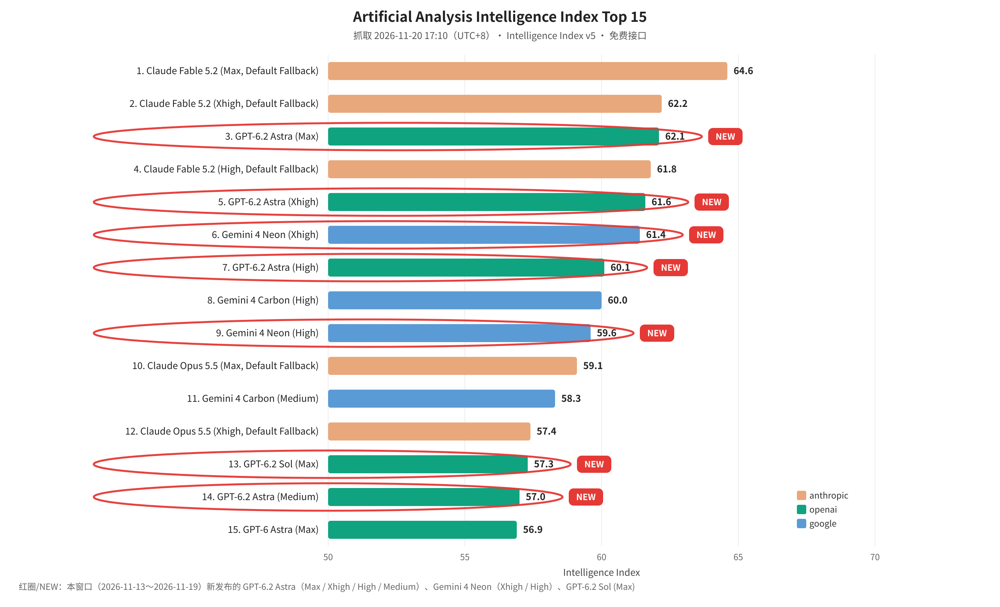
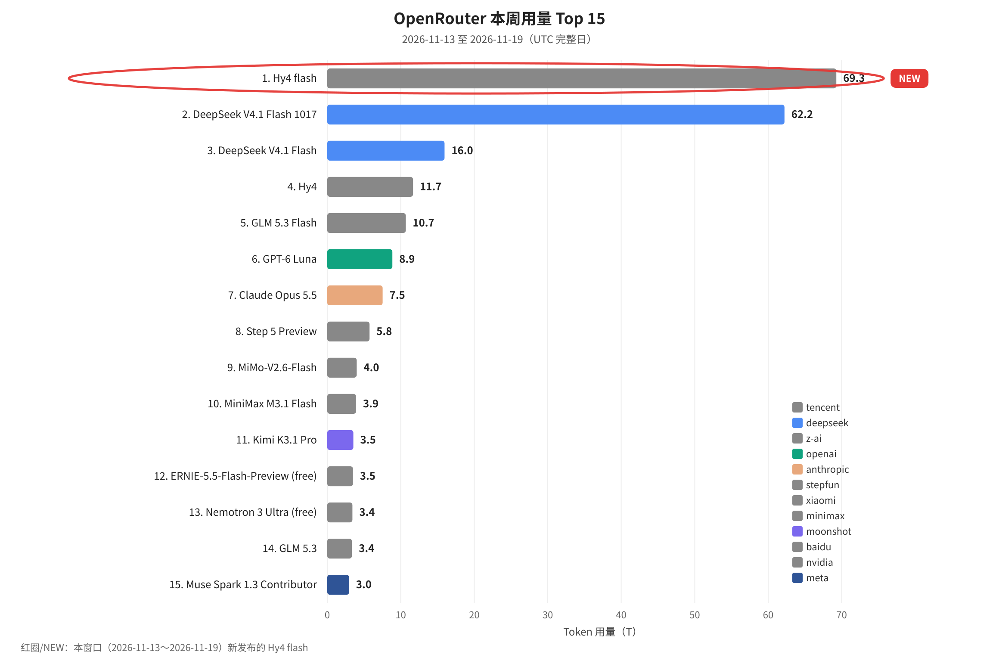
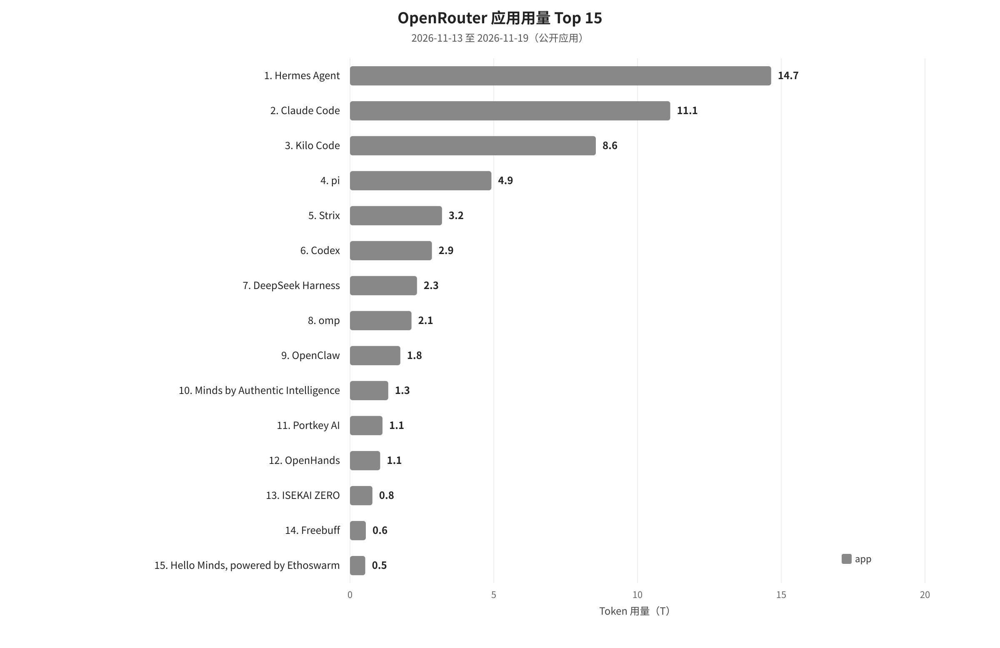

覆盖窗口：2026-11-13 00:00:00 至 2026-11-19 23:59:59（UTC；生成日 2026-11-20，不含当天）。

## 一、本周关键词

Gemini 4 Neon、GPT-6.2 Astra / Sol、Qwen4-Max、Devin Bots、常驻 Agent、软件工厂、Skill 自进化与评测、工具检索

<!-- keywords-cloud
[{"word":"Gemini 4 Neon","score":5,"mentions":2,"sources":3},{"word":"GPT-6.2 Astra / Sol","score":5,"mentions":1,"sources":2},{"word":"Qwen4-Max","score":4,"mentions":1,"sources":2},{"word":"Devin Bots","score":4,"mentions":2,"sources":2},{"word":"常驻 Agent","score":3,"mentions":2,"sources":3},{"word":"软件工厂","score":3,"mentions":2,"sources":2},{"word":"Skill 自进化与评测","score":3,"mentions":3,"sources":2},{"word":"工具检索","score":3,"mentions":2,"sources":3},{"word":"验证闭环","score":3,"mentions":3,"sources":3},{"word":"Super-agent","score":3,"mentions":2,"sources":1},{"word":"本体","score":2,"mentions":2,"sources":2},{"word":"Cursor 安全事件","score":3,"mentions":1,"sources":1},{"word":"DeepSeek 应用 API","score":3,"mentions":1,"sources":1},{"word":"llama.cpp v1.0","score":2,"mentions":1,"sources":1},{"word":"免费额度","score":2,"mentions":4,"sources":1}]
-->

 

## 二、模型进展

### Artificial Analysis

这张智力指数前 15 里，本周新发布的是 GPT-6.2 Astra、Gemini 4 Neon 和 GPT-6.2 Sol。

<!-- chart-meta
红圈：GPT-6.2 Astra（Max / Xhigh / High / Medium）、Gemini 4 Neon（Xhigh / High）、GPT-6.2 Sol (Max)。
-->

### LLM Arena

Gemini 4 Neon (High) 新进第 3。上一期榜末的 Gemini 4 Hydrogen (High) 掉出前 15，Muse Spark 1.1 从第 14 到第 15，Muse Wonder (Max) 从第 3 到第 4。

<!-- chart-meta
榜单发布日 2026-11-18。红圈：Gemini 4 Neon (High)。
-->

### OpenRouter

Hy4 flash 这周用量排到第 1，上一期第 1 的 DeepSeek V4.1 Flash 落到第 2。

<!-- chart-meta
红圈：Hy4 flash。
-->

这是编程场景的 token 用量，不是质量排名。Inkling 2 Small (free) 和 MiMo-V2.6-Flash 新进前 15，图上没有本周才发布的模型。

公开应用用量的前四仍是 Hermes Agent、Claude Code、Kilo Code 和 pi。

#### [Introducing GPT-6.2 Astra and Sol](https://openai.com/index/introducing-gpt-6-2-astra-sol)

OpenAI 11 月 17 日发布，官方称在专业产出、编码、computer use 和效率上提升，成本更低，覆盖 ChatGPT Work、Codex 和 API。CodeRabbit 的复测：Astra 6.2 在 83 个已知问题中抓到 58 个（上代 51 个），API 价格降到每百万 token 输入 8 美元、输出 40 美元，但评论量从 331 条涨到 847 条，精度从 21.7% 降到 12.2%，更吵；Sol 6.2 高推理抓到 60/81（Sol 6.1 为 58/81），单次评审成本约高 48%。CodeRabbit 自己说这些结果不能算纯模型提升。对研发：做代码评审先看噪声和成本，别只看抓到几个。[GPT-6.2 Sol and Astra review: should you switch?](https://coderabbit.ai/blog/gpt-6-2-sol-and-astra-review)

#### [Gemini 4 Neon in Google Antigravity](https://antigravity.google/blog/gemini-4-neon-in-google-antigravity)

11 月 18 日上线，定位在 Carbon（长程深度）与 Hydrogen（日常快速）之间，有 Low 到 Extra High 四档思考。Google 称它在 Artificial Analysis Intelligence Index 上 Extra High 档 61 分、排第 3，并在 Artificial Analysis Coding Agent Index 拿到第 1（58.6）。Orchestrator 现在支持 Neon 当规划者、Hydrogen 当执行者，Hydrogen 卡住时交还给 Neon 修计划。向付费的 AI Pro / Ultra 订阅者开放，覆盖桌面应用、CLI 和 IDE 扩展。Devin 的 FrontierCode 2.0 测得 46.2%、每任务 4.38 美元，比 Claude Opus 5.5 低约 1 分，成本约三分之一：[Gemini 4 Neon is now available in Devin](https://devin.ai/blog/gemini-4-neon)。

#### [Qwen4-Max 正式上线](https://qwen.ai/blog?id=qwen4-max)

阿里 11 月 16 日发布，2.4 万亿参数的 MoE，原生视觉，百万 token 上下文。官方内部评测称比 Qwen3.8-Max 最多少用约 50% token、单任务成本降 60% 以上；定价每百万 token 输入 1.5 美元、输出 4.5 美元、隐式缓存 0.075 美元。Vals AI 称它是 Vals Index 上最强的中国模型（总榜第 11）。可从千问 AI 平台 API、阿里 Token Plan、Qoder 调用，也已上线 OpenRouter 和 Vercel AI Gateway；中小尺寸会陆续开源。[Qwen4-Max 正式上线！](https://mp.weixin.qq.com/s?__biz=Mzg4NTczNzg2OA==&mid=2247512505&idx=1&sn=1c20deef6f26aaa98b23cfc483c123ca)、[Qwen4-Max is live on @OpenRouter](https://x.com/Alibaba_Qwen/status/2122171875573068153)、[Vercel AI Gateway](https://x.com/Alibaba_Qwen/status/2122248112479907848)、[Vals Index](https://x.com/Alibaba_Qwen/status/2122175103115075709)

 

## 三、项目开源

#### GitHub Trending（weekly / all 前 5）

这期看的是一周榜，前五是 Plannotator、Stitch Skills、Modern Web Guidance、OpenCodeReview 和 last30days。

#### [backnotprop/plannotator](https://github.com/backnotprop/plannotator)

跟上 Agent 的工作区：整理计划、批注、审代码，和团队共享，再把<mark>反馈一键发回 Agent</mark>。

完整总结

<strong>解决什么问题：</strong>人和多个 Agent 一起干活时，决定、计划、原型和改动散在各处，审完也不容易把意见送回正在跑的那一个。

<strong>如何解决：</strong>它是本地浏览器里的审阅面，用插件、钩子和命令接上编码 Agent。Agent 给出决定、计划、HTML 或做完一轮，页面打开，人批注计划、规格和消息，或在 diff 和 PR 上评论，再把反馈发回。Inbox 把消息、问题和文件收在一个本地窗口，回复回到提问的那个会话，审的时候不必一直占着会话。代码评审覆盖本地改动和远端 PR，也提到 Git、GitButler、Jujutsu、Perforce、GitHub 和 GitLab。

<strong>效果怎样：</strong>仓库说明没有另报一组使用量。它把批注和评论送回提出那件事的 Agent。

<strong>洞察与启发：</strong>审的时候若占着正在跑的会话，人就只能盯着一个 Agent。本地窗口把批注送回去，回复回到提问的那个会话，Agent 不必等人一直开着它。

<strong>相关工作：</strong>同期的 OpenCodeReview 也在按行写代码评论，这里多了计划和产物的批注。Claude Code 那篇说没有验证闭环时人只能看着一两个 Agent，这是把人的标记送回去的那一层。

#### [google-labs-code/stitch-skills](https://github.com/google-labs-code/stitch-skills)

给 Stitch MCP 用的 <mark>Agent Skill 库</mark>，按开放标准写，兼容 Antigravity、Gemini CLI、Claude Code 和 Cursor。

完整总结

<strong>解决什么问题：</strong>编码 Agent 要接上 Google Stitch，缺一套能装进现有 Agent 的 skill。

<strong>如何解决：</strong>按 Agent Skills 开放标准提供 skill 和插件，给 Stitch 的 MCP 用。插件分成设计、构建和工具三类。说明里写兼容 Codex、Antigravity、Gemini CLI、Claude Code、Cursor，OpenCode 需手动安装。Codex、Claude Code、Cursor 可以走插件市场或 npx；OpenCode 要把 skill 目录拷进它能发现的路径，并自己接上 MCP。

<strong>效果怎样：</strong>仓库说明没有另报一组使用成绩。装上之后，这些 Agent 可以按同一套 skill 调用 Stitch。

<strong>洞察与启发：</strong>设计能力要进编码 Agent，卡在每家的安装方式不一样，不在 skill 正文本身。同一套开放标准，Codex、Claude Code、Cursor 能走插件，OpenCode 仍要手动拷目录并自己接上 MCP。

<strong>相关工作：</strong>这和本期把一类领域能力收成 skill 是同一侧，例如火山那篇把音视频收成命令。这里多了一层：标准统一了，安装仍按 Agent 分开。

#### [GoogleChrome/modern-web-guidance-src](https://github.com/GoogleChrome/modern-web-guidance-src)

把 Web 最佳实践和<mark>浏览器兼容数据</mark>做成编码 Agent 的 skill。

完整总结

<strong>解决什么问题：</strong>编码 Agent 容易沿用训练数据里的旧写法，用一大段 JavaScript 去做浏览器已经提供的事。模型就算知道某个接口，也常常缺少能直接用的现代写法。

<strong>如何解决：</strong>这是 Modern Web Guidance 的源码仓库，由 Chrome、Edge、Firefox 和 MDN 一起维护。skill 把 Web 平台经验、最佳实践和浏览器兼容数据放进 Agent 的上下文。命令行可以搜索指南、按编号取出一篇，或扫描代码库里的过时写法。安装向导要求 Node.js 22 或更新。

<strong>效果怎样：</strong>仓库说明没有另给一组对照成绩。它要让 Agent 少用过时模式，改用浏览器自己能优化、也带无障碍能力的接口。

<strong>洞察与启发：</strong>模型知道某个 Web 接口存在，仍可能写出过时的一大段脚本，因为训练数据里旧写法更密。把实践和兼容数据放进上下文，是在补这个密度，不是再教一遍接口名单。

<strong>相关工作：</strong>同期 Gemini 的工具检索解决的是工具太多、上下文装不下。这篇解决的是写 Web 时上下文里缺现代写法。阿里那篇把规矩做成构建失败，这里是用 skill 把写法送进 Agent。

#### [alibaba/open-code-review](https://github.com/alibaba/open-code-review)

代码评审工具，确定流程加上 LLM Agent，<mark>按行评论</mark>，规则覆盖空指针、线程安全、XSS 和 SQL 注入，接口兼容 OpenAI 和 Anthropic。

完整总结

<strong>解决什么问题：</strong>只看 diff 的评审容易停在表面，通用 Agent 又容易又吵又贵。

<strong>如何解决：</strong>它读 Git diff，把改动交给可配置的模型。Agent 能读整个文件、搜索代码库、看其他改动，再按行写出评论。规则覆盖空指针、线程安全和注入。接口兼容 OpenAI 和 Anthropic。除了 diff，也可以整文件扫描没有像样 diff 的目录。

<strong>效果怎样：</strong>仓库说明写，和通用 Agent 用同一个模型时，它的精度更高、用掉的 token 大约是九分之一，召回更低，这是有意少报噪声。它还写到在阿里内部用了两年。具体数字以仓库说明为准。

<strong>洞察与启发：</strong>通用 Agent 用同一个模型也能评审，但更吵。少报噪声是有意用召回换精度，不是没找到问题。

<strong>相关工作：</strong>这和本期 Kiro 对评测饱和的复盘、Anthropic 的验证闭环是同一类：过了不等于有用。Plannotator 把人的评论送回 Agent，这里是模型按行先写出评论。

#### [mvanhorn/last30days-skill](https://github.com/mvanhorn/last30days-skill)

Agent skill，跨 Reddit、X、YouTube、HN、Polymarket 和网页<mark>调研一个主题并汇总</mark>。

完整总结

<strong>解决什么问题：</strong>单个模型碰不到 Reddit 评论、X、YouTube 这些各自隔开的来源，搜一个主题时看不到别人正在讨论什么。

<strong>如何解决：</strong>这是一个 Agent skill。Reddit、HN、Polymarket 和 GitHub 不用额外配置就能查；跑一次设置向导后再打开 X、YouTube、TikTok、arXiv 等。它并行去搜，按点赞、投票和 Polymarket 上的真实仓位打分，再收成一份简报。

<strong>效果怎样：</strong>仓库说明没有另报一组准确率。它给出的是按这些平台上的互动收成的一份简报。

<strong>洞察与启发：</strong>单个模型搜不到的，往往不是网页，而是各平台自己的互动：点赞、投票和真实仓位。把这些隔开的来源收成一份简报，比再换一个搜索引擎更靠近别人正在怎么看。

<strong>相关工作：</strong>同期的目标工程说最难补的上下文没写在文档里。这篇是从 Reddit、X 和预测市场把那段还没写进文档的讨论找出来。

 

## 四、精选文章

### 国内模型厂

#### &lt;产品&gt;&lt;DeepSeek&gt;[DeepSeek 发布全家桶应用 API](https://mp.weixin.qq.com/s?__biz=Mzk0OTYwNzc3NQ==&mid=2247485910&idx=1&sn=529f50ba3b37e39319dad1faf7a122cf)

把 App 的联网搜索、读文件、读链接和语音放进原有 API，<mark>工具调用由服务端完成</mark>。

完整总结

<strong>解决什么问题：</strong>开发者要在自己的应用里做出 App 那种联网搜索、读文件、读链接和语音，还得自己接工具并处理调用衔接。

<strong>如何解决：</strong>在原有对话接口打开参数后，搜索、读链接、文件解析和上下文拼接由服务端完成；Search、Fetch、OCR、ASR、TTS 也可单独调用。对外提供服务时打开安全校验。

<strong>效果怎样：</strong>官方用这套接口做了可导入历史对话的轻量示例并开源，对话能力和 App 基本一致。

<strong>洞察与启发：</strong>应用里要做出联网搜索、读文件和语音，难的是调用衔接，不是再接一套工具。收到服务端之后，这些能力才像 App 里那样能直接用。

<strong>相关工作：</strong>这篇把单次对话的工具调用收到服务端。同期的 LoopForge 和 Octop 则把调度和执行拆开，让任务在人离开后继续跑。

### 国外模型厂

#### &lt;工程实践&gt;&lt;Anthropic&gt;[How the Claude Code team thinks about verification](https://claude.dev/blog/how-the-claude-code-team-thinks-about-verification/)

Agent 要能<mark>用证据验证</mark>自己的产出，才能并行跑很多个。

完整总结

<strong>解决什么问题：</strong>Claude Code 团队大部分代码由 Claude 写并评审。没有验证闭环时，人只能同时看着一两个 Agent。

<strong>如何解决：</strong>优先做端到端、性质和差分测试。端到端看整条用户路径，性质测试用随机输入找不变量，差分测试拿旧系统当对照。改动不能改判定自己的检查。检查失败几轮仍过不了，就交给人。

<strong>效果怎样：</strong>文中说有验证才能并行跑很多个，内部一次对照里单独评分能抬高较难任务的成功率。具体幅度以原文为准。

<strong>洞察与启发：</strong>没有能用证据验证的检查，人就只能同时看着一两个 Agent。改动若能改判定自己的检查，通过了也不算数。

<strong>相关工作：</strong>Kiro 同期也在说二元通过率会饱和，两边都是把评测从「过没过」改成能指导改动。

#### &lt;工程实践&gt;&lt;Anthropic&gt;[Using a "chaos loop" to harden the Claude Docs launch](https://claude.dev/blog/chaos-loop-claude-docs-launch/)

上线前让 Claude 在预发集群上持续压测、<mark>搞坏再修好</mark>。

完整总结

<strong>解决什么问题：</strong>Claude Docs 上线前只在单机上给内部少数人用，不知道正式流量会不会把它压垮。

<strong>如何解决：</strong>大约两周里，Claude Code 会话在镜像生产的预发集群上选场景、读遥测、改完再跑。难撤回的改动，例如表结构，会停下来等人。服务用 Rust、少依赖，好让测到的内存和延迟能对上自己写的代码。

<strong>效果怎样：</strong>原文写上线后十亿级请求里服务端错误很少，而且没有回滚。具体次数以原文为准。

<strong>洞察与启发：</strong>上线前不知道会不会被压垮，是因为只在单机上给少数人用过。Agent 能连续修，是因为遥测和不能破的标准先在，难撤回的改动仍会停下来。

<strong>相关工作：</strong>这是验证闭环的一个长程例子：Agent 连续多日对着同一目标修，而不是等人逐条派活。

#### &lt;Agent 与 Harness&gt;&lt;Anthropic&gt;[Building always-on agents](https://claude.com/resources/articles/building-always-on-agents)

常驻 Agent <mark>大部分时间在睡</mark>，被事件或计时器叫醒后再干活。

完整总结

<strong>解决什么问题：</strong>用户感觉它一直在线，实现上却不能真的不关机，否则事件会丢、两次运行会打架。

<strong>如何解决：</strong>五个原语：事件收件箱、计时器、记忆、权限、发件箱。来源把事件写入收件箱，由一个工人取出跑一轮，再把要给人的话放进发件箱。记忆只存别处查不到的东西。高风险动作可以先挂起，等用户回复变成新事件。

<strong>效果怎样：</strong>这是架构说明，没有报一组上线成绩。

<strong>洞察与启发：</strong>用户感觉它一直在线，实现上却不能真的不关机。事件若会丢、两次运行会打架，常驻就只是把进程挂着。

<strong>相关工作：</strong>Devin Bot 和 LangChain 的主动 Agent 都在做这件事，这篇把零件拆开了。

#### &lt;产品&gt;&lt;Anthropic&gt;[Linked billing on the Claude Platform](https://claude.com/resources/articles/linked-billing-on-claude-platform)

Claude Platform 的<mark>关联计费</mark>。

订阅源里只有这些，所以没有写完整总结。

#### &lt;Agent 与 Harness&gt;&lt;OpenAI&gt;[Inside the Codex sandbox](https://openai.com/index/inside-the-codex-sandbox)

Codex 在你现有的环境里跑命令，用<mark>系统自带的沙箱</mark>限制文件和网络。

完整总结

<strong>解决什么问题：</strong>把计算搬进容器会丢掉本机才有的工具，例如 Mac 上的 iOS 工具链和模拟器。可是命令又不能不受限。

<strong>如何解决：</strong>沙箱留在用户现有环境里，用各系统自己的机制限制。权限配置写明能写哪里、能读哪里、网络开不开。默认在仓库里可写，`.git` 和配置目录只读，网络关掉。训练和对齐仍是另一层，因为沙箱挡不住所有坏事，例如改被忽略的本地依赖。

<strong>效果怎样：</strong>这是设计说明，覆盖 macOS、Linux 和 Windows，没有报一组拦截数据。

<strong>洞察与启发：</strong>把计算搬进容器会丢掉本机才有的工具。沙箱留在现有环境里，挡的是文件和网络，挡不住改被忽略的本地依赖这类事。

<strong>相关工作：</strong>Cursor 同期说明凭据泄露后的后果，这篇讲的是命令本身的边界。

#### &lt;Agent 与 Harness&gt;&lt;Google&gt;[Introducing Tool Retrieval in the Gemini API](https://blog.google/innovation-and-ai/technology/developers-tools/gemini-api-tool-retrieval/)

工具很多时，先只给名字和说明，要用再<mark>加载参数模式</mark>。

完整总结

<strong>解决什么问题：</strong>每次请求都带上全部工具的参数模式，输入变长，选工具也更容易错。

<strong>如何解决：</strong>预览版在 Interactions API 里加 `tool_search`，把不常用的工具标成延后加载。模型仍看得到名字和说明，需要时再取出完整模式，同一次请求里完成调用。也可以改成客户端自己搜。常用工具仍可一开始就带上。

<strong>效果怎样：</strong>没有单独收费，省不省 token 取决于没加载的模式是否多于加载的。文章建议用自己的流量量。

<strong>洞察与启发：</strong>每轮都带上全部工具的参数模式，输入变长，选工具也更容易错。先只给名字和说明，要用再加载，省不省取决于没加载的是否多于加载的。

<strong>相关工作：</strong>它和 LangSmith 工具网关互补：一个管装进上下文，一个管谁能调。

#### &lt;产品&gt;&lt;xAI&gt;[Building an accounting team with Grok Bot](https://x.ai/news/grok-bot-accounting)

五名 Grok Bot 在 SpaceXSI 各管一段<mark>会计工作</mark>，从给客户开户到收款，只有需要判断时才找人。

订阅源里只有这些，所以没有写完整总结。

#### &lt;工程实践&gt;&lt;Meta&gt;[How Meta Uses AI Agents to Scale ML Innovations Across Ads Ranking Models](https://engineering.fb.com/2026/11/18/ml-applications/ai-agents-to-scale-ml-innovations-across-ads-ranking-models/)

Ranking Engineer Agent 提出假设并设计实验，这篇写怎么把验证过的改进<mark>铺到一大批模型</mark>。

订阅源里只有这些，所以没有写完整总结。

### 国内非模型厂

#### &lt;工程实践&gt;&lt;阿里&gt;[AI 写代码越来越快，谁来守住章法？](https://mp.weixin.qq.com/s?__biz=Mzg4NTczNzg2OA==&mid=2247512530&idx=1&sn=8b68130297282a0c27a8648c649b22e4)

AI 写得快，也更容易把代码写乱，要把分层和门禁写成<mark>可执行的规则</mark>。

完整总结

<strong>解决什么问题：</strong>AI 写代码很快，缺分层、参数堆叠、注释又长又可能和实现不一致也会一起变多。写在说明文件里的规矩，上下文一长就容易被忘掉。

<strong>如何解决：</strong>把架构分层和代码约束写成编译期可执行规则。违规让构建失败，并在报错里写清下一步怎么改。动手前先读架构规范。

<strong>效果怎样：</strong>文章写在真实 Java 项目里，编译和校验能拦住反向依赖、参数过多、嵌套过深和多余注释，AI 按报错里的步骤改。没有另报一组总成绩。

<strong>洞察与启发：</strong>写在说明文件里的规矩，上下文一长就容易被忘掉。能让构建失败、并在报错里写清下一步的规则，才不会被绕过去。

<strong>相关工作：</strong>本体和 Skill 自进化改的是知识和说明。这篇把规矩做成构建失败。Skill 自进化把安全规则标成只读，和这篇由人定死的阈值是同一侧。

#### &lt;Agent 与 Harness&gt;&lt;阿里&gt;[Skill 自进化：基于执行轨迹与评测反馈的多代优化实践](https://mp.weixin.qq.com/s?__biz=MzAxNDEwNjk5OQ==&mid=2650547008&idx=1&sn=88ed890da980cee1caa6c9c21b90e773)

用评测和执行轨迹决定 skill 改动留不留，避免<mark>修好一处弄坏另一处</mark>。

完整总结

<strong>解决什么问题：</strong>按单个失败改业务 Skill，容易修好一处、弄坏另一处。改过多次以后，也难说明哪个版本更好、收益来自哪条规则。

<strong>如何解决：</strong>冻结黄金评测集和评分口径，用执行轨迹做逐条反思，每轮只改一个业务模块。子版本只和直接上一版逐条比，整体更好或各有所长才留下，最后按平均分选交付版本。权限和不可逆操作不自动改。

<strong>效果怎样：</strong>修改依据、范围和取舍可以追溯。留下的版本仍可能在部分题目上回退，交付时要说明。同一评测集上的提升，还要用没参与搜索的保留集看泛化。没有另报一组上线成绩。

<strong>洞察与启发：</strong>按单个失败改 Skill，容易修好一处、弄坏另一处。留不留要看和上一版的逐条比较，权限和不可逆操作不该跟着自动改。

<strong>相关工作：</strong>本体那篇也用后续结果决定知识留不留。这篇把这套做法用到 Skill 正文。阿里那篇在构建期卡住结构，这里把安全规则留在进化范围之外。

#### &lt;工程实践&gt;&lt;阿里&gt;[淘宝闪购本体平台：让人与 AI Agent 共用一份实时可信的业务知识](https://mp.weixin.qq.com/s?__biz=Mzg4NTczNzg2OA==&mid=2247512538&idx=1&sn=e647beb5607a2116473bddad4cb04719)

用本体把指标口径收成一份，人和 Agent 看同一份<mark>已确认的定义</mark>。

完整总结

<strong>解决什么问题：</strong>同一指标可以有多种算法。人能找人确认，Agent 只能猜。还要知道哪一版由谁确认、变更有没有留下。

<strong>如何解决：</strong>定义以一份库为事实来源，草稿要查重并走确认。查询限制在当前场景里，回答带上版本和确认人。取数仍留在业务系统。

<strong>效果怎样：</strong>已发布的版本，人和 Agent 读到同一份。文章写他们自己的回放里，口头叫法仍要回本体核对。这不代表通用查询表现。

<strong>洞察与启发：</strong>同一指标有多种算法时，人能找人确认，Agent 只能猜。口径若没有确认过的版本，回答再顺也不可用。

<strong>相关工作：</strong>下一篇用这份已确认的口径给写 SQL 提供输入。

#### &lt;工程实践&gt;&lt;阿里&gt;[基于本体的 AI 数据研发落地](https://mp.weixin.qq.com/s?__biz=Mzg4NTczNzg2OA==&mid=2247512497&idx=1&sn=82924a5a7f2f62006617c12080a83fc2)

本体给 AI 写 SQL 提供精确输入，避免<mark>同名字段各说各话</mark>。

完整总结

<strong>解决什么问题：</strong>经营分析要跨很多表。同名字段含义不同，口径多藏在历史 SQL 里。写出来的查询能跑，却可能是错数。

<strong>如何解决：</strong>从核心表和生产 SQL 抽出规则，按问题召回表、口径和值域。召回是确定的程序，用不用由模型判断。人确认后的修改写回本体。

<strong>效果怎样：</strong>文章写在他们的工单评测里，字段对齐变好，人转向审稿。这是这个经营分析场景的结果，不代表任意数仓。

<strong>洞察与启发：</strong>查询能跑，不代表数字是对的。同名字段的含义若还藏在历史 SQL 里，模型就只能猜用哪一个。

<strong>相关工作：</strong>闪购发布已确认的口径。这篇是消费端，用它来写 SQL。

#### &lt;开源&gt;&lt;腾讯&gt;[登上 GitHub Trending｜腾讯开源 LoopForge](https://mp.weixin.qq.com/s?__biz=MjM5ODYwMjI2MA==&mid=2649808207&idx=1&sn=2e8dc64891bdc8488ea11e48c33711b4)

腾讯开源云端研发平台：共享工作区里跑带门禁的流程，<mark>日常单可以无人值守</mark>。

完整总结

<strong>解决什么问题：</strong>单机编码 Agent 合上电脑就断，多人上下文靠复制，自由改代码容易假装完成，日常单据仍要人盯。

<strong>如何解决：</strong>工作区放在云上持续运行。小改动直接改完提合并请求，大需求走带客观门禁的多角色流程，人可以暂停或接管。跑完复盘，人确认后再改流程和门禁。

<strong>效果怎样：</strong>文章写它已在内部多个业务上自动完成需求和日常单据，人主要在关键节点拍板。具体数量以原文为准。

<strong>洞察与启发：</strong>合上电脑就停，是因为执行和环境绑在本机。验收若能落在编译、测试和复盘上，人离开以后流程还能继续。

<strong>相关工作：</strong>它把常驻做成团队交付。Octop 把专家过程留在房间里由人确认；这里把验收放在编译、测试和复盘上。

#### &lt;Agent 与 Harness&gt;&lt;腾讯&gt;[用 Super-agent 的理念拆解 Octop 团队模式](https://mp.weixin.qq.com/s?__biz=MjM5ODYwMjI2MA==&mid=2649808189&idx=1&sn=bde97fbc46f8cb2e118267dce763042c)

主持人拆任务，专家并行执行，<mark>人离开后仍可以从云上分派</mark>。

完整总结

<strong>解决什么问题：</strong>人同时跟得住的复杂会话有限。助手若只在本机，合盖就停；整套搬上云又够不到本机仓库和凭据。

<strong>如何解决：</strong>主持人只留分派和看进度，专家各自执行并异步交回。云上负责对话，常开的本地实例读写仓库和凭据。敏感工具停下来等人确认。

<strong>效果怎样：</strong>复合任务可以并行，前台继续接新指令。文章写团队模式仍是测试版：单层团队，没有跨专家共享工作区。

<strong>洞察与启发：</strong>复杂会话跟不住，常常是因为调度和执行挤在同一处。分派留在云上、凭据留在本机，人离开以后任务还能交回。

<strong>相关工作：</strong>它和 DeepSeek 的调度员加执行单元是同一层结构。LoopForge 把验收做成客观门禁；这里把敏感操作的确认留在人手里。

#### &lt;Agent 与 Harness&gt;&lt;腾讯&gt;[不只是 Memory：Ontology 如何让 Coding Agent 越用越懂项目](https://mp.weixin.qq.com/s?__biz=MjM5ODYwMjI2MA==&mid=2649808188&idx=1&sn=9493b80e2a1e4c6ab409e77f2ac57584)

用本体表达项目里的概念和约束，再用<mark>执行反馈</mark>决定哪些经验留下。

完整总结

<strong>解决什么问题：</strong>Coding Agent 能读代码，却不掌握项目里的概念、约定和历史。这一轮做完，下一轮仍会重犯已经澄清过的错。

<strong>如何解决：</strong>用本体写下概念、关系和适用条件，Memory 留下来源，再用执行结果检验。工程事实、项目语义和历史经验做成三层互索引。失败归到具体概念上再改，改错了可以收紧或撤回。

<strong>效果怎样：</strong>内部定位试验里，加上这套图谱后定位成功率从 58% 提到 65%。文章写明这只说明定位这一步有初步增益，完整交付还要分开验证。

<strong>洞察与启发：</strong>读得懂代码，不等于记得项目里已经澄清过的约定。经验若挂不住具体概念，下一轮仍会重犯同一个错。

<strong>相关工作：</strong>和 Skill 自进化一样，改动留不留看后续结果，这里改的是项目语义。阿里那篇守分层和写法，本体补的是这段代码在业务上的含义。

#### &lt;Agent 与 Harness&gt;&lt;火山引擎&gt;[把 80+ 项音视频能力装进 Claude Code 后，我合上了 FFmpeg 手册](https://mp.weixin.qq.com/s?__biz=MzI1MzYzMjE0MQ==&mid=2247524506&idx=1&sn=0d9dab639998e69bde48db3e1dadf652)

在 Claude Code 里用 skill <mark>调音视频能力</mark>，文中实测不代表通用表现。

完整总结

<strong>解决什么问题：</strong>拼接、增强、擦字幕、拆条，查手册太重，在线工具又难批量。缺的是能听懂一句话的音视频执行层。

<strong>如何解决：</strong>原子能力收成命令行，再包成若干 skill。同一套参数，本地走本机处理，云端走异步任务。密钥从环境变量读。

<strong>效果怎样：</strong>作者在自己的素材上试了增强、擦字幕和高光。等待和花费都是这批素材的记录，不代表别的片子。

<strong>洞察与启发：</strong>手册和在线工具都接不住一句话。原子能力收成命令以后，缺密钥就该失败，不该悄悄改走另一条路。

<strong>相关工作：</strong>这篇把一类领域能力做成 skill。同期的本体文章解决的是该按哪条口径理解业务。

#### &lt;Agent 与 Harness&gt;&lt;美团&gt;[《Agent评测白皮书》系列02](https://tech.meituan.com/2026/11/17/Agent-Evaluation-White-Paper-02.html)

商家广告助手不能只看回答像不像对，要验证<mark>整段任务有没有做完</mark>。

完整总结

<strong>解决什么问题：</strong>广告助手要读真实账户、调多个工具、守投放规则，有时还直接改计划。只看最终回答，看不出意图、工具和账户状态对不对。

<strong>如何解决：</strong>以巡检任务做业务 Benchmark，校准评测器并做错误分析，再用图灵平台做持续回归和模型选型。评测体系和 Agent 互相推动。

<strong>效果怎样：</strong>文章给出的是这套落地方法，没有另报一组总成绩。

<strong>洞察与启发：</strong>只看最终回答像不像对，看不出意图、工具和账户状态对不对。评测若跟不上改计划的那一步，通过了也不等于任务做完。

<strong>相关工作：</strong>这和本期淘宝 skill 自进化、Kiro 对评测饱和的复盘是同一类问题：评测本身要跟着 Agent 一起改。

#### &lt;Agent 与 Harness&gt;&lt;百度&gt;[从代码生成到需求交付：DarkFactory 的工程实践](https://mp.weixin.qq.com/s?__biz=Mzg5MjU0NTI5OQ==&mid=2247607833&idx=1&sn=46122dcf464df97a601d62e805c5e617)

以研发任务为中心组织多 Agent、执行环境和<mark>结果验证</mark>。

完整总结

<strong>解决什么问题：</strong>复杂系统里，生成代码只是交付的一步。约束散落，长链路会断，结果仍要人逐项验收。

<strong>如何解决：</strong>任务写清目标、不能改的行为和验收方式。每人独立环境，状态不绑在某一台机器上。检查分本地、集成和上线前观察，跑完再交回复验。

<strong>效果怎样：</strong>文章写他们自己的迁移和长流程跑通了，并给出前置拦住缺陷的内部对照。这不代表别的代码库同样表现，数字以原文为准。

<strong>洞察与启发：</strong>生成代码只是交付的一步。目标和验收若先写在任务上，检查才不必等人逐项重做一遍。

<strong>相关工作：</strong>淘宝用本体对齐口径。这篇用任务上的目标和验收做同样的对齐。

### 国外非模型厂

#### &lt;行业&gt;&lt;Cursor&gt;[An update on our recent security incident](https://cursor.com/blog/security-incident-update)

攻击从 Fireworks 泄露的<mark>访问密钥</mark>开始，后来有人拿到恶意的 Claude Code 扩展副本。

完整总结

<strong>解决什么问题：</strong>10 月 29 日的事件需要说清攻击怎么进来、碰到了什么、哪些没有碰到。

<strong>如何解决：</strong>攻击者用 Fireworks 侧暴露的密钥，复制了共享存储桶里的少量编码 Agent 轨迹，多为 2025 年、非隐私模式，其中少量凭据未脱敏。随后用被盗凭据进入部分 SaaS，并在扩展市场缓存里放了恶意扩展副本。Cursor 停用密钥、轮换凭据，并下架该副本。Open VSX 源没有这份恶意包，也不是 Anthropic 产品的漏洞。

<strong>效果怎样：</strong>原文写受影响面很小，并已直接通知相关客户。隐私模式的提示和代码不在暴露范围内。具体比例和时间以原文为准。

<strong>洞察与启发：</strong>攻击从别人泄露的密钥进来，轨迹里没脱敏的凭据会把它带进下一步。密钥的范围和轨迹有没有脱敏，决定了后面还能碰到什么。

<strong>相关工作：</strong>这和 Codex 沙箱是同一件事的两面：Agent 的凭据和轨迹都要有边界。

#### &lt;产品&gt;&lt;Cognition&gt;[Introducing Devin Bots: from tasks to outcomes](https://devin.ai/blog/introducing-devin-bots)

Devin Bot 是带记忆的常驻 Agent，自己调查、派活、验收，只把<mark>要人判断的决定</mark>交回来。

完整总结

<strong>解决什么问题：</strong>编码 Agent 把任务做完以后，找下一个问题、调查方案、检查改动有没有用，这些仍压在人身上。

<strong>如何解决：</strong>Bot 持有目标和记忆，并行带着多个 Devin。人给的是要守住的结果，不是一张任务单。它用测试、录屏和每日报告自己判断下一步，只有需要人拍板时才来问。

<strong>效果怎样：</strong>文中用 Android 应用、页面跳动和游戏工作室三个内部例子说明它能长期守住一件事。具体产量以原文为准，这里不另引数字。

<strong>洞察与启发：</strong>编码做完只是第一步。找下一个问题、检查改动有没有用，若仍压在人身上，Agent 就还是在等人派活。

<strong>相关工作：</strong>这和 LangChain 的目标工程、Anthropic 的常驻 Agent 是同一类：从派任务改成交结果。

#### &lt;产品&gt;&lt;Cognition&gt;[Introducing Devin Apps](https://devin.ai/blog/devin-apps)

Devin 在自己的<mark>云电脑</mark>上托管私有网页应用，团队用链接打开。

完整总结

<strong>解决什么问题：</strong>内部小工具往往要单独找地方托管，还接不上已有的代码和集成。

<strong>如何解决：</strong>你描述要什么，Devin 在自己的机器上建好并给一个稳定链接。应用能用已有的 MCP、集成和代码库。机器空闲就休眠，有人打开再醒。更新不换网址，新版本起不来就继续用上一版。

<strong>效果怎样：</strong>适合内部工具、仪表盘和预发副本，不适合高流量的正式服务。

<strong>洞察与启发：</strong>内部小工具难的往往不是再做一遍，而是单独找地方托管，还接不上已有的代码。链接稳定、新版本起不来就留上一版，试错才不会碰到线上。

<strong>相关工作：</strong>它把 Devin Bot 守住的结果做成团队能打开的页面，而不是只留在会话里。

#### &lt;产品&gt;&lt;Amp&gt;[Amp for Windows](https://ampcode.com/news/amp-for-windows)

Amp 推出 <mark>Windows 原生应用</mark>。

完整总结

<strong>解决什么问题：</strong>Amp 原先的桌面应用还没有 Windows 版。

<strong>如何解决：</strong>原文只宣布 Windows 应用已经有了，并指向文档和其他原生应用。

<strong>效果怎样：</strong>页面没有写功能和对比。

<strong>洞察与启发：</strong>原文只宣布 Windows 应用已经有了，没有写功能和对比。缺的是这个平台，不是一篇新的能力说明。

<strong>相关工作：</strong>这是编码 Agent 桌面端补平台，和本期其他 Agent 产品发布是同一类客户端消息。

#### &lt;Agent 与 Harness&gt;&lt;LangChain&gt;[Goal Engineering](https://www.langchain.com/blog/goal-engineering)

目标要划成<mark>容易给人复核</mark>的一块，Agent 才能从反馈里学。

完整总结

<strong>解决什么问题：</strong>Agent 开始承接开放目标。指错方向会浪费很多调用，而最难补的上下文往往没写在文档里，只能靠人的反馈。

<strong>如何解决：</strong>把目标划成同一类、好一起复核的工作。Actively AI 先按客户账号各放一个 Agent，销售要在不同账号间来回切换，经验也难共享。后来改成「动作」：外联或早期商机各自一条，同类任务放在一起复核，账号背景另由后台 Agent 去收集。

<strong>效果怎样：</strong>文章讲的是这次改范围之后更好教，没有另给一组成绩。

<strong>洞察与启发：</strong>开放目标指错方向，会浪费很多调用。按客户各放一个 Agent，经验散在不同账号里，复核也聚不到一起。

<strong>相关工作：</strong>Devin Bot 把任务改成要守住的结果，这篇补的是结果要方便人批改。

#### &lt;Agent 与 Harness&gt;&lt;LangChain&gt;[What We've Learned Building Proactive Agents](https://www.langchain.com/blog/what-weve-learned-building-proactive-agents)

主动 Agent 在后台朝目标推进，记忆和复核界面决定它<mark>什么时候来打扰你</mark>。

完整总结

<strong>解决什么问题：</strong>Agent 已经能像新同事一样从清清楚楚的小任务走到开放目标，但每次来问都占掉你的注意力。

<strong>如何解决：</strong>触发可以是外部事件、人定的日程，或 Agent 自己定的跟进。LangChain 内部用销售 Agent 和工程 Agent 试。记忆来自过去的先例、当下的修改和事后的结果。复核要快，并且出现在人已经在用的 Slack 里。

<strong>效果怎样：</strong>文章认为记忆加上少而准的打扰，能让它越来越少犯已改过的错。没有单独的总成绩。

<strong>洞察与启发：</strong>主动来问会占掉注意力。记什么、什么已过期，比再多发一条提醒更能决定它会不会重复已改过的错。

<strong>相关工作：</strong>Anthropic 的常驻 Agent 把收件箱和发件箱拆开，这篇讲的是发件箱里该放什么。

#### &lt;Agent 与 Harness&gt;&lt;LangChain&gt;[New context engineering challenges in late 2026](https://www.langchain.com/blog/context-engineering-challenges-late-2026)

常驻、奔着目标跑的 Agent 带来一批还没有通用解法的<mark>上下文问题</mark>。

完整总结

<strong>解决什么问题：</strong>编码 Agent 那套做法已经比较齐：摘要、把大结果挪出去、skill、工具搜索、子 Agent。有人因此觉得难问题做完了。

<strong>如何解决：</strong>文章不给一套新框架，只列出常驻 Agent 新碰到的难处：主动但不烦人、记什么、异步完成时怎么通知、怎样把目标拆开还一直试新办法、目标会被钻空子、浏览器比终端更难当主工具。

<strong>效果怎样：</strong>作者认为这些还没有通用解法，只是把问题摆出来。

<strong>洞察与启发：</strong>摘要、skill 和工具搜索已经比较齐，容易让人觉得难问题做完了。常驻、奔着目标跑的 Agent 碰到的是另一批还没有通用解法的问题。

<strong>相关工作：</strong>同期的目标工程和常驻 Agent 指南都在补这张清单里的某一条。

#### &lt;产品&gt;&lt;LangChain&gt;[LangSmith Tool Gateway: Secure, governed tool use for agents](https://www.langchain.com/blog/langsmith-tool-gateway)

公测一层网关，统一管<mark>每次工具调用</mark>的凭据、身份、审批和记录。

完整总结

<strong>解决什么问题：</strong>Agent 开始定时跑、自己往下做。每个 Agent 各自写登录和令牌，工具一多就看不清它用了谁的身份。

<strong>如何解决：</strong>工具在网关登记一次，再打成套件给某个 Agent。调用可以代表用户，或代表 Agent 自己的服务身份。可以拒绝某些工具，或在敏感动作前要求人点头。每次调用记在原来的 trace 里。

<strong>效果怎样：</strong>文章用商店运营和夜间对库存的两个 Agent 说明问题，没有另报上线成绩。公测。

<strong>洞察与启发：</strong>每个 Agent 各自写登录和令牌，工具一多就看不清用了谁的身份。登记一次再按身份调用，敏感动作才有地方停下来等人。

<strong>相关工作：</strong>Gemini 的工具检索解决的是工具太多、上下文装不下；这篇解决的是谁有权调用。

#### &lt;工程实践&gt;&lt;Warp&gt;[Becoming a factory engineer](https://www.warp.dev/blog/factory-engineering-software-factories)

工程重心从写实现，转到做那套<mark>让 Agent 写实现的系统</mark>。

完整总结

<strong>解决什么问题：</strong>Agent 拿走了大部分实现之后，如果只剩下开会和收尾，工程看起来像被换掉了。

<strong>如何解决：</strong>把计划、实现、评审里仍要人决定的部分当成系统设计：何时找人、Agent 能碰哪些密钥和 skill、怎样在找人之前自己验证。软件工厂是围着 Agent 的自动化环，人和 Agent 共用一套云端配置，而不是每人一套本机环境。要看的指标包括花费、用另一个模型给行为打分，以及让 Agent 能读到这些指标去改自己的流程。

<strong>效果怎样：</strong>这是概念说明，并指向一门免费课，没有报一组成绩。

<strong>洞察与启发：</strong>Agent 拿走大部分实现之后，若只剩下开会和收尾，工程看起来像被换掉了。还要人决定的，是何时找人、能碰哪些密钥，以及它能不能在找人之前自己验证。

<strong>相关工作：</strong>同期的 Warp Learn 和推广文把这套说法拆成课程和团队阻力。

#### &lt;工程实践&gt;&lt;Warp&gt;[Introducing Warp Learn: Build your first software factory](https://www.warp.dev/blog/warp-learn-software-factory-course)

一门免费动手课，教你用 Warp 做、量、改自己的<mark>软件工厂</mark>。

订阅源里只有这些，所以没有写完整总结。

#### &lt;工程实践&gt;&lt;Warp&gt;[Overcoming challenges in software factory adoption](https://www.warp.dev/blog/software-factory-adoption-challenges)

软件工厂难推，是因为这个词像流水线，也因为 Agent 要从个人电脑挪到<mark>团队共用环境</mark>。

完整总结

<strong>解决什么问题：</strong>开发者听到工厂会以为自己不再做有意思的工程。另一头，每人自选模型和 skill 的做法，到了账单和安全上就不可控。

<strong>如何解决：</strong>把工作说成设计工厂，而不是站在产线上。工厂产出的仍是给客户的软件，只是吞吐、成本和质量要一起看。Agent 的行为放到云端、写成团队能改的配置，而不是留在每个人的笔记本上。作者建议承认迁移会暂时变慢，但长期不维持上百套个人环境。

<strong>效果怎样：</strong>文章是观点，没有报一组采用数据。

<strong>洞察与启发：</strong>听到工厂会以为自己不再做有意思的工程。另一头，每人自选模型和 skill，到了账单和安全上就不可控。

<strong>相关工作：</strong>这是上一篇「工厂工程」在团队里会碰到的阻力。

#### &lt;产品&gt;&lt;Warp&gt;[Warp now supports linked billing with Claude Platform](https://www.warp.dev/blog/warp-now-supports-linked-billing-with-claude-platform)

可以把 Claude 组织直接连到 Warp，用支持的 Claude 模型，<mark>不用交出 API 密钥</mark>。

订阅源里只有这些，所以没有写完整总结。

#### &lt;产品&gt;&lt;Lovable&gt;[Lovable Drafts](https://lovable.dev/blog/introducing-drafts)

可以复制整个应用并行试想法，<mark>线上版本保持不动</mark>。

完整总结

<strong>解决什么问题：</strong>想试另一种做法时，会碰到正在线上跑的应用。

<strong>如何解决：</strong>新建草稿会复制设计，需要时连同数据库。每个草稿有自己的对话和预览。接受以后再发布才上线。试的数据留在草稿里，接受或删除时清掉。接受后、发布前还可以从历史撤回。

<strong>效果怎样：</strong>文章用销售工具和多国市场的例子说明可以并排试，没有报一组使用量。

<strong>洞察与启发：</strong>想试另一种做法时，会碰到正在线上跑的应用。草稿把试的数据和线上分开，接受以后还要再发布才上线。

<strong>相关工作：</strong>这和 Devin Apps 一样，都是让人在不影响正式环境的副本里看 Agent 做出的东西。

#### &lt;开源&gt;&lt;Hugging Face&gt;[llama.cpp v1.0.0：本地 AI 生态更稳的底座](https://huggingface.co/blog/ggml-org/llama-cpp-v1)

llama.cpp 和 ggml 的库接口发布 v1.0.0，给下游一个灵活但<mark>稳定的 API</mark>。

完整总结

<strong>解决什么问题：</strong>文章写这个项目已经做了三年半，很多下游应用依赖它的库接口。每多一个接入，就多一批人要靠这个 API。接口要灵活，也要稳定。

<strong>如何解决：</strong>llama.cpp 和 ggml 的库一起发布 v1.0.0，分别是 libllama 和 libggml。以后 API 或 ABI 不兼容就升主版本。公开 C 接口的破坏性改动升主版本，向后兼容的功能和模型支持升次版本，不改接口的缺陷修复升补丁版本。

<strong>效果怎样：</strong>文章写目前支持 150 多种架构变体，以及主流的投机解码。预编译包覆盖 Linux、macOS、Windows、Android 和 iOS，也列出 Docker、Debian、Homebrew 等分发渠道。没有另报一组速度成绩。

<strong>洞察与启发：</strong>下游依赖的是库接口。灵活和稳定要同时有，不兼容就该用主版本标明，而不是让调用方事后才发现。

<strong>相关工作：</strong>同期 Hugging Face 把开源权重的调用接到 OpenRouter。这边是本地推理库的接口按主版本标明不兼容，那边是云上入口换了路由。

#### &lt;产品&gt;&lt;Hugging Face&gt;[Hugging Face and OpenRouter join forces to make open-weight models easy to run](https://huggingface.co/blog/openrouter)

Hub 上的开源权重模型改由 <mark>OpenRouter 选提供商</mark>，仍用 Hugging Face 的 token 调用。

完整总结

<strong>解决什么问题：</strong>以前一次请求只选一个提供商，失败就把错误返回来。

<strong>如何解决：</strong>语言请求改走 OpenRouter，按当时的价格、速度和可靠性挑选，失败就在同一次调用里换下一家。对话可以留在已有缓存的那一家。模型名加后缀仍可指定最快、最便宜或某一家。图像、视频、音频不走这条路由。账单仍是提供商的价格，Hugging Face 不加价。不能再拿自己的提供商密钥走这些语言模型。

<strong>效果怎样：</strong>文章引用了 OpenRouter 上开源权重占比和路由改版后的错误、延迟变化，数字以原文为准，这里不转述。

<strong>洞察与启发：</strong>一次请求只绑一家提供商，失败就把错误直接返回来。换下一家若能留在同一次调用里，调用方就不必自己重试。

<strong>相关工作：</strong>这和本期 OpenRouter 用量图是同一条路由，只是 Hugging Face 把调用入口接了过去。

#### &lt;工程实践&gt;&lt;AWS&gt;[Lessons learned from one million evaluations](https://kiro.dev/blog/1m-evals-lessons)

固定题集加二元通过率会饱和，通过了也<mark>不等于客户体验好</mark>。

完整总结

<strong>解决什么问题：</strong>编码 Agent 的评测常常是一套固定任务、只看过没过。模型变强以后，剩下的差距可能是基准噪声。工具调用失败、变慢、变贵，都可能不影响通过率。

<strong>如何解决：</strong>Kiro 把场景按真实用量的任务、领域和语言补齐，来源包括自己写的、其他团队的和公开基准。每次除了通过率，还看延迟、token、工具失败，以及用模型给代码质量和语气打分。再拿调查和用户原话核对，数据和故事不一致时先听故事。

<strong>效果怎样：</strong>一次模型上线在公开基准上正常，内部试用却更差，后来发现工具描述让新模型大量用错参数。文章用这个例子说明为什么要改评测，没有另给总成绩。

<strong>洞察与启发：</strong>固定题集只看过没过，模型变强以后剩下的差距可能只是基准噪声。通过了，仍可能更慢、更贵，或把工具用错。

<strong>相关工作：</strong>Anthropic 同期强调端到端和性质测试，都是不满足于二元通过。

#### &lt;Agent 与 Harness&gt;&lt;AWS&gt;[Amazon Bedrock AgentCore harness adds Strands harness defaults, built-in tools, and lifecycle hooks](https://aws.amazon.com/blogs/machine-learning/amazon-bedrock-agentcore-harness-adds-strands-harness-defaults-built-in-tools-and-lifecycle-hooks/)

托管的 Agent 运行时换上开源 Strands 的默认配置，并在关键动作前允许插入<mark>确定的检查</mark>。

完整总结

<strong>解决什么问题：</strong>选好模型之后，Agent 仍要工具、长会话里的上下文，以及退款这类动作前的护栏。这些如果每个 Agent 自己拼，很难保持一致。

<strong>如何解决：</strong>AgentCore harness 改用 Apache 2.0 的 Strands harness 做默认：推荐模型、面向把任务做完的系统提示、提示缓存和上下文摘要，另有计划、网页抓取、文件、委派等内置工具。生命周期钩子让 Lambda 在调用前或工具前允许或拒绝。不改配置的现有 harness 会自动拿到这套默认。显式写了模型和工具列表的保持原样。

<strong>效果怎样：</strong>文章说明的是默认变强、钩子能拦住退款，没有另报一组客户成绩。

<strong>洞察与启发：</strong>模型和工具若每个 Agent 自己拼，退款这类动作前的检查就很难一致。没写明的会拿到会变的推荐默认，写明了的应保持原样。

<strong>相关工作：</strong>LangSmith 工具网关也在管谁能调用工具，这篇把检查放进 AWS 上的一次调用里。

