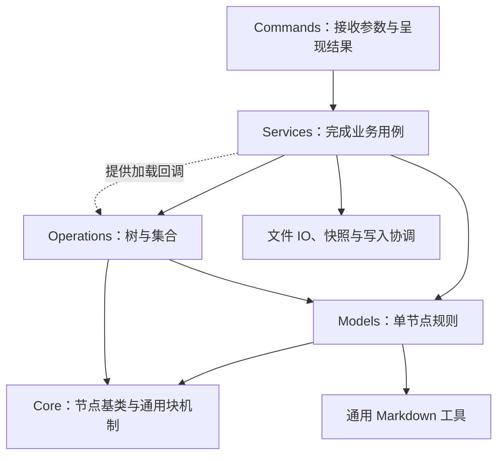
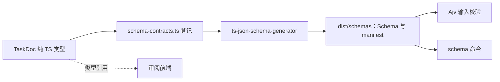

# Edges CLI

`edges` 是人和 Agent 共用的 Edges 命令行入口。它把任务、项目记忆、笔记和发布能力放到同一套作用域与节点协议上，让能力可以跨仓库复用，而内容始终归属于选定的目录。

核心分工是：**先确定作用域，由 Service 完成用例，Model 维护单节点规则，operations 处理集合与树。** 文件系统是内容载体，AGENTS.md 是递归索引入口；CLI 执行明确的操作，不替调用方判断内容应该属于本层还是下层。

本目录的 pull request 由 Cursor Bugbot 按 [`.cursor/BUGBOT.md`](.cursor/BUGBOT.md) 自动审，并需 @VirusPC 人审（[`.github/CODEOWNERS`](../../.github/CODEOWNERS)）。

## 快速开始

运行、构建与测试以 Node.js 22.20 及以上为基线（与依赖 `skills@1.7.2` 的 `engines.node` 一致）。以下命令在仓库根执行：

```bash
pnpm install --frozen-lockfile
pnpm --filter @viruspc/edges exec tsx src/index.ts --help

# 构建本地可执行产物
pnpm --filter @viruspc/edges build
node extensions/cli/dist/index.js --help
```

开发时可以通过 tsx 直接运行源码；需要 Schema 的命令先运行 `build:schemas`，需要审阅页的命令先构建审阅应用。`pnpm --filter @viruspc/edges dev --help` 会先生成 Schema。

公开包名是 `@viruspc/edges`，命令名只有 `edges`。另一台装了 Node.js 22.20 及以上的机器上：

```bash
npm install -g @viruspc/edges
edges --help
```

`package.json` 的 bin 指向 `dist/index.js`。`files` 还包含构建时从 `extensions/skills/` 拷来的 `skills/`。`prepack` 会执行完整构建，把审阅页编好的 HTML/JS/CSS、Schema、Memory 模板和这些 skill 放进安装包。`tasks-review-app` 只在本仓构建时使用，不单独发布；安装包里没有它的 React 源码，也没有 `workspace:` 依赖。不要用 `npm publish` 或 `npm pack`：npm 不会去掉 workspace 协议。本仓打本地安装包仍是 `pnpm --filter @viruspc/edges pack`。只有 build 或 prepack 成功后，编译后的命令才可用。

直接运行 `edges` 而不带子命令会返回用法错误；没有 `edges-note` 别名，也没有根命令默认写入笔记的行为。

### 发布到 npm

CLI 运行时只读 `extensions/cli/package.json` 的 `version`。发版只升这一处，并写入 `CHANGELOG.md`。

版本合进 `main` 之后，在该提交上打 annotated tag `@viruspc/edges@<version>`（例如 `@viruspc/edges@0.2.2`）。发版 tag 必须是 annotated tag（`git tag -a`），轻量 tag 不会通过。推送这个 tag 会跑 [`.github/workflows/publish-edges-cli.yml`](../../.github/workflows/publish-edges-cli.yml)：先测试，再经 GitHub Environment `npm-publish` 人工放行，用 npm Trusted Publishing（OIDC）执行 `pnpm --filter @viruspc/edges publish --no-git-checks --access public`（`publishConfig.access` 为 `public`）。Node 22.20 自带 npm 10.9.3，publish job 在 `pnpm install` 之前执行 `npm install -g npm@^11.5.1`，因为 Trusted Publishing 需要 npm >= 11.5.1，而 `pnpm publish` 会交给 npm 上传。不建 GitHub Release。决定见 [ADR 0037](../../docs/adr/0037-npm-publish-via-github-actions.md)。

合并后做一次（npm 上的 Trusted Publisher 若两天内没有成功发布会过期）：

- npmjs.com → 包 `@viruspc/edges` → Trusted Publisher：仓库 `VirusPC/edges`，workflow 文件名 `publish-edges-cli.yml`，environment `npm-publish`。
- GitHub → Environments → 新建 `npm-publish`，Required reviewers 设为 peng cheng。

## 整体架构

```text
src/
├── index.ts               # 进程入口
├── program.ts             # Commander 命令树与 run()
├── context.ts             # 单次命令的环境、stdin 和结果上下文
├── commands/              # 参数、输入输出与命令适配
├── services/              # 完整用例、跨节点协调和持久化
├── domain/
│   ├── core/              # BaseNode、InternalNode、LeafNode、通用块机制
│   ├── models/            # 各节点类型、具体文法与目录分类
│   └── operations/        # 树遍历、惰性查询和集合算法
└── utils/                 # Markdown、文件系统等基础工具
```



| 层 | 负责什么 | 例子 |
| --- | --- | --- |
| commands | 命令注册、参数与 stdin 适配、stdout/stderr 和退出码 | 把 `notes create` 转成 `services/notes/service` 的创建请求 |
| services | 加载、跨节点协调、文件操作与完整业务流程 | 各领域 `service.ts`；创建 Task 后登记父 AGENTS、保存、移动整个任务目录 |
| core | 节点基类、本层/下层索引、关系和通用块机制 | BaseNode、InternalNode.addChild、core/node-content 按传入文法解析区块 |
| config | 入口文件名、叶子目录规则、区块标题与标记 | config/layout.ts 的 AGENTS.md、README.md、SKILL.md、INDEX.md 和 memory、task、note、project 规则；config/sections.ts 的 project-harness / project-entries 标题与标记 |
| models | 节点自身的字段、校验、解析序列化和索引编辑 | Task 优先级校验；models/node/layout.ts 按 memory、task、note、project 判定目录类型；AgentsNode 与 ReadmeNode 经 models/node/document.ts 使用 core/node-content |
| operations | 对多个元素进行遍历、筛选、分组、查找 | traverse、filter、groupBy、Task 数组排序 |
| utils | 可复用的底层格式与文件机制 | gray-matter 适配、路径与文件原语 |

Model 的 create/update/destroy 是内存领域方法；创建目录、保存文档等完整动作通过 Service 完成。operations 通过回调取得加载能力，不反向依赖 Service。不要让业务调用方重新拼装模型修改与文件读写。

每个领域模块有 `services/<module>/service.ts`。commands 只从这份主文件进入，不直接装配 `NodeService`，也不直接 import 模块里的其他文件。实现可以留在原文件，主文件 re-export 即可，不必为了统一入口把函数搬一遍。`memory` 的 `migrateMemory` 在主文件里动态 `import("./migrate.js")`：这份实现可以不随 CLI 启动加载，命令入口仍是 `service.ts`。notes 与 projects 的主文件固定各自的叶子规格，再委托共用底层。

init 的主文件是 `services/init/service.ts`。`edges init` 只从这份文件进入，做公共的系统入口步骤，再依次调用各模块自己的那一段。`edges notes init`、`edges projects init`、`edges skills init`、`edges tasks init` 经各自 `service.ts` 上的薄转发，只把本模块交给 init service。`edges memory init` 从 `services/memory/service.ts` 的 `initMemory` 进入，只初始化 memory。模块之间不创建对方的材料。`edges artifacts init` 仍只写 artifacts 自己的 token 配置。

这些是跨领域工具，不另造 `service.ts`：`services/node/`（`node-service.ts`、`scope-session.ts`，以及带日期 `INDEX.md` 叶子的 `dated-leaf.ts`）、`scope.ts`、`list-query.ts`、`metadata.ts`、`config.ts`、`import-entry.ts`。命令要用其中的符号时，由该领域的 `service.ts` 再导出。进程入口 `program.ts` 在分发命令前直接取 `services/node/node-lock.ts` 的写锁，这不是某个领域命令。

notes、projects、skills、memory、tasks、artifacts、forest 的 commands 都只调用各自的 `service.ts`。tasks list 的看板目录名、README 位置与是否存在由 `services/tasks/service.ts` 回答，命令不读挂载表。审阅页仍负责读输入、选输出路径和写 HTML。artifacts 的 token 配置写入仍在 command 侧。调用点收口了，list 的遍历顺序没有改写。

[解耦 CLI commands 与 Service](../../.harness/tasks/edges-extensions/done/2026-10-06--解耦-CLI-commands-与-Service/INDEX.md) 记录了这层入口约定。`services/tasks/result.ts` 仍组装命令运行时（地点、读写和时钟），审阅页命令仍负责读输入、选输出路径和写 HTML。

详细设计按职责分开阅读：

- [Domain](src/domain/README.md)：整体依赖、写入与查询路径、Schema 链路。
- [Models](src/domain/models/README.md)：类图、入口与目录、parent/children/harness、解析与扩展。
- [Operations](src/domain/operations/README.md)：函数与查询链、求值时机、短路和加载边界。

## 作用域与递归节点

### 先确定内容归属

```bash
edges --scope /absolute/project tasks list
edges --scope /absolute/project memory doctor
```

作用域按 `--scope` → `EDGES_SCOPE` → `EDGES_REPO` → 当前工作目录附近的所属 AGENTS 作用域或 Git 根解析。相对路径基于调用时的 cwd，CLI 的安装目录不是默认内容目录；指定作用域不会自动初始化 Project Memory。

笔记写入选定作用域的 `notes/`，Git 操作使用它实际所属的仓库根。Artifacts 服务安装操作使用 CLI 实现仓库，独立于内容作用域。new-note MCP 未显式配置目标时保存调用方 cwd；显式配置优先，Skill 和 CLI 实现路径仍指向实现仓库。

### 目录是内容单位，入口是节点身份

所有内容节点采用目录形式：普通内容以 `index.md` 为入口，Skill 以 `SKILL.md` 为入口，内部索引以 `AGENTS.md` 为入口。ID 是规范化的绝对入口路径；图片和附件属于内容目录，不另建资源节点。

AGENTS 的本层硬约束、本层记忆、下层索引分别对应 constraints、localChildren、descendantChildren。NodeReference 只有 id，以及可选的 name、description；作者写下的相对链接由解析和序列化层维护。

每个节点可以有独立的 harness。内容叶节点的 harness 是同目录 AGENTS.md；AgentsNode 的下一层 harness 位于 `.harness/AGENTS.md`。harness 不混入 children，普通查询不会自动进入维护系统的下一层。

新增父级登记跟着主体系统走。路径在该系统的 `.harness` 里进本层；另一套系统入口进下层。已有关系保留原分组。缺少 owner 时不会自动初始化；生成的 Task 项目与 Memory 类型入口使用其固定本层系统维护信息关系。

### 查询遵循索引

NodeService.query 按已登记关系遍历，不靠扫描补齐遗漏。默认走全部组成 children（local∪descendants），不走进 Compose 边；显式 `localOnly` 走 localChildren；`withComposed` 穿过挂载点，只纳入外部仓库入口；includeHarness 才沿维护关系递归。**traverse 一次走一个系统的 `children`。根级 `--with-composed` 才把被组合仓库的入口 `AGENTS.md` 纳入结果，并且只到这一层。** 多个系统由 Service 层收集并拼成森林，见[多个系统拼成森林](#多个系统拼成森林)。默认根是 scope 下真 `AGENTS.md`。显式 `--super` 在这个 scope 的上一级建 `SuperAgentsNode`：当前 scope 目录就是该超节点的 `.harness`，材料 README 按 `harness-materials.json` 的 path 直接挂在 scope 下（`tasks/README.md` 即 `<scope>/tasks/README.md`）。scope 自己的 `<scope>/.harness/` 是再下一层维护系统，由真 `AGENTS.md` 进入，超节点不把它再当成材料根。遍历仍当普通 `AgentsNode`，只走 `children`，不从真 AGENTS 并 README 边。详见 [models 设计原则](src/domain/models/README.md#设计原则树与入口)与 [operations 遍历原则](src/domain/operations/README.md#traverse-只走单个系统)。

### 多个系统拼成森林

多个系统由 Service 层收集并拼成森林。

[`services/node/system-roots.ts`](src/services/node/system-roots.ts) 的 `collectSystemRoots` 扫盘，收下带 `project-harness` 标记的 `AGENTS.md`。一份路径和正文算不算这种入口，由 [`models/agents/harness-agents.ts`](src/domain/models/agents/harness-agents.ts) 的 `isProjectHarnessAgentsFile` 判断；这个函数只看传入的文本。

[`services/node/system-forest-service.ts`](src/services/node/system-forest-service.ts) 的 `buildSystemForest` 对每个根各自做一次 traverse，得到 `BaseNode[][]`。`independent`（默认）在 resolve 遇到其它根时停住；`innermost` 在外层能走到内层时只留下内层。命令行是 `edges forest list`。

超节点的 `children` 只有这一层本层挂载，`descendantChildren` 为空。表里的 path 相对当前 scope；文件不存在就跳过，不扫盘补。以本仓库根为 `--scope` 时，九条材料里只有 `tasks/README.md` 和 `README.md` 在根上，所以 `children` 就是这两份。`memory/`、`skills/`、`evaluation/`、`observation/` 实际在 `.harness/` 下，根上没有同名路径，不会挂上。`.harness/tasks/README.md` 也不是这个超节点的孩子。

```text
edges --scope <仓库根> --super

虚拟超节点
└── <仓库根>/                         ← 超节点的 .harness
      ├── tasks/README.md             ← children
      ├── README.md                   ← children
      └── .harness/                   ← 仓库自己的维护系统，不在 children 里
            ├── tasks/README.md
            └── memory/feedbacks/README.md
```

把 `--scope` 指到 `<仓库根>/.harness` 才是下一层：这个目录本身成为超节点的 `.harness`。它的 children 是该目录下存在的 `tasks/README.md`、`memory/feedbacks/README.md`、`memory/projects/README.md`、`memory/references/README.md`、`skills/managed/README.md`、`skills/referenced/README.md`、`evaluation/README.md`、`observation/README.md`、`projects/README.md`、`notes/README.md`。这不是仓库根那一份名单。

默认 list 从真 `AGENTS.md` 做一次 traverse。`--all` 从当前 `--scope` 走森林。`--super` 只换根。最全的一次查询是 `--scope <仓库根> --super --all`。这三个开关都在根命令上。

再往下走的是这两个 README 自己的 `project-entries-*`，不是超节点的另一组孩子。`--super tasks list` 只留下这条链上的 Task。

```ts
const pending = service.query(scope, { types: ["task"] })
  .filter((node): node is TaskNode => node instanceof TaskNode)
  .filter(task => task.priority === "high")
  .groupBy(task => task.status)
  .mapValues(tasks => tasks.map(task => task.title));

const groups = await pending.value();
```

查询链只描述计算，value 才执行；重复求值会重新运行。普通 filter 不剪枝；类型选择由 Service 协助跳过无关叶节点正文。groupBy 虽然延迟执行，计算时仍需收集上游数据。

## 创建、保存与一致性

同一个 NodeService 内，同路径共享一个可变实例。update 保存节点的完整当前状态；create/import/move/destroy 会保存其实际影响到的索引的完整当前状态，包括这些索引已有的未保存修改，不顺便保存无关 dirty 节点。不同 Service 保持独立快照，不做三方合并。

query 最初只加载入口快照。对查询结果执行目录 move/destroy 前，用 get(node.path) 补充资源快照；它复用同一实例，不丢弃已有修改。list 返回的节点已捕获相应快照。目录移动与删除按完整生命周期单位处理，附件随目录操作。

节点写命令在业务读取前取得工作树级锁，结束后释放。父子作用域共享最近 Git worktree 根的 `.edges-write.lock/`，不同 worktree 独立；非 Git 写操作保守地共享系统临时目录中的同名锁。只读命令和 Artifacts 操作不取得这把节点锁；直接使用 NodeService 的调用方需要自行协调命令级锁。

锁由 proper-lockfile 管理，竞争时立即报 busy；`.edges-write.lock` 是保留运行时名称，扫描、复制会排除它，生命周期操作拒绝搬移或删除活动锁。其他仓库应自行配置对应忽略项，CLI 不代改其 .gitignore。

已有文件通过 write-file-atomic 替换，快照同时检查内容和文件身份。外部编辑器不遵守协作锁，因此仍存在检查到替换间的竞争窗口；单文件原子写入不等于多文件事务。失败时保留恢复路径和报告，不宣称崩溃下的全事务保证。

模型与文档处理保留未修改的业务扩展字段及 AGENTS 非受控正文。YAML 使用 gray-matter 的正常行为，不承诺编辑后保留 YAML 注释与样式。只读引用和管理根边界由 Service 执行，不把资源管理或新的业务权限体系塞进 Model。

## 命令

commands 的目录对应命令树：一个文件注册一个命令节点，同名子目录放它的子命令及参数、输出辅助代码。完整参数以各层 `--help` 为准。

### 任务：tasks

主体系统由 `--scope` 决定。一般任务写在 `<scope>/.harness/tasks`。`--super` 把主体换成该 scope 上的虚拟系统一，它的 harness 就是这个 scope 目录，任务写在 `<scope>/tasks`。`--all` 从当前 scope 走森林。最全的一次查询是 `--scope <仓库根> --super --all`。

```bash
edges --scope <directory> tasks list
edges --scope <directory> --all tasks list --status todo --priority high --sort priority
edges --scope <directory> --all tasks list --group-by project
edges --scope <directory> --super tasks list
edges --scope <directory> tasks create --title "修复构建" --project default
edges tasks get <stem或路径>
edges tasks update <stem或路径> --priority high
edges tasks status <stem或路径> done
edges tasks project list
edges tasks project review-page --from /tmp/tasks.json --out /tmp/review.html
```

任务写操作只改文件，不执行 Git；取消使用 status cancelled，没有 delete 命令。任务以 `<stem>/index.md` 存储，并带 `.<stem>.log.md`；状态或项目变化移动整个目录。

`edges --scope <目录> --super tasks list` 在该 scope 上建超节点，列出从材料 README 能走到的任务，范围不改去 Git 根。`edges --scope <目录> --all tasks list` 从该 scope 走森林，不另跳 Git 根。未登记的看板不会因物理存在而自动出现。

普通任务命令 stdout 为 JSON；runs、run-messages 只读，默认表格，可用 `--output json`。未分组 list 返回 tasks 数组；分组输出是 `{ groupBy, groups: [{ key, items }] }`，先筛选再分组。条目携带 path、project、stem。

review-page 只把 groups/items JSON 渲染成 HTML，不改任务、不打开浏览器、不自动发布。需要公开预览时再调用 artifacts publish。固定任务站点的生成、部署与路径配置见[部署说明](deploy/README.md)。

### 项目记忆：memory

Project Memory 的执行能力由 TS CLI 提供，Skill 负责工作流和调用规范。

```bash
edges --scope /absolute/project init -- -g -y
edges --scope /absolute/project init notes
edges --scope /absolute/project notes init
edges --scope /absolute/project memory init --memory-types project feedback
edges --scope /absolute/project skills init --skill-types managed referenced
edges --scope /absolute/project skills init -- -g -y --agent claude-code
edges --scope /absolute/project init -- -y --agent '*'
edges --scope /absolute/project tasks init
edges --scope /absolute/project memory remember --type project --slug decision \
  --description "记录本项目的设计取舍" --content-file /tmp/decision.md
edges --scope /absolute/project memory doctor
edges --scope /absolute/project memory doctor --apply
edges --scope /absolute/legacy-project memory migrate --recursive --dry-run
edges memory backup --repo-dir /absolute/project
edges memory restore --repo-dir /absolute/project --archive /private/archive.tar.gz
```

新作用域的 `edges memory init` 未选择类型时只返回推荐项，不创建 notes、projects、skills 或 tasks 的材料。无参 `edges init` 的默认集包含 skills。`edges skills init` 既写 skill 类型索引，也把包内 skill 装给本机 agent：安装步骤是固定的 `skills@1.7.2`，只额外传入包内 skills 目录和 `--skill '*'`，`--` 之后的 token 原样转交。`skills@1.7.2` 在探测到自己跑在 agent 里时会非交互，并只装给那个 agent；没有探测到、stdin 又不是 TTY 时，不带 `-y` 会退出 1。非交互且保留自动探测时用 `edges init -- -g -y`（`-g` 装到用户目录，`-y` 跳过确认；本机没有已安装 agent 时它会装给全部 agent）。指定某一个则用 `edges init -- -y --agent claude-code`（不加 `-g` 时写当前项目的 `.claude/skills`）。`--` 只在 `init` 和 `skills init` 上切开；其他命令把 `--` 和后面的 token 原样交给 commander。解析后的模块集合里没有 skills 时，这次 init 不会装，stderr 会列出被忽略的 token。memory 还在等类型选择、因而提前返回时，不因为没装 skills 而报这句。安装失败时进程退出码就是安装器的退出码，stdout 信封是 `{ status: "failed", errorCode: "SKILLS_INSTALL_FAILED", reason, created }`。`created` 是失败前已经写好的相对路径。`errorCode` 与 `VALIDATION_ERROR` 不同；不要用退出码是不是 2 来判断是不是校验错误，安装器自己也可能退出 2。校验错误仍然是退出码 2、`errorCode` 为 `VALIDATION_ERROR`。`edges tasks init` 只写任务看板。remember 不初始化缺失作用域；doctor 默认只诊断。旧 `.memory` 通过显式 `edges memory migrate` 转换，普通命令不兼容迁移。`edges init` 遇到旧层会失败，并提示先跑 `edges memory migrate --dry-run`，看完再跑不带 `--dry-run` 的同一条命令。迁移认识目录式旧布局，也认识早期平铺的大写类型索引（`FEEDBACK.md`、`PROJECT.md`、`REFERENCE.md`、`USER.md`）和根上的 `<type>_<slug>.md`；被条目用相对路径引用的附件目录跟该条目进 `<type>_<slug>/`。无法归类的路径写在 JSON 的 `diagnostics`（`unclassified-legacy-path`）里，正式迁移时挪到 `.project-memory-migration/unclassified/`，不让一个文件挡住其余条目。符号链接和路径冲突仍然整次停止。新建子作用域按路径登记到父级：`AGENTS.md` 在父级 `.harness` 下记入本层，否则记入下层。已经登记的保持原组。`edges memory doctor --apply` 按同一规则补上缺失的父级链接。

用户记忆 restore 默认拒绝覆盖，明确使用 --force 才整份替换，失败时回滚。备份和恢复接受未压缩或 gzip tar，解包上限 256 MiB、10,000 文件，拒绝硬链接；中断后若报告 `.private-user-memory-*/previous`，应保留恢复副本。模板随包复制到 dist，运行不依赖相邻 Skill 源码或 Python。

内容类型、私有忽略规则与规范以 [Project Memory LAYOUT](../skills/project-memory-init/references/LAYOUT.md) 为准。

### 笔记：notes

```bash
edges --scope /absolute/project notes create --title "Design note" --body "正文。"
edges --scope /absolute/project notes get notes/2026-10-08--design-note/INDEX.md
edges --scope /absolute/project notes update notes/2026-10-08--design-note/INDEX.md --body "更新后的正文。"
edges --scope /absolute/project notes delete notes/2026-10-08--design-note/INDEX.md
```

`notes create` 只在该 scope 的 `notes/` 下本地创建叶子，不 commit、不 push、不开 PR。标题来自 `--title` 或正文里的一级标题，正文用 `--body`。没有 `--content`、`--import-entry`、`--co-author`、`--mode`、`--dry-run` 或 token 旗标。get 与 delete 只收目标路径；list 用共享的 `--filter` / `--group-by`。stdout 为 JSON，诊断在 stderr；退出码为成功 0、运行错误 1、用法或校验 2。

### 项目：projects

```bash
edges --scope /absolute/project projects create --title "Demo" --body "What this project is."
edges --scope /absolute/project projects list --filter title=Demo
edges --scope /absolute/project projects get projects/2026-10-08--demo/INDEX.md
```

`projects create` 只在该 scope 的 `projects/` 下本地创建叶子，不 commit、不 push、不开 PR。旗标与 `notes` 相同：metadata、`--body`，标题来自 `--title` 或正文一级标题。get 与 delete 只收目标；list 用共享的 `--filter` / `--group-by`。

### 技能：skills

```bash
edges --scope <directory> skills list
edges --scope <directory> skills get <name-or-path>
edges skills delete <name-or-path>
```

`skills create` 与 `skills update` 写入当前 scope 的 `skills/managed/<name>/SKILL.md`（真系统在 `<scope>/.harness/` 下）。`edges memory remember` 仍可另写 skill 类记忆，两者并列。没有 `edges skill` 别名。

<a id="artifacts"></a>

### 预览发布：artifacts

```bash
edges artifacts init --base-url https://edges.viruspc.tech
edges artifacts publish /tmp/review.html --ttl 24h
edges artifacts delete <id或URL>
edges artifacts server install
edges artifacts server start
edges artifacts server status
```

init 管理客户端配置，publish/delete 调用预览服务并返回 JSON。server install 负责构建、服务配置和启用，不自动 start；start/stop/restart 只管理进程。服务部署路径与内容作用域独立。发布任务来源时使用 from-type、from-id、task-project，不把渲染审阅页与发布合成一个隐含动作。

客户端 token、服务端配置、nginx、升级与恢复流程见 [Artifacts 服务说明](../services/artifacts-preview/README.md)和[部署说明](deploy/README.md)。

### 组合仓库：compose

作用域 `AGENTS.md` 的 `project-harness-compose` 区块登记被组合的 harness 仓库。每条是一个本地目录链接：链接文字是名字，破折号后面是说明，`remote: <git-url>` 是 clone 用的地址。`register` 的 `--description` 必填，要写清这个仓存什么、什么时候该往里写；不传或传空字符串时校验失败，不写区块。`register` 不传 `--path` 时，检出目录是 `~/.edges/composed/<name>`，区块按这个以 `~` 开头的形式保存。显式 `--path` 使用传入值。检出就放在 `checkout` 展开后的目录上。完整操作见 [`edges-compose`](../skills/edges-compose/SKILL.md)。

```bash
edges --scope <directory> compose register --name brain --remote https://github.com/example/brain.git --description "个人大脑：只在记跨项目判断时写入"
edges --scope <directory> compose register --name brain --path ../brain --remote https://github.com/example/brain.git --description "个人大脑：只在记跨项目判断时写入"
edges --scope <directory> compose list
edges --scope <directory> compose unregister --name brain
edges --scope <directory> compose clone
edges --scope <directory> compose pull
edges --scope <directory> compose push --name brain
```

`register`、`list` 和 `unregister` 读写当前作用域的 Compose block，经 NodeService 保存 `AGENTS.md`。`unregister` 按 `--name` 去掉一条登记，不删除已 clone 的目录。`clone` 把尚未检出的条目 `git clone` 到登记目录；该目录已经是同一 origin 的检出时保持不动。`pull` 与 `push` 在检出目录里执行这个仓库自己的 `git pull` / `git push`，不另建提交。`clone` / `pull` / `push` 的 `--name` 只处理一条。默认查询停在当前 scope。`--with-composed` 把这些目录的入口 `AGENTS.md` 纳入结果，并且只到这一层。

<a id="json-schema-contracts"></a>

### 数据合同：schema

```bash
edges schema list
edges schema get task-doc/v1 > /tmp/task-doc.schema.json
pnpm --filter @viruspc/edges run build:schemas
```

list 返回已打包合同的 key/id/title/description，get 返回完整 draft-07 JSON Schema。它们不依赖内容作用域、不读 stdin，不在运行时生成 Schema；缺少构建产物应重新 build 或安装。成功 stdout 只有 JSON，错误写 stderr 并返回非零状态。



当前只有 TaskDoc 接入，类型源为 [task-doc-contract.ts](src/domain/models/tasks/task-doc-contract.ts)，不是整个 TaskNode 类。生成物不提交仓库。构建时生成，运行时 Ajv 校验；前端直接引用纯类型和枚举，不依赖生成器。

TaskDoc 要求 name、description、metadata、body，拒绝未知顶层字段；metadata 允许 JSON 扩展值，已知字段校验状态、优先级、项目标识与日期格式。校验不做类型强转、默认补值或字段删除。grouped-list 与 review-page 的 JSON 入口复用此合同；原始 Markdown 解析保留自身策略，不偷偷套用这套 JSON 校验。选型依据见 [ADR 0025](../../docs/adr/0025-typescript-source-generated-json-schema.md)。

## 开发与验证

```bash
pnpm --filter @viruspc/edges exec tsc --noEmit
pnpm --filter @viruspc/edges test
pnpm --filter @viruspc/edges build
pnpm --filter @viruspc/edges run dev:tasks-review-app
```

test 会准备 Schema 和审阅页后执行 CLI 回归；build 清理 dist、生成 Schema、构建审阅应用、编译 TS 并复制 Memory 模板。包测试还会在仓库外仅安装生产依赖，验证编译产物可用。局部测试若直接运行，需自行准备对应资产。

新增行为按边界落位：单节点规则进 models，集合算法进 operations，完整用例进 services，命令协议进 commands。不要为一种新节点重复实现加载、索引、YAML 或文件写入，也不要为统一外观增加空层或无用包装。

旧 task-projects 区块需要独立迁移，普通任务写入不会自动转换。先预览选定范围，再明确执行：

```bash
pnpm --filter @viruspc/edges exec tsx ../../scripts/migrate-agents-indexes.mts \
  --root /absolute/scope --check
pnpm --filter @viruspc/edges exec tsx ../../scripts/migrate-agents-indexes.mts \
  --root /absolute/scope --write
```

脚本先检查所有候选再写入，保留原文备份，跳过符号链接、依赖目录、受保护的 posts 和嵌套 Git 边界；重复执行无变更。

Task Project 列表属于看板 `README.md`（`project-entries-local`）；看板 `AGENTS.md` 只登记 `<project>/AGENTS.md` 系统入口。把看板 AGENTS 里的 README 型 project 链接（含旧 task-projects 区块）一次性移过去：

```bash
pnpm migrate:task-project-lists -- --root /absolute/scope          # 预览
pnpm migrate:task-project-lists -- --root /absolute/scope --apply
```目录迁移与本机私有内容恢复见[迁移指南](../../docs/recursive-layout-migration.md)。
