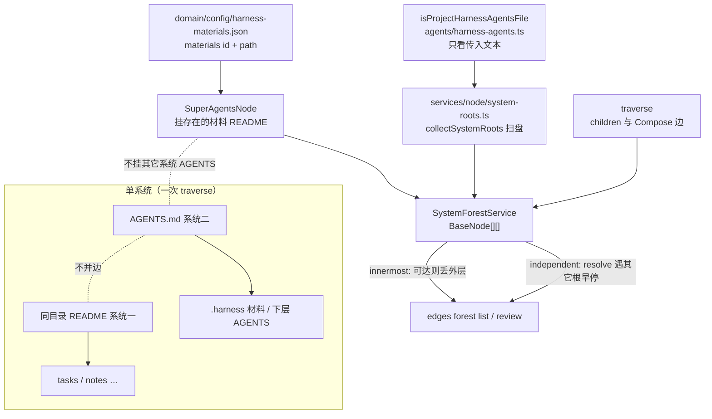
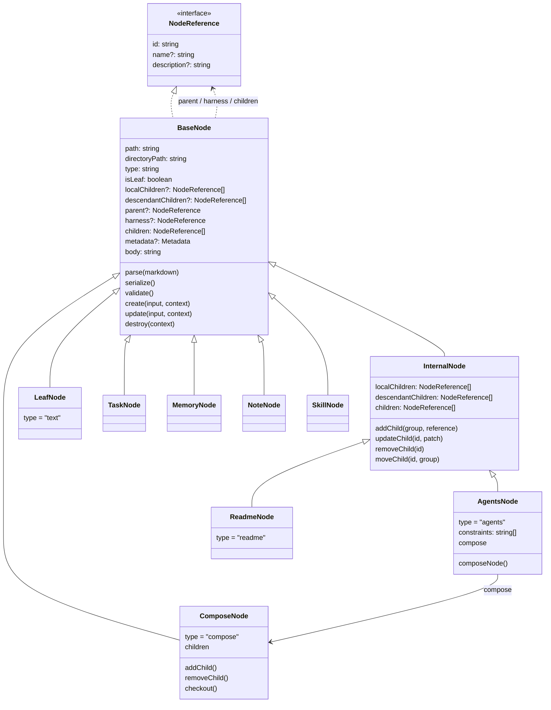
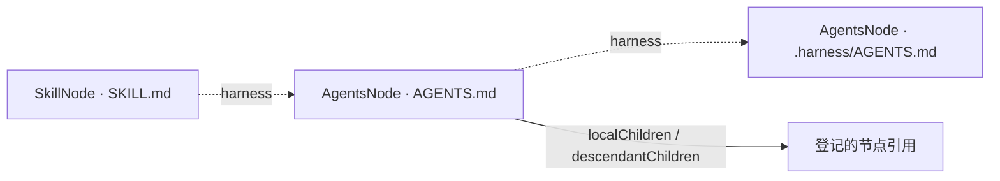
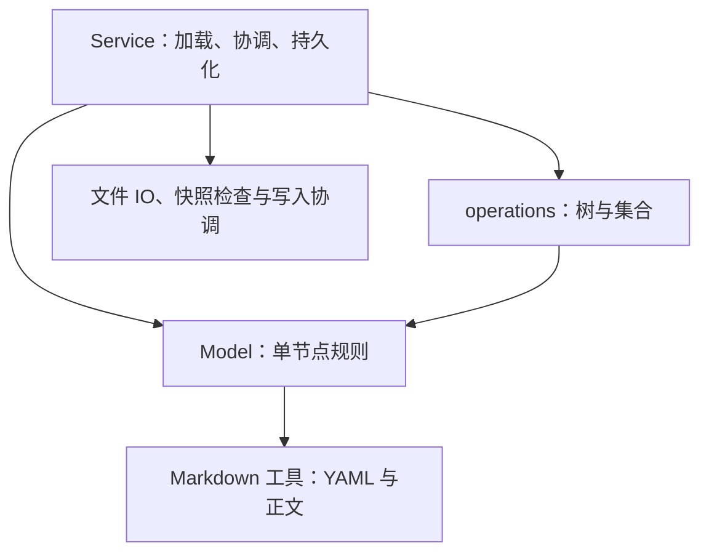
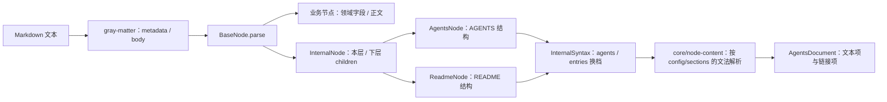
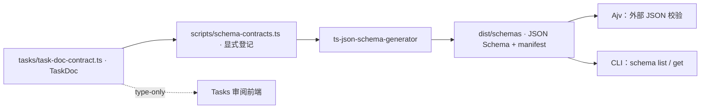

# 节点模型架构

Model 表达一个文件系统节点的身份、内容、关系与自身行为。节点以目录组织，以 Markdown 入口标识；Task、Memory、Note、Skill 和 AGENTS 共用这套基础模型。

**Model 处理单节点，operations 处理集合与树，Service 完成用例与持久化。** 整体依赖见 [Domain 架构](../README.md)，查询组合见 [operations](../operations/README.md)；仓库的系统设计与内容目录约定仍以[根 README](../../../../../README.md)为准。

## 设计原则（树与入口）

下列原则以 2026-10-06 grill、2026-10-07 澄清与根 `CONTEXT.md` 为准；类图已与现行实现一致：`AgentsNode` / `ReadmeNode` 继承 `InternalNode`，业务节点直继 `BaseNode`，`LeafNode` 是纯 text 节点。

1. **递归系统二：** 系统入口是 `AGENTS.md`，带组成登记。CLI **默认**从 scope 下真 `AGENTS.md` 出发，只做该系统的**系统二**操作。经登记可达才算节点。
2. **组成边 ≠ 维护边：** `harness` 不进 `children`。默认遍历不跟随 harness。
3. **同目录双文件：登记分工，不是 traverse 并边：** 若同时存在 `AGENTS.md` 与 `README.md`，系统一孩子只挂在 README 的 `project-entries-*`；AGENTS 的 `project-harness-*` 只挂系统二材料与下级 AGENTS。持久化上互不为对方的 child。从真 AGENTS 出发**到不了** README 上的 tasks/notes 是预期。
4. **`traverse` 单系统：** 只走一个入口的 `children`，并沿该入口 Compose block 的边进入登记目录的 `AGENTS.md`，再继续走那边的 `children`。多个系统由 Service 层的 [`system-roots.ts`](../../services/node/system-roots.ts) 收集带 `project-harness` 的 `AGENTS.md`，并由 [`system-forest-service.ts`](../../services/node/system-forest-service.ts) 拼成森林。收集、判定和 `independent` / `innermost` 见 [CLI README](../../../README.md#多个系统拼成森林)。
5. **仓库可视为个人系统二 + `SuperAgentsNode`：** 整仓可当作上一级主体（如个人）的系统二；向上建虚拟 `SuperAgentsNode`。当前 scope 目录就是这个超节点的 `.harness`，材料路径是 scope 加上 `harness-materials.json` 里的 path（`tasks/README.md` → `<scope>/tasks/README.md`）。scope 自己的维护目录仍是 `<scope>/.harness`，由真 `AGENTS.md` 走，超节点不再往下找一层。traverse Super 时当作普通 `AgentsNode`，只走 `children`，不挂其它系统 AGENTS，材料可缺。不要从真 AGENTS 临时并 README 边。用户命令的范围只有 `--scope`、`--super`、`--all`：默认 list 从真 `AGENTS.md` 做一次 traverse；`--all` 从当前 scope 走森林；`--super` 只换根。最全是 `--scope <仓库根> --super --all`。`--scope <仓库根>` 与 `--scope <仓库根>/.harness` 的 children 不是同一份。
6. **入口合同：** 组织清单 → `README.md` + `project-entries-*`；内容叶子 → `INDEX.md`；Skill → `SKILL.md`；系统入口 → `AGENTS.md`。有无子节点看是否出现组成登记，不持久化 `isLeaf`。
7. **谁拥有系统入口：** 任意目录可由用户自行 init；不是路径白名单。有列表 ≠ 系统入口。
8. **存量迁 `INDEX.md`：** 可预览脚本；含 `posts/`（仅改名）。不要手改、不要另写扫盘冒充组成。



查询：真 AGENTS 不到 README；换根用 `--super`。写路径把同目录 README 另起根闭合引用图。traverse 只走单个系统，见 [operations README](../operations/README.md#traverse-只走单个系统)。多个系统由 Service 层收集并拼成森林，见 [CLI README](../../../README.md#多个系统拼成森林)。

设计真源：[recursive-system-two-entries-design](../../../../../docs/superpowers/specs/2026-10-06-recursive-system-two-entries-design.md)。相关记忆：`feedback_traverse_single_system_and_forest_roots`、`feedback_cli_is_system_two_ops`、`feedback_content_via_super_agents_node`。

## 类与节点关系

> `InternalNode` 与 `LeafNode` 都在 `domain/core/`，分别承接组成索引和纯 text。`AgentsNode` / `ReadmeNode` 继承 `InternalNode`；Task、Memory、Note、Skill、Project 直继 `BaseNode`。`type` 含 `agents`/`readme`/`text`。组成登记（`localChildren` 是否存在）派生组织/叶子。`LeafNode` 是 deprecated 的纯 text 节点。



图中列出可读取的关系；不表示这些属性允许随意赋值。具体签名与只读限定见 [BaseNode](../core/base-node.ts)、[InternalNode](../core/internal-node.ts)、[NodeReference](../core/types.ts) 和 [AgentsNode](agents/agents-node.ts)。

- `id` 等于规范化的绝对入口路径，例如 `/repo/notes/example/index.md`；`directoryPath` 是入口所在目录。移动节点会改变路径与 ID，由 Service 协调。
- `name`、`description` 是可选内容字段。引用只携带 `id/name/description`，无需先加载完整节点。
- `type` 区分 `agents/readme/task/memory/note/skill/text`。Memory 的 `memoryType` 是另一个维度。
- `isLeaf` 不持久化，由组成登记派生（`localChildren` 缺省且无 children 即叶子）；`traverse` 用 `localChildren` 是否存在而非类判断。
- `parent` 由 Service 根据物理目录和管理边界恢复。跨目录引用可以组成图，但不另行改变被引用节点的 parent；没有脱离目录的公开 `reparent` 操作。

### 本层、下层与 harness

AgentsNode 对应 `AGENTS.md`，把受管部分映射为：

| AGENTS 内容 | 内存模型 | 含义 |
| --- | --- | --- |
| 本层硬约束 | `constraints` | 本节点的重要约束 |
| 本层系统维护信息 | `localChildren` | 本层系统二材料与维护入口引用（现行标题；旧称本层组成） |
| 下层系统维护信息 | `descendantChildren` | 下层系统入口引用（现行标题；旧称下层节点） |
| 组合 | `compose` / `ComposeNode` | 一条指向 `<所属目录>/.compose/README.md` 的边。被组合仓库是 `ComposeNode` 的 children，id 是该目录下的 `AGENTS.md` |

`children` 是 `localChildren` 与 `descendantChildren` 的有序合并，不含 Compose 边。默认 list / query 停在当前 scope。根级 `--with-composed` 穿过 `ComposeNode`，把外部仓库入口 `AGENTS.md` 纳入结果，并且只到这一层；无类型 list 不包含挂载点 `.compose/README.md`。这里的 descendant 是下层索引组，不是已经加载完的所有后代；两组存的都只是当前入口登记的引用。物理目录深度或节点类型不能替代本层/下层的判断，新增登记由调用方明确给出 `local` 或 `descendant`。`moveChild` 只修改当前 AGENTS 中引用的分组，不移动目录、不改变 parent。

已有 Memory 类型入口的 `project-memory-entries` 区块也按本层索引处理；不要求为了使用 AgentsNode 而改写成另一套标题。普通导航链接和非受控 Markdown 保持为正文。

每个节点还可以有独立的 `harness` 引用。它不加入 `children`，所以普通树遍历不会自动跨进维护系统。当前[布局协议](node/layout.ts)约定：

```text
example-skill/
├── SKILL.md                 ← SkillNode：内容入口
├── AGENTS.md                ← AgentsNode：该 Skill 的 harness
├── assets/                  ← 附件，Model 不为其建资源节点
└── .harness/
    └── AGENTS.md            ← 上一个 AgentsNode 的 harness
```



同目录的 SKILL.md 与 AGENTS.md 是两个节点，入口和角色不同。一般叶节点的 harness 入口是同目录 AGENTS.md；AgentsNode 的下一层 harness 是 `.harness/AGENTS.md`，可以继续递归。目录的移动、删除及附件随迁由 Service 根据布局确定完整操作单位。

遍历策略属于 [operations/traverse.ts](../operations/traverse.ts)：默认走全部组成 `children`（local∪descendants）；只要本层时显式 `localOnly`。`includeHarness` 默认 false——例如从 `/repo/.harness/AGENTS.md` 检索且 `includeHarness: false` 时，不沿维护边进入下一层 harness。`--with-composed` 才穿过 Compose 边。

## 文件按什么规则组织

```text
domain/
├── config/
│   ├── layout.ts            # 入口文件名、旧叶子拼写、旧类型拼写、叶子目录规则顺序
│   ├── sections.ts          # project-harness / project-entries 的标题、标记和文法表
│   └── harness-materials.ts # .harness 材料路径
├── core/                    # BaseNode、InternalNode、LeafNode、引用、共享字段、通用块机制
│   └── node-content/        # parse / serialize / blocks / document：只认区块、标题、标记、条目
└── models/
    ├── index.ts             # 节点类、输入类型和路径判定的公共出口；基类从 domain/core 再导出
    ├── node/
    │   ├── layout.ts        # 路径类型、href、harness 材料、生命周期；叶子按 memory、task、note、project
    │   ├── document.ts      # 绑好文法的 parse/serialize，区块改写，Agents 与 README 换档
    │   └── stem.ts          # 目录名清理
    ├── agents/              # AgentsNode、harness 判定；一条 compose 边
    ├── super-agents/        # SuperAgentsNode：显式 --super 的虚拟系统入口
    ├── compose/             # ComposeNode：虚拟组合索引，id 为 .compose/README.md
    ├── readme/              # ReadmeNode：组织清单
    ├── tasks/               # TaskNode、任务字段规则、TaskDoc 契约和文档适配
    ├── memory/              # MemoryNode 与记忆文档规则
    ├── notes/               # NoteNode：当前主要是正文标题访问与更新
    └── skills/              # SkillNode：SKILL.md 入口、名称和描述校验
```

同一节点的类与专属规则放在一起。节点基类在 `domain/core`。`core/node-content` 按调用方给出的标题、标记和条目解析、序列化区块。README 与 AGENTS 的标题和标记在 `config/sections.ts`，`models/node/document.ts` 的 `InternalSyntax` 负责换档并把 `HARNESS_GRAMMAR` 交给 core。入口文件名和叶子规则在 `config/layout.ts`，路径类型判定在 `models/node/layout.ts`，叶子规则按 memory、task、note、project 排列。不要求每个节点都有同样数量的 types、codec、factory 文件。

| 模块 | 值得保留的拆分 |
| --- | --- |
| [core](../core/base-node.ts) | `base-node.ts` 管通用内容与生命周期 hooks；`internal-node.ts` 管本层/下层 children 与索引编辑；`leaf-node.ts` 是纯 text；`types.ts` 管基础契约；`fields.ts` 管共享 metadata 字段；`relations.ts` 保存 Service 协调的路径、parent、harness，不从公共入口开放身份改写。`core/node-content` 的 `parse.ts`/`serialize.ts` 按传入文法保留原文；`blocks.ts` 只提供与标记名无关的区块字符串操作；`document.ts` 是文档表示；`grammar.ts` 描述标题、标记如何对应到区块 |
| [config/sections.ts](../config/sections.ts) | `INTERNAL_SECTIONS`、`ENTRIES_SECTIONS`、`CODEC_SECTIONS` 是 project-harness / project-entries 的标题与标记。同一文件放这些标记的注释常量、改写表和 `HARNESS_GRAMMAR` |
| [node/document.ts](node/document.ts) | 按标记插入、替换、改写区块。`decodeBody` / `parseNode` / `serializeNode` 把 `HARNESS_GRAMMAR` 交给 core。`InternalSyntax` 在 agents 与 entries 两档之间换标记 |
| [agents](agents/agents-node.ts) | `agents-node.ts` 管 AGENTS 引用、约束，并持有一条 `compose` 边；`harness-agents.ts` 只根据传入路径与正文判断是不是带 project-harness 的 `AGENTS.md`，不读盘 |
| [super-agents](super-agents/super-agents-node.ts) | `super-agents-node.ts` 是显式 `--super` 的虚拟超节点，继承 `AgentsNode`，不落盘。`compose` 为空 |
| [compose](compose/compose-node.ts) | `compose-node.ts` 是虚拟组合索引，继承 `BaseNode`。children 是被组合仓库的 `AGENTS.md`；`checkout` 给出已展开的目录和 remote |
| [tasks](tasks/task-node.ts) | `types.ts` 放任务枚举、输入及数据类型；`priority.ts`/`project.ts` 放单值规则；`frontmatter.ts`/`task-doc.ts` 适配文档；`task-doc-contract.ts` 单独服务前端与 Schema 生成 |
| [memory](memory/memory-node.ts) | `memory-node.ts` 管 memoryType；`documents.ts` 管已有记忆字段的读取、兼容和保留 |
| [config/layout.ts](../config/layout.ts) | 入口文件名（AGENTS.md、README.md、SKILL.md、INDEX.md，兼容旧 index.md）、旧类型拼写，以及叶子目录规则表。规则顺序是 memory、task、note、project |
| [node/layout.ts](node/layout.ts) | 按文件名判定 `AGENTS.md` / `README.md` / `SKILL.md`，按 config 里的叶子规则判定 `INDEX.md`。同一文件做 href 解析、harness 路径和生命周期单位。`registerDirectoryClassifier` 把额外规则插到叶子列表前面 |

## Model、operations 与 Service 的边界

| 动作 | 归属 | 原因 |
| --- | --- | --- |
| Task 标题、优先级更新与校验 | Model | 一个节点自己的规则 |
| AgentsNode.addChild/updateChild | Model | 只改当前节点持有的索引内容 |
| Markdown parse/serialize | Model 使用格式工具 | 从文本恢复自身内容或把自身内容输出为文本 |
| traverse、filter、groupBy、Task 数组排序 | operations | 处理多个节点或集合；遍历通过回调加载 |
| 创建任务并登记父入口、保存、移动目录、删除 | Service | 涉及文件 IO、多个节点和完整用例 |



Model 的 `create/update/destroy` 是内存领域方法，不会创建、写入或删除文件。业务调用方通过 [NodeService](../../services/node/node-service.ts) 或 Tasks/Memory/Note 业务 Service 完成持久化，而不是自行拼接模型更新和文件写入。`destroy` 当前提供删除前校验，实际目录删除由 Service 执行。

模型采用可变实例。同一个 NodeService 内，同路径节点共享实例；`create/update` 使用临时草稿校验后再更新当前实例，减少失败时的半修改状态。这不等于 immutable，也不构成跨进程事务。metadata 和关系 getter 返回受保护的视图/副本；修改 getter 返回值不会更新节点，内容应通过字段 setter 或模型方法更新。

`domain/core` 不依赖具体节点，也不引用 models 或 config。Model 不依赖 operations 或 Service。节点类型依赖 core，彼此不互相引用（`SuperAgentsNode` 继承 `AgentsNode`，`AgentsNode` 持有 `ComposeNode` 除外）。README 与 AGENTS 共用 `config/sections.ts` 和 `models/node/document.ts`，不互相引用。通用 Markdown 工具不依赖任何节点模型。跨模块的 type-only 引用不等于运行时依赖环；例如 BaseNode/relations 与文档解析器之间有类型引用，运行时仍无循环。

## Markdown 如何进入模型

通用 [Markdown 工具](../../utils/markdown/document.ts)使用 gray-matter 解析可选 YAML 头，正文保持为 Markdown 字符串。模型实例的 `parse/serialize` 复用这层处理，子类通过 `validateMetadata`、`parseBody`、`serializeBody` 和 `applyInput` 扩展自身规则。



AgentsNode 将索引链接变成具有绝对入口 ID 的 NodeReference；AgentsDocument 保存文档中的链接目标与文本项，InternalSyntax 和解析器负责保留原文及位置信息。**AgentsDocument 是文档表示，AgentsNode 是领域节点**，两者职责不同。原文位置等解析细节不进入公共节点模型。

序列化保留 AGENTS 的非受控正文、可保留的原链接及区块结构；YAML 使用库的正常输出，不承诺编辑后仍保留 YAML 注释和排版。`parse` 会执行解析与 metadata 校验，完整领域校验仍通过 `validate` 及 Service 的写前检查完成；不要把所有节点的 parse 等同于完整写入校验。

文档 codec 只是 `type + parse + serialize` 的格式适配接口。通用工厂与 base codec 位于 Markdown 工具；Memory、Task、AGENTS 的适配分别位于自己的模块。Tasks 的文档适配位于 `tasks/`，使用通用 Markdown 工具。

## Schema 与模型的关系

Schema 描述对外的数据合同，不直接扫描包含方法、路径与关系的完整节点类。当前接入的是 TaskDoc，而不是“所有节点都已有 Schema”。



TaskNode 负责节点行为；TaskDoc 是可交换的纯数据。契约与节点类分开，前端和生成器才不会连带加载文件系统或 Markdown 解析代码。生成物不提交仓库；输入校验与构建约定见 [CLI README](../../../README.md#json-schema-contracts)和 [Schema ADR](../../../../../docs/adr/0025-typescript-source-generated-json-schema.md)。

## 扩展一个节点

1. 在所属类型目录定义类。业务内容直继 BaseNode。维护本层/下层索引的入口继承 InternalNode：系统入口用 AgentsNode，组织清单用 ReadmeNode。没有专属行为的 index.md 可使用（deprecated 的）LeafNode 或 BaseNode。
2. 保持只传绝对入口路径即可构造。通过现有 hooks 扩展字段、校验及解析序列化；正文的 serialize → parse 必须能恢复状态，因为生命周期草稿复用这条路径。
3. 定义该类型的输入与规则；共享后再下沉，不预先新增空抽象层。
4. 若需要自动识别，通过 `models/node/layout.ts` 的目录规则和 NodeService 的 `models` 映射接入。分类只决定模型类型，不推断 local/descendant 归属。
5. 由 Service 协调 IO 与完整用例。需要集合算法时放 operations；确有外部数据合同需求时，再单独定义纯类型并登记 Schema。

公共节点类和必要类型从 [index.ts](index.ts) 导入。模型内部直接依赖实际模块，避免绕公共聚合出口形成环。验证已有行为可运行 CLI 的模型、文档、查询及全量测试；模块整理的设计与验收记录见[实施计划](../../../../../docs/superpowers/plans/2026-10-06-model-module-organization.md)。
