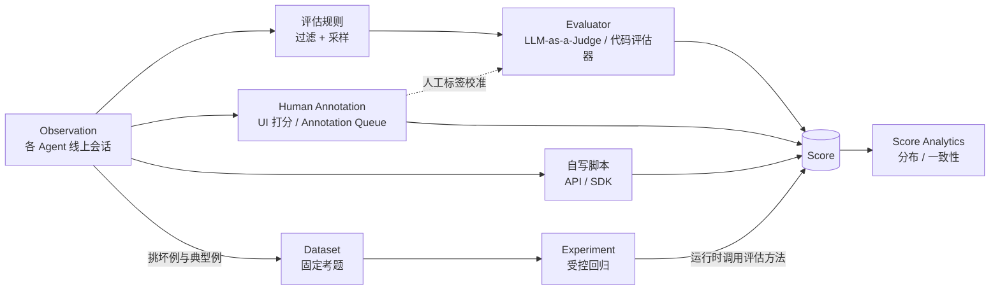

# Langfuse 评估五件套：Scores、Evaluators、Datasets、Human Annotation、Experiments 对比与 Observation 落地

## 一句话总览

在 Langfuse 里，**Score 是唯一的评估结果对象**；**Evaluator**（LLM-as-a-Judge、代码评估器）自动产生 Score；**Human Annotation**（UI 直接打分、Annotation Queue）由人产生 Score；**Dataset** 是固定下来的考题集；**Experiment** 拿 Dataset 跑一遍被测任务并打分，做受控回归。线上数据（Observation）经 Evaluator 与人工标注得到分数，坏例与典型例沉淀进 Dataset，再由 Experiment 在改动前做对照，形成闭环。

## 背景：用户的 Observation 场景

各 AI Agent（Grok Bot 各助手、Codex、Cursor、Claude Code、OpenCode、Pi）的会话统一收进自建 Langfuse `https://langfuse.viruspc.tech`（v4，write mode `events_only`），在 Edges 里称为 Observation。可筛选维度放 tag（如 `device:<dns-short>`），其余放 metadata；OpenCode 插件不支持 tags，设备写在 `environment` 字段，配规则时要单独考虑。项目里已建 LLM connection `minimax`（OpenAI 适配器，base URL `https://api.minimaxi.com/v1`，模型 MiniMax-M2.5、M2.7、M3 等）。Observation 带 `sessionId`，但一个会话常跨多轮甚至跨助手，单条 trace 很难判断任务是否完成。这是后文所有取舍的出发点。

## 五个功能逐个说明

### Scores：评估结果

- **是什么**：统一存放评估结果的数据对象。必有 `name`、`value`、数据类型，另有 `source`、`comment`、`configId` 等字段。数据类型有四种：`NUMERIC`（浮点）、`CATEGORICAL`（预定义类别）、`BOOLEAN`（0 或 1）、`TEXT`（1 至 500 字符自由文本）。`TEXT` 不能聚合，不进 Experiment、LLM-as-a-Judge 和 Score Analytics。
- **挂在哪**：每条 Score 恰好挂在 Trace、Observation、Session、DatasetRun 四者之一。只传 `sessionId` 即为会话级分数。v4 下原来的 trace 级分数挂到该 trace 的 root observation 上。
- **数据从哪来**：`source` 自动标为 `EVAL`（托管评估器）、`ANNOTATION`（人工）或 `API`（脚本、SDK、用户反馈）。
- **Score Config**：约束名称、类型、取值范围或类别。人工打分和 Annotation Queue 必须先有 Score Config。Config 不可修改，只能归档与恢复。
- **幂等写回**：`id`、`name`、日期三者都相同时新分数才覆盖旧分数。脚本写回应使用确定性 `id`（如 `<sessionId>-task_done`），并保持 `name` 与时间戳不变，否则会多出一条分数。
- **与 tag 的分工**：tag 在写入时确定，之后不能改，用来描述「是什么」；score 可以事后任何时候补，用来衡量「好不好」。`device:<dns-short>`、助手类型属于 tag；任务是否完成属于 score。
- **产出与消费**：Score Analytics 看分布、趋势，以及两个分数之间的一致性（类别型和布尔型给出 Cohen's Kappa、F1、总体一致率与混淆矩阵，数值型给出相关系数）；也可进自定义 dashboard、配置告警，经 Scores API v3 读取。
- **场景例子**：会话「合并 #365」跨 Grok Bot 与 Codex 两个助手，人看完整段后给该 `sessionId` 打 `task_done = done`，`comment` 写「PR #365 已合并，CI 通过」。

### Evaluators：自动产生分数

**Evaluator 定义怎么打分，评估规则（Rule）定义给哪些 observation 打分。** 规则由过滤条件和采样率组成，可挂一个或多个 evaluator；同一个 evaluator 可被多条规则复用，规则还可以为某个 evaluator 覆写变量映射。Evaluator 有三种用途：

1. 挂到规则上，在线评估新进的 observation；
2. 批量评估（batch evaluation），在表格里选中历史数据后执行 Actions → Evaluate 回填；保存 evaluator 时也可勾选 **Also run on past observations**，按时间范围回填（有范围与条数上限，启动前给出成本估算）；
3. 用于 Experiment（UI 发起的 prompt experiment 可直接选）。

**评估对象与上下文边界**（对用户场景最关键）：

- v4 推荐 observation 级 evaluator；trace 级 evaluator 基于旧数据模型，已废弃，自建 v4 进入 `events_only` 后不再产出结果。官方表示多 span 评估会在新的 observation 数据模型上再做，目前没有可用的会话级托管评估器。
- observation 级 evaluator 只能映射**被匹配那一条 observation** 的 input、output、metadata、tool calls（expected output 与 item metadata 只在 Experiment 中可用），**不加载兄弟或子 observation**。
- 需要一次调用的整体输入输出时，用规则的 **Is Root Observation**（API 中为 `isRootObservation`）过滤 logical root。logical root 指没有物理父节点或被 SDK 显式标为应用根的 observation；它仍然只看到自己身上写的数据。
- 规则可以把 observation 条件（类型、名称、metadata）与 trace 条件（`userId`、`sessionId`、tags、version）叠加。

**LLM-as-a-Judge**

- 写一个带 `{{input}}`、`{{output}}` 等变量的评判 prompt，选模型（项目默认模型或单独指定），选输出类型（数值、类别、布尔），再把变量映射到 observation 字段。右侧可挑样本试跑，看分数与理由后迭代。
- 执行方：Langfuse **worker** 从队列取出匹配的 observation，渲染 prompt，经项目的 **LLM connection** 调模型，把分数写回。不在被追踪的应用里运行。自建时是 worker 容器需要能访问 LLM 端点，SSRF 校验也作用在这次调用上。
- 每次执行都产生一条完整 trace，环境为 `langfuse-llm-as-a-judge`，可在表格里按该 environment 过滤排查；执行状态有 Completed、Error、Delayed（被限流后指数退避重试）、Pending。
- 保存时会用结构化输出定义发一次测试请求，失败则报 `Model configuration not valid for evaluation`。经 OpenAI 适配器接第三方端点时，官方要求端点支持 OpenAI 格式的 tool calling。`minimax` 连接能否用作 judge，以保存时这次测试请求是否通过为准。
- 实时评估新数据的前提：Python SDK 不低于 4.7.0 或 JS/TS SDK 不低于 5.4.0；直接走 OTel 摄入的，需要在 span exporter 上设置 `x-langfuse-ingestion-version: 4`。各 Agent 的追踪插件用的 SDK 版本不一，上线规则前要逐个核对。
- 评估器与规则都有公开 API，可以版本化管理；更新 evaluator 会生成新版本，活跃规则自动使用最新版。

**代码评估器**

- 在 Langfuse 里写 Python 或 TypeScript 的 `evaluate(ctx)`，返回一个或多个 Score，适合确定性检查：精确匹配、正则、JSON 可解析、schema 校验、关键词、工具调用参数、业务规则。没有变量映射步骤，代码直接读 `ctx.observation`（input、output、metadata、tool_calls），在 Experiment 中还可读 `ctx.experiment` 的 expected output 与 item metadata。
- 自建前提：必须配置 `LANGFUSE_CODE_EVAL_DISPATCHER`，可选 `aws-lambda`（生产推荐）或 `insecure-local`（仅 TypeScript/JavaScript，只适合代码完全受信的部署）；未配置时功能关闭。还要求 observation 由基于 OpenTelemetry 的 SDK 摄入。

另有 decision-model evaluator（向 TypeSafe Jev 或 OpenAI 的决策模型提出类型化问题），本笔记不展开。

**场景例子**

- LLM-as-a-Judge：规则过滤 `Is Root Observation = true`，并叠加 tag `device:macmini`；judge 用 `minimax` 的 MiniMax-M2.7，判断「这一轮输出是否声称完成任务，并给出可核对的证据（PR 链接、测试结果）」，输出类别 `turn_outcome`：`claims_done_with_evidence`、`claims_done_no_evidence`、`in_progress`、`blocked`。
- 代码评估器（需先配好 dispatcher）：检查 tool calls 里是否出现合并 PR 的命令，产出布尔分数 `merge_tool_called`。在「合并 #365」会话里，它只能在真正执行合并的那一轮 observation 上为真，判断不了整段会话是否完成。

### Human Annotation：人工产生分数

- **两种入口**：在 trace、observation、session 页面上直接打分（Scores via UI），或建 **Annotation Queue** 做结构化评审。两者都要求先有 Score Config，产出的 Score `source = ANNOTATION`。
- **Annotation Queue**：新建队列时选定要用的 Score Config，填名称与说明，可指派成员；通过勾选批量 Actions → Add to queue，或在单条上 Annotate 加入 trace、observation 或 session；评审时逐条在 Annotate 卡片上打分，Complete + next 进入下一条，全程支持键盘操作。还可以录入修正后的输出（corrections），队列也能通过 API 管理。
- **定位**：建立 ground truth，并作为 LLM judge 的校准基准，用 Score Analytics 对比人工与 judge 的一致性。
- **场景例子**：建队列 `task-completion-review`，绑定 Score Config `task_done`（类别：`done`、`partial`、`not_done`、`unclear`）。每周挑一批会话入队，覆盖每个助手，也特意包含「合并 #365」这类跨助手会话。官方支持把 session 加入队列；自建 `events_only` 下会话视图是否可用需在实例上确认，不可用时退而加入该会话的 root observations，再由脚本按 `sessionId` 汇总。

### Datasets：固定考题

- **是什么**：一组 dataset item，每条有 `input`，可选 `expected_output` 与 `metadata`。名称在项目内唯一，名称里带 `/` 即形成虚拟文件夹。
- **数据从哪来**：SDK 或 UI 逐条添加、CSV 导入、在生产 observation 上 Add to dataset，或在 Observations 表格里多选后批量加入（支持整字段映射、JSON path 提取、多字段拼装，后台执行，部分失败不影响其余条目）。用 SDK 创建时可写 `source_trace_id`、`source_observation_id` 链回原始数据。
- **质量控制**：可为 `input` 和 `expected_output` 设 JSON Schema，不合规的条目被拒；每次增、改、删、归档条目都产生新版本，可按时间戳取某一版本，Experiment 也可以在指定版本上跑；归档的条目不进入之后的运行。
- **场景例子**：Dataset `agent-sessions/task-completion`，每条 item 的 `input` 是按 `sessionId` 拼好的整段对话（或消息数组），`expected_output` 是人工标签，如 `{"task_done": "done", "evidence": "PR #365 已合并"}`，`metadata` 记录涉及的助手、设备与原始 `sessionId`，`source_observation_id` 指向会话里的某条 root observation。

### Experiments：受控回归

- **是什么**：对 Dataset 的每个 item 执行被测任务（task），得到输出，再用评估方法打分；一次执行称为一次 experiment run。可与 baseline 并排对比、逐条查看退步，并在 CI 中用 `langfuse/experiment-action` 加阈值拦截回归（脚本抛出 `RegressionError` 即判失败）。
- **三种发起方式**：
  - **UI（prompt experiment）**：选数据集、Prompt Management 里的 prompt 版本和模型（走 LLM connection），可选挂 LLM-as-a-Judge 或代码评估器。
  - **SDK**：`run_experiment` 跑任意代码，数据可在 Langfuse 也可在本地；支持逐条评估器和整轮的 run-level 评估器（后者的分数挂到 dataset run 上），并发可控、单条失败相互隔离。
  - **OpenTelemetry**：不用 SDK 时给 span 加 experiment 属性。
- **v4 注意**：dataset run 的读取改为 experiments API（`/api/public/experiments`、`/api/public/experiment-items`），旧的 `POST /api/public/dataset-run-items` 不应再用。
- **场景例子**：Agent 的历史会话无法重放，所以这里被测的不是 Codex 或 Cursor，而是 **judge 本身**。task 为「把整段会话交给 MiniMax 判断 `task_done`」，逐条评估器把结果与 `expected_output` 中的人工标签比对，run-level 评估器算总体一致率。分别以 MiniMax-M2.5、M2.7、M3 或不同 prompt 版本各跑一轮，与 baseline 对比后再决定线上用哪套。

## 对比

| 维度 | Scores | LLM-as-a-Judge | 代码评估器 | Human Annotation | Datasets | Experiments |
| --- | --- | --- | --- | --- | --- | --- |
| 本质 | 结果对象 | 自动打分方法（语义判断） | 自动打分方法（确定性规则） | 人工打分方法 | 测试数据 | 在测试数据上运行并打分 |
| 对象粒度 | Trace、Observation、Session、DatasetRun 四选一 | 单条 observation，或实验输出 | 单条 observation，或实验输出 | Trace、Observation、Session | Dataset item | Experiment run 及其条目 |
| 谁产生 | 由其余方法与脚本写入 | Langfuse worker 经 LLM connection | Langfuse worker 经 dispatcher | 人 | 人或脚本从生产数据挑选，也可合成 | SDK、UI 或 CI 触发 |
| 线上还是离线 | 两者皆可 | 线上（规则）、回填、离线（实验） | 线上（规则）、回填、离线（实验） | 线上抽样 | 离线 | 离线 |
| 可复现性 | 取决于来源 | 固定 prompt 与模型时较稳定，仍有随机性 | 高 | 低，受评审人影响 | 高，有版本 | 高，同一版本数据可重复跑 |
| 成本 | 存储为主 | 每次评判一次模型调用，执行本身也写 trace | 计算资源与 dispatcher 运维 | 人力时间 | 构建与维护标签的人力 | 被测任务成本加评估成本 |
| 典型问题 | 「这条好不好，趋势如何」 | 「回答是否有据、是否声称完成」 | 「输出格式对不对、调用了什么工具」 | 「真实结论是什么，judge 准不准」 | 「拿什么做标准考题」 | 「改了 prompt 或模型之后是否退步」 |

## 在 Observation 场景的落地建议

### 会话维度的限制

- 托管 evaluator 只看单条 observation，trace 级 evaluator 在 `events_only` 下不运行，目前没有会话级托管评估器。
- `GET /api/public/sessions` 在 `events_only` 下返回 404，旧的 traces、observations 读取接口同样不可用。
- 可用的组合：Observations API v2（`GET /api/public/v2/observations`）支持按 `sessionId` 精确过滤，可通过 `fields` 选取 `io`、`metadata`、`trace_context` 等字段组，查询须带时间窗；Score 可以只挂 `sessionId`。
- 会话跨多轮、跨助手，单条 root observation 只记录其中一轮，「任务是否完成」只能在会话层面判断。

### 两条路

**路一：observation 级打分，再按 sessionId 聚合**

- 用托管 LLM-as-a-Judge（MiniMax）在每轮 root observation 上打单轮分，如上文的 `turn_outcome`；能用规则表达的确定性信号交给代码评估器。
- 再写一个轻量脚本按 `sessionId` 汇总单轮分数，例如「最后一轮为 `claims_done_with_evidence` 且之后没有 `blocked`」判为完成，写回会话级 Score。
- 优点：在线、托管、可回填，执行可在 `langfuse-llm-as-a-judge` 环境里排查。缺点：judge 看不到整段上下文，聚合规则需要自己定义和维护。

**路二：自写脚本拼整段对话，调 MiniMax 打分并写回**

1. 按时间窗从 Observations API v2 拉数据，按 `sessionId` 分组、按开始时间排序。
2. 只取各轮 root observation 的 input、output 拼成对话，截断过长的工具输出，标注每轮来自哪个助手与设备。
3. 等会话静默一段时间后再判，避免对仍在进行的会话下结论。
4. 用 OpenAI 兼容方式调用 MiniMax，要求结构化输出 `task_done` 与理由；API key 只放本机配置，不入库。
5. 经 `POST /api/public/scores` 写回只挂 `sessionId` 的 Score：`id = <sessionId>-task_done` 保证幂等，`comment` 写理由，`metadata` 记 judge 模型与 prompt 版本。
6. 脚本自身的调用也用 Langfuse SDK 追踪到单独的 environment（如 `edges-session-judge`），与业务 Observation 分开，便于查看成本与失败。

两条路可以并行：路一提供低成本的在线单轮信号，路二产出 `task_done` 这个会话级主指标。

### 起步顺序

1. **定一个维度**：只做 `task_done`，先建 Score Config（类别 `done`、`partial`、`not_done`、`unclear`）。
2. **人工标少量**：用 Annotation Queue 标一批会话，覆盖每个助手、每台设备，以及跨助手会话。
3. **建 Dataset**：把标过的会话转成 dataset item，`expected_output` 即人工标签。
4. **单一维度 judge 抽样**：先用路二脚本或路一 evaluator 在 Dataset 上跑 Experiment；线上只开低采样率规则，或脚本只处理部分会话。
5. **校准**：在 Score Analytics 对比 judge 与人工的一致性（Kappa、混淆矩阵），调 prompt 或换模型后再跑 Experiment，对比 baseline。
6. **再扩**：一致性稳定后提高采样、用批量评估回填历史，再增加新维度（如是否需要人工返工、工具误用），每个新维度重复上面的流程。

运行期注意：在 dashboard 中排除 `langfuse-llm-as-a-judge` 与脚本自身的 environment，避免评估流量混入业务统计；为 judge 成本与分数阈值设告警；自建实例确认 worker 能访问 `api.minimaxi.com`。

## 参考链接

- [Evaluation Overview](https://langfuse.com/docs/evaluation/overview)
- [Evaluation Core Concepts](https://langfuse.com/docs/evaluation/core-concepts)
- [Scores Overview](https://langfuse.com/docs/evaluation/scores/overview)、[Scores Data Model](https://langfuse.com/docs/evaluation/scores/data-model)、[Score Analytics](https://langfuse.com/docs/evaluation/scores/score-analytics)
- [Scores via API/SDK](https://langfuse.com/docs/evaluation/evaluation-methods/scores-via-sdk)、[Scores via UI](https://langfuse.com/docs/evaluation/evaluation-methods/scores-via-ui)
- [LLM-as-a-Judge](https://langfuse.com/docs/evaluation/evaluation-methods/llm-as-a-judge)
- [Code evaluators](https://langfuse.com/docs/evaluation/evaluation-methods/code-evaluators)、[Code evaluators (self-hosted)](https://langfuse.com/self-hosting/configuration/code-evaluators)
- [Annotation Queues](https://langfuse.com/docs/evaluation/evaluation-methods/annotation-queues)
- [Datasets](https://langfuse.com/docs/evaluation/experiments/datasets)
- [Experiments via SDK](https://langfuse.com/docs/evaluation/experiments/experiments-via-sdk)、[Experiments via UI](https://langfuse.com/docs/evaluation/experiments/experiments-via-ui)、[Experiments in CI/CD](https://langfuse.com/docs/evaluation/experiments/experiments-ci-cd)
- [LLM Connections](https://langfuse.com/docs/administration/llm-connection)
- [Sessions](https://langfuse.com/docs/observability/features/sessions)
- [Public API（Observations API v2）](https://langfuse.com/docs/api-and-data-platform/features/public-api)
- [Migrate Langfuse v3 to v4 (self-hosted)](https://langfuse.com/self-hosting/upgrade/upgrade-guides/upgrade-v3-to-v4)
- 本仓相关笔记：[多机 Langfuse Agent 追踪安装与验收](../2026-10-24--多机-langfuse-agent-追踪安装与验收/INDEX.md)
