> 讲师介绍：前 Web 3D 场景导购引擎负责人&可视化工具负责人。后来转向 AI 研效相关工作。

# 第一课：大模型基础

> **目标**：理解大模型"能力从何而来、成本因何而生"，明白"如何进行模型选型和参数配置"。

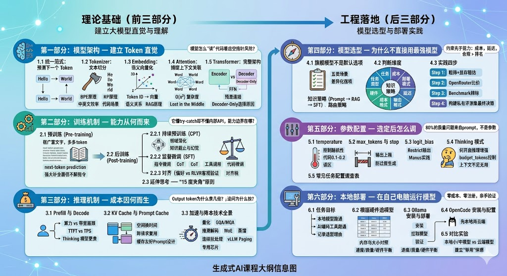

---

## 核心主线

> 你搭了一个 AI CR 工具，在 PR 合并前自动 review 代码。

<redoc-highlight emoji="tuding" fillColor="cyan-blue">
某天一个同事提交了这样一段代码：
</redoc-highlight>

```typescript
async function renderProfile(userId: string) {
  // 通过接口获取用户信息
  const res = await fetch(`/api/users/${userId}`);
  const user = res.ok ? await res.json() : null;
  // 提取用户名称
  const name = user.name;
  // 页面渲染用户名称
  document.getElementById('name')!.textContent = name;
}
```

<redoc-highlight emoji="tuding" fillColor="cyan-blue">
你的 AI CR 工具给出了一条 review 意见："user 可能为 null，第 6 行直接访问 .name 会抛出 TypeError。建议使用可选链 user?.name。"
</redoc-highlight>

<br/>

它说对了。但你可能会有一些疑惑——

<br/>

<redoc-columns>
<redoc-column ratio="0.5">
**模型原理：**

1. **模型架构**：模型不认识文字，它是怎么"读"代码的？

2. **知识和理解**：它为什么能够“理解”代码中的空指针报错？为什么可以一步步思考推理问题？为什么有时候review结论会很保守、讨好，不指出严重错误？

3. **成本和性能**：output token 为什么比 input token 贵好几倍？追问为什么比首次提问快？如何优化token成本和性能？
</redoc-column>
<redoc-column ratio="0.5">
**工程决策：**

1. 如何进行模型选型？

2. 选定模型后如何调参？

3. 前面讲了这么多，能不能自己跑一个模型试试？
</redoc-column>
</redoc-columns>

<br/>

这节课就跟着这六个问题，把大模型拆开来看清楚。

<br/>

## 第一部分：模型架构——建立 Token 直觉

<redoc-highlight emoji="tuding" fillColor="cyan-blue">
先从第一个问题开始：**模型不认识文字，它到底是怎么"读"代码的？**
</redoc-highlight>

### 1.1 统一范式：预测下一个 Token

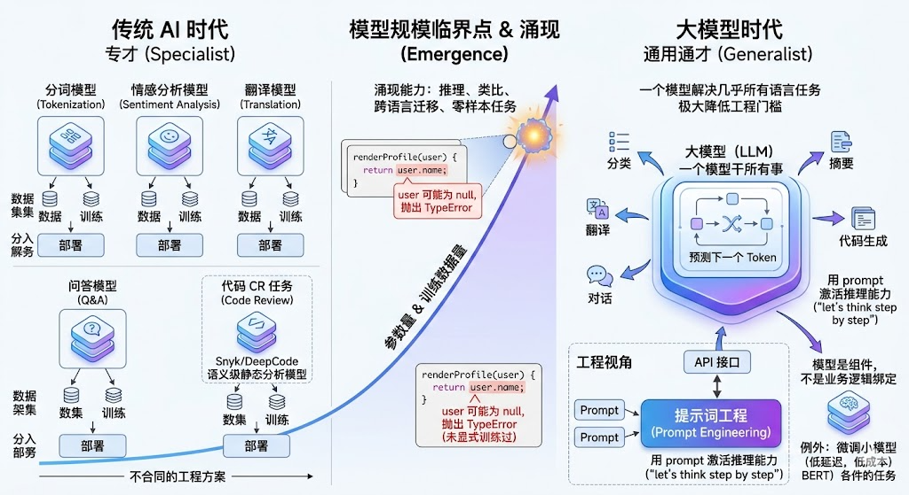

在大模型出现之前，不同的语言任务需要不同的模型和工程方案：分词一个模型、情感分析一个模型、翻译一个模型、问答又一个模型。每个任务单独收集数据、单独训练、单独部署。对于现在看起来很自然的 AI CR 任务，传统的做法是Snyk/DeepCode那样，从大量开源仓库的历史提交和 Bug 修复补丁中学习代码模式，用语义级静态分析模型自动发现缺陷并给出修复建议。

<br/>

转折发生在模型规模跨过某个临界点之后。研究者发现，当**参数量**和**训练数据量**大到一定程度时，模型会突然"冒出"一些从未被显式训练过的能力——推理、类比、跨语言迁移、甚至零样本完成全新任务。这就是所谓的**涌现（Emergence）**。没有人在训练目标里写过"请学会 review 代码"，但当模型大到一定量级，给它开头那段<font color="#F06A1D" backgroundColor="rgba(0, 0, 0, 0.05)"> renderProfile</font> 函数，它就能指出"<font color="#F06A1D" backgroundColor="rgba(0, 0, 0, 0.05)">user</font> 可能为<font color="#F06A1D" backgroundColor="rgba(0, 0, 0, 0.05)"> null</font>，直接访问<font color="#F06A1D" backgroundColor="rgba(0, 0, 0, 0.05)"> .name</font> 会抛出 <font color="#F06A1D" backgroundColor="rgba(0, 0, 0, 0.05)">TypeError</font>"。

<br/>

正是涌现，让"一个模型干所有事"从不切实际变成了工程现实。LLM **用一个"预测下一个 token"的统一范式，覆盖了几乎所有语言任务**。分类、摘要、翻译、代码生成、对话……全部可以转化为"给定前文，生成后续 token"的问题。

<redoc-highlight>
**工程视角**：

1. **不需要为每个任务搭专用模型了**。一个 API 接口 + 不同的 prompt 就能处理大部分语言任务。这极大降低了 AI 应用的工程门槛，也是为什么"提示词工程"（第二课）变得如此重要。

  1. 对于极端追求**低延迟、低成本、高并发**的单一简单任务（例如千万级日活的垃圾评论过滤、或者高频的情感极性打分），企业依然会选择微调部署一个小巧的专用模型（如 BERT 或轻量级分类器），因为调用大模型 API 太慢且太贵。

2. **涌现让模型的能力边界变得不可预测**，每次基座模型升级都可能解锁之前做不到的任务。很多能力不是模型没有，是你没"激活"它。比如加一句"let's think step by step"，推理能力就涌现出来了。你今天用 prompt 搞不定的事，换一个更大或更新的模型可能就通了。所以**好的 AI 工程架构应该把模型当作可替换的组件**，而不是把业务逻辑绑死在某个模型的特定行为上。
</redoc-highlight>

---

### 1.2 Tokenizer：文本切分与基础单元

**模型不认识文字。** 开头那段<font color="#F06A1D" backgroundColor="rgba(0, 0, 0, 0.05)"> renderProfile</font> 代码发给模型后，第一步不是"理解"——而是切词。切后的产物就是 **token**——介于字符和单词之间的子词单元

**动手验证**：用 [OpenAI Tokenizer](https://platform.openai.com/tokenizer) 或[HuggingFace - Tokenizer Playground](https://huggingface.co/spaces/Sagicc/tokenizer-playground)把代码放进去，看下不同模型带来的影响、去除注释和空格缩进带来的影响。

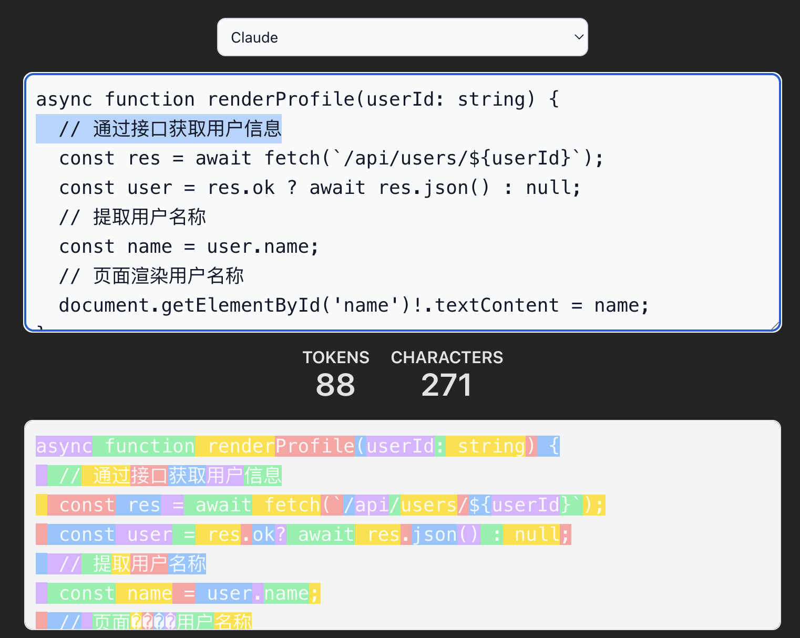

具体是根据词表做切分。hugging face 的 tokenizer.json 文件示例:

```json
{
  "version": "1.0",
  "truncation": null,
  "padding": null,
  "added_tokens": [
    { "id": 0, "content": "<s>", "special": true },
    { "id": 1, "content": "</s>", "special": true }
  ],
  "model": {
    "type": "BPE",
    "dropout": null,
    "unk_token": "<unk>",
    "continuing_subword_prefix": null,
    "end_of_word_suffix": null,
    "fuse_unk": false,
    "byte_fallback": true,
    "vocab": {
      "<s>": 0,
      "</s>": 1,
      "Ġ": 3,
      "t": 4,
      "h": 5,
      "e": 6,
      "Ġthe": 7
    },
    "merges": [
      "Ġ t",
      "Ġt h",
      "Ġth e",
      "Ġ t h e"
    ]
  }
}
```

切分后实际是映射到了编号

```
"user.name" → ["user", ".", "name"] → token ID: [882, 13, 2601]

"写代码"     → ["写", "代码"]          → token ID: [35946, 99257]
```

<redoc-highlight>
**工程视角**：

1. **切词效率**：**API 不是按字符计费，而是按 Token 计费**。**切词效率很重要。**在早期 GPT-4 等采用传统词表的模型中，同样语义的中文通常比英文消耗多 1.5-2 倍 Token，直接推高成本。但在最新的国产原生多语言模型（如 DeepSeek/Qwen）或采用新词表（如 GPT-4o）的模型中，这种差异已缩小至 1.3 倍甚至逼近 1:1。处理大量中文文档时，选对模型的底层词表就是省钱。

2. **代码与 API 场景的隐形消耗**：连续的空格、代码缩进、长变量名都会疯狂吞噬 Token。此外，前端开发中常见的大型 JSON 数据、OpenAPI 接口规范、或是层级极深的 DOM 结构，往往伴随着极高的 Token 冗余。这就是为什么高效的 AI 终端工作流和编码工具，在将上下文喂给模型前，都必须先执行代码压缩、AST（抽象语法树）裁剪或 API 规范精简等预处理步骤。

  1.  **AI CR 场景**：一个 PR 的完整 diff 往往包含大量空行、缩进变更和上下文行，Token 消耗远超你直觉。设计 CR 工具时，对 diff 做预处理（只保留有实质变更的 hunk、去掉纯格式调整）能显著降本。
</redoc-highlight>

<br/>

| Claude，有注释（88） | Claude，无注释（65，<font backgroundColor="rgba(255, 0, 0, 0.18)">-26% token</font>） |
| --- | --- |
| <br/> <split/>  | <br/> <split/> 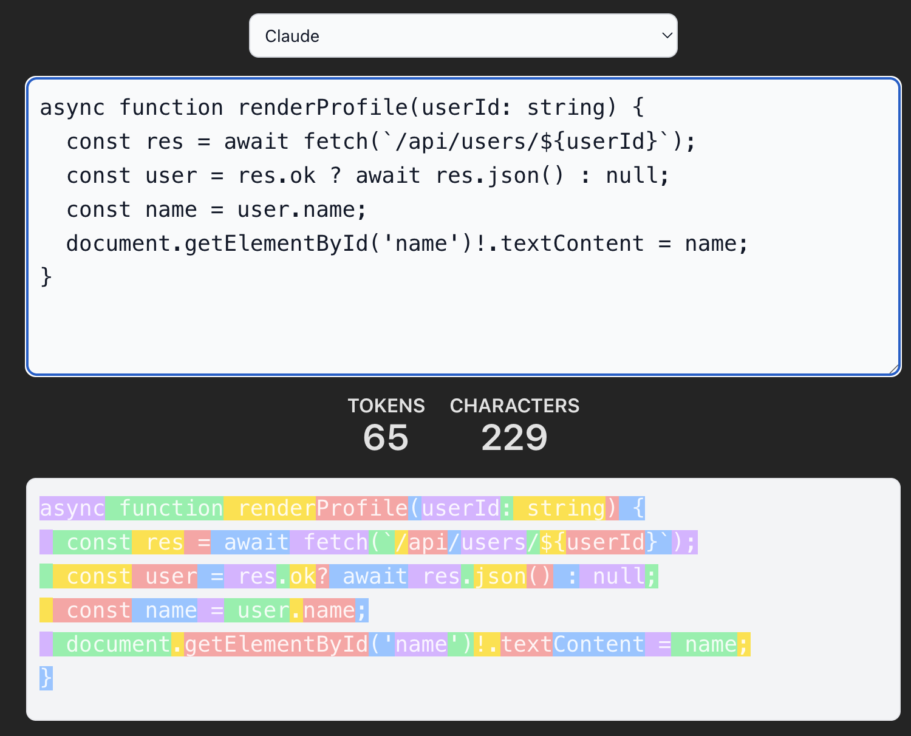 |

<br/>

---

### 1.3 Embedding：词的向量化与语义表示

Tokenizer 把文本切成了 token 并编上 ID，但 ID 只是编号，不含任何语义信息。**Embedding 的作用是把每个 token ID 映射成一个数字向量**，让语义相近的词在向量空间中距离也近。

回到开头那段代码——AI CR 建议把 <font color="#F06A1D" backgroundColor="rgba(0, 0, 0, 0.05)">user.name</font> 改成 <font color="#F06A1D" backgroundColor="rgba(0, 0, 0, 0.05)">user?.name</font>。假设将token映射为3维向量：

<br/>

```
                [属性访问,  函数调用,  安全防御]
user.name    → [0.9,      0.1,       0.1]
user?.name   → [0.9,      0.1,       0.9]
callback()    → [0.1,      0.9,       0.1]
callback?.()  → [0.1,      0.9,       0.9]
```

于是 <font backgroundColor="#FFFF33"> callback?.()- callback() </font>得到了纯粹的安全防御属性：

```
[0.1, 0.9, 0.9] - [0.1, 0.9, 0.1]  = [0.0, 0.0, 0.8] // 安全防御属性拉满
```

user.name +  [<font backgroundColor="#FFFF33">callback?.()- callback() </font>] 相当于为 user.name  加上安全防御：

```typescript
// user.name    +   安全防御
[0.9, 0.1, 0.1] + [0.0, 0.0, 0.8] = [0.9, 0.1, 0.9] ≈ user?.name
```

直觉上也说得通：<font color="#F06A1D" backgroundColor="rgba(0, 0, 0, 0.05)">user.name</font>（不安全的属性访问）加上"安全防御"维度，就得到了 <font color="#F06A1D" backgroundColor="rgba(0, 0, 0, 0.05)">user?.name</font>（可选链访问）。这就是为什么 AI review 开头那段代码时，看到 <font color="#F06A1D" backgroundColor="rgba(0, 0, 0, 0.05)">user.name</font> 能联想到 <font color="#F06A1D" backgroundColor="rgba(0, 0, 0, 0.05)">user?.name</font>——因为两者在向量空间中只差一个"安全防御"维度，模型能据此建议你"这里可能 NPE，需要加<font color="#F06A1D" backgroundColor="rgba(0, 0, 0, 0.05)"> ?.</font>"。

<br/>

模型通过训练，把语义关系编码进了向量的方向和距离。真实的 embedding 维度通常是几百到几千维，但原理相同。

<br/>

<redoc-highlight>
**工程视角**：

1. Embedding 的原理直接支撑了** RAG**（检索增强生成）的核心逻辑——把文档转成向量存起来，查询时也转成向量，找距离最近的片段返回给模型。"**语义相近的内容向量距离近**"就是语义搜索能工作的根本原因。选 Embedding 模型时，核心指标就是它对你的领域数据能否准确捕捉语义相似度。

2. 传统AI Coding工具如Cursor会对整个代码仓库做向量化，但会打破代码的结构性逻辑，导致上下文割裂。新的 AI Coding 工具如 Claude Code 更多采用** Agentic Search **的方式。
</redoc-highlight>

---

### 1.4 Attention：捕捉上下文间的关联

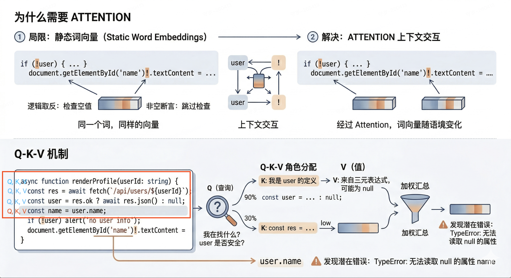

1. <font backgroundColor="#FFFF33">计算Q、K、V：对每个token，算Q（查询）、K（计算相关性）、V（值）(可cache)</font>

2. 计算“相关权重”：对当前token，用Q✖️每个之前token的K，计算相关性

3. 计算“加权值”：利用权重和 Value，做加权求和

<br/>

#### 为什么需要 Attention

```typescript
async function renderProfile(userId: string) {
  // 通过接口获取用户信息
  const res = await fetch(`/api/users/${userId}`);
  const user = res.ok ? await res.json() : null;
  // 提取用户名称
  const name = user.name;
  // 判空toast
  if(!user) alert('no user info');
  // 页面渲染用户名称
  document.getElementById('name')!.textContent = name;
}
```

但静态词向量有一个局限：每个词只有一个固定向量，无法区分多义词。还是开头那段代码——第 8 行有个

<font color="#F06A1D" backgroundColor="rgba(0, 0, 0, 0.05)">!(document.getElementById('name')!.textContent）</font>，而如果你在前面加一个判空<font color="#F06A1D" backgroundColor="rgba(0, 0, 0, 0.05)"> if (!user)</font>，这里也有个<font color="#F06A1D" backgroundColor="rgba(0, 0, 0, 0.05)"> !</font>。两处<font color="#F06A1D" backgroundColor="rgba(0, 0, 0, 0.05)"> !</font><font backgroundColor="rgba(0, 0, 0, 0.05)"> </font>含义完全相反：前者是非空断言（"我保证不为空"），后者是逻辑取反（"user 是否为空"）——前者是在跳过空值检查，后者是在检查空值。但在早期词向量时代，两处的<font color="#F06A1D" backgroundColor="rgba(0, 0, 0, 0.05)"> ! </font>是同一个向量。

Transformer 解决了这个问题：token 经过 Attention 的上下文交互之后，最终表示会随语境变化——同一个词在不同句子里的向量是不同的。下面看具体机制。

#### Q-K-V 机制

Attention涉及Q-K-V的概念

回到开头那段<font color="#F06A1D" backgroundColor="rgba(0, 0, 0, 0.05)"> renderProfile </font>代码。模型读到第 4 行 <font color="#F06A1D" backgroundColor="rgba(0, 0, 0, 0.05)">user.name</font> 时，要判断这行有没有问题。如果只盯着 <font color="#F06A1D" backgroundColor="rgba(0, 0, 0, 0.05)">user.name</font> 本身，语法完全正确。它需要回头找线索——<font color="#F06A1D" backgroundColor="rgba(0, 0, 0, 0.05)">user</font> 是怎么来的？有没有可能为空？

Attention 做的事情就是：**让当前位置去"查询"前文，给每个位置打一个相关性分数，再按分数加权汇总信息。**

Q/K/V 是这个过程的三个角色：

- **Q（Query）**：当前位置发出的"我在找什么"——<font color="#F06A1D" backgroundColor="rgba(0, 0, 0, 0.05)">user.name</font> 的 Q 在问："user 是什么？能不能安全地访问它的属性？"

- **K（Key）**：前文每个位置的"我是什么"，用来和 Q 匹配打分——<font color="#F06A1D" backgroundColor="rgba(0, 0, 0, 0.05)">const user = res.ok ? await res.json() : null </font>的 K 标识着"我是 user 的定义"

- **V（Value）**：前文每个位置真正要传递的内容，按得分加权汇总后输出——这一行的 V 携带的信息是"user 来自三元表达式，当请求失败时值为<font color="#F06A1D" backgroundColor="rgba(0, 0, 0, 0.05)"> null</font>"

在这个例子里，<font color="#F06A1D" backgroundColor="rgba(0, 0, 0, 0.05)">user.name</font> 的 Q 会对<font color="#F06A1D" backgroundColor="rgba(0, 0, 0, 0.05)"> const user = res.ok ? ... : null </font>打出高分（变量定义 vs 属性访问，高度相关），而对<font color="#F06A1D" backgroundColor="rgba(0, 0, 0, 0.05)"> const res = await fetch(...) </font>打出较低的分（间接相关，不是 user 的直接来源）。高分位置的 V 被重点吸收——于是模型能发现<font color="#F06A1D" backgroundColor="rgba(0, 0, 0, 0.05)">：user </font>可能为 null，直接访问<font color="#F06A1D" backgroundColor="rgba(0, 0, 0, 0.05)"> .name</font> 会抛出<font color="#F06A1D" backgroundColor="rgba(0, 0, 0, 0.05)"> TypeError: Cannot read properties of null</font>。

<br/>

<redoc-highlight>
**工程视角**：

- **超长上下文的难点**：Attention 的计算量与序列长度的平方成正比（每个位置i和前文每个位置j计算相关分数，O(n²)），这就是超长上下文是技术难题的根本原因，也是为什么各家都在做 Attention 优化（KV Cache、GQA、MQA、稀疏注意力等）。

- **Lost In Middle**：自回归模型的训练是预测下一个 token，最直接、最常出现的有效信号通常来自最近的前文；而开头天然是所有token都看得到的公共前缀，容易被多层、多头反复读到。研究发现模型对开头和结尾的信息关注更多，中间部分容易被"忽略"（Lost in the Middle 现象）。这直接关系到提示词工程和上下文工程——关键信息该放哪里、怎么组织。# Lost in the Middle: How Language Models Use Long Contexts
</redoc-highlight>

---

### 1.5 Transformer：大模型的网络架构

前面我们跟着<font color="#F06A1D" backgroundColor="rgba(0, 0, 0, 0.05)"> renderProfile </font>走过了切词（Tokenizer）、向量化（Embedding）、并通过 Attention 进一步得到了带有上下文的向量表达。但这些只是独立组件。**Transformer 是把 Embedding、 Attention 和其他模块组合成完整架构的方案。**


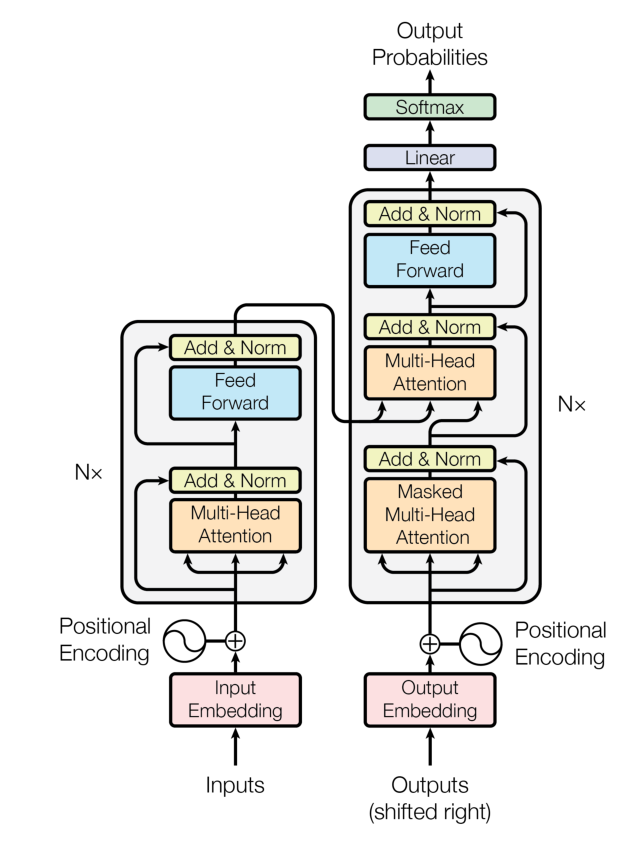

<br/>

> **注**：上图展示的是经典 Transformer 的 **Encoder-Decoder 架构**（包含左侧encoder和右侧decoder），也是最初用于机器翻译设计的结构。但**现代大语言模型（LLM）几乎全部转向了纯解码器（ecoder-only）架构**，只有右侧。

#### Encoder vs Decoder vs Decoder-Only

| **架构** | **特点** | **代表** |
| --- | --- | --- |
| **Encoder-Only** | 双向看全文，擅长理解 | BERT（分类、NER 等） |
| **Encoder-Decoder** | 先理解再生成 | T5、早期翻译模型 |
| **Decoder-Only** | 只看前文，自回归生成 | **GPT、Claude、Gemini、DeepSeek** |

在问答场景下，Encoder-Decoder 和 Decoder-Only 的区别在哪里？

假设你问模型一个问题：<font color="#F06A1D" backgroundColor="rgba(0, 0, 0, 0.05)">“帮我写一段冒泡排序的代码”</font>

- **Encoder-Decoder（像“闭卷考试”）**：
模型有两个大脑。**大脑 A (Encoder)** 负责审题，它会反复阅读你的问题，理解你要的是“冒泡排序”而不是“快速排序”，然后把这个理解封装成一个“意图包”传给 **大脑 B (Decoder)**。大脑 B 拿到意图包后，开始在另一张白纸上从头写代码。问题和答案在模型里是**物理隔绝**的。

- **Decoder-Only（像“即兴接话”）**：
模型只有一个大脑。它不觉得你在考它，它觉得你只是说了一句话：<font color="#F06A1D" backgroundColor="rgba(0, 0, 0, 0.05)">“帮我写一段冒泡排序的代码”</font>。它的本能是把这句话接下去。于是它顺着你的语气，自然而然地输出：<font color="#F06A1D" backgroundColor="rgba(0, 0, 0, 0.05)">“好的，以下是 Python 实现的冒泡排序：...”</font>。在模型看来，**你的问题和它的答案其实是同一段长文本的前后半部分**。

**为什么现代 LLM 统一选择了 Decoder-Only？**
虽然 Encoder-Decoder 在翻译任务上很强，但 Decoder-Only 在处理问答时展现了更强的“联想”和“推理”能力。它把全世界的知识都看作是一个无止境的“续写任务”，这种**问答即续写**的统一范式，让它能更容易地通过海量互联网文本学会逻辑和常识。此外，Decoder-Only 在推理时可以极大利用 KV Cache 缓存（详见 3.2），在大规模并发场景下工程效率更高。

<redoc-highlight>
**工程视角**：Decoder-Only 的自回归特性意味着——模型是**逐 token 生成**的，每个 token 都依赖前面所有 token。这直接导致了生成速度受限（无法跳过中间内容直接输出结论）。另外input token（输入prompt）早就知道可以并行化处理，但后续预测的output token不能，也直觉解释了为什么 output token 比 input token 贵（详见第三部分）。
</redoc-highlight>

<redoc-highlight emoji="tuding" fillColor="cyan-blue">
到这里，第一个问题有了答案：**模型怎么"读"代码的？**模型通过** Tokenizer** 把代码切成 token，通过 **Embedding **赋予语义，通过** Attention** 让 <font color="#F06A1D" backgroundColor="rgba(0, 0, 0, 0.05)">user.name</font> 关注到 <font color="#F06A1D" backgroundColor="rgba(0, 0, 0, 0.05)">const user = res.ok ? ... : null</font> 发现空值风险，再通过**多层 Transformer **逐步深化推理得到下一个token。
</redoc-highlight>

---

## 第二部分：训练机制——能力从何而来

<redoc-highlight emoji="tuding" fillColor="cyan-blue">
第一部分走完了模型从切词到推理的完整机制，但只解释了怎么"读代码"——还没解释"为什么理解"。它为什么能够“理解”代码中的空指针报错？为什么可以一步步思考推理问题？为什么有时候review结论会很保守不指出严重错误？**能力到底从何而来？**

**答案藏在训练过程里。**
</redoc-highlight>

<br/>

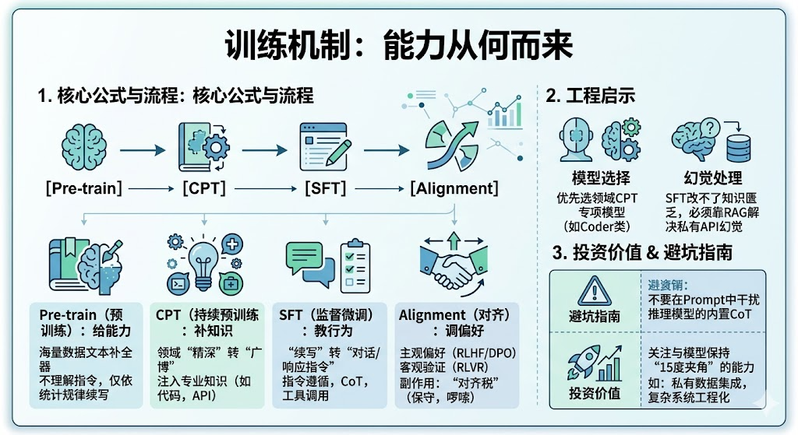

<br/>

### 2.1 预训练（Pre-training）

预训练是在海量无标注文本上做 next-token prediction。这个阶段让模型学会语言本身——语法、语义、常识推理、世界知识。

但训练完的模型**不理解"指令"，也没有对话意识**，本质上是一个强大的**文本补全器**：给它一段前文，它能续写出统计意义上合理的下文。如果你给它一段代码然后写"<font backgroundColor="#FFFF33">请 review 以上代码</font>"，它可能补全为"<font backgroundColor="#FFFF33">请 review 以上代码的测试覆盖率。请 review 以上代码的文档完整性。请 review……"</font>——因为它认为你在列举 review checklist 条目，而不是在下指令。

<redoc-highlight>
**工程视角**：

- **不要直接用Base模型**：除非要做微调，不要用 Base 模型——它不会回答你，只会续写
</redoc-highlight>

### 2.2 持续预训练 (CPT)：从"广博"到"精深"

**为什么需要 CPT？**

Base 模型用互联网文本训练，什么都懂一点，但对专业领域只是"扫过"——代码、医学论文、法律文书在通用数据中占比有限，深度不够。

问题在于：**SFT 教的是"怎么回答"，不是"懂什么"**。底层知识储备不够，SFT 无法无中生有。CPT 在 SFT 之前，用大量领域数据对模型做"浸泡式"深化训练，把知识基础打厚，再交给 SFT 雕刻行为。

以代码领域为例，CPT 阶段会喂入海量 GitHub、Stack Overflow 数据，让模型真正理解代码的结构逻辑：<font color="#F06A1D" backgroundColor="rgba(0, 0, 0, 0.05)">if-else</font>/<font color="#F06A1D" backgroundColor="rgba(0, 0, 0, 0.05)">try-catch</font> 的深层语义、跨几百行的函数依赖关系、不同语言中语义等价的写法（Python 的 <font color="#F06A1D" backgroundColor="rgba(0, 0, 0, 0.05)">list.append</font> vs C++ 的 <font color="#F06A1D" backgroundColor="rgba(0, 0, 0, 0.05)">vector.push_back</font>）。

> 本地部署常用的 Qwen2.5-Coder 在 Qwen2.5 通用基模的基础上，用 5.5 万亿 token 的代码密集型数据进行继续预训练

<redoc-highlight>
**工程视角**：

- **CPT 是模型厂商做的事，不是应用开发者的事**。但你能看到它的结果——这就是为什么 Qwen2.5-Coder 和通用 Qwen2.5 在代码任务上有显著差距：前者经过了代码领域的 CPT，底层知识储备更深厚。选模型时，同等规模下优先选经过领域 CPT 的专项模型。

- **知识截止日期**：模型的知识锁死在预训练结束那一刻。问它你们内部的 API 会"幻觉"，这是 RAG 存在的根本原因
</redoc-highlight>

### 2.3 SFT（监督微调）：从"续写"到"响应指令"

**SFT 不改变模型知道什么，而是改变模型的行为模式**——让它从"续写文本"切换到"响应指令"。

最直接的体现：问 Base 模型"帮我写个总结"，它可能续写、偏题；问 Instruct 模型，它会稳定输出总结结构。SFT 教的是"怎么回答"，而不是"懂什么"——底层知识储备不够，SFT 无法无中生有。

<br/>

SFT 覆盖几个方向，每个方向决定了一类能力：

- **指令微调**：教模型学会"对话范式"——听从指令、按期望格式输出，而不是续写。这是 Chat / Instruct 版本和 Base 版本最本质的区别。

- **思维链微调（CoT SFT）**：在训练数据里不只提供最终答案，还包含推理步骤，让模型学会"先思考再回答"。这是推理模型（o1、DeepSeek-R1）能力的基础之一。

- **工具调用微调**：让模型学会在合适时机生成结构化函数调用（JSON schema），而不是用自然语言回答。AI CR 工具能调用 linter、返回结构化 review 结果，就来自这里。

- **代码微调**：用大量（需求 → 代码）样本训练，让模型输出可编译、可运行的代码产物，覆盖补全、修 bug、重构等场景。（Qwen Coder）

<redoc-highlight>
**工程视角**：

- **SFT 能修行为，补不了知识**：模型文风不对、格式不稳，可以通过 SFT 调整；但如果底层逻辑本身不行，少量 SFT 很难有质变

- **不要给推理模型加"请一步一步思考"**：o1、DeepSeek-R1 这类通过 RLVR 训练的模型已经内置了推理链，手动加这句会干扰它，反而降低效果

- **专用 Coder 模型 vs 通用模型**：同等规模下，经过代码 CPT + Code SFT 的模型在代码任务上显著优于通用模型
</redoc-highlight>

### 2.4 Alignment（对齐）：从"能回答"到"回答得好"

SFT 后的模型能响应指令，但回答质量参差不齐——该拒绝的不拒绝、过于冗长或过于保守。Alignment 通过对比"好回答 vs 差回答"的偏好信号，让模型在多个可行答案里选更符合人类期望的那个。一是让模型按照用户意图行事（helpful），二是让模型拒绝有害请求、不输出危险内容。

两种主要路径：

- **偏好对齐（RLHF / DPO）**：RLHF 先训练一个"奖励模型"来模拟人类偏好，再用它指导语言模型优化；DPO 跳过奖励模型，直接用好/差回答对比优化，效率更高。两者目标相同：让模型更有用、更安全。GPT-4、Claude 系列走的是这条路。

- **客观验证（RLVR）**：用编译器、测试用例等客观标准给分——代码能跑就是对，跑不了就是错。不依赖人类主观评价，模型可以通过大量自我博弈不断进化。DeepSeek-R1、o1 系列走的是这条路，这也是为什么它们在代码和数学上表现突出——代码是少数"答案对错极度明确"的领域，天然适合强化学习。

**Alignment Tax（对齐税）**：过度对齐会让模型变得瞻前顾后，损失部分原始的直接性和创造力。你在 AI CR 里看到的"建议考虑是否……"而不是直接说"这里有个 bug"，大多来自这里。这是训练机制带来的，不是 prompt 能完全解决的。

<redoc-highlight>
**工程视角**：

1. **为什么代码任务最适合强化学习 (RLVR)**：代码是少数几个“答案对错极度明确”的领域（能运行 vs 报错）。这就是为什么 DeepSeek-R1 等模型在代码任务上表现极其惊艳，因为它们在训练阶段被编译器“毒打”过无数次，练就了极强的纠错本领。

2. **现在的RL不仅用于对齐，还用于推理能力强化**：从 DeepSeek-R1 和 OpenAI o1 开始，RL 已经变成了一个更通用的训练手段，对齐只是它的用途之一。另一个同样重要甚至更受关注的用途是推理能力强化。

3.  **AI CR 场景**：Alignment Tax 是 CR 工具中一个常见痛点——review 结论太保守（”建议考虑是否……”而非”这里有 bug”）是对齐机制带来的，不是 prompt 写得不好。适当降低 temperature 有帮助，但治不了根；在 prompt 里明确要求”直接指出问题，不要用建议性措辞”可以部分缓解。通过强行让模型先输出 JSON，强制其在一个严苛的枚举值中做判定，也可以部分缓解。
</redoc-highlight>

<br/>

### 2.5 哪些投入不会被模型能力内化

这一节跳出训练机制本身，从工程投资的角度做一个短暂的反思——理解了模型能力的来源后，哪些方向值得长期投入？

**与模型发展方向保持"15度夹角"**（Respect To 秒哒产品经理 2026 年 2 月访谈）：

```
0度（做模型即将内化的事）→ 下一代模型淘汰你的工作
90度（和 AI 完全无关）→ 无法借 AI 杠杆
15度（构建模型增强但不会替代的能力层）→ 模型越强，你越值钱
```

<redoc-highlight>
**短期不会被内化的方向**：

- 领域知识、业务知识

- 与内部系统深度集成（CI/CD、数据库、监控、审批流）

- 评估体系与可观测性（trace、debug、回放）

- 发现"哪些问题值得用 AI 解决"的判断力——这个能力需要同时理解业务和模型能力边界
</redoc-highlight>

<redoc-highlight emoji="tuding" fillColor="cyan-blue">
**能力从何而来？Pre-train 给能力，CPT 补知识，SFT 教行为，Alignment 调偏好。**

1. 为什么能够“理解”代码中的空指针报错？答案在 Pre-train和CPT。

2. 为什么可以一步步思考推理问题？答案在SFT。

3. 为什么有时候review结论会很保守不指出严重错误？答案在Alignment。
</redoc-highlight>

---

## 第三部分：推理机制——成本因何而生

<redoc-highlight emoji="tuding" fillColor="cyan-blue">
前两部分回答了模型怎么"读"代码、能力边界在哪。第三个问题关于成本和性能：**output token 为什么比 input token 贵好几倍？追问为什么比首次提问快？如何优化token消耗和性能？**

**这是推理机制决定的。**
</redoc-highlight>

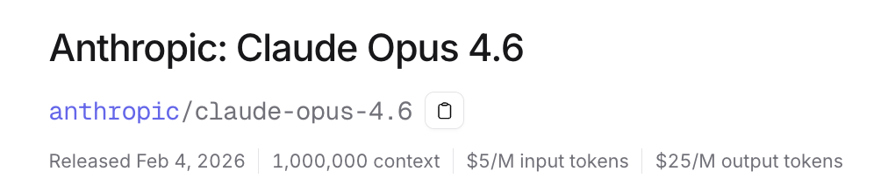

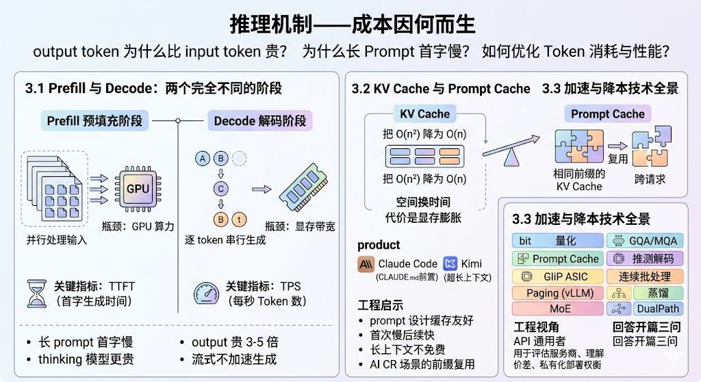

<br/>

### 3.1 Prefill 与 Decode：两个完全不同的阶段

**一句话本质**：处理输入和生成输出是两个瓶颈完全不同的过程。

| <br/> | **Prefill** | **Decode** |
| --- | --- | --- |
| **做什么** | 并行处理整个输入（系统提示词、Claude.md、skill description、用户提示词等等），计算所有 token 的 KV <split/> <font color="#F06A1D" backgroundColor="rgba(0, 0, 0, 0.05)">"[renderProfile代码] + 请review空指针风险"</font> | 逐个生成新 token，每步读取全部已有 KV <split/> <font color="#F06A1D" backgroundColor="rgba(0, 0, 0, 0.05)">"第 / 4 / 行 / user / . / name / ..."</font> <split/> <br/> |
| **瓶颈** | GPU 算力 <split/> 一次性吃完整段 prompt，做大矩阵乘，FLOPs 密度高，更吃算力。 | 显存带宽 <split/> 每生成 1 个 token 都要遍历所有层的 KV cache，频繁读写显存，访存量随上下文长度线性增长。 |
| **关键指标** | TTFT（Time To First Token） | TPS（Tokens Per Second） |

<redoc-highlight>
**这解释了你日常体验中的很多现象**：

- **长 prompt 要等更久才出第一个字**：Prefill 处理全部输入 token，输入越长 TTFT 越高。

- **Output token 比 Input token 贵 3-5 倍**：Decode 阶段每生成一个 token 都要过一遍模型，串行执行，GPU 利用率低但没法省。

- **Thinking 模型更贵**：Extended Thinking 在 Decode 阶段生成大量推理 token，一般都按 Output 价格计费。

- **"流式输出"并不加速生成**：生成速度由 Decode 决定，流式只是让你提前看到已生成
</redoc-highlight>

---

### 3.2 KV Cache 与 Prompt Caching

#### KV Cache：空间换时间

Decode 阶段，每生成一个新 token 理论上要对所有前面的 token 重算 Attention。KV Cache 把已算过的 Key 和 Value 缓存起来，避免重复计算：

```
 
无 KV Cache: 每步重算全部，计算量 O(n²)
 
有 KV Cache: 每步只算新 token 的 KV 并追加到缓存，计算量 O(n)
 
代价: KV Cache 随序列增长不断膨胀，长上下文场景占几十 GB 显存
```

#### Prompt Caching：跨请求复用

当多次请求共享相同前缀（比如同一个 system prompt），可以跨请求复用已计算的 KV Cache。Claude Code 是这么做的：

```typescript
[
  /* static sections ... */,
  "__SYSTEM_PROMPT_DYNAMIC_BOUNDARY__",
  /* dynamic sections like memory, env, skills, MCP, scratchpad ... */
]
```

- 前半部分：intro、系统规则、工具用法、风格等静态 section。

- 分界线标记：<font color="#27251E" backgroundColor="rgba(39, 26, 0, 0.07)">SYSTEM_PROMPT_DYNAMIC_BOUNDARY</font> 常量。

- 后半部分：session guidance、记忆、env、语言/输出风格、MCP 指令等动态 section。

<br/>

分界线前面的内容首次请求后缓存，后续对话只为新输入付全价。缓存命中的 token 只有原价 ~10%。这就是为什么 Claude Code 鼓励用详细的 CLAUDE.md 和 system prompt——前期投入更多 input token 换后续每轮的大幅降本。[https://platform.claude.com/docs/zh-CN/build-with-claude/prompt-caching](https://platform.claude.com/docs/zh-CN/build-with-claude/prompt-caching)。[https://x.com/trq212/status/2024574133011673516](https://x.com/trq212/status/2024574133011673516)

<br/>

比较下面两种 prompt 写法，哪个token更贵？

- A 版：[团队规范 1000 tokens][代码库上下文 3000 tokens][本次 PR diff 500 tokens]                                                                    

- B 版：[本次 PR diff 500 tokens][团队规范 1000 tokens][代码库上下文 3000 tokens]   

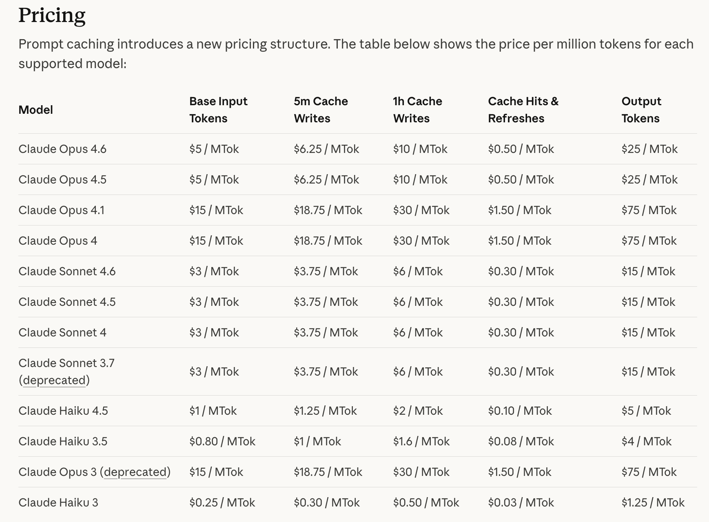

<br/>

#### KV Cache VS Prompt Caching

**一句话总结：KV Cache 让一次请求内不重复算，Prompt Caching 让多次请求间（同session或跨session）不重复算**。两者缓存的数据本质一样（KV 向量），只是一个活在请求内，一个活在请求间。

| <br/> | **KV Cache** | **Prompt Caching** |
| --- | --- | --- |
| **缓存什么** | 注意力层的 Key/Value 向量 | 同样的东西——prefill 阶段生成的 KV |
| **解决什么问题** | decode 阶段避免对已生成 token 重复计算 K/V | 跨请求避免对相同前缀重复做 prefill |
| **生命周期** | 单次请求内，请求结束即释放 | 跨请求持久化，TTL 5分钟或1小时 |
| **作用域** | 单次请求 | workspace/organization 内前缀一致的所有请求 |
| **存储位置** | GPU 显存 | 服务端存储（具体实现未公开） |
| **谁来管** | 推理引擎自动处理，用户无感 | API 层，需要用户通过 cache_control 显式或自动开启 |
| **省的是什么** | 省 decode 阶段的重复计算 | 省 prefill 阶段的全部计算 |
| **额外成本** | 无，是基础优化 | 写入费 1.25x，读取费 0.1x |

<br/>

<redoc-highlight>
**工程决策启示**：

1. **设计 prompt 时考虑缓存友好性**：稳定内容（system prompt、规则、参考文档）放前面，变化内容（用户输入）放后面，最大化缓存命中。

2. **理解"首次慢、后续快"**：Agent 多轮调用中，第一轮最慢最贵，后续因缓存命中大幅提速降本。这也是为什么一些 Agent 框架会刻意"预热"缓存。

3. **长上下文不免费**：128K 窗口虽然支持，但 KV Cache 的显存开销意味着长上下文请求占用的资源远超短请求，部分服务商会对超长上下文加价。

4. **AI CR 场景**：这就解释了为什么同一个会话里追问第二个问题明显更快——system prompt + 代码库上下文 + 团队规范这些不变的前缀在第一次请求时已被缓存。设计 CR 工具时，把团队编码规范、review checklist 等稳定内容放在 prompt 最前面，每个文件的 diff 放在最后，就能最大化利用 Prompt Cache，review 多个文件时后续文件的成本和延迟都大幅下降。
</redoc-highlight>

---

### 3.3 其他加速与降本技术

| **技术** | **做什么** | **工程价值** |
| --- | --- | --- |
| **量化** | 降低参数精度 FP16→INT8→INT4 | 显存降 2-4 倍，私有化部署首选，但有精度损失 |
| **专用芯片 (ASIC)** | 为模型架构定制硬件 | Google TPU、Groq LPU——极致推理速度 |
| **Paging (vLLM)** | 像 OS 虚拟内存一样管理 KV Cache 碎片，用逻辑连续 + 物理离散 来替代“物理连续”， | 显存利用率近 100%，支撑更多并发用户 |
| **混合专家模型 (MoE)** | 每次推理仅激活 1/N 的参数（如 DeepSeek, GPT-4） | 以极低推理功耗换取巨量模型性能 |
| **蒸馏 (Distillation)** | 大模型指导小模型训练，将“智慧”迁移到更小的模型 | 1.5B/7B 模型能达到接近大模型的垂直领域水平 |
| **推测解码** | 小模型快速草拟 + 大模型验证 | 生成速度 2-3× 提升，质量不降 |
| **连续批处理 (Continuous Batching)** | 词级迭代请求，不等前一个任务完全结束即开始新任务 | 显著提升系统吞吐量（Throughput），降低排队时延 |
| **DualPath** | 利用解码节点闲置带宽做 KV-Cache 双路加载，突破存储 I/O 瓶颈 | Agent 多轮长上下文场景吞吐提升近 2× |

<redoc-highlight>
**工程视角**：作为 API 调用者，你不需要实现这些技术，但理解它们有助于你：在选推理服务商时评估技术栈（Groq 的 LPU 极快但模型选择有限）；理解同一模型在不同平台上价格和速度差异的原因；在私有化部署时做精度-成本权衡（INT4 量化的 70B 模型可能比 FP16 的 7B 模型效果好且成本相当）。
</redoc-highlight>

<redoc-highlight emoji="tuding" fillColor="cyan-blue">
- **output token 为什么比 input token 贵好几倍？**

  - 是因为 Prefill 阶段可以并行，但 Decode 阶段只能逐 token 串行生成；

- **追问为什么比首次提问快？**

  - 首次提问你等的那几秒是 Prefill 在并行处理整个输入；追问变快是因为通过 Prompt Caching 复用了上一轮的 KV Cache；

- **如何优化token消耗和性能？**

  - 把稳定内容（system prompt、规范、参考文档）放前面，把变化内容（用户输入、diff）放后面，最大化 Prompt Cache 命中；

  - 控制输出长度，因为 Decode 是主要成本来源；
</redoc-highlight>

---

## 第四部分：模型选型

<redoc-highlight emoji="tuding" fillColor="cyan-blue">
前面三部分建立了理性基线——你知道了模型怎么处理代码、能力边界在哪、成本花在了哪里。现在进入工程决策。第四个问题：**为什么不直接用最强的模型？如何进行模型选型？**
</redoc-highlight>

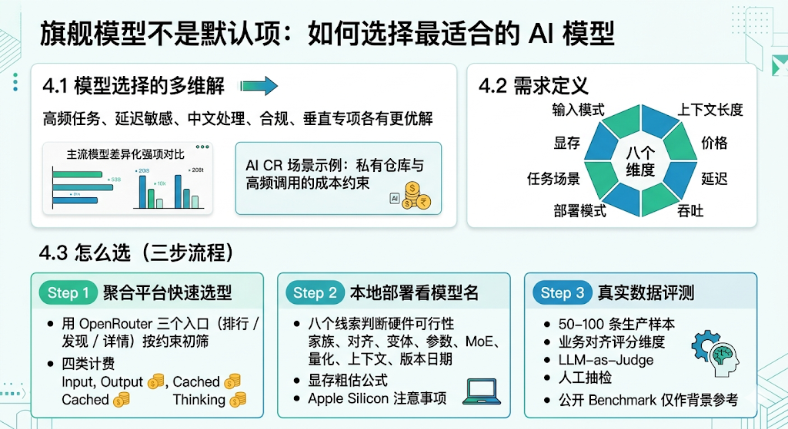

<br/>

### 4.1 为什么不直接用最强模型

1. **业务需求。旗舰模型（Claude Opus 4.6、GPT-4.1 等）代表能力上限，但不是工程默认选项：**

| **场景** | **问题** | **更合适的方案** |
| --- | --- | --- |
| **价格敏感（分类、摘要、格式转换等高频简单任务）** | Opus 单价高，千次调用成本失控。 <split/> 经过专项 SFT 的小模型在窄任务上不输 Opus，但便宜数十倍 | Claude Haiku / GPT-4o mini <split/> Qwen2.5-Coder、DeepSeek-Coder |
| **延迟敏感（实时补全、流式交互）** | Opus + Thinking 响应慢，P95 延迟难达标 | 小参数量快速模型 |
| **私有数据 / 合规要求** | Claude 是纯 API，数据必须出境 | 本地部署开源模型（Qwen、Llama） |
| **垂直专项任务（代码补全、特定领域）** | 。。。 | 。。。 |

> **AI CR 场景**：如果 CR 触发频率很高（每天上百个 PR），旗舰模型的成本可能比招一个人还贵——这些约束比"哪个模型 review 质量最高"优先级更高。

2. **模型偏好。即使同为旗舰，各家强项不同。**

| **模型** | **差异化强项** | **典型适用场景** |
| --- | --- | --- |
| **Claude Sonnet / Opus** | 长上下文、Agentic 编码、指令跟随精确 | 多步代码工程、长文档分析、复杂 Agent |
| **GPT-4o / GPT-4.1** | 通用综合、结构化输出稳定、视觉理解 | 通用问答、JSON 提取、视觉任务 |
| **o3 / o4（OpenAI 推理系列）** | 数学推理、竞赛编程、硬逻辑 | 复杂算法、数学证明、架构方案设计 |
| **Codex（OpenAI）** | 代码补全与生成专项优化，低延迟 | IDE 内联补全、函数生成、代码翻译 |
| **Gemini 2.5 Pro** | 超长上下文（1M+）、视频理解 | 超长文档处理、视频分析、Google 生态集成 |
| **DeepSeek V3 / R1** | 成本极低、代码与推理能力强、中文友好 | 代码任务的低成本替代、中文场景 |

3. **Provider差异。同一个模型，在不同provider下的表现不同。**(openrouter api 可以指定provider)[https://openrouter.ai/anthropic/claude-opus-4.6](https://openrouter.ai/anthropic/claude-opus-4.6)

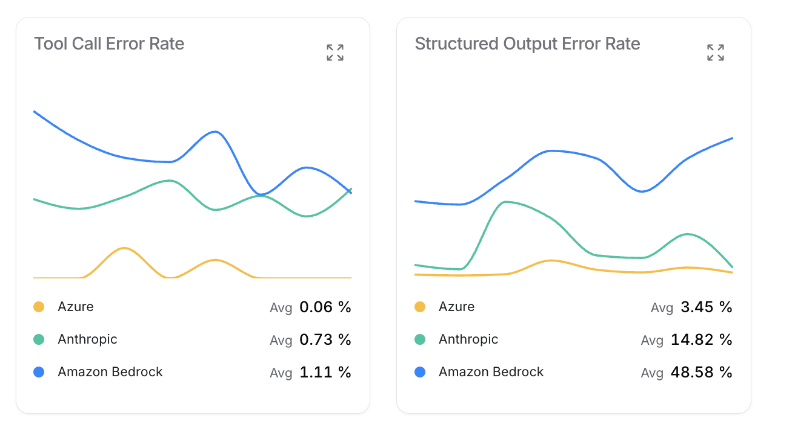

4. **任务分工。复杂任务可能本身就适合根据复杂度做拆分，路由到不同模型。**工程中常见三种路由实现（[参考](https://portkey.ai/blog/task-based-llm-routing/)）。路由的收益已有实证：Anthropic 在其[多模型路由指南](https://docs.anthropic.com/en/docs/build-with-claude/prompt-routing)中建议按任务复杂度分流到不同层级模型；实际工程中，团队通过规则路由将月度 LLM 开销降低 50%+ 而不影响输出质量的案例并不少见。

- **AI CR 场景**：

  - CR 是规则路由的典型应用——按文件变更复杂度分流，先用 Haiku 级别的快模型扫一遍明显的代码风格和格式问题（低成本高频），只对包含复杂逻辑变更的文件升级到 Sonnet/Opus 做深度 review（高成本低频），同样的 review 覆盖率，成本降 60%+。

  - coding 和 review 采用不同模型

> 

既然不能无脑选最强，第一步是明确你的需求。

---

### 4.2 需求定义

选型之前，先把需求写成可检查的问题：

| 维度 | 对应 Step | 关键问题 | 对选型的影响 |
| --- | --- | --- | --- |
| **任务场景** | 1、2 | 代码任务还是 Agent 任务？用在OpenClaw上还是Hermes上？ | 代码任务优先 Coder 变体；Agent 场景优先 Reasoning 变体； |
| **部署模式** | 1、2 | API 调用还是本地？数据能出境吗？对幻觉的容忍度？ | 本地部署只能选开源可自托管模型；医疗/法律/金融等高风险场景仍可用 LLM，但必须叠加验证层（如规则校验、人工复核）来兜底 |
| **输入模式** | 1 | 问答 / 代码 / 视觉 / 多模态？ | 决定需要哪些输入模态 |
| **上下文长度** | 1 | 单次输入有多长？需要处理整个代码库还是单个函数？ | 长文档/大仓库需要 128k+ 窗口的模型；"能塞下"≠"都能用好" |
| **提示词价格** | 1 | 每次调用的预算是多少？ | 直接划掉高于预算的模型层级 |
| **延迟要求（Latency&TTFT）** | 1 | 用户能等几秒？P95 延迟要求？ | Prefill阶段决定。旗舰模型 TTFT 通常比小模型慢 |
| **吞吐量要求** **（Throughput&TPS）** | 1 | 整个回答用户能等多久？ | Decode 阶段决定。[https://openrouter.ai/docs/api/reference/authentication](https://openrouter.ai/docs/api/reference/authentication) |
| **显存 / 硬件** | 2 | 本地有多少显存（或统一内存）？ | 直接决定能跑的最大参数量和精度（本地部署专属，API 场景可跳过） |

<br/>

约束明确后，接下来用三步流程找到具体的模型。

---

### 4.3 怎么选

**快速选型 → 模型名称判断（本地部署） → 真实数据评测**

#### Step 1：用聚合平台快速选型

<redoc-columns>
<redoc-column ratio="0.333333">
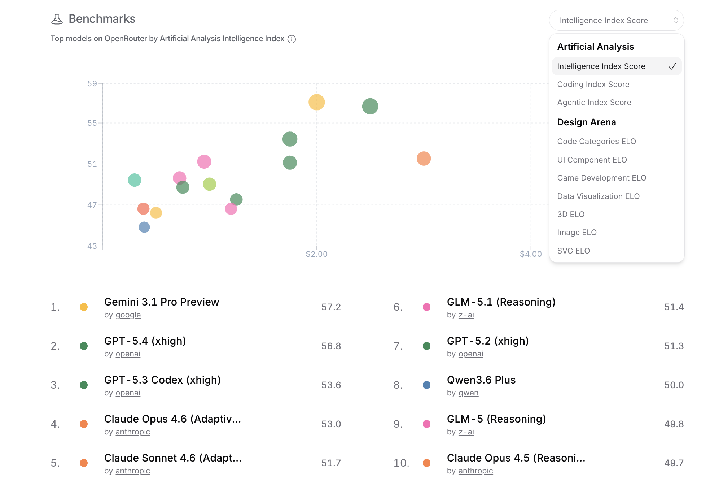

</redoc-column>
<redoc-column ratio="0.376553">
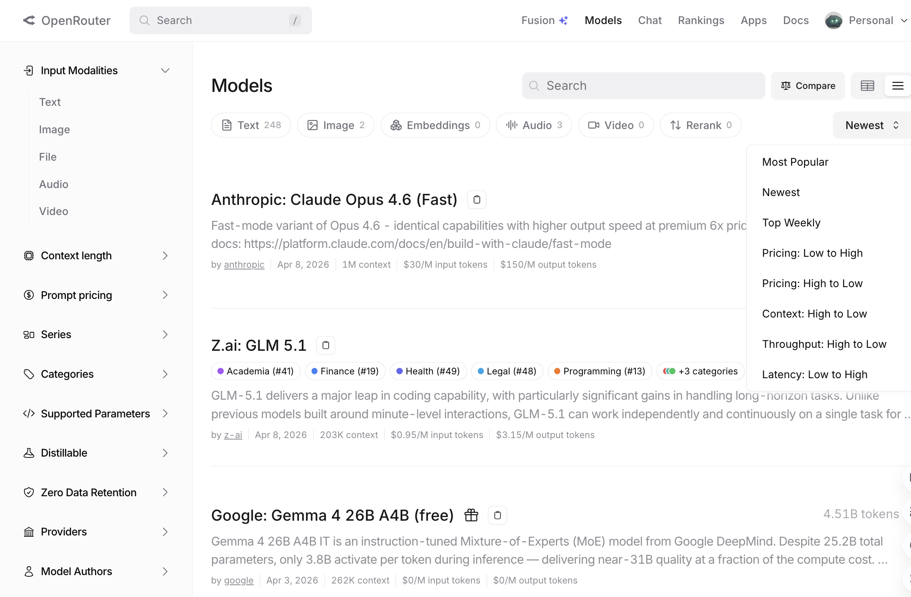
</redoc-column>
<redoc-column ratio="0.290114">
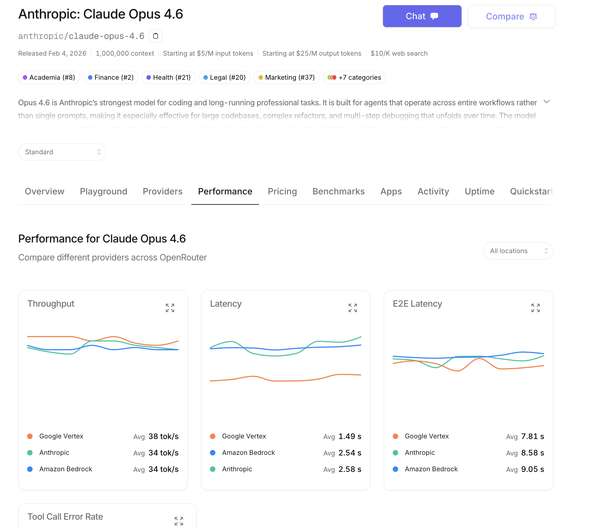

</redoc-column>
</redoc-columns>

带着 4.2 定义的约束，用**模型聚合平台**做初筛是最高效的起点——这类平台汇集了数百个模型的定价、能力、上下文窗口等元数据，用约束条件做过滤，几分钟锁定候选池。这里以[OpenRouter](https://openrouter.ai/models) 为例。

OpenRouter是一个聚合了 200+ 模型的统一 API 平台，选型时有三个实用入口：

- **全局排行榜**（[/rankings](https://openrouter.ai/rankings), [/apps](https://openrouter.ai/apps) ）：反映真实工程场景下哪些模型被大量使用——比单纯看 Benchmark (如：[artificial analysis](https://artificialanalysis.ai/models))分数更贴近生产。

- **模型候选池**（[/models](https://openrouter.ai/models)）：按任务类型、上下文长度、是否支持工具调用过滤，按流行度、价格、吞吐量、延迟等排序。几分钟看到满足约束的所有模型。

- **单模型详情**（[claude-opus-4.6](https://openrouter.ai/anthropic/claude-opus-4.6)）：每个模型有独立页面，列出该模型的实时性能、定价明细、上下文窗口、 Benchmark 成绩、支持的功能（工具调用、JSON 模式、视觉等），以及 Playground 可直接测试——是做候选对比时的标准查阅入口。

#### Step 2：本地部署从模型名字辅助选型

**为什么要学会读模型名字？** 本地部署时，你面对的往往只有一个文件名——从 HuggingFace 下载的 <font color="#F06A1D" backgroundColor="rgba(0, 0, 0, 0.05)">.gguf</font>、Ollama 拉取的镜像名、或者 llama.cpp 加载的模型路径。没有 OpenRouter 这样的平台帮你过滤、比价、查功能列表；能提取出哪些信息，完全取决于你能不能读懂这个字符串。

模型名字里藏着关键信息，快速判断"值不值得进候选池"：

| <br/> | **名字线索** | **常见标记** | **代表什么** | **对选型的含义** |
| --- | --- | --- | --- | --- |
| <br/> | **模型家族 / 代次** | Qwen2.5、Llama-3.1、DeepSeek-V3 | 能力谱系和代际 | 同系列代次越新，对齐越稳 |
| 任务 | **指令对齐** | Instruct、Chat | 经过指令微调 | 应用默认选 Instruct/Chat |
|  | **任务域变体** | Coder、Vision、Reasoning | 领域强化版本 | 代码任务优先 Coder；Agent 场景优先 Reasoning（长链推理 + 工具调用更稳） |
| 显存 | **参数规模** | 3B/7B/14B/32B/70B | 稠密参数量 | 越大质量越高但越慢越贵 |
|  | **MoE 标记** | MoE、671B/37B active | 每次仅激活部分专家 | 不要只看总参数，看激活参数 |
|  | **量化/精度** | Q4/Q8、INT4、GGUF | 权重压缩精度 | 本地部署必看，省显存但有精度损失 |
|  | **上下文长度** | 32k/128k/1M | 最大窗口 | “能塞下”≠”都能用好” |

<br/>

例：<font color="#F06A1D" backgroundColor="rgba(0, 0, 0, 0.05)">Qwen2.5-Coder-7B-Instruct-Q4_K_M.gguf</font> = Qwen2.5 家族 / 代码优化 / 7B / 指令对齐 / 4bit 量化 / 本地推理格式。

**从名字粗估显存占用**：参数量和上下文长度是两个主要变量。

```
模型权重显存 ≈ 参数量(B) × 每参数字节数
  FP16:  7B × 2 字节 ≈ 14 GB
  INT8:  7B × 1 字节 ≈  7 GB
  Q4:    7B × 0.5字节 ≈  4 GB（含开销约 4–5 GB）
 
KV Cache 显存 ≈ 随上下文长度线性增长
  7B 模型，128k context，FP16 KV ≈ 额外 16 GB+ 
  ollama默认4k context，Q4下大概只要256MB
 
实际可用规则（本地/消费级）：
  8 GB  显存/统一内存 → Q4 量化的 7B 以内
  16 GB → Q4 量化的 13B，或 FP16 的 7B（上下文受限）
  32 GB → Q4 量化的 32B，或 FP16 的 14B
```

> 

#### Step 3：用真实数据评测选型

> **解决的约束**：质量——用你的真实业务数据做最终验证。

公开 Benchmark 测的是通用能力分布，和你的任务分布大概率不一致；50 条真实样本的评测结果比任何榜单都更能预测模型在你任务上的表现（[如何构建评测集](https://hamel.dev/blog/posts/evals/)｜[LLM Evals FAQ](https://hamel.dev/blog/posts/evals-faq/)｜[AWS: Beyond Vibes](https://aws.amazon.com/blogs/machine-learning/beyond-vibes-how-to-properly-select-the-right-llm-for-the-right-task/)）。

<br/>

**做法：**

1. **从生产数据中抽样 50–100 个典型 case**（AI CR 场景：真实 PR diff + 期望的 review 意见）

2. **定义评分维度**：准确性、格式合规、误报率——和业务指标对齐

3. **LLM-as-Judge 自动评测** + **人工抽检 10–20%**（[LLM-as-Judge 指南](https://www.anthropic.com/research/evaluating-ai-systems)｜[实践参考](https://hamel.dev/blog/posts/llm-judge/)）。注意 position bias：A/B 对比时随机化呈现顺序或交换顺序跑两次取平均

<redoc-highlight>
**个人看法**：Benchmark 不适合作为选型步骤，但可以用来建立模型能力的大致印象（[为什么不够用](https://www.evidentlyai.com/llm-guide/llm-benchmarks)｜[Benchmarks 2026](https://www.lxt.ai/blog/llm-benchmarks/)），了解大模型能力的发展方向。目前主流的benchmark包括以 **AIME / Codeforces** 为代表的慢思考与长逻辑推理；以 **SWE-bench**（真实工程开发）和 **OSWorld / WebArena**（系统与网页交互）为代表的 Agent 复杂操作闭环；以及以 **GPQA Diamond** 为代表的专家级前沿认知。注意，MMLU 和 HumanEval 等测验基础常识与简单生成的榜单均已高度饱和（90%+），不再是拉开头部梯队差距的指标。
</redoc-highlight>

**AI CR 场景**：收集 50 个历史 PR（覆盖不同复杂度和语言），用人工标注出"应该指出的问题"，作为评测集。让候选模型跑一遍，比较召回率和误报率——这比看 SWE-Bench 分数可靠得多。

<redoc-highlight emoji="tuding" fillColor="cyan-blue">
**回答最初的问题**：

- **为什么不直接用最强的模型？**

  - 因为真实业务场景往往面对种种约束，这些约束比"质量最高"更优先。不同旗舰模型有不同的任务偏好，同样的模型在不同provider下的表现也有不同。

- **如何进行模型选型？**

  - 先用 4.2 的维度把约束写清楚，再用 4.3 的三步（聚合平台初筛 → 模型名字判可行性 → 真实数据评测）进行选型
</redoc-highlight>

---

## 第五部分：参数配置

<redoc-highlight emoji="tuding" fillColor="cyan-blue">
模型选好了，第五个问题：**选定模型后如何调参？**

但在回答怎么调之前，先问一个更基础的问题——参数到底影响多大？
</redoc-highlight>

选定模型之后，参数配置决定模型"怎么生成"——但在调参之前，先建立一个正确的预期。

**调参的真实影响层级：**

```
80% 的输出质量问题 → 来自 Prompt 写得不够好
15% → 来自上下文信息不足
 4% → 来自参数设置不对
 1% → 来自模型本身的能力瓶颈
```

大多数时候，你以为需要"调参"的问题，其实是 prompt 的问题。参数是锦上添花，不是救命稻草。**先改 prompt，再调参数，最后才考虑换模型。**

---

### 5.1 采样参数：temperature

<font color="#F06A1D" backgroundColor="rgba(0, 0, 0, 0.05)">temperature</font> 控制输出的"随机程度"——数值越低，模型越倾向于选概率最高的 token；数值越高，低概率 token 被选中的机会越大。

| **temperature** | **效果** | **典型场景** |
| --- | --- | --- |
| **0 – 0.2** | 几乎确定性输出 | 代码生成、JSON 提取、分类 |
| **0.3 – 0.5** | 稳定但有灵活性 | 代码审查、技术问答、摘要 |
| **0.6 – 0.8** | 自然流畅 | 日常对话、文档写作 |
| **0.9 – 1.2** | 多样、发散 | 头脑风暴、创意写作 |

**三条容易踩的坑：**

1. <font color="#F06A1D" backgroundColor="rgba(0, 0, 0, 0.05)">**temperature=0**</font>** 不等于"完全确定"**——浮点精度和 batch 策略会带来微小变异。

2. **低 temperature 不等于"更正确"**——它只影响从分布中怎么选，不改变分布本身。模型如果对某事实本来就不确定，降 temperature 只会让它更坚定地选错误答案。

3. **代码任务推荐 0.1–0.2 而非 0——完全贪心解码有时会陷入重复模式。**

<font color="#F06A1D" backgroundColor="rgba(0, 0, 0, 0.05)">top_p</font> 和 <font color="#F06A1D" backgroundColor="rgba(0, 0, 0, 0.05)">top_k</font> 是另两个采样控制参数，与 temperature 效果部分重叠（顺序：tempature=&gt;top_k=&gt;top_p=&gt;加权采样）。**实操建议：只调 temperature，top_p 保持默认 1.0，top_k 通常不需要碰。**

<br/>

**AI CR 场景**：temperature 建议 0.1–0.3。太高会导致同一段代码每次 review 结论不一致，开发者失去信任；太低（0）则容易陷入重复的模板化评语。如果你需要 CR 结果可复现（比如用于审计），加上 seed 参数固定随机状态。

---

### 5.2 输出控制：max_tokens 与 stop

<font color="#F06A1D" backgroundColor="rgba(0, 0, 0, 0.05)">**max_tokens**</font> 是输出的硬性上限，不是目标——模型遇到自然结束符会提前停止。

| **场景** | **推荐值** | **注意** |
| --- | --- | --- |
| **分类 / 判断** | 50–200 | 限制住可以减少废话 |
| **JSON / 结构化提取** | 预期大小 × 1.5 | 留余量，别开太大烧钱 |
| **代码生成（函数级）** | 4096–8192 | 太大模型可能"过度生成" |
| **Agentic 工具调用** | 4096–8192 | 需要包含工具调用 JSON |
| **长文档 / 多文件重构** | 16384+ | 复杂任务需要足够空间 |

输出被截断（JSON 没闭合、代码缺 <font color="#F06A1D" backgroundColor="rgba(0, 0, 0, 0.05)">&#125;</font>）是最常见的 bug 之一，通常就是 <font color="#F06A1D" backgroundColor="rgba(0, 0, 0, 0.05)">max_tokens</font> 不够。（本地部署ollama可能经常遇到，默认4k上下文）

<font color="#F06A1D" backgroundColor="rgba(0, 0, 0, 0.05)">**stop**</font>** 参数**：指定字符串，模型生成到任何一个就立即停止。在 Agent 和结构化输出中很实用：

```
stop = ["
 
", "```"]      # JSON 输出后防止模型继续解释
stop = ["User:", "Human:"]  # 多轮模拟中防止模型演其他角色
stop = ["
def ", "
class "]  # 只要一个函数，不让模型继续生成
```

注意：stop 是前缀匹配，<font color="#F06A1D" backgroundColor="rgba(0, 0, 0, 0.05)">stop=["&#125;"]</font> 在嵌套 JSON 中会提前终止。

<br/>

**AI CR 场景**：

- Max Tokens 是成本与稳定性的“防火墙”： 通过动态限制输出长度，防止 AI 针对大批量代码产生冗余废话，从而降低 API 开销并避免因响应过长导致的流水线超时。

- Stop 参数是结构化解析的“断路器”： 在输出 JSON 或单行修复建议时，通过强制截断多余的客套话，确保结果能被 CI/CD 系统直接解析并自动标注到代码行。

- 两者共同实现了审查的“工程化鲁棒性”： 它们将 AI 从不可控的“聊天模式”切换为精准的“工具模式”，是实现自动化代码注入和大规模批量审查的技术基石。

---

### 5.3 logit_bias：限制输出范围

logit_bias 允许你直接调整特定 token 的生成概率：正值让该 token 更可能被选中，负值（如 -100）让它几乎不可能出现。

**Agent 场景中的典型用途**：当 Agent 在某个状态下只允许调用特定工具子集时，直觉上的做法是"把不可用工具从列表里删掉"——但这会改变 prompt 前缀，破坏 KV Cache 命中率（参见 3.2）。Manus 的做法是**保持 prompt 不变，控制输出**：

- **logit masking**：在 decode 阶段直接屏蔽不可用工具对应的 token，模型物理上无法选择（需要底层推理框架支持）

- **Response prefilling**：把回复前缀预填为 browser_，模型只能续写浏览器相关工具——大多数 API 直接支持，无需底层访问

```plaintext
tool1, tool2, tool3
```

<br/>

配合一致的工具命名规范（browser_*、shell_*），prefilling 就能实现精细的工具访问控制，同时不影响 KV Cache。

<br/>

**工程视角**：大多数场景用 stop 或 prefilling 已经足够；logit_bias 适合对输出有精确约束的场景（强制 JSON 格式、硬性禁止某个词）。直接操作 logits 需要知道 token ID，维护成本高，轻易不要碰。

<br/>

### 5.3 Thinking 模式：何时开启推理增强

Claude Extended Thinking、OpenAI o 系列等推理模型在生成答案前会先进行长链推理。**思考 token 按 output 价格计费，动辄数千 token——用错场景成本翻 5–10 倍效果几乎不变。**

| **场景** | **是否开启** | **原因** |
| --- | --- | --- |
| 复杂算法设计 / 架构决策 | ✅ 开 | 需要多步推理和权衡 |
| 跨文件 Bug 追踪 | ✅ 开 | 需要跨文件追踪因果链 |
| 数学 / 逻辑推理 | ✅ 开 | 思维链显著提升准确率 |
| 简单代码补全 / 格式转换 | ❌ 不开 | 浪费 token |
| 长文档摘要 | ❌ 通常不开 | 主要靠理解而非推理 |

Claude 的 <font color="#F06A1D" backgroundColor="rgba(0, 0, 0, 0.05)">budget_tokens</font> 可以控制思考长度——复杂任务给 10000–20000，中等给 5000–8000，避免过度思考。

如果问题的难度来自"上下文不足"（模型不知道你的项目结构），开 Thinking 无济于事——它只是让模型"想得更久"，但没有新信息可以想。这种情况改善上下文比开 Thinking 更有效。

**AI CR 场景**：大部分 review（代码风格、命名、简单逻辑）不需要开 Thinking；但对于涉及并发安全、分布式一致性、安全漏洞等需要多步推理的复杂变更，开启 Thinking 能显著提高发现深层问题的概率。实操建议：默认关闭，对标记为"核心模块"或"安全相关"的文件路径自动开启。

<br/>

---

### 5.4 常见任务配置速查

| **任务** | **model 层级** | **temperature** | **max_tokens** | **thinking** |
| --- | --- | --- | --- | --- |
| **代码生成（函数级）** | Sonnet | 0.2 | 8192 | 关 |
| **代码审查 / 深度 Debug** | Sonnet | 0.3 | 4096 | 开，budget 8000 |
| **Agent 工具调用** | Sonnet | 0.1 | 4096 | 关 |
| **数据提取 / JSON 输出** | Haiku | 0 | 2048 | 关 |
| **头脑风暴 / 方案探索** | Sonnet | 0.9 | 4096 | 关 |
| **复杂架构 / 算法设计** | Opus | 0.3 | 8192 | 开，budget 16000 |

<br/>

这些是起点，不是终点。**调参方法：从模板出发 → 跑 5–10 个真实 case → 识别哪些不满意 → 一次只改一个参数 → 对比效果。**

<br/>

**AI CR 场景**：一个实用的起点配置——model=Sonnet, temperature=0.2, max_tokens=4096, thinking=关。先用这个跑 10 个历史 PR 的 review，和人工 review 结果对比，再决定哪个参数需要调。

<redoc-highlight emoji="tuding" fillColor="cyan-blue">
**选定模型后如何调参？**——参数只占 4% 的影响（prompt 80%、上下文 15%），先改 prompt，再补上下文，最后才动参数。真要动时各有分工：

- **temperature**：控随机性，代码/JSON 用 0–0.2，对话/写作 0.6–0.8，头脑风暴 0.9+。

- **max_tokens + stop**：防截断兼成本闸门，按预期输出给 1.5× 余量，再用 stop 切掉废话。

- **thinking**：默认关，只在多步推理（跨文件 bug、复杂算法）才开。

- **logit_bias / prefilling**：日常不用，Agent 限制工具子集时用 prefilling，不破坏 KV Cache。
</redoc-highlight>

---

## 第六部分：模型部署

<redoc-highlight fillColor="cyan-blue">
**最后一个问题：前面讲了这么多，能不能自己跑一个模型试试？**

<br/>

能。这一部分只做一件事：**在你自己的 Mac 上把本地模型和 AI 编码工具跑通**。用 Ollama 拉一个开源模型，零成本、零注册，亲手感受 token、推理速度、模型大小这些概念。同时，如果你的团队有代码不能出境的合规要求，本地部署也是 AI CR 的唯一路径。
</redoc-highlight>

### 6.1 任务目标

完成三件事：

1. **模型选型**：根据任务和硬件选择本地模型。

2. **本地模型跑通**：用 Ollama 拉起一个模型并成功对话。

3. **AI 编码工具跑通**：用 OpenCode 完成一次代码相关对话。

---

### 6.2 模型选型：先想清楚再动手

#### 第一步：确认你的硬件

先看芯片和内存：

```
sysctl -n machdep.cpu.brand_string
sysctl -n hw.memsize | awk '{print $0/1024/1024/1024 " GB"}'
```

只需要记住两项：**芯片型号**和**统一内存大小**。

#### 第二步：根据硬件选本地模型

Apple Silicon 的统一内存既给系统，也给模型。**粗略规则：模型大小不要超过总内存的 70%-80%**。

| 你的内存 | 可用于模型的空间 | 推荐模型 | 参数量 | 模型大小（量化后） |
| --- | --- | --- | --- | --- |
| 8 GB | ~5 GB | Qwen2.5-Coder:3b | 3B | ~2 GB |
| 16 GB | ~10 GB | Qwen2.5-Coder:7b / DeepSeek-Coder-V2-Lite | 7B | ~4-5 GB |
| 24 GB | ~16 GB | Qwen2.5-Coder:14b / DeepSeek-Coder:33b (Q4) | 14-33B | ~8-12 GB |
| 32 GB+ | ~22 GB+ | Qwen2.5-Coder:32b / CodeLlama:34b | 32-34B | ~18-20 GB |
| 64 GB+ | ~45 GB+ | DeepSeek-V2.5 / Llama3:70b (Q4) | 70B+ | ~35-40 GB |

- **只想跑通流程**：<font color="#F06A1D" backgroundColor="rgba(0, 0, 0, 0.05)">qwen2.5-coder:3b</font>

- **日常本地编码辅助**：<font color="#F06A1D" backgroundColor="rgba(0, 0, 0, 0.05)">qwen2.5-coder:7b</font>

- **本地尽量追求质量**：<font color="#F06A1D" backgroundColor="rgba(0, 0, 0, 0.05)">qwen2.5-coder:32b</font>

- **追求最好效果**：直接用 API，本地模型主要胜在免费和隐私

核心原则不是“越大越好”，而是**速度、质量、硬件约束三者平衡**。

---

### 6.3 Ollama 安装与本地部署

#### 第一步：安装 Ollama

```
brew install ollama
```

也可以直接去官网下载安装包：<font color="#F06A1D" backgroundColor="rgba(0, 0, 0, 0.05)">https://ollama.com/download</font>。

#### 第二步：拉取模型

```
ollama pull qwen2.5-coder:7b
ollama list
```

如果机器较小，把模型名换成 <font color="#F06A1D" backgroundColor="rgba(0, 0, 0, 0.05)">qwen2.5-coder:3b</font>。

#### 第三步：验证——发出你的第一句话

```
ollama run qwen2.5-coder:7b
```

进入交互模式后，输入一句简单指令，例如：

```
写一个 Python 函数，接受一个整数列表，返回其中所有偶数的平方和。
```

按 <font color="#F06A1D" backgroundColor="rgba(0, 0, 0, 0.05)">Ctrl+D</font> 或输入 <font color="#F06A1D" backgroundColor="rgba(0, 0, 0, 0.05)">/bye</font> 退出对话。

#### 验证 API 服务

Ollama 默认提供本地 API，后面 OpenCode 会直接用到：

```
curl http://localhost:11434/api/chat -d '{"model":"qwen2.5-coder:7b","messages":[{"role":"user","content":"你好，请用一句话介绍你自己"}],"stream":false}'
```

返回 JSON 就说明服务正常。

#### 常见问题排查

| 问题 | 处理方式 |
| --- | --- |
| <font color="#F06A1D" backgroundColor="rgba(0, 0, 0, 0.05)">ollama: command not found</font> | 重新安装，或检查 PATH |
| 拉取超时 | 检查网络或代理 |
| 生成极慢 | 模型太大，换小一档 |
| 内存不足 | 关闭其他应用，或换小模型 |

---

### 6.4 OpenCode 安装与配置

OpenCode 是终端里的 AI 编程助手，可以连本地 Ollama，也可以连云端 API。

#### 第一步：安装 OpenCode

```
brew install opencode
```

也可以用 <font color="#F06A1D" backgroundColor="rgba(0, 0, 0, 0.05)">go install github.com/opencode-ai/opencode@latest</font> 安装。

#### 第二步：配置模型连接

先用本地 Ollama 跑通最省事。在项目目录创建 <font color="#F06A1D" backgroundColor="rgba(0, 0, 0, 0.05)">opencode.json</font>：

```
{
  "provider": "ollama",
  "model": "qwen2.5-coder:7b"
}
```

如果要连云端 API，再切换 provider 和模型即可，例如先设置：

```
export ANTHROPIC_API_KEY=your_key
```

建议顺序：**先本地跑通，再切到 API 对比效果**。

#### 第三步：在项目中启动 OpenCode

```
cd ~/your-project
opencode
```

#### 第四步：发出你的第一条编码指令

进入交互界面后，先试两类问题：

```
这个项目是做什么的？主要用了什么技术栈？
 
检查 [某个文件路径] 中的代码，指出潜在的 bug 和优化建议
```

能基于项目上下文正常回答，就说明环境已经搭好。

<br/>

---

## 回到那段代码

回头看开头那段 renderProfile：

```typescript
async function renderProfile(userId: string) {
  // 通过接口获取用户信息
  const res = await fetch(`/api/users/${userId}`);
  const user = res.ok ? await res.json() : null;
  // 提取用户名称
  const name = user.name; // NPE
  // 页面渲染用户名称
  document.getElementById('name')!.textContent = name;
}

```

你的 AI CR 工具说：<font backgroundColor="#FFFF33">"user 可能为 null，第 4 行直接访问 .name 会抛出 TypeError。" </font>现在你知道这句话背后发生了什么：

1. **架构**：模型通过 Tokenizer 把代码切成 token，通过 Embedding 赋予基础语义，通过 Attention 关联上下文让<font color="#F06A1D" backgroundColor="rgba(0, 0, 0, 0.05)"> user.name</font> 关联到 <font color="#F06A1D" backgroundColor="rgba(0, 0, 0, 0.05)">const user = res.ok ? ... : null </font>发现空值风险，再通过多层 Transformer 逐步深化推理。

2. **训练**：Pre-train 打基础，CPT 补知识，SFT 教行为，Alignment 调偏好。它之所以懂 null check，是因为预训练扫过了 GitHub 上数十亿行代码、CPT 阶段又用代码语料做了浸泡式深化；SFT 阶段教会模型逐步推理和指令遵循等能力；review 结论太保守可能是对齐税的原因。

3. **推理**： Prefill 阶段可以并行处理输入但 Decode 阶段只能逐 token 串行生成，某种程度上导致了 output token 比 input token 贵；首次请求等的那几秒是 Prefill 在并行处理整个输入，追问变快是因为 Prompt Cache 复用了上一轮的 KV Cache；为了优化 token 消耗和性能，应该把稳定内容（system prompt、规范、参考文档）放前面，把变化内容（用户输入、diff）放后面，最大化 Prompt Cache 命中；

4. **选型**：你没必要用最贵的旗舰模型——业务需求、模型偏好、平台差异。最好先确认需求；再利用聚合平台、模型名字进行选型，最后在真实业务上做 Evaluation。简单 CR 任务可以路由给便宜模型。

5. **参数**：参数通常只占小部分影响。真要动时：<font color="#F06A1D" backgroundColor="rgba(0, 0, 0, 0.05)">temperature</font> 按任务定档（代码/CR 用 0.1–0.3，创意写作 0.6+），<font color="#F06A1D" backgroundColor="rgba(0, 0, 0, 0.05)">max_tokens + stop</font> 防截断兼控成本，<font color="#F06A1D" backgroundColor="rgba(0, 0, 0, 0.05)">thinking</font> 只在多步推理时才开，<font color="#F06A1D" backgroundColor="rgba(0, 0, 0, 0.05)">logit_bias</font> 用来在 Agent 场景限制工具子集且不破坏 KV Cache。

6. **部署**：在你自己的 Mac 上就能跑一个 Coder 模型，零成本验证以上所有概念。

这六层理解构成了一个工程师使用大模型的**理性基线**。有了这个基线，你不会再把模型当黑盒——你知道它能做什么、做不到什么、贵在哪里、该怎么选。

<br/>

<redoc-highlight>
但这节课只回答了"模型本身怎么回事"。你可能已经注意到，很多工程视角里反复提到同一件事：**prompt 决定了 80% 的输出质量**。怎么写 prompt、怎么组织上下文、怎么让模型稳定地按你的意图输出——这是下一课的内容。
</redoc-highlight>

---

## 参考资料

- [GitHub - datawhalechina/happy-llm: 📚 从零开始的大语言模型原理与实践教程](https://github.com/datawhalechina/happy-llm/tree/main)（2025.6）

- [3Blue1Brown - Transformers 可视化](https://www.youtube.com/watch?v=wjZofJX0v4M)

- [Understanding KV Cache and Prompt Cache Basics](https://yuanchaofa.com/post/understanding-kv-cache-and-prompt-cache-basics)

- [Prompt Cache Design for LLM Agents](https://yuanchaofa.com/post/prompt-cache-design-for-llm-agents)

- [Factory Droid - Why Use Mixed Models](https://docs.factory.ai/cli/configuration/mixed-models#why-use-mixed-models)

- [LMSYS Chatbot Arena](https://chat.lmsys.org/) / Aider LLM Leaderboards / LiveBench

- [Ollama](https://ollama.com/) —— 本地模型部署

- [GitHub - opencode-ai/opencode: A powerful AI coding agent. Built for the terminal.](https://github.com/opencode-ai/opencode) —— 开源终端 AI 编程助手

- [Ollama Model Library](https://ollama.com/library) —— 可用模型列表与规格

<br/>