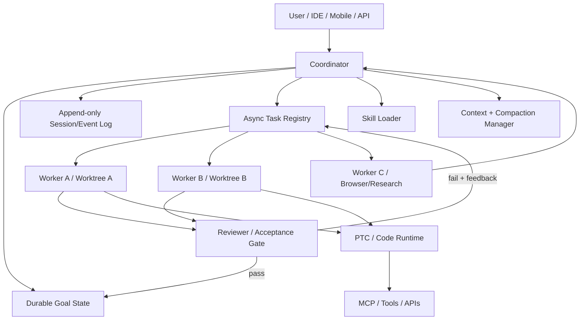

# 近六个月 Agent 技术与 Coding Agent 产品调研：从 Goal、PTC、Async 到 Durable Agent

## 执行摘要

本报告观察窗口为 **2026 年 5 月 14 日至 2026 年 11 月 14 日**。如果把最近半年的 Agent 演进压缩成一句话，最重要的变化不是“模型又聪明了一点”，而是 **Agent harness 正在从一次性 ReAct 循环，升级成可持续运行、可恢复、可并行、可中途干预的操作系统式 runtime**。DeepSeek Harness 明确提出 “Agent = Model + Harness”；Pi Durable、OpenAI Agents API、Cloudflare Durable Agents、Kimi Goal mode、OpenCode `/goal`、Cursor/Claude Code 的 background subagents 都指向同一个方向：模型只是推理内核，真正拉开 Coding Agent 工程能力差距的是 **状态、调度、隔离、恢复、上下文和人与 Agent 的控制面**。citeturn655526search2turn538275search0turn865633search5

近半年最值得投入的技术，我会按工程价值排序为：**Goal / Objective Runtime → Async Subagents → Durable Session & Task Runtime → Worktree 隔离 + Reviewer Gate → Context Compaction → Progressive-disclosure Skills → PTC / Code Mode → Multi-agent Teams → ACP/A2A**。其中 Goal、Async、Worktree、Compaction、Skills 已经适合直接在生产级 Coding Agent 中复刻；Durable Agent 和 PTC 的战略价值更大，但实现复杂度和副作用控制难度更高，应放在第二阶段。这个排序不是按“概念新颖度”，而是按对任务完成率、无人值守时间、人工干预率和 token 成本的综合提升来排序。

**Goal 并不是“再加一个 todo list”**。DSH 将 Goal 做成跨 turn、resume、fork、进程重启仍可保存的版本化状态，包含 active / paused / blocked / complete 状态和 revision/CAS；OpenCode 在 2026 年 10 月加入 `/goal`，由 reviewer 决定目标是否真正完成；Kimi 在 9 月强化 Goal mode 的长期运行时间预算；Codex 在 5 月 21 日将 Goal mode 推至 GA。由此可以看到 Goal 正在从 UI 功能变成 Agent runtime 的控制平面。citeturn138613search0turn905814search5turn968489search0turn865633search0

**PTC（Programmatic Tool Calling）/ Code Mode 的核心不是让 Agent “写更多代码”，而是把大量工具编排从自然语言 token 流转移到代码执行环境。** Anthropic 的 PTC 让模型生成程序完成循环、条件、聚合和多工具调用；DSH 的 PTC presentation mode 甚至只向模型暴露 `run_code` 与动态生成的 SDK，而不是所有工具 schema。2026 年 10 月公开的生产研究对 26,528 次 PTC 调用进行了评估，报告平均输入 token 降低约 77%、延迟降低约 21%，回答成功率提升 5.6 个百分点；Cloudflare 又把 MCP 工具接入 durable Code Mode，使授权暂停/恢复和长任务结合起来。PTC 的核心思想早于本观察窗口，但 **2026 下半年的实质进展是生产验证、durability 和大规模工具目录融合**。citeturn151676search1turn138613search6turn151676search10turn631829search0

**Async Agent 是最近半年最明显的产品级收敛。** Async 的关键不是“并行调用几个 subagent”，而是主 Agent 在 worker 执行期间仍能继续与用户交互、启动更多工作、查看状态、修改方向、取消任务，并在后台结果完成时重新注入上下文。LangChain 在 2026 年 11 月将这种模式概括为 “Agents Are Going Async”；Cursor、OpenCode、Claude Code、Kimi 都在这一时期强化 background subagent / background task 生命周期。更激进的 AWS Infinity 把每个模型调用视为 coroutine slice，在工具调用处 suspend，状态持久化后再恢复，展示了“agent process 不需要持续驻留”的 runtime 方向。citeturn151676search5turn151676search6turn905814search4turn305237search2turn968489search0

**Pi Durable 是这轮变化里非常值得关注的产品设计。** 它不是 Pi Coding Agent 2.0，而是 Pi 之外的一层实验性 durable harness：任务可跨进程失败继续执行，多个人或多个 surface 可以控制同一 agent，subagent 可以在后台独立运行，进程崩溃后仅重试未完成的安全工作。Cloudflare 随后提供基于 Durable Objects、SQLite 和 durable job queue 的 Pi Durable 集成。它真正值得借鉴的不是 API，而是三个 runtime invariants：**event-sourced state、recoverable task boundary、multi-client steering**。citeturn538275search0turn631829search3

产品层面，目前最有辨识度的不是“谁有 agent mode”，而是各家的 **harness 哲学**：Claude Code 偏向完整内建能力、权限控制、hooks 与 Agent Teams；Codex 偏向 cloud/local 混合、隔离环境、Goal 和远程委派；Pi 刻意保持极小核心，把 subagent、plan mode 等留给 extensions；OpenCode 则走开放、多模型、快速吸收新 runtime primitive 的路线。DSH 很像“面向 agent 作者的 harness toolkit”，其 Goal + PTC + plugin-native 架构技术含量很高，但目前仍处于 developer/public preview；Kimi Code 则已经从旧 Python `kimi-cli` 迁移到新的 TypeScript/Node CLI，并在半年内快速补齐 Goal、background tasks、Remote Control、session import、remote environment、Tower artifact mission 等能力。citeturn993453search8turn973591search4turn968489search0turn622633search4

对你提到的 **`dsh`**，目前最有证据的对应物是 DeepSeek 官方的 **DeepSeek Harness / DSH (`@deepseek-ai/dsh`)**，官方站点使用 DSH 缩写，并公开 plugin-native harness、Goal、PTC、subagents 等能力。不过 GitHub 社区还存在 `dsh-cc`、`dsh-code`、`codsh`、`DSCODE` 等不同项目，不能混为一谈；本报告后文逐一消歧。citeturn973591search4turn655526search0turn655526search1turn655526search3turn655526search8

对 **Kimi**，当前应这样理解：**Kimi Code 是编程服务总称；Kimi Code CLI 是现行 Node/TypeScript CLI；旧 Kimi CLI 是已归档的 Python 产品；Kimi Coding Plan 更接近订阅/API entitlement，而不是另一款 CLI；`Kimi for Coding` 主要作为 coding 模型/服务命名存在。** Kimi Code 同一订阅可覆盖 Desktop、CLI、VS Code 和第三方工具调用。citeturn622633search1turn622633search2turn622633search3turn622633search4

从“值得自己做什么”来看，我不建议复刻完整 Claude Code 或 Cursor。更高复利的路线是先抽象一套 **model-agnostic harness kernel**：`GoalState + SessionLog + TaskRegistry + WorktreeManager + ContextManager + SkillLoader + ToolRuntime + Reviewer`。这个 kernel 可以同时接 Claude、GPT、Kimi、Gemini、DeepSeek，并把模型替换成本降到很低。最近半年的产品变化已经证明：**模型能力会趋同，harness primitive 才是可持续积累的工程资产。**

## 技术演进：Goal、PTC、Async 与 Durable Agent

下面的成熟度是本报告的工程判断，满分 5：5 代表已被多个生产产品稳定采用；4 代表成熟可用；3 代表可用但 API/边界仍快速变化；2 代表实验性；1 代表研究概念。

| 技术 | 定义与机制 | 2026-05-14～11-14 的实质变化 | 工程实现重点 | 优点 / 代价 | 成熟度 | 是否值得复刻 |
|---|---|---|---|---|---:|---|
| **Goal Runtime** | 将“目标”建模为独立于单次 prompt 的持久状态；维护 phase、revision、完成条件，并驱动多轮自动继续。DSH Goal 可跨 turn/resume/fork/restart，采用 revision/CAS；OpenCode `/goal` 由 reviewer 验证结束。citeturn138613search0turn138613search2turn905814search5 | Codex 5/21 Goal mode GA；Kimi 9 月取消 Goal mode 24h 上限并改进时间预算；OpenCode 10 月加入 reviewer-driven goal；DSH 将 Goal 抽象成 package/runtime primitive。citeturn865633search0turn968489search0turn905814search5 | `goal_id/revision/state/success_criteria`；CAS 防并发覆盖；round driver；blocked 检测；人工 pause/resume；completion evaluator。 | 显著减少“做了一半就停”；风险是无限循环、目标漂移、错误自判完成。 | **4.0** | **P0，强烈推荐** |
| **PTC / Code Mode** | 模型不是逐个发 tool call，而是生成一段代码，在 sandbox 中批量查询、循环、聚合工具结果；DSH PTC 对模型仅暴露 `run_code + SDK`。citeturn151676search1turn138613search6turn138613search7 | 生产数据开始出现：2026 EMNLP 行业论文报告 26,528 次调用上平均输入 token -77%、延迟 -21%、成功率 +5.6pp；Cloudflare 10 月把 MCP 纳入 durable Code Mode。citeturn151676search10turn631829search0 | sandbox、SDK generation、AST/policy validation、工具 allowlist、side-effect transaction boundary、runtime reset。 | 工具多、数据大时 token/latency 优势巨大；难点是代码安全、工具权限和副作用重试。 | **3.5** | **P1；工具 ≥20 个时升级 P0** |
| **Async Subagents** | worker 启动后立即返回 task handle，主 agent 继续响应；支持 list/check/steer/cancel，并在完成后异步注入结果。citeturn151676search5turn905814search4 | Cursor 增加 background follow-up / live subagent stream；OpenCode 11/13 默认 background subagents；Claude Code 11 月强化后台 subagent 生命周期；Kimi 加入 WaitFor、background task 和 NotifyUser。citeturn905814search0turn905814search4turn305237search2turn968489search0 | task registry、mailbox/event bus、status lifecycle、interrupt/steer、结果 relevance gate、并发预算。 | 并行吞吐和交互性明显提升；代价是 race、上下文污染、成本不可控。 | **4.2** | **P0** |
| **Durable Agent Runtime** | Agent 的状态与执行进程解耦；执行器可以崩溃、迁移或休眠，任务通过日志/checkpoint 重建。Pi Durable 是最典型的新案例。citeturn538275search0turn631829search3 | Pi Durable 于 2026 年 10 月随 Pi 1.0 公布；Cloudflare 随后提供 Durable Object/SQLite/job queue 运行方式；OpenAI Agents API 9 月公开 beta，也提供 durable session、compaction 与 recovery。citeturn538275search0turn631829search3turn865633search5 | append-only event log、idempotency key、checkpoint、lease、retry policy、side-effect journal、resume cursor。 | 支持小时/天级任务和远程控制；最难的是“LLM 已产生外部副作用但 checkpoint 尚未提交”的 exactly-once 问题。 | **3.0** | **P0 战略能力，P1 实现顺序** |
| **Agent Teams / Coordinator–Worker** | coordinator 将目标拆成多个独立上下文 worker；worker 可并行读写不同 worktree 或交换消息。Claude Agent Teams 和 DSH AgentTeam 都在增强这种模式。citeturn305237search6turn973591search0 | DSH 11 月加入 named/nested subagents、session-shared AgentTeam；Cursor Projects 增加 coordinator 与 agent 通信；Claude Code 持续完善 Agent Teams。citeturn973591search0turn905814search0turn305237search6 | DAG/task queue、ownership、dependency、budget、merge/review protocol。 | 对大型 repo/跨层修改有价值；简单任务会因协调成本反而变慢。 | **3.5** | **P1** |
| **Progressive-disclosure Skills** | 初始上下文只加载 skill name/description，真正相关时再注入 `SKILL.md`/具体内容，相当于 lazy-loaded procedural memory。Gemini CLI、GitHub Copilot 都已采用 skills。citeturn807618search1turn807618search10 | 2026 下半年 skills 从单产品约定逐渐成为跨 agent 的可迁移资产；Google Cloud 8 月系统化解释了 modular/version-controlled/progressive-disclosure 模式。citeturn631829search8 | metadata index、semantic/规则召回、按需激活、workspace/user/global scope、版本化。 | 实现成本低、上下文收益高；主要风险是 skill 冲突与陈旧知识。 | **4.5** | **P0** |
| **Worktree Isolation + Reviewer Gate** | 每个 agent/任务使用独立 Git worktree，完成后由独立 reviewer 或 acceptance test 决定 merge。DSH、Codex、Cursor、OpenCode 都强化 worktree/parallel workflow。citeturn973591search0turn865633search1turn905814search5 | DSH 11 月新增 Git worktree review；OpenCode 支持 scripted worktree run；Codex 在云端/本地都强化隔离环境。citeturn973591search0turn905814search5turn865633search8 | branch/worktree lease、dirty-check、diff summary、test gate、review agent、merge conflict resolver。 | 对 Coding Agent 几乎是纯收益；磁盘和 Git 管理有少量复杂度。 | **4.7** | **P0** |
| **ACP / A2A** | ACP 解决 editor↔agent 通信；A2A 解决 agent↔agent 发现、任务与消息交换。ACP 已支持 Amp、Claude、Codex、Cursor、Devin、Gemini CLI、Kimi、OpenCode、Pi 等；A2A 2026 年继续扩展 streaming/CLI/coding harness。citeturn405793search0turn405793search5 | A2A 8 月进入 Agentic AI Foundation Growth Stage；9 月 roadmap 强化双向 streaming、elicitation 和 coding harness 集成。citeturn405793search8turn405793search5 | capability discovery、session transport、auth、streaming、human elicitation、artifact schema。 | 互操作价值高，但不是完成任务质量的第一瓶颈。 | **3.5** | **P1/P2** |

这里有三个容易混淆的概念需要明确。

第一，**Goal ≠ Plan**。Plan 是“当前打算怎么做”，可以频繁重写；Goal 是“什么状态算完成”，应该比计划更持久。一个好的 runtime 会允许 `plan_n` 反复变化，但 `goal_id + success_criteria` 不轻易改变。DSH 把 Goal 明确做成独立状态对象，而 Kimi、Codex、OpenCode 的 Goal mode 也越来越接近这个方向。citeturn138613search0turn968489search0turn865633search0turn905814search5

第二，**Async ≠ Parallel**。`Promise.all([agentA(), agentB()])` 只是并行；真正的 async agent 要求 worker 生命周期脱离当前 model turn，主 Agent 在其执行时保持可用，用户能 steer/cancel，进程重启后任务最好还能恢复。LangChain 对此给出的工具抽象就是 start/check/update/cancel/list；AWS Infinity 更进一步把 model turn 变成可以 suspend/resume 的 coroutine。citeturn151676search5turn151676search6

第三，**Durable ≠ 保存聊天记录**。聊天记录持久化只能“重新提示模型”；durability 要保存的是 execution state：哪些 tool side effects 已发生、哪个 worker 正在执行、哪个 event 已消费、哪一步可以安全重试。Pi Durable 明确把“crash 后仅重新运行未完成任务”作为设计目标，这一点与普通 session persistence 有本质区别。citeturn538275search0

一个值得复刻的 runtime 可以抽象成：

这套架构最大的价值是把 **LLM provider 从 architecture 中剥离**：Claude、GPT、Kimi、Gemini、DeepSeek 只是 `ModelAdapter`，而 Goal、Task、State、Worktree、Skills、Tool Runtime 才成为长期积累的能力。

## 产品版图与对比矩阵

“首次发布时间”只使用能从官方/原始资料确认的信息；找不到精确日期的明确标记为“未找到/待确认”，不通过第三方猜测。

| 产品 | 首次公开时间 | 标志性能力 | Async / Durable | 扩展模式 | 2026-05-14～11-14 关键变化 | 本文成熟度 |
|---|---|---|---|---|---|---:|
| **Claude Code** | **2025-02-24** research preview。citeturn977698search0 | Subagents、Hooks、Skills、MCP、background tasks、Agent Teams、权限系统。citeturn305237search3turn305237search6 | Async 强；session durable 中等 | Hooks / MCP / skills / subagents | 11 月 MCP tasks 可自动进入后台；完成的 subagents 可在 restart 后重新打开/发消息；background agent 生命周期继续改进。citeturn305237search2 | **5.0** |
| **OpenAI Codex** | **2025-05-16** cloud software-engineering agent。citeturn977698search1 | Cloud tasks、isolated env、Goal mode、worktrees、remote steering、Agents API。 | Async 强；durable 强 | Skills/plugins/MCP/API | 5/21 Goal GA；6 月强化 remote engineering；9/10 Agents API public beta，提供 managed harness、compaction、recovery；后续增加 `/agents` delegation 等。citeturn865633search0turn865633search8turn865633search5turn865633search1 | **4.8** |
| **Cursor** | 官方至少可追溯至 **2023-04-06 v0.2.0**；更早 exact launch 未找到。citeturn977698search3 | IDE-first Agent、Projects coordinator、cloud/background agents、live subagent stream、Agent SDK、voice。 | Async 强 | Rules/skills/MCP/ACP/SDK | 8 月支持 steering、background follow-ups；9–10 月 Projects、ACP subagents、background SDK、coordinator→agent messaging；11/6 Voice Chat。citeturn905814search0turn905814search1 | **4.8** |
| **Windsurf** | 精确首次发布时间：**未找到/待确认**；2025-07-14 被 Cognition 收购。citeturn245812search1 | Cascade/IDE Agent；当前产品路线已与 Devin 融合。 | 中等 | IDE/MCP | **2026-06-02 Devin Desktop 被定义为 next generation of Windsurf**，加入 Agent Command Center、Spaces、ACP agent support，同时保持 Windsurf backwards compatibility。citeturn245812search0 | **3.8*** |
| **OpenCode** | 精确首次发布时间：**未找到/待确认** | 开源、多 provider、Terminal/Desktop/Mobile/SDK；Goal、background subagents、Code Mode、persistent terminal。citeturn977698search4 | Async 强；durable shell/session 增强 | provider/plugin/MCP/skills | 10/29 `/goal` + reviewer；10/30 persistent terminals/worktree runs；11/13 background subagents 默认开启、shell handoff、Code Mode structured results。citeturn905814search5turn905814search4 | **4.3** |
| **Pi** | 精确首次公开日期：**未找到**；Pi 1.0 于 **2026-10** 公布。citeturn538275search0 | 极小核心、extensions、skills、prompt templates、MCP、Codemode；刻意不内建大量 workflow。citeturn993453search8 | 核心轻；**Pi Durable** 很强但实验性 | JS/TS extensions/packages | 10 月 Pi 1.0 + Pi Durable；后者支持 long-running、crash recovery、multi-surface steering、后台 subagent。citeturn538275search0 | **Core 4.4 / Durable 2.8** |
| **Amp** | 官方 notes 显示 **2025-05-15 “Amp is now available”**。citeturn993453search3 | Orbs 云机器、跨设备 threads、Puck coordinator、subagents、compaction-first、remote control。citeturn993453search7turn884383search0 | Async/remote 强 | Plugins / MCP / threads | 7 月开始强化 Orbs；11 月加入 Spaces、Boxes，模型选择改为 Dial。citeturn884383search4 | **4.2** |
| **Devin** | **2024-03-12**。citeturn993453search1 | 云端自主软件工程师、长期任务、并行 agents、Manager/Command Center、Desktop。 | Async/durable 强 | API/ACP/IDE | 6/2 发布 Devin Desktop，作为 Windsurf 下一代；6–9 月继续推进 Fusion、本地/CLI/Desktop 协同。citeturn245812search0turn245812search3 | **4.6** |
| **Gemini CLI** | **2025-06-25**。citeturn993453search0 | 开源 CLI、extensions、subagents、skills、MCP、A2A remote agents、browser agent。citeturn807618search2turn807618search3 | Async 中强 | Extensions/skills/MCP/A2A | 10/6 autonomous plan execution；10/13 atomic ops + state persistence/recovery；11/10 SubagentStop hooks 与 sandbox 安全增强。citeturn807618search0 | **4.3** |
| **GitHub Copilot coding agent** | **2025-05-19**。citeturn324234search0 | Issue→agent→draft PR、Actions sandbox、GitHub code search、custom agents、skills、subagents。citeturn807618search9turn807618search10 | Cloud async 强 | GitHub/MCP/skills/custom agents | 10/28 cloud agent 与 CLI/app 工具能力进一步统一，支持 connectors/MCP、skills、slash commands、permission 管理。citeturn807618search7 | **4.8** |
| **DeepSeek Harness / DSH** | 2026 public preview；**精确首次官方发布日期未找到**。citeturn973591search4 | Plugin-native harness、Goal、PTC、presets、subagents、AgentTeam、worktree review。citeturn138613search10turn138613search0turn138613search6 | Async 强；Goal durable；runtime 快速演化 | package/plugin | 11/11 v0.2.2-rc.2 增加 worktree review、named/nested subagents、AgentTeam shared state。citeturn973591search0 | **3.1** |
| **Kimi Code** | 新 **Kimi Code CLI v0.1.0：2026-05**；旧 Kimi CLI 更早。citeturn968489search0 | Desktop/CLI/VS Code、Goal、Plan、background tasks、Remote Control、Tower、remote env、session import/fork。 | Async/remote 强 | Plugins/MCP/subagents/third-party API | 5 月重写 CLI；7 月 coder subagent；8 月 WaitFor；9 月 Goal/ Desktop；10 月 Remote Control/session import；11 月 remote env、fork、persistent permission、Tower artifact mission。citeturn968489search0 | **4.2** |

\* Windsurf 的分数反映的是“独立产品边界”的成熟度，而不是 Cognition 整体 agent 能力；官方已经明确将 Devin Desktop 定位为 Windsurf 的下一代。citeturn245812search0

如果用四种“harness 原型”来对比，这些产品的差异会更清楚：

| 原型 | 核心哲学 | 最接近的产品 |
|---|---|---|
| **Claude Code 型** | 功能较完整，工具/权限/hooks/subagent 都由产品直接提供；强调开发者控制、安全边界和强交互。 | Claude Code、Gemini CLI、Kimi Code |
| **Codex 型** | 把 coding task 委托给隔离的本地/云环境，支持长时间运行、worktree、远程 steering。 | Codex、Devin、GitHub Copilot coding agent、Cursor cloud agents |
| **Pi 型** | 极小 core，只定义稳定 primitive；复杂 workflow 交给扩展。Pi Durable 又把 durability 作为独立 harness 层。 | Pi、一定程度的 DSH |
| **OpenCode 型** | 开源、多模型/多 surface，快速把行业最新 primitive 吸收到统一 runtime 中。 | OpenCode、DSH、部分 Gemini CLI |

从技术研究价值看，**Pi 与 DSH 最适合“读架构”，Claude Code/Codex 最适合“研究成熟 UX 和 safety”，OpenCode 最适合“观察新 primitive 如何快速落地”，Kimi Code 与 Cursor 最适合“观察 Agent 在真实交互产品中如何做到 foreground/background/remote 三态切换”。**

## 重点产品概览、dsh 消歧与 Kimi 产品边界

以下按“值得研究的标志性机制”而不是产品营销词进行拆解。

| 产品 | 近半年最值得研究的具名特性 | 技术机制 / 可复刻模式 | 限制 | 与 Pi / Claude Code / Codex / OpenCode 的关键差异 |
|---|---|---|---|---|
| **Claude Code** | **Agent Teams、background agents、Hooks、Subagents** | 每个 subagent 独立上下文；Teams 增加 agent 间协调；hooks 把安全/自动化逻辑放在 model loop 之外。近期 release 允许 MCP task 自动后台化，并使已完成 agent 更易跨 restart 回访。citeturn305237search2turn305237search6 | 多 agent 成本高；内建功能较多意味着 runtime 偶尔有“魔法行为”；官方也提示不要无差别使用 subagents。citeturn305237search3 | 比 Pi 更 opinionated；比 Codex 更 local/interactive；比 OpenCode provider 锁定更强。 |
| **Codex** | **Goal mode、remote engineering、Agents API** | Goal 把任务从单 turn 拉长；cloud sandbox/worktree 隔离任务；Agents API 将 Codex harness 的 session、compaction、recovery 暴露给开发者。citeturn865633search0turn865633search5turn865633search8 | 高度依赖 OpenAI runtime；云端任务的环境同步、secret、安全策略需要额外治理。 | 最接近“managed durable coding runtime”；Pi 更 primitive，Claude Code 更本地交互，OpenCode 更开放。 |
| **Cursor** | **Projects、background agents、live subagent stream、Agent SDK、Voice** | Project/coordinator 持有任务级上下文，worker 可并行执行；用户能在 turn 中 steering；SDK worker 可以在 tool return 后继续后台执行。citeturn905814search0 | IDE 强耦合；很多能力是闭源产品层，难直接复刻实现细节。 | 比 Claude Code 更 IDE/native；比 Codex 更实时协作；比 Pi/OpenCode 更产品化、较少暴露 runtime primitives。 |
| **Windsurf** | **Cascade → Devin Desktop / Agent Command Center** | Cognition 将 Windsurf IDE 的交互方式与 Devin 多 agent 管理器合并，Spaces 作为共享上下文，ACP 用于第三方 agent 接入。citeturn245812search0 | “Windsurf 还是不是独立产品路线”本身已变模糊。 | 重点已经从单 agent IDE 转向 Devin 的多 agent command center。 |
| **OpenCode** | **`/goal`、background subagents、persistent terminal、Code Mode** | `/goal` 将完成判定交给 reviewer；后台 agent 立即返回；PTY 可跨 server handoff/restart；worktree scripted run 提供隔离。citeturn905814search4turn905814search5 | 更新极快，API/行为变化风险高；不同 provider 能力不完全对齐。 | 接近“开放版行业功能试验场”；比 Pi 功能更内建，比 Claude/Codex provider 中立。 |
| **Pi** | **Minimal harness、Codemode、Pi Durable** | Pi core 故意不内建 subagents/plan/todos/background bash；通过 extension 组装。Pi Durable 进一步把任务、session 与进程解耦。citeturn993453search8turn538275search0 | Durable 明确是 experimental；exactly-once 外部副作用依然难处理。citeturn538275search0 | 四个基准里最“Unix philosophy”：少 primitive、强组合性。 |
| **Amp** | **Orbs、Puck、remote-control threads、automatic compaction** | Orb 是每 thread 独立云开发机，用户关电脑后仍可继续；线程跨 web/app/CLI；subagents 自带 context，主 agent 只接收摘要。citeturn993453search7turn884383search0 | subagents 之间不能任意互相通信，用户也不能像某些 team runtime 那样直接 steering 每个 worker。citeturn884383search0 | 比 Pi 更 cloud-first，比 Claude Code 更重 remote execution，比 Codex 更强调“thread = persistent machine”。 |
| **Devin** | **Agent Command Center、Desktop、Fusion** | 核心价值是让多个长期 coding agents 成为可管理的工作队列，而不是把一个 agent 塞进编辑器。Desktop 继承 Windsurf 编辑体验并加入 Spaces/ACP。citeturn245812search0turn245812search3 | 云端自主性带来成本与审查负担；适合较大任务，不适合每个小 edit。 | 比 Codex 更“虚拟工程师组织”；比 Claude/OpenCode 更 cloud/task-management first。 |
| **Gemini CLI** | **Subagents、A2A remote agents、Skills、Extensions** | extension package 可同时携带 prompts、MCP、commands、themes、hooks、subagents、skills；remote subagent 可经 A2A 接入。citeturn807618search2turn807618search3 | 更深绑定 Gemini 生态；subagent 当前有递归限制。citeturn807618search2 | 比 Pi core 更 batteries-included；在开放 protocol/A2A 上比多数 CLI 更激进。 |
| **GitHub Copilot coding agent** | **Issue assignment、draft PR、custom agents、Agent HQ** | GitHub issue 直接成为 async task；Actions 提供隔离 runner；agent 产出 draft PR、logs/artifacts，天然接入 review lifecycle。citeturn324234search0turn807618search9 | 强依赖 GitHub workflow；本地实时交互体验不是其最大优势。 | 相比四个基准，更像“GitHub-native asynchronous engineer”。 |
| **DSH** | **Goal、PTC、plugin-native harness、AgentTeam** | Goal 是版本化持久状态；PTC 把工具目录折叠成 code SDK；package/preset 允许替换 agent 行为；AgentTeam 在 session 中共享 members/tasks。citeturn138613search0turn138613search6turn973591search0 | 官方明确是 developer/public preview，API 可破坏性变化。citeturn138613search10turn973591search4 | 比 Pi 更强调 first-class Goal/PTC；比 Claude/Codex/OpenCode 更像 agent-framework/harness，而不是成熟终端产品。 |
| **Kimi Code** | **Goal mode、WaitFor、Remote Control、Tower、session import/fork、remote env** | CLI 内建 coder/explore/plan subagents；background task 可 WaitFor；Desktop/CLI 可以远程接管；Tower artifact mission 要求关键文件提交并由人显式 acceptance。citeturn968489search0 | 半年内版本演进非常快；部分特性仍有实验性质，产品命名历史也容易混淆。 | 比 Pi/DSH 更 end-user product；与 Claude Code 接近但更强调 Remote Control、Tower、Kimi 模型服务集成。 |

**`dsh` 消歧结果如下。** 从当前证据看，你所说的 “dsh” **最可能是 DeepSeek Harness**；其他几个是基于它构建的社区 Coding Agent 或兼容层，不应该把它们的功能算到 DeepSeek 官方产品上。

| 候选 | 身份与证据 | 是否官方 | 判断 |
|---|---|---:|---|
| **DeepSeek Harness / DSH** | DeepSeek 官方 Harness 页面明确提供 public preview；`dshai.org` 文档称其为 plugin-native agent harness，并使用 DSH 命名。citeturn973591search4turn655526search2 | **是** | **最可能是用户所指 dsh** |
| **`dsh-cc/dsh-cc`** | GitHub 项目自称在 DeepSeek Harness 上提供 Claude Code-style workflow，复用 `.claude/agents`、`SKILL.md`、hooks、commands、TUI、MCP 等。citeturn655526search0 | 否 | 社区增强层 |
| **`guoxiucai/dsh-code`** | 以 DSH 为 runtime、采用 Pi TUI 风格的 coding agent。citeturn655526search1 | 否 | 社区产品 |
| **`codsh`** | DSH-based terminal coding agent，具名 `/ship` 流程：Grill → Spec → Tickets → Land → Verify，并包含审批 gate。citeturn655526search3 | 否 | 社区产品 |
| **DSCODE** | 基于 DSH，强调 persistent shell、session bridge、cross-session memory、subagents、background host、remote runtime、agent-to-agent tasks 等。citeturn655526search8 | 否 | 社区产品 |

因此，**后文“DSH”均专指 DeepSeek 官方 DeepSeek Harness；如果你原本指的是 dsh-cc 或 DSCODE，则需要把它们视为单独的上层 Coding Agent。**

**Kimi 的命名边界则可以较明确地拆成五层：**

| 名称 | 实际边界 | 当前状态 |
|---|---|---|
| **Kimi Code** | 编程服务总品牌/产品层，覆盖 Desktop、CLI、VS Code，也允许通过兼容 API key 接 Claude Code、OpenCode、Codex 等第三方工具。citeturn622633search1 | **当前主品牌** |
| **Kimi Code CLI** | 2026 年 5 月起的新一代 Node/TypeScript CLI；v0.1.0 起重写旧架构，并持续加入 subagents/plugins/schedules/background/Goal 等。citeturn968489search0 | **当前 CLI** |
| **Kimi CLI** | 旧 Python CLI；官方 GitHub 已归档，最终系列为 1.52.x，并明确由 Kimi Code CLI 替代。citeturn622633search4turn622633search6 | **Deprecated / archived** |
| **Kimi Coding Plan** | 当前官方文档语境更接近 coding 订阅/API entitlement；例如模型配置文档将其与 coding API 使用方式关联。没有证据表明它是一款独立 Agent 客户端。citeturn622633search2turn622633search3 | **套餐/服务层，而非单独客户端** |
| **Kimi for Coding** | 主要是 coding-oriented 模型/服务命名，例如 `kimi-for-coding` / high-speed variant；不是另一个 CLI 产品。citeturn622633search3 | **模型/服务别名** |

Kimi 这半年的产品节奏尤其值得研究，因为它基本把 2026 年 Agent runtime 的主要趋势压缩进了六个月：5 月重写 CLI；7 月强化 coder subagent；8 月加入 `WaitFor`；9 月强化 Goal 并发布 Desktop；10 月加入 Remote Control、Claude Code/Codex session import；11 月加入 SSH/Docker/custom-command remote environment、running-session fork、persistent permission rules 和需要人工 acceptance 的 Tower artifact mission。citeturn968489search0

## 可复刻功能清单与工程价值排序

这里的“优先级”是针对你要自己设计/增强 Coding Agent 或 AI Coding 基础设施而言，而不是建议普通用户什么时候使用这些产品。`难度` 估算的是做出**工程可靠版本**的难度，而不是 demo。

| # | 可借鉴的具名模式 | 代表产品 | 核心价值 | 难度 | 优先级 |
|---:|---|---|---|---|---|
| 1 | **Durable Goal State** | DSH Goal、Codex Goal、Kimi Goal | 目标跨 turn/session 存续；避免 Agent 中途“忘了为什么在做” | 中 | **P0** |
| 2 | **Reviewer-gated Goal Completion** | OpenCode `/goal` | 不让执行 Agent 自己既当运动员又当裁判 | 中 | **P0** |
| 3 | **Async Task Registry** | OpenCode/Claude/Kimi/LangChain | `start/check/steer/cancel/list`，主 Agent 不阻塞 | 中高 | **P0** |
| 4 | **Worktree-per-task** | Codex/DSH/OpenCode | 并行修改 repo 而不互相污染 | 中 | **P0** |
| 5 | **Append-only Session Event Log** | Pi Durable/DSH/AWS Infinity | crash recovery、audit、fork 的基础 | 高 | **P0** |
| 6 | **Automatic Context Compaction** | Amp/Codex/OpenCode | 长任务不会因为上下文满而突然死亡 | 中高 | **P0** |
| 7 | **Progressive-disclosure Skills** | Gemini CLI/GitHub Copilot | 低成本建立可复用 procedural memory | 低 | **P0** |
| 8 | **Steer While Running** | Cursor/Kimi/Pi Durable | 人不必停止 Agent 才能调整方向 | 中高 | **P0** |
| 9 | **Persistent PTY / Shell Handoff** | OpenCode/DSCODE | build/dev server 不因 agent turn 或 frontend 断开而死亡 | 中 | **P0** |
| 10 | **Artifact + Acceptance Gate** | Kimi Tower | 把“完成”变成可验证产物而非自然语言宣称 | 中 | **P0** |
| 11 | **PTC / Code Mode** | DSH/Anthropic/Cloudflare/Pi Codemode | 工具多时显著降低 schema、中间结果 token | 高 | **P1→P0*** |
| 12 | **Dynamic Tool Discovery** | Anthropic Tool Search / Code Mode | 不把数百个工具 schema 全塞进 prompt | 中 | **P1** |
| 13 | **Durable Background Worker** | Pi Durable | 进程退出/机器切换仍能继续任务 | 很高 | **P1** |
| 14 | **Task Mailbox / Result Injection** | Async agent runtimes | worker 完成后只在相关时机把结果注入主 Agent | 中 | **P1** |
| 15 | **Coordinator + Workers** | Claude Agent Teams/Cursor Projects/Devin | 大任务并行拆分 | 高 | **P1** |
| 16 | **Independent Review Agent** | OpenCode/DSH worktree review | 降低同一模型的确认偏误 | 中 | **P1** |
| 17 | **Remote Control / Multi-client Session** | Kimi/Pi Durable/Amp | 手机、Web、CLI 对同一运行中 Agent 接力 | 高 | **P1** |
| 18 | **Session Fork** | Kimi/Pi Durable/DSH | 从同一历史探索多个实现分支 | 中 | **P1** |
| 19 | **Reusable Remote Dev Environment** | Codex/Amp Orbs/Devin | 减少每次 agent task 冷启动和环境差异 | 高 | **P1** |
| 20 | **Subagent Transcript / Live Stream** | Cursor | coordinator 不再是黑盒，便于 debug 和人工介入 | 低中 | **P1** |
| 21 | **Permission Rules as Code** | Kimi/Claude Code | side-effect 权限持久化且可审计 | 中 | **P1** |
| 22 | **ACP Adapter** | Cursor/Kimi/Gemini/Pi/OpenCode 等 | 一套 agent backend 接多个 IDE/editor | 中 | **P2** |
| 23 | **A2A Remote Agent Adapter** | Gemini CLI/A2A | 外部专业 agent 可成为子任务执行器 | 高 | **P2** |

\* 如果你的 Agent 可见工具达到几十到几百个，或单个任务中工具会返回大量结构化数据，PTC 应直接升到 P0；Anthropic 的官方设计和 2026 生产研究都说明其收益主要集中在这类 workload。citeturn151676search1turn151676search10

如果只能选 **八项** 自己做，我建议顺序是：

**Goal State → Worktree → Async Task Registry → Session Event Log → Compaction → Skills → Reviewer Gate → PTC。**

这个顺序刻意没有先做 “Agent Teams”。原因是，多 agent 会放大底层 runtime 的所有缺陷。如果单 agent 还没有稳定的 goal、task ownership、context compaction、worktree isolation 和 recovery，增加 3 个 subagents 通常只会把成本和不可预测性放大三倍。Claude、Cursor、DSH、Devin 的近期产品演进也都表明，真正可靠的 multi-agent 都建立在任务状态、隔离、通信和 review 基础上。citeturn305237search6turn905814search0turn973591search0turn245812search0

从“研究源码/架构”的 ROI 看，我会这样排：

| 排名 | 研究对象 | 最值得偷师的部分 | 原因 |
|---:|---|---|---|
| **S** | **DSH** | Goal、PTC、plugin/preset abstraction | 目前最直接把“harness primitives”显式暴露给开发者的项目之一。citeturn138613search0turn138613search6 |
| **S** | **Pi / Pi Durable** | minimal core、durable execution、multi-surface session | 对“什么应该进 core、什么应该是 extension”思考最干净。citeturn993453search8turn538275search0 |
| **S** | **OpenCode** | background agent、goal/reviewer、persistent PTY、provider abstraction | 新模式落地速度快且开源，适合做实现参考。citeturn905814search4turn905814search5 |
| **A+** | **Claude Code** | permissions、hooks、subagent/team UX | 适合学成熟产品的安全与 interaction pattern。citeturn305237search2turn305237search6 |
| **A+** | **Codex** | managed sandbox、remote task、Agents API | 适合学 durable cloud coding task 的产品形态。citeturn865633search5turn865633search8 |
| **A** | **Kimi Code** | Goal + background + Remote + Tower acceptance | 2026 半年内 agent UX 演进最快的代表之一。citeturn968489search0 |
| **A** | **Cursor** | interactive steering、Projects、live workers | 最值得研究 IDE 内“人和后台 agent 同时工作”的交互。citeturn905814search0 |
| **A** | **Amp** | Orbs、cross-device thread、compaction | 很适合研究 remote-first persistent coding workspace。citeturn993453search7turn884383search0 |

## 实践路线与三十天横向 A/B 评测

如果目标不是“体验产品”，而是形成可长期复用的 Agent 技术能力，90 天应该围绕一个 **Agent Runtime Kernel** 展开，而不是分别写 10 个 demo。

| 周期 | 建设目标 | 应交付的工程资产 | 验收标准 |
|---|---|---|---|
| **0–30 天** | 建立可比较、可测量的 baseline runtime | `ModelAdapter`；GoalState；TaskRegistry；WorktreeManager；SkillLoader；基础 compaction；统一 trace/event schema；CLI | 同一任务可无改动切 Claude/GPT/Kimi/DeepSeek；支持 2–4 async workers；任务完成状态可机器判断 |
| **31–60 天** | 解决长任务和高工具负载 | append-only event log；resume/fork；persistent PTY；PTC sandbox；Reviewer；permission policy；budget manager | 随机 kill process 后能恢复；worker 可 steer/cancel；20+ tool workload token 明显低于 native tool schema baseline |
| **61–90 天** | 产品化与互操作 | remote control；multi-client session；ACP adapter；A2A adapter；scheduler；dashboard；failure/retry/side-effect journal | CLI/Web/IDE 能接同一 session；任务可 unattended 运行小时级；有 p50/p95 成功率、成本、恢复率数据 |

前三十天建议直接做 **六款核心候选 + 一款 IDE 对照**：

**Claude Code、Codex、OpenCode、Pi、DSH、Kimi Code** 作为 runtime/harness 对照，**Cursor** 作为 IDE-first 对照。Gemini CLI 与 Copilot 可以在第二轮加入，因为它们的主要差异更多来自生态/A2A/GitHub workflow，而不是你当前最需要验证的核心 runtime primitive。上述产品当前分别覆盖 mature local agent、managed cloud agent、open multi-provider、minimal/durable、harness-first、rapid remote/goal product 和 IDE-first coordinator 七种明显不同的架构范式。citeturn305237search2turn865633search5turn905814search4turn538275search0turn973591search4turn968489search0turn905814search0

测试集不要主要使用 HumanEval 一类单函数题。建议准备 **40–60 个真实 repo task**，分成四类：小型 bugfix、跨文件 feature、repo exploration/architecture 问题、2 小时以上长任务。每个 task 固定 repo commit、容器镜像、acceptance test、网络权限和最大预算；每款 Agent 至少跑 3 次，避免把一次 sampling 运气当产品能力。

核心评分可以直接定义为：

\[
SuccessRate =
\frac{\text{通过全部 acceptance tests 且无需人工修改的任务}}
{\text{总任务}}
\]

\[
HumanInterventionRate =
\frac{\text{需要人工纠偏、补 prompt、手工 edit 或 restart 的任务}}
{\text{总任务}}
\]

\[
CostPerSuccess =
\frac{\text{总模型/API/云执行成本}}
{\text{成功任务数}}
\]

\[
AutonomyRatio =
1 -
\frac{\text{人工主动操作时间}}
{\text{任务 wall-clock 时间}}
\]

建议最终 dashboard 至少保留这些指标：

| 指标 | 定义 | 为什么比“token 数”更重要 |
|---|---|---|
| **Success Rate** | acceptance tests + reviewer 均通过 | 最终价值指标 |
| **Wall-clock p50 / p95** | 从下达任务到可 merge | async/parallel 的真实收益 |
| **Human Active Time** | 人实际输入/审查/修复分钟数 | 衡量 Agent 是否真的节省注意力 |
| **Human Intervention Rate** | 纠偏/重启/补 prompt 比例 | 最能暴露 autonomy 假象 |
| **Cost per Successful Task** | API + compute / 成功任务 | 防止 multi-agent 用 5 倍钱换 10% 成功率 |
| **Tokens per Successful Task** | 输入+输出 token / 成功任务 | 评估 PTC、skills、compaction |
| **Recovery Success Rate** | kill/restart 后成功继续比例 | 验证“durable”是不是营销词 |
| **Merge Conflict Rate** | parallel agent 最终冲突比例 | 验证 worktree/team orchestration |
| **Regression Rate** | 原有测试/静态检查被破坏比例 | 防止只看目标 case |
| **Reviewer False-positive Rate** | Agent 声称完成但 acceptance fail | 直接衡量 Goal completion 可靠性 |
| **Context Compression Loss** | compaction 后因遗忘导致回滚/重复工作的比例 | 长任务关键指标 |
| **Steering Latency** | 人发出 steer 到 worker 实际采用新方向的时间 | 衡量 async UX |

30 天 A/B 中最有价值的不是“谁总分第一”，而是把功能拆开做 **feature ablation**。例如，同一个 runtime 在 `Goal on/off`、`Reviewer on/off`、`Worktree on/off`、`Async workers=1/3`、`Skills eager/lazy`、`Native tool calling/PTC`、`Compaction none/auto` 七组条件下运行。只有这样才能回答：“成功率提升到底来自更强模型，还是来自 harness？”这比简单比较 Claude Code vs Codex 有更高的长期价值。

基于近半年证据，我对这些 ablation 的预期排序是：**Worktree isolation 与 Goal/Reviewer 最可能稳定提高成功率；Skills 与 PTC 最可能改善 context/token efficiency；Async workers 最可能降低 wall-clock 但提高成本方差；Durable runtime 最可能不提高短任务 benchmark，却显著降低长任务的人工作业和失败恢复成本。** 其中前两项已经在 DSH、OpenCode、Codex 等产品中成为明显方向，PTC 则已有生产数据支持其 token/latency 效果，而 Pi Durable、OpenAI Agents API 与 Cloudflare Durable integration 显示 durability 正从研究模式走向产品 runtime。citeturn973591search0turn905814search5turn151676search10turn538275search0turn865633search5turn631829search3

最终工程推荐可以收敛成一个判断：**不要把未来半年主要时间花在“再造一个 Chat UI + ReAct loop”；把精力投到 Agent runtime。** 最具长期复利的核心资产不是某个模型 prompt，而是：

`Goal → Event Log → Async Task → Worktree → Tool Runtime → Context/Skill → Reviewer → Recovery`

这一层一旦稳定，上层可以换 Claude、Codex、Kimi、Gemini、DeepSeek，甚至同时跑多个模型；而且它恰好对应 2026 年 5–11 月几乎所有领先 Coding Agent 正在强化的能力边界。citeturn655526search2turn538275search0turn865633search5turn305237search2turn905814search4turn968489search0