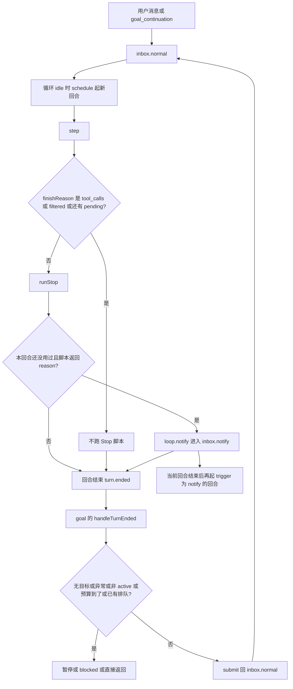

# 编码 Agent 的 Goal 机制

> 这篇笔记把五家编码代理里的长时目标（命令名都叫 `/goal`）写成可以单独阅读的说明。材料日期是 2026-11-17。开源部分按下面列出的提交读过源码。标成「调研记录、这次没有重开那个文件」的句子，来自同一天更早的记录，没有在对应提交上再打开。

相关笔记：[Codex 的 Code Mode](../2026-11-17--codex-的-code-mode/INDEX.md)。那篇写的是把多次工具调用收进一次 JavaScript 执行。这篇只写长时目标。

## 这篇笔记回答什么问题

一个编码代理平常是一轮一轮说话的。人发一句，模型做一点，然后把控制权交回来。长任务会在中途停住，因为模型认为这一轮可以结束了。`/goal` 是各家后来加上的一层：人先写下「做到什么算完」，程序在每一轮结束之后，如果目标还有效，就自己再开一轮，直到完成、卡住，或者被某条停止规则拦住。

这篇要回答的是：

- 用户实际怎么下达、查看、暂停、恢复和清除一个目标。
- 目标记在什么地方，运行过程中的进度记在什么地方。
- 程序怎样在一轮结束后再开一轮。
- 谁来判断「已经做完」。是正在干活的模型自己说，还是另一个模型看对话。
- 预算、出错、额度用完时，谁来强制停。
- 为什么给模型的工具里没有「删掉目标」。
- 为什么各家没有直接套用 Ralph 那种外层死循环。
- Kimi 的自动续跑是不是它的 Stop hook，消息按什么顺序进队列，下一回合会不会把目标再交给模型。

对照的五家是 Codex、Claude Code、DeepSeek Harness（命令行名字是 dsh）、Kimi Code，以及 pi。pi 的核心没有这条命令，只附上两个只读了说明文件的第三方扩展。Ralph 是更早的一种外层循环，用来解释各家改了什么。

读过的版本：

- Codex：[openai/codex@59ac39addbbcd3499319c805a916846ca8ac5fef](https://github.com/openai/codex/commit/59ac39addbbcd3499319c805a916846ca8ac5fef)（2026-11-17）
- dsh：[deepseek-ai/deepseek-harness@39163dd30f703a79079e2d2446545cff3c453738](https://github.com/deepseek-ai/deepseek-harness/commit/39163dd30f703a79079e2d2446545cff3c453738)（2026-11-13）
- Kimi Code：[MoonshotAI/kimi-code@2931c7efd542a7cb2486faec0fc35bc2fde0f533](https://github.com/MoonshotAI/kimi-code/commit/2931c7efd542a7cb2486faec0fc35bc2fde0f533)（2026-11-17。版本号 v2.6.2 来自调研记录，这次没有重开发布说明）
- Anthropic 官方插件 ralph-loop：[claude-plugins-official@fd30cee3ecd5a8ee772733c5d20c0f2bae2da2f0](https://github.com/anthropics/claude-plugins-official/commit/fd30cee3ecd5a8ee772733c5d20c0f2bae2da2f0)（2026-11-16）
- Claude Code 的 `/goal` 是闭源的，只引用文档 [Keep Claude working toward a goal](https://code.claude.com/docs/en/goal)
- pi 核心与两个扩展这次没有克隆。核心的提交号仍是调研记录里的 `badlogic/pi-mono@4afe78de`（coding-agent 1.5.2）

## 先把词说清楚

**目标（goal）。** 这里的目标不是待办清单里的一条任务，也不是模型这一轮打算怎么做的计划。它是一句要长期有效的完成条件，例如「把这组测试修到全绿」。人用 `/goal` 把它交给程序。程序单独存起来。以后每一轮开始，模型还能看见它，即使用户没有再打一遍。

**回合（turn）和一步（step）。** 一个回合是模型从收到一条用户侧消息，到它决定这一轮可以停下来。一个回合里面可以有很多步。一步通常是「模型想一次，然后要么调用工具，要么给出不再调用工具的答复」。Kimi 的 Stop hook 挂在「一步结束」上。它的目标续跑挂在「整个回合结束」上。这两个时刻不一样。

**续跑（continuation）。** 续跑是指：当前回合已经结束，目标仍处在进行中，宿主程序自己再提交一条消息，让同一个会话再开一个回合。宿主是包着模型的那个程序，负责存状态、排队、审批和计费。续跑不是人又打了一句，也不是新开一个进程。

**Stop hook。** hook 是程序在固定时机调用的一段外部逻辑。Stop hook 发生在模型这一步看起来要停下来的时候。Claude Code 的 `/goal` 官方文档说，它本身就是包在会话上的一种 Stop hook。Kimi 另外还有用户可以配置的 Stop 脚本。那条脚本和 Kimi 的目标续跑不是同一条路径，后面会分开写。

**inbox.normal 和 inbox.notify。** 这是 Kimi 主循环里的两个队列，可以把它想成收件箱的两个格子。`inbox.normal` 放普通的下一条用户消息，包括目标续跑提交的那一条。`inbox.notify` 放通知类消息，包括 Stop 脚本返回的理由。循环空闲时才会从收件箱取消息来开新回合，并且先取 normal，没有了才取 notify。

**预算。** 预算是宿主数的上限：用了多少 token、开了多少轮，或者墙钟走了多久。到点之后由程序改状态、停止自动续跑，而不是指望模型自己觉得该停了。token 是模型读和写的计费单位。墙钟是真实流过的时间，不是模型自己估计的时间。

**自己评估是否完成。** Codex、dsh、Kimi 都是正在干活的那个模型调用一个工具，声明「完成」或「卡住」。程序检查声明的格式、有时还检查轮数够不够，但不打开工作区替它验收。Claude Code 不同：另一只小而快的模型读条件和对话，给出还没达到、已经达到，或不可能达到。

**上下文压缩。** 对话太长时，程序把较早的内容收成一段摘要，腾出位置。长时目标如果只活在最早那几句里，压缩之后可能丢。各家因此会在之后的回合里把目标再交一遍，或在压缩边界单独留一份。

**Ralph loop。** Geoffrey Huntley 在 2025 年 7 月 14 日的文章 [Ralph Wiggum as a "software engineer"](https://ghuntley.com/ralph/) 里，把最朴素的形式写成一个 shell 死循环：反复把同一份 `PROMPT.md` 喂给一个新的 `claude-code` 进程。做完与否靠模型在输出里打出约定的 `<promise>…</promise>`。进度靠仓库里的文件和 git，因为新进程不带上一轮的对话。

## 整体结论

五家里，Codex、Claude Code、dsh、Kimi Code 都把「没做完就再开一轮」做进了产品。pi 的核心没有。它们都留在同一次会话里接着做，靠原来的上下文压缩对付变长的历史，而不是每轮新开一个空白进程。

判断完成的方式分成两种。Codex、dsh、Kimi 让干活的模型自己调用工具。程序只检查这是不是允许的状态，dsh 还用代码卡住「没到轮数就报阻塞」。Claude Code 让另一只小模型只看对话。Ralph 的官方插件则只比较模型有没有打出约定字符串。

预算也分成两种。Codex 和 Kimi 由宿主计数，到点强制收尾。Codex 只有 token，而且不写配置就没有上限。Kimi 的 token、轮数、墙钟默认都不设，要用户把数字说出来。dsh 只数轮，默认 256。Claude 没有宿主预算，只能把「做满 20 轮就停」写进条件，让那只小模型去理解。

给模型的工具里都没有删除。人可以清除或取消。模型只能走「完成」或「卡住」，而且要按提示里的审计来说。dsh 把「谁可以改状态」和「没满轮数不能报卡住」写进了会抛错的代码。Codex 和 Kimi 的三轮门槛主要写在提示里。Codex 上曾经出现钩子把所有工具都拦住、循环两千多次的事故，说明只写在提示里挡不住调度器。

## Codex

材料是上面的 Codex 提交。实现在独立包 `codex-rs/ext/goal/`。

### 用户怎么用

终端里的命令形状是 `/goal`，后面可以跟目标原文，或者 `clear`、`edit`、`pause`、`resume`。命令展示的位置，调研记录写在 `codex-rs/tui/src/goal_display.rs` 第 5 行，这次没有重开那个文件。

功能开关在调研记录里是 `features.goals`，阶段标成稳定，并且默认打开（`features/src/lib.rs` 第 2286 行）。这次没有重开那个文件。这次读到的配置只有 `[goals] max_goal_token_budget`。它的类型是可选的正整数。注释写明：它既是允许的 token 上限，也是新建目标时的默认预算（`codex-rs/config/src/config_toml.rs` 第 798 到 802 行）。

目标最长 4000 字。更长就写成附件 `goal-objective.md`。这两点来自调研记录（`protocol/src/protocol.rs` 第 4525 行，`tui/src/goal_files.rs`），这次没有重开。

### 内部怎么跑

目标存在独立的 SQLite 里，不混在普通对话表中。库文件名 `goals_1.sqlite` 来自调研记录（`state/src/sqlite.rs` 第 50 行），这次没有重开。表 `thread_goals` 每个线程一行。这次读到的字段是线程编号、目标编号、目标原文、状态、token 预算、已用 token、已用秒数、创建时间和更新时间（`codex-rs/state/goals_migrations/0001_thread_goals.sql`）。后来的迁移 `migrations/0033_thread_goal_stopped_statuses.sql` 重写了这张表，字段没有增加。

状态有六种：进行中（active）、暂停（paused）、卡住（blocked）、额度用完（usage_limited）、预算用完（budget_limited）、完成（complete）。另有一张推迟表 `thread_goal_continuation_deferrals`，只有线程编号一列（`goals_migrations/0002_thread_goal_continuation_deferrals.sql`）。调研记录说，`codex exec` 分叉出来的非临时线程会推迟续跑（`exec/src/lib.rs` 第 1208 行），这次没有重开。

线程空闲时，扩展调用 `continue_if_idle`。下面这段在 `codex-rs/ext/goal/src/runtime.rs` 第 474 到 492 行。它决定要不要在同一条线程上再开一轮。

```rust
if goal.status != codex_state::ThreadGoalStatus::Active {
    self.inner.accounting_state.clear_active_goal();
    return Ok(());
}
thread.start_turn_if_idle(request.on_start(TurnStartOptions {
    turn_trigger: Some("goal".to_string()),
    ..start_options
})).await
```

第一行看状态。只要不是进行中，就清掉「当前有一个活动目标」的标记并返回，不会再开一轮。是进行中，才调用 `start_turn_if_idle`。这是在原来的线程上开工，不是新线程。`turn_trigger` 被设成 `"goal"`，用来标记这一轮是目标续跑触发的。`start_options` 是这线程上原来的启动选项，审批和沙箱因此保持不变，续跑只改了触发原因（同文件第 478 到 492 行一带）。

续跑请求会带上内部说明 `continuation.md`。目标原文以「不可信附加上下文」附上，种类名是 `AdditionalContextKind::Untrusted`（`steering.rs` 第 59 到 70 行）。不可信的意思是：这段文字是用户数据，不能把它当成可以改写系统规则的指令。

对话被压缩时，每一轮仍会重新注入名为 `goal_objective` 的目标上下文。用户通过目标接口写下的说明，会在压缩边界单独留一份。`codex-rs/core/src/context/user_goal.rs` 第 16 到 18 行、第 30 到 38 行、第 100 到 105 行写明：目标转成 JSON 后如果超过 700 字节，这份证据整段改成「目标已省略」，避免截断以后把一句限制读成一句授权。恢复会话后重新挂上进行中的目标，来自调研记录里的 `restore_after_resume`，这次没有重开那个函数。续跑本身不新开线程。分叉会复制目标快照，但是另一条路径。非临时的 exec 分叉可以推迟续跑。

### 怎么判断完成、什么时候停

判断完成的是正在干活的模型。它调用 `update_goal`。这个工具的参数只有状态，允许的值是 complete、blocked、paused（`spec.rs` 第 60 到 70 行）。

`spec.rs` 第 75 行的工具说明要求：只有用户明确要求暂停，才能把状态设成 paused，模型不能自己停。`continuation.md` 第 52 行同样写，只有用户明确要求暂停时才使用 paused。`create_goal` 的描述在 `spec.rs` 第 46 行写明 "do not infer goals from ordinary tasks"：不要从普通任务推断出一个目标，只在用户或系统、开发者指令明确要求时创建。

宿主收到 `update_goal` 之后，在 `tool.rs` 第 270 到 278 行只检查枚举。不是这三种就把错误交回模型。是这三种，就记账并写入数据库（同函数接到第 305 行）。它不读工作区，也不数「这是不是已经连续卡住三轮」。三轮门槛写在 `continuation.md` 的完成审计和卡住审计里，也写在工具描述里。`accounting.rs` 里真正按三轮计数的，是连续空回复（第 244 到 245 行）和连续执行失败（第 172 行），不是 blocked。

`continuation.md` 第 31 到 42 行的完成审计要求：先把完成当成尚未证明，从目标里抽出具体要求，对着当前文件、命令输出和测试结果逐条找证据。证据弱、不完整，或只是没找到明显的剩余工作，就继续做，不要标完成。第 44 到 50 行的卡住审计要求：第一次碰到障碍不要报 blocked。同一个障碍要连续至少三个目标回合（用户触发的那一轮和自动续跑都算）才能报。用户把曾经卡住的目标恢复之后，这三轮重新计数。难、慢、不确定、没做完、还想再问一句，都不是 blocked。

token 用到预算后，状态变成 budget_limited，并注入模板 `templates/goals/budget_limit.md` 让模型收尾。状态分支在 `runtime.rs` 第 241 到 251 行：预算用完、暂停、卡住、额度用完、完成，都会清掉活动目标，从而不再自动续跑。额度用完是 usage_limited。`time_used_seconds` 会累计，但 `GoalsToml` 只有 token 这一项，这次没有看到按墙钟强制停的配置。

连续三轮空回复的代码在 `accounting.rs` 第 244 到 245 行：

```rust
inner.consecutive_empty_turns = inner.consecutive_empty_turns.saturating_add(1);
(inner.consecutive_empty_turns >= 3).then_some(goal_id)
```

第一行把连续空回复加一，加到头也不溢出。第二行在达到 3 时交出目标编号，供调用方停止这个目标。执行失败是同一形状，阈值也是 3（第 172 行）。

调研记录里还有：回合出错会停目标，`extension.rs` 第 423 行的注释写着 "Block the goal to prevent automatic continuation from looping"，这次没有重开。用户中断记成 interrupted。有没有进展的检查只写在提示里，没有另做代码。PR #23094 修的是 issue #23828：无限循环加上反复压缩。这次没有重开这两个工单。

已知问题同样来自调研记录，工单正文这次没有重开。[#36503](https://github.com/openai/codex/issues/36503) 里，PreToolUse 钩子拦住了全部工具，包括 `update_goal`，循环 2514 次，大约 8 小时。[#41831](https://github.com/openai/codex/issues/41831) 和 [#40929](https://github.com/openai/codex/issues/40929) 里，目标文本里的暂停条件，或用户更早说过的「先别测」，和仍然是 active 的调度撞在一起，空转。这几件说明：调度器只看状态是不是 active。提示里写「先别做」挡不住它再开一轮。

## Claude Code

### 用户怎么用

文档写：`/goal` 后面跟完成条件，就会设定目标并立刻开一轮。不带参数是查看。`/goal clear` 清除，别名还有 stop、off、reset、none、cancel。普通的 `/clear` 会开始一段新对话，也会清掉目标。文档原话是："`/goal` is a wrapper around a session-scoped prompt-based Stop hook"。意思是，它是包在当前会话上的一种基于提示的 Stop hook，不是另一套调度器。

文档写条件最长 4000 个字符，并且可以在非交互的 `-p`、桌面应用和 Remote Control 里用。v2.1.139 于 2026-05-11 引入这一命令，来自调研记录里的发布页，这次没有重开那个发布页。

### 内部怎么跑

目标按会话保存。具体文件格式是闭源的，没有看到。文档 "Resume with an active goal" 写：`--continue` 和 `--resume` 会带回会话结束时仍在进行的条件，但轮数、计时和 token 花费的基线清零。已经完成或已经清除的目标不会恢复。

每一轮结束，Claude Code 把条件和到目前为止的对话交给配置好的小而快的模型。环境变量 `ANTHROPIC_DEFAULT_HAIKU_MODEL` 可以换这只模型。它不调用工具，所以只能看对话里已经出现的内容。文档因此要求：写条件时要让证据出现在对话里。例如「`test/auth` 里的测试都通过」，得先由干活的 Claude 把测试跑出来，评估器才能在记录里看到。

它返回三种结论，各带一句短理由。还没达到（Not yet met）：继续做，这句理由成为下一轮的指引。已经达到（Met）：清除目标，并在记录里写下达成。不可能达到（Impossible）：清除目标，并记下失败。文档没有写评估提示的原文。

过长走会话自己的自动压缩。文档没有写这条 Stop hook 会清空上下文。压缩救不回来的溢出，会把目标清掉。

文档写："A goal doesn't change your permission mode"。设目标不改变权限模式。想无人值守，要自己打开 auto mode。`disableAllHooks` 为真时，`/goal` 不可用，因为评估器走的是 hook 系统。

### 怎么判断完成、什么时候停

完成与否由那只小模型看对话决定，不是干活的模型调用 `update_goal`。

没有内置的轮数预算或 token 预算。想限制长度，要把例如 "or stop after 20 turns" 写进条件。评估器从对话里理解这句话，所以这是软限制，不是宿主数到 20 就停。

连续几轮没有工具调用时，Claude Code 会停掉循环、把控制权交回，目标仍留着。文档只写 several turns，没有给出具体次数。这个数字未核实。

必须人来修的错误会清除目标，警告以 "Goal cleared after an unrecoverable error" 开头。文档列出的包括：Claude Code 自己管凭证时的鉴权失败（桌面或云会话由宿主恢复凭证时，目标可以留着）、磁盘满到无法续登录、额度用尽、自动压缩救不回的上下文溢出、模型不可用。

其余错误在交互会话里、并且版本不低于 v2.1.269 时，会打出原因，然后重试或暂停。会自己过去的失败，例如服务器过载或连接断开，通知以 "Goal still active" 开头，并显示下次尝试前的等待。自动重试三次之后改为暂停。限流、用量上限、或 hook 把回合结束掉，则直接暂停，通知以 "Goal paused" 开头。用户随时发消息可以立刻开始下一轮。把 `CLAUDE_CODE_GOAL_CHECKIN_MINUTES` 设为 0，会同时关掉自动重试和下面的 check-in。

如果子代理或后台 shell 还在跑，这一轮跳过评估，改到下一次「没有后台工作」的回合结束再评。后台工作让目标空等满 30 分钟，就该做一次 check-in：列出还在跑的任务，请 Claude 读输出，有进展就继续等，卡住就修或停。第一次之后，每次等待加倍，最长到第一次间隔的四倍。默认是第一次 check-in 之后再等 1 小时，然后每 2 小时。非交互会话（例如 `-p`）只在回合结束时送出 check-in。交互会话还可以在空闲时自己开一轮来送。两次用户消息之间，最多三次这种空闲 check-in。第三次会说明先停，直到用户再发消息。空闲 check-in 从 v2.1.236 起可用；v2.1.246 之前不封顶。check-in 本身从 v2.1.234 起可用。v2.1.239 之前，只有空闲 check-in 会这样拉长间隔，回合结束时送出的仍按第一次的间隔重复。这些句子来自文档的 "Other errors retry or pause the goal" 和 "Background work defers evaluation"。

已知问题只看过搜索摘要，工单正文没有重开：[#85594](https://github.com/anthropics/claude-code/issues/85594) 说完成后仍会无限循环；[#58334](https://github.com/anthropics/claude-code/issues/58334) 说 `/goal clear` 不生效。

更早的替代是官方插件 ralph-loop，见后面「为什么各家不用 Ralph loop」。它不是这只小模型。它只比较输出里的 `<promise>` 和事先约定的字符串。

## dsh

dsh 是 DeepSeek Harness 的命令行名字。目标拆成四个包：`goal` 管状态，`tool-goal` 是给模型的工具，`command-goal` 是 `/goal` 命令，`goal-round-driver` 负责空闲后续跑，可以不装。base 包默认四个都装，来自调研记录（`packages/bundle/base/cordis.patch.yml` 第 327 行），这次没有重开那个补丁。`dsh-superagent-prototype` 只是一个插件，和目标无关，来自调研记录。

### 用户怎么用

`/goal` 不带参数是查看。`/goal` 后面跟原文是设定。另外有 edit、pause、resume、clear。这些在界面的命令层执行，不消耗模型的一个回合。

### 内部怎么跑

状态用事件溯源。每一次修改追加一条 `goal/change` 事件，里面是修改后的完整快照，或一条清除标记，并带上递增的修订号。写入用比较并交换：调用方必须带上它看见的那一版修订号，过期的写入会被拒绝。

持久字段在 `packages/goal/goal/src/types.ts` 第 59 到 99 行：标识、修订号、目标原文、阶段、卡住原因、允许的最大轮数。读出来的视图再加已开始的轮数、创建时间和更新时间。阶段是 active、paused、blocked、complete。是否「武装」（armed，也就是这个进程允许自动续跑）只活在进程内存里，不写入可回放的投影。所以恢复会话或分叉之后，不会自动接着跑，要人执行 `/goal resume`。类型里名叫 checkpoint 的结构是回放用的投影，不是工作日志。

续跑包在整个代理空闲、子代理也结束后，用 `agent.followup()` 投递一条用户消息。消息正文由 `goal-round-driver/src/prompt.ts` 第 12 到 25 行生成，包在 `<goal_round>` 里，写上目标和「第几轮 / 共允许几轮」。投递点在 `goal-round-driver/src/index.ts` 第 190 到 208 行。只有真正进入历史的轮才计数。包的说明写：进入一步之前和之后都会核对修订号，用来挡住并发和过期的一轮。这次没有把这段监听再逐行打开。

已进入历史的轮会留在同一次会话里，直到压缩把它们挡住。说明写明不新建代理，也不复制一段对话前缀。续跑只是再追加一块 `<goal_round>`，不裁掉已有历史。

`tool-goal` 里能看到的权限是「谁可以改状态」：直接的人类消息，或当前这一轮目标续跑。没有看到审批或沙箱策略。续跑那一轮和审批的关系，没有逐行看完。

### 怎么判断完成、什么时候停

模型调用 `update_goal`。动作可以是 edit、pause、resume、complete、blocked（`tool-goal/src/index.ts` 第 47 行，参数在第 234 到 253 行）。complete 和 blocked 可以由目标续跑这一轮调用。edit、pause、resume 要求直接的人类请求。模型不能把暂停的目标恢复成进行中，这种情况会抛出 `GOAL_TOOL_RESUME_PAUSED`。`create_goal` 允许从人的长时请求推断目标。这和 Codex「不要从普通任务推断」相反。

blocked 在「这一轮是目标续跑」的权限下，如果已开始的轮数小于 `blockedAfterConsecutiveRounds`（默认 3），就抛出 `GOAL_TOOL_BLOCK_THRESHOLD`。代码在 `index.ts` 第 39 行和第 282 到 292 行：

```ts
if (args.action === 'blocked' && authority.kind === 'goal-round'
    && authority.goal.roundsStarted < resolved.blockedAfterConsecutiveRounds)
  throw new HarnessError(
    `blocked requires at least ${resolved.blockedAfterConsecutiveRounds} consecutive goal rounds`,
    'GOAL_TOOL_BLOCK_THRESHOLD')
```

这三行的意思是：动作是 blocked，调用方是目标续跑，而且已经开始的轮数还没到配置的下限，就拒绝这次调用，并告诉模型还差多少轮。直接的人类请求可以立刻停，不受这道轮数限制。代码不比较「是不是同一个障碍」。障碍文本由模型写进 `blocked_reason`，blocked 时这段文字必须非空。

过了门槛之后，`goals.complete` 要求当前阶段还不是 complete，然后写成 complete 并解除武装（`goal/src/index.ts` 第 393 到 402 行）。`goals.block` 只接受当前是 active（第 412 到 426 行）。回放折叠 `fold.ts` 第 239 到 245 行再拒绝不合法的阶段变化。

续跑提示（`prompt.ts` 第 18 到 23 行）要求模型先看工作区取证，再读当前目标。做完了就标 complete。没做完就保持 active，留给下一轮。轮数门槛不在这段提示里，而在上面的抛错里。系统提示也会把这个轮数写进去。

默认最多 256 轮（`defaultMaxGoalRounds`）。用完就以原因 `round-limit` 把目标标成 blocked（`goal-round-driver/src/index.ts` 第 182 到 187 行）。只计真正进入历史的轮。说明写明没有 token、费用或时间预算。写入失败、取消、卸载插件都会停。取消之后不会自动再开。没有独立的评估器，说明里的原话是 "evaluator-backed certification remains deferred"。异常不会自动重试，要人之后再 resume。

同仓库另有实验工具 `dsh-tool-ralph`，不在这四个包里。它做的是每一轮一个全新的子会话。见后面关于 Ralph 的一节。

## Kimi Code

### 用户怎么用

命令有 `/goal`，以及子命令 status、pause、resume、cancel、replace、next。实现在 `packages/agent-core-v2/src/features/goal/`，`goalService.ts` 大约 1500 行。

`/goal next` 后面跟一句目标，会把这条追加进「接下来要做」的队列。如果当前没有目标，会立刻开始这一条。`/goal next manage` 打开队列面板。上下方向键调用 `moveGoalQueueItem` 调整顺序，也可以改文字或删除。这些在 `apps/kimi-code/src/tui/commands/goal.ts` 的 `parseNextGoalCommand`、`queueNextGoal` 和 `handleGoalQueueManagerAction`，提交就是上面的 `2931c7ef…`。官方斜杠命令文档页这次没有打开，队列行为以这份终端界面源码为准。

`kimi -p "/goal ..."` 的退出码，调研记录是 0 表示完成、3 表示阻塞、6 表示暂停。这次没有重开文档页。旧的 Python 实现 `kimi-cli` 已归档。社区 PR #2276 当时未合并。这两句是调研记录，这次没有重开那个 PR。交互说明和斜杠命令的文档链接是 [guides/interaction](https://www.kimi.com/code/docs/en/kimi-code-cli/guides/interaction.html) 和 [slash-commands](https://www.kimi.com/code/docs/en/kimi-code-cli/reference/slash-commands.html)。

创建目标时，如果当前不是自动批准模式，会弹出确认，让用户改到 auto 或 yolo。创建失败会把权限模式改回去。位置来自调研记录：`goalService.ts` 第 1167 行，以及 `apps/kimi-code/src/tui/commands/goal.ts`。这次读队列时打开了后面这个文件，没有把第 1167 行的权限弹窗再对一遍，所以弹窗细节仍算调研记录。设定目标本身不改审批策略。

### 内部怎么跑

目标写在会话的传输事件里：创建、更新、清除、用量记账、续跑。回放这些事件可以重建状态。事件名的位置来自调研记录（`agent/replayBuilder/fold.ts` 第 45 行），这次没有重开。

状态是 active、paused、blocked、complete。快照字段在 `types.ts` 第 24 到 34 行：目标编号、原文、可选的完成标准、状态、已用回合数、已用 token、已用墙钟毫秒、预算报告，以及可选的结束原因。完成标准是「怎样算做完」，不是做到哪一步的流水。结束原因是为什么停，例如被中断或预算到了。

分叉是另一条路径，不是续跑。分叉可以清掉当前目标，并留下一句提醒。压缩是会话自己的机制。目标提醒在压缩摘要出现后会回到完整版，那是多注入一段提醒，不是删掉历史。

### 怎么判断完成、什么时候停

模型调用名为 `UpdateGoal` 的工具。状态只能是 active、complete、blocked（`tools/update-goal/update-goal.ts` 第 6 到 14 行）。active 用来在用户明确要求继续时，把暂停或卡住的目标恢复。宿主在 `updateGoalTool.ts` 第 30 到 76 行检查：状态是否合法，目标是否还在，这一回合开始后目标原文有没有被改过。然后 complete 调用 `markComplete`，blocked 调用 `markBlocked`。两者都要求当前是 active（`goalService.ts` 第 451 行和第 464 行），成功后让这一回合停下。这里没有「是不是已经连续三轮」的计数器。

三轮写在续跑提示 `GOAL_CONTINUATION_PROMPT` 第 152 到 163 行，也写在完整提醒里。另外，目标本身不可能、不安全或自相矛盾，可以在当轮就报 blocked。提示还要求：大多数回合不要调用 `UpdateGoal`。做完有边界的一小片，如果还没全部完成，就正常结束这一回合，让运行时再开一轮。

和 Codex 的 `templates/goals/continuation.md` 对过原文。卡住的门槛同向：第一次不报，同一条件连续三轮（含用户触发的那一轮和自动续跑），恢复后重新计数，难、慢、不确定、没做完、还想澄清，都不算 blocked。完成审计的结论也同向：按当前状态核对每一条明确要求，弱证据或间接证据不算完成，计划、摘要、第一遍或半成品不算完成，预算快用完或自己想停也不算。Kimi 没有把 Codex 第 31 到 42 行那份更长的取证清单写全。那份清单还包括：从目标推导具体要求、不能把成功定义成已经做出的那一部分、窄的检查不能支撑宽的结论、测试只有覆盖了对应要求才算证据。Kimi 多出来的，是「每轮只做有边界的一片」，以及「不可能、不安全或自相矛盾可以当轮 blocked」。

token、轮数、墙钟三种预算都有，默认都不设。只有用户明确说出「最多 20 轮」或「花 1 小时」这类话，模型才调用 `SetGoalBudget`。工具说明在 `set-goal-budget.md`，这次按调研记录引用，没有把该文件再逐行打开。到了预算，状态变成 blocked。最后一轮里剩余的工具调用会被全部拒绝，提示模型写一段总结（`goalService.ts` 第 122 到 130 行）。墙钟只在会话开着的时候走。

用户中断会暂停。限流、鉴权失败、接口错误会暂停，并在原因前面加上对应的前缀。`UserPromptSubmit` 钩子如果拦截了这一回合，会把目标标成 blocked，原因写成被这个钩子拦住。

Kimi 怎样把续跑接进主循环、和 Stop hook 差在哪、时序和提醒，放在后面三节，避免和这里的「何时停」缠在一起。

## pi

### 用户怎么用

核心没有 `/goal`。调研记录说，在源码和变更日志里搜索 goal，只见到压缩摘要模板里的一节标题「## Goal」。那不是一套目标运行时。这次没有重开 pi 仓库。

最接近的扩展点，调研记录写在 `docs/extensions.md` 第 661 行：`agent_before_settle` 可以返回继续再来一轮，或者在 `agent_end` 里用后续消息再送一句。示例扩展是 plan-mode。这次没有重开该文档。

### 内部怎么跑，以及何时停

核心靠扩展自己接这些钩子，没有内建的目标调度。

`pi-mono-goal`（作者 emanuelcasco）此前只读过说明：有 manual、assist、auto 三种模式，auto 默认最多 10 轮、30 分钟，状态以自定义的 goal-event 记在会话里。这次没有重开那个仓库，所以这三句仍是旧的说明记录。

`@mocito/pi-goal` 这次读的是 npm 0.4.0 上的 README，没有读扩展源码。npm 上的仓库字段指向 `github.com/jvm/pi-mono` 里的 `packages/pi-goal`。README 写：成功跑完之后，在 Pi 的 `agent_before_settle` 这个可以行动的边界，提议一条隐藏消息，名字是 `pi-goal-context`。状态随会话分支走。它有 token 预算。取消不会自动再开。普通错误会稍后做有界的延迟续跑。预算用尽，或检测到服务商限额时，不另开一轮，只留下一条可见通知。README 还写，取消或压缩失败会抑制这一轮里的续跑。这些都只来自 README。

核心不因目标改变权限。两个扩展的权限行为没有读源码。这次也没有读到它们判断完成的代码。

## 五家放在一起看

表里每一行是同一个问题。读的时候可以先看这一段，再看格子里的原话。

「有没有做进产品」看的是核心或默认安装里有没有这条命令，续跑是不是还要另装。「目标记在哪」是持久状态的位置，不是工作进度。「谁在回合结束后再开一轮」是触发点。「谁说做完了」是干活的模型，还是另一只模型。「卡住要不要满三轮」里，写在提示里的，程序不数轮；写进抛错的，程序会拒绝过早的 blocked。「预算」同时写了种类、默认有没有、谁来填、到了以后怎样。「强制停止」是预算之外、程序仍会停下来的情况。「恢复会话之后」是把旧会话打开时，目标会不会自己接着跑。「设目标会不会改权限」看的是审批和沙箱。「有没有下一条队列」只有 Kimi 有。

| 问题 | Codex | Claude Code | dsh | Kimi Code | pi 的扩展 |
| --- | --- | --- | --- | --- | --- |
| 有没有做进产品 | 有，并且默认打开 | 有 | 有。续跑是单独的包，可以不装 | 有 | 核心没有。下面两列之外的行为来自第三方说明 |
| 目标记在哪 | 每个线程一行，在独立的 SQLite 表 `thread_goals` | 跟会话走。文件格式没有看到 | 会话事件日志。每次修改带完整快照和修订号 | 会话传输事件。回放可以重建 | 说明写在会话的自定义条目里。源码未读 |
| 谁在回合结束后再开一轮 | 线程空闲时调用 `continue_if_idle`，且状态必须是进行中 | 一轮结束时的 Stop hook，把条件和对话交给小模型 | 代理空闲后，续跑包用 `followup` 投递 `<goal_round>` | 订阅回合结束事件，再 `submit` 一条用户消息 | README：在 `agent_before_settle` 提议下一条上下文。源码未读 |
| 谁说做完了 | 干活的模型调用 `update_goal` | 另一只小模型只看对话 | 干活的模型调用 `update_goal` | 干活的模型调用 `UpdateGoal` | 没有读到扩展里的判断代码 |
| 报卡住要不要满三轮 | 提示和工具说明要求连续三轮。程序不数这三轮 | 小模型若认为条件不可能达到，就清除目标。没有「三轮」这条 | 程序强制。默认少于三轮就抛错 | 提示要求连续三轮。程序不数。不可能、不安全或自相矛盾可以当轮报告 | 未读源码 |
| 程序怎样检查这次声明 | 状态只能是完成、卡住或暂停 | 闭源。文档只写三种结论 | 修订号必须对。轮数不够不能报卡住 | 状态只能是恢复、完成或卡住。目标必须还在 | 未读源码 |
| 预算 | 只有 token。不写配置就没有上限。配置值既是上限也是新目标的默认。创建时可以设得更小。到了就变成预算用完 | 没有宿主预算。只能写进条件，由小模型理解。真正强制停的是鉴权、余额和救不回的溢出 | 只有轮数，默认 256，由宿主计数。用完就记成轮数上限并标成卡住。没有 token、费用或时间预算 | token、轮数、墙钟都有，默认都不设。用户把数字说出来，模型才写入。到了就卡住，并拒绝剩余工具调用 | 一份旧说明写 auto 最多 10 轮、30 分钟。另一份 npm 说明写有 token 预算。源码未读 |
| 预算以外何时强制停 | 连续三轮空回复，或连续三轮执行失败。回合出错。额度用完 | 连续几轮不调用工具就停，但目标还在，具体轮数未知。鉴权失败、余额用尽、救不回的溢出会清除目标 | 写入失败、取消、卸载。取消后不自动再开 | 用户中断、限流、鉴权或接口错误会暂停。提交钩子拦截则标成卡住 | 见各份说明。源码未读 |
| 把旧会话打开之后 | 同一条线程上，进行中的目标可以再续。另有一张推迟表 | 带回仍在进行的条件。轮数、计时和 token 基线清零 | 不自动续。要人执行恢复 | 靠事件回放重建。分叉可以清掉当前目标 | 说明写状态跟随分支。源码未读 |
| 设目标会不会改权限 | 不会。续跑沿用原来的启动选项 | 不会。文档写权限模式不变。无人值守要自己开自动模式 | 目标包里没有看到改审批。和沙箱的关系没有逐行看完 | 创建时若还不是自动模式，会提示用户切换。设定本身不改审批策略 | 核心不变。扩展未读源码 |
| 有没有「下一条」队列 | 没有 | 没有 | 没有 | 有。`/goal next` 入队，`/goal next manage` 可以改顺序 | 没有看到 |

表里「谁说做完了」和「报卡住要不要满三轮」是后面几节的索引。预算的细节在下一节。

## 预算是怎么定的

差别在两件事：数字由谁来数，以及默认有没有上限。Codex 和 Kimi 由宿主数，到点就改状态并停止自动续跑。Codex 只有在写了配置时才有上限，不写就没有。Kimi 三种都要用户把数字说出来，否则一直不设。dsh 只数轮，默认二百五十六，上限宽。Claude 没有宿主侧的预算计数，全靠那只小模型去理解条件里的句子。

### Codex

只有 token 预算。`config_toml.rs` 第 800 到 802 行的注释原文是 "Maximum token budget allowed for a goal and default budget for new goals"。类型是可选的正整数。JSON Schema 里这项没有默认值。解析配置时如果缺了，结果就是空（`core/src/config/mod.rs` 第 4759 到 4771 行）。所以没有一个写死的默认数字。不写这项时，新目标的 token 预算也是空，宿主不会按 token 把它打成预算用完。

单个目标可以设得比这个上限更小。`create_goal` 有可选参数 `token_budget`。工具说明是：除非明确要求，否则不要填；只有明确要求了一个 token 预算才填（`spec.rs` 第 35 到 47 行）。创建时如果没带，就用配置里的上限。`tool.rs` 第 219 行是 `request.token_budget = request.token_budget.or(self.max_goal_token_budget)`。这行的意思是：请求里有预算就用请求的，没有就用配置上限。`validate_goal_budget`（第 445 到 461 行）拒绝小于等于 0 的数，也拒绝大于上限的数。`update_goal` 不能改预算，只能改状态。终端界面新建目标时传入的预算是空，于是走上限。编辑时沿用原来的预算（`tui/src/app/thread_goal_actions.rs` 第 196 到 203 行）。应用服务器的 `thread_goal_set` 可以显式设置一个预算（`thread_goal_processor.rs` 第 192 到 196 行）。

宿主把已用 token 累计进 SQLite。到了预算，状态变成 budget_limited，并注入 `budget_limit.md`。已用秒数会记，但目标配置里没有时间上限。

### Claude Code

没有宿主预算。文档让人把 "or stop after 20 turns" 写进条件，由评估器从对话里理解。这是软限制。会清除目标的硬停止是错误类：鉴权失败、余额用尽、自动压缩救不回的溢出。

### dsh

只限制轮数。默认 256。用完记成 round-limit，并把目标标成 blocked。只计算真正进入历史的轮。说明写明没有 token、费用或时间预算。

### Kimi Code

三种都有，默认都不设。用户说出「最多 20 轮」或「花 1 小时」时，模型才调用 `SetGoalBudget`。到点变成 blocked，最后一轮剩余工具调用全部拒绝，让模型写总结。墙钟只在会话开着时走。

### pi 的扩展

`pi-mono-goal` 的 10 轮和 30 分钟是旧的说明记录。`@mocito/pi-goal` 的 npm 说明写有 token 预算，并在 `agent_before_settle` 注入隐藏的 `pi-goal-context`。源码未读。

## 模型怎样判断做完了

Codex、dsh、Kimi 的做法可以概括成：提示里有一份审计清单，干活的模型自己调用工具。宿主检查这是不是允许的状态字，有时还检查轮数和目标是否还在，不打开仓库验收「是不是真的做完了」。Claude Code 是另一只小模型读条件和对话。Ralph 插件是字符串相等。

### Codex

工具定义在 `codex-rs/ext/goal/src/spec.rs` 第 63 到 66 行。`update_goal` 的状态只能是 complete、blocked、paused。

续跑提示在 `templates/goals/continuation.md` 第 31 到 42 行，开头是 "Completion audit:"，要求在宣称完成之前把完成当成尚未证明，并写明：只有当前证据证明每一条要求都已满足、没有剩余的必要工作，才能标完成。第 44 行起的卡住审计写：第一次出现障碍时不要调用 blocked。只有同一障碍连续至少三个目标回合，才可以使用。

宿主在 `tool.rs` 第 270 到 305 行把不合法的状态退回给模型。合法则更新数据库。状态一旦不是进行中，`runtime.rs` 第 474 到 476 行就不再续跑。那段代码上面已经解释过。

### Claude Code

没有公开的工具定义。文档写评估器的输入是条件加上到目前为止的对话，输出是还没达到、已经达到、不可能达到，各带短理由。它不调用工具。

### dsh

`update_goal` 必须带目标标识、修订号和动作。动作是 edit、pause、resume、complete、blocked。blocked 还要一段非空的原因（`tool-goal/src/index.ts` 第 234 到 252 行）。续跑提示要求先取证再标记完成。轮数门槛在执行时抛错，见上面的代码块。完成会解除武装。卡住只接受当前是进行中。

### Kimi Code

`UpdateGoal` 的状态是 active、complete、blocked。续跑提示要求做完一小片就正常结束，不要急着调用这个工具。只有要求都做完、该有的验证过了、没有下一步，才标完成。非终局的障碍要连续三个目标回合。不可能、不安全或自相矛盾可以当轮标卡住。宿主不数这三轮。和 Codex 提示的逐句差别，写在上一节「怎么判断完成」里。

### pi

核心没有这套工具。两个扩展的判断代码没有读到。

### ralph-loop 怎样停

插件的 `plugins/ralph-loop/hooks/stop-hook.sh` 第 128 到 188 行从助手最后一段文本里取出 `<promise>` 和 `</promise>` 中间的文字，和状态文件里的 `completion_promise` 做字符串相等比较。相等就删掉状态文件并放行。不相等就输出一段 JSON：`decision` 是 block，`reason` 是原来的提示。于是同一段提示被追加回当前会话，历史还在。这不是 Claude `/goal` 那只小模型。

## 运行过程中进度记在哪

这里的进度是「做到哪一步、下一步是什么」，不是用了多少 token。五家做进产品的目标都没有这样一个字段。宿主记的是计量：token、时间、轮数、状态。做到哪一步，留在对话和压缩摘要里。如果只靠模型记得，压缩之后可能丢。Ralph 那种新进程则必须把进度写进文件。

Codex 的 `thread_goals` 没有进度、摘要或笔记列。`continuation.md` 没有要求写 `progress.md`。

dsh 的持久快照也没有进度叙述。名叫 checkpoint 的类型是回放投影。

Kimi 多了完成标准和结束原因。提醒里有一行 Progress，内容是续跑了多少回合、用了多少 token、墙钟走了多久（`goalInjection.ts` 第 121 行）。这是计量。预算耗尽时的提醒要求模型在对话里写一段最终状态，不要求写文件。

ralph-loop 的状态文件 `.claude/ralph-loop.local.md` 由 `scripts/setup-ralph-loop.sh` 第 140 到 151 行写成。文件头里有是否活动、迭代次数、会话编号、最大迭代、完成约定、开始时间。正文是原始提示。没有进度字段。

Huntley 的原文里没有 `progress.md`。他让提示约定模型维护 `fix_plan.md`（按优先级列出还没做的事）和 `specs/*`，并用 git 把它们加进去。原文还写不要把状态报告塞进 `AGENT.md`。社区如果用 `progress.md` 或待办文件，那是提示里的约定，不是这篇原文里的文件名。这次没有另查社区仓库。

## goal 指令存在哪

「指令」这里分两处：人敲的斜杠命令写在哪，以及目标记录存在哪。

Codex 的斜杠命令在终端界面。调研记录指向 `goal_display.rs`，这次没有重开。目标记录在 SQLite 的 `thread_goals`。续跑逻辑在 `codex-rs/ext/goal/`。

Claude Code 的命令和存储都在闭源程序里。文档只说明它跟会话走，恢复时带回条件并清零计数。文件格式未核实。

dsh 的斜杠命令在 `command-goal`，在界面层执行。记录是会话日志里的 `goal/change` 事件。给模型的工具在 `tool-goal`。自动续跑在可选的 `goal-round-driver`。

Kimi 的斜杠命令在 `apps/kimi-code/src/tui/commands/goal.ts`。队列的追加和调序也在这个文件。目标状态在 `packages/agent-core-v2/src/features/goal/`，通过会话事件回放。

pi 核心没有这条命令。扩展若有，按它们的说明记在会话自定义条目里。源码未读。

## 同一次会话里接着做，还是每次新开进程

Claude 的 `/goal` 和官方 ralph-loop 都留在当前会话。Stop hook 输出 block 之后，原来的提示或评估理由作为新消息追加，此前的对话还在。变长了就靠会话自己的自动压缩。文档和插件说明都没有写这条 hook 会把上下文清空。

Huntley 原文的原话是 "In its purest form, Ralph is a Bash loop." 命令是：

```bash
while :; do cat PROMPT.md | claude-code ; done
```

这里没有 `claude -p`，也没有 `--continue`。每一次都是一个新进程。文章没有写「上下文是空的」这四个字，但这条命令没有把上一轮会话带回来。进度靠 `PROMPT.md` 指向的规格、`fix_plan.md` 和 git。

官方插件的帮助页把示意循环写成了 `cat PROMPT.md | claude-code --continue`（`commands/help.md` 第 15 到 17 行）。多出来的 `--continue` 和原文不一致。插件真正走的也不是这个 shell。README 第 27 行写：循环发生在当前会话里。`stop-hook.sh` 第 179 到 188 行把同一段提示放进 block 的 reason。

dsh 的目标续跑是同一次会话里的 `followup`。准确出处是 `packages/goal/goal-round-driver/README.zh.md` 第 126 行：「只在同一会话执行——此包有意不 spawn 新 agent、不 fork 会话前缀，也不实现 Ralph 风格的独立尝试；该工作流属于单独的插件层。」英文说明的同一段在 `goal-round-driver/README.md` 第 126 行。这里的插件层就是实验工具 `dsh-tool-ralph`。它的说明写：每一轮一个全新子会话，父对话和上一个子会话都不带过去，只交一份有长度上限的结构化报告，共享工作区是长期记忆（`packages/experimental/tool-ralph/src/index.ts` 第 180 到 184 行）。目标包自己的续跑不另开会话。压缩会把旧的一轮挡住。

Codex 在同一条线程上 `start_turn_if_idle`，不新开线程，也不在续跑时裁掉历史。压缩是会话自己的事。用户写下的目标说明在压缩边界另留一份。超长目标在这份证据里整段省略。

Kimi 在同一个主循环里再提交一条用户消息。提醒可以从完整版换成短版，那是少注入一段文字，不是删除历史。

代价可以这样看。同一次会话留得住细节和中途的指示，但越跑越长，压缩可能丢掉关键句。每次新进程的上下文是干净的，但必须把进度写进文件和 git，否则下一轮什么都不记得。

## 为什么各家不用 Ralph loop

官方没有一篇文章标题就叫「我们为什么不用 Ralph」。下面是从实现反推的。能找到的原文和表态附在节末。没有表态的不写。

各家留下了「没做完就再喂一轮」，换掉了原版的两点：每轮新进程，以及靠 `<promise>` 这句话来停。

第一，每轮新开进程要重读代码，也会丢掉已经踩过的坑和用户中途说过的话，除非提示约定模型去维护 `fix_plan.md` 这类文件。产品不能把这份约定交给每个用户现写。同一次会话加上原来就有的压缩，和日常一轮轮说话是同一条路。

第二，暗号容易坏。模型提前打出 `<promise>` 就会停。一直不打，循环就空转。结构化的完成调用至少能检查状态字、设置门槛，并配一份审计说明。Claude 再进一步，用另一只模型看对话。

第三，原版没有上限，也没有把报错和额度用完接进循环。Codex 上钩子把 `update_goal` 一起拦住、循环两千多次的事故说明，这些要写进调度，不能只写在提示里。

第四，原版在产品外面。外层 shell 看不到目标状态。用户没法在产品里暂停、恢复、改目标，界面也不显示计量。`/goal` 把状态、审批、权限、恢复和计费放进宿主。

第五，原版常和「跳过审批、无人值守」一起用。上面几家设目标都不改变权限模式。

Ralph 没有被换掉。它适合可以按文件切块的很长任务，例如按清单改很多文件。干净的上下文在那里是优点。它仍以插件或实验工具存在。dsh 的目标包在中文说明第 126 行把这种独立尝试划给单独的插件层，该层就是 `dsh-tool-ralph`。

可以收成一句：各家拿走了自动再来一轮，把清空上下文和暗号停机换成同一次会话里的续跑和结构化的完成声明，并加上宿主侧的停止规则。

已找到的原文和表态：

- Geoffrey Huntley 的文章就是上面的链接。最朴素的形式是那个 bash 循环。
- Anthropic 官方插件的 [README](https://github.com/anthropics/claude-plugins-official/blob/fd30cee3ecd5a8ee772733c5d20c0f2bae2da2f0/plugins/ralph-loop/README.md) 引用「Ralph 是一个 bash 循环」，并写明自己改成当前会话里的 Stop hook。
- dsh 的 [中文说明第 126 行](https://github.com/deepseek-ai/deepseek-harness/blob/39163dd30f703a79079e2d2446545cff3c453738/packages/goal/goal-round-driver/README.zh.md) 就是上一节引用的那句。插件层的工具说明在 [工具目录的 ralph 一节](https://github.com/deepseek-ai/deepseek-harness/blob/39163dd30f703a79079e2d2446545cff3c453738/docs/tool-catalog.md)。
- Claude Code 的 `/goal` 文档没有提到 Ralph。这次检出的 Codex 目标代码里没有 Ralph 这个词。Kimi 的循环配置里有一个字段叫 `maxRalphIterations`（`packages/agent-core-v2/src/agent/loop/configSection.ts` 第 16 行）。旁边没有解释它和 Ralph 这套技法的关系，所以不把它当成表态。

## 为什么模型不能删除目标

人可以去掉目标。Codex、dsh 和 Claude Code 用 `/goal clear`。Kimi 用 `/goal cancel`。给模型的工具里没有删除。

如果模型能删，遇到难做的，最省事的出路就是删掉目标。宿主看见没有进行中的目标，就会停止续跑。完成审计被绕开。Codex 的 `update_goal` 只允许完成、卡住或暂停，而且暂停还要用户明确说出来。

留下状态也比删掉有用。完成和卡住都是结果。目标原文、用掉的 token、卡住的原因还在。删了就看不出是做完了还是放弃了。

dsh 更严。编辑、暂停、恢复都要求直接的人类请求，由代码强制。模型只能报告完成，或在连续轮数达到门槛之后报告卡住。

所以结束一个目标有两条路。模型只能走要说明理由的那条，也就是完成或卡住。不留记录的删除只留给人。

## 设计上分开的几件事

自己评估还是另请一只模型。自己评估看得到工作区里的文件，也省一次额外调用。它容易过早说完成，或卡住了还在空转。各家用很长的审计说明压这件事。Claude 的另一只模型不容易自己骗自己，但看不到文件，于是「证据必须出现在对话里」变成写条件的人的负担。

规则写在提示里，还是写进会抛错的代码。Codex 那些高消耗事故出在提示挡不住调度器。dsh 把卡住的轮数门槛、谁能改状态、恢复后不自动续跑写进代码。

预算放在宿主计数，还是放进给评估器看的句子。Codex 和 Kimi 到点由程序收尾。Claude 只能写进条件，结果取决于那只小模型怎么理解。

同一次会话接着做，还是每次新进程。做进产品的 `/goal` 都是同一次会话。Ralph 那种新进程加文件传状态，留在插件和实验工具。dsh 的目标续跑说明把后者划了出去。

目标文本当成不可信数据。Codex 用不可信附加上下文。Kimi 把目标包在 `<untrusted_objective>` 里，并写明这是数据，不能压过系统消息、工具定义和权限。设目标都不改变审批策略。

## Kimi 的续跑是不是就是 Stop hook

不是。目标续跑订阅的是整个回合结束。用户配置的 Stop 脚本挂在一步结束之后。两者最后都可能再给模型一条用户侧消息，但进的队列不同，触发条件也不同。

goal 模块在主代理上订阅 `TurnEnded`。订阅语句在 `goalService.ts` 第 1268 行。回调在第 1215 到 1219 行，把事件交给 `handleTurnEnded`。这个函数若抛错，就走 `settleGoalAfterContinuationFailure`，把目标暂停，并写上续跑失败的原因前缀。

`handleTurnEnded` 在第 645 到 678 行，顺序是：

1. 如果这回合是「用户恢复目标时循环还在跑，等它结束再续」记下来的那一次，而且结束原因是取消：目标若不是这个进行中的目标就返回；预算到了就返回；否则直接再提交一轮并返回（第 652 到 659 行）。这是恢复路径，不是下面的异常结算。
2. 这回合没有目标编号就返回（第 661 行）。
3. 如果不是「这一回合的步数到了上限」，并且原因是 blocked、cancelled 或 failed，就调用 `settleAbnormalTurn` 然后返回（第 662 到 670 行）。`settleAbnormalTurn` 在第 707 到 724 行：blocked 记成被 `UserPromptSubmit` 钩子拦住；cancelled 调用 `pauseOnInterrupt`，也就是因中断而暂停；failed 按错误类型加上原因前缀后暂停。
4. 如果这是目标的起始回合，已用回合数加一（第 672 行）。
5. 状态不是这个进行中的目标就返回（第 674 到 675 行）。
6. 预算检查若返回了快照，说明已经到点，就返回（第 676 行）。
7. 否则调用 `launchContinuationTurn`（第 677 行）。

第 674 到 677 行就是「还在进行、预算没到，才续跑」：

```ts
if (state === null || state.status !== 'active' || state.goalId !== lifecycleGoalId) return;
if (blockIfBudgetReached(context, state) !== null) return;
launchContinuationTurn(context, lifecycleGoalId, stepCapped);
```

第一行：没有目标、状态不是进行中，或编号已经对不上这一回合开始时的目标，就停。第二行：预算函数若已经把目标改成卡住，就停。第三行：否则提交下一回合。`stepCapped` 为真时，提示前面会加上「上一步数到顶了，请把工作切小」。

`launchContinuationTurn` 在第 749 到 781 行。它再确认目标仍是进行中，并且没有一笔还没落地的续跑。然后调用主循环的 `submit`，提交一条角色为 user 的消息。来源标记在第 105 到 108 行：种类是 `system_trigger`，名字是 `goal_continuation`。

```ts
const { id } = loop.submit({
  role: 'user',
  content: message.content,
  attributes: { origin: message.origin },
});
```

这段在 `goalService.ts` 的 `launchContinuationTurn` 里。`submit` 返回的编号用来跟踪这条消息后来有没有真正开成回合。消息内容是续跑提示，不是用户刚打的那句。

邮箱实现在 `packages/core/src/loop/loop-actor.ts`。`submit` 把消息推进 `normal`（第 155 到 159 行）。`notify` 把消息推进 `notify`（第 162 到 166 行）。服务层 `loopService.ts` 第 907 到 915 行：循环对象还在、而且不在静默期，就直接 `this.loop.submit`。否则先放进 `pendingSubmissions`，等循环可以接收时再倒进去。

通用 Stop hook 在 `agentExternalHooksService.ts` 的 `registerLoopHooks`，第 264 到 288 行。它注册在 `onDidFinishStep`，并且先 `await next()`，让别的「一步结束」逻辑先走完。然后如果结束原因是 `tool_calls` 或 `filtered`，或者快照里还有待处理请求，就返回，不跑用户的 Stop 脚本。否则调用 `runStop`（第 437 到 448 行）。若本回合已经用过一次 Stop 续跑（`stopHookContinuationUsed` 为真），`runStop` 直接返回空。脚本若返回一段理由，就把标志设为真，并 `loop.notify` 一条来源为 `stop_hook` 的用户消息。回合结束时这个标志被清掉（第 414 到 415 行），所以一轮里 Stop 续跑只用一次。

`notify` 进入 `inbox.notify`。新回合只在循环处于空闲、没有被按住、也没有未完成的工具收尾时，才会从邮箱取消息。这个条件在 `canSchedule`（`loop-actor.ts` 第 566 到 568 行）。`take()` 先拿 `inbox.normal` 的第一条，没有了才拿 notify（第 222 到 239 行）。因此 Stop 脚本返回的理由不会插回当前这一步。当前回合结束后，它成为下一次排程拉起的回合，触发种类是 notify。

还有一条相邻但不是 Stop 脚本自己的路径：如果某一步本来还要因为工具调用继续，而邮箱里已经有 notify，`finalizeStep` 会把这一步收成结束，原因是 notify，从而结束当前回合（第 1845 到 1855 行）。Stop 脚本在结束原因已经是 `tool_calls` 时根本不会运行。这条是别的 notify 来源碰到「这一步还想继续」时的行为。

所以两者的效果都是「这一轮停了以后，再喂一条用户消息」。目标续跑靠目标状态决定喂不喂，消息进 `inbox.normal`。Stop 脚本靠用户配置的脚本决定喂不喂，消息进 `inbox.notify`。和 Claude `/goal` 的差别仍是谁来判断完成：Kimi 是主模型自己调用 `UpdateGoal`。Claude 是另一只小模型读对话，给出还没达到、已经达到或不可能。

队列里 normal 和 notify 谁先被取，上面只读了 `take()` 的优先顺序。把 normal 挪进 notify 的 steer、只追加不调用模型的 promptOnly、以及脱离的工具完成再排进 notify，这些交错没有逐行追完。

## 续跑消息的时序怎么保证

回合结束的事件记在 `finishTurn` 里（`loop-actor.ts` 第 1873 行）。记下 `turn.ended` 之后，才把阶段改成空闲，然后调用 `schedule()`（第 1877 到 1884 行）。目标模块的 `submit` 如果发生在这次 `schedule` 之前，消息已经在 `inbox.normal` 里，随后这次排程就能把它拉起来。如果当时循环还在跑，`canSchedule` 不成立，消息留在邮箱里，等空闲再开。

`launchContinuationTurn` 用 `pendingContinuation` 挡住重复提交。它拿 `promptHandle` 的 `launched` 记下真正开出来的回合编号，在 `completion` 结束时清掉这笔排队（`goalService.ts` 第 771 到 781 行）。

另有一个函数 `canLaunchContinuation`（第 784 到 788 行）。它要求没有正在进行的回合编号，没有待落地的续跑，并且循环快照是空闲、也没有待处理请求。它用在用户把目标从暂停或卡住恢复、并且选择立刻继续的时候（第 396 到 398 行）。`handleTurnEnded` 本身不调用它。

下面这张图和上面的结论一致。Stop 的 notify 不回到当前步。它在回合结束后，成为下一次空闲排程拉起的、触发种类为 notify 的回合。目标续跑则 submit 回 `inbox.normal`。



图里的「非 active」就是状态不是进行中。「已有排队」是已经有一笔 `pendingContinuation`。「异常」是上面说的 blocked、取消和失败，且不是步数到顶那一种。

## 续跑时会重新注入目标吗

会。但目标和续跑提示走两条通道，不是收件箱里的两条普通用户消息。

`GoalInjection.reminder` 在 `goalInjection.ts` 第 48 行：如果这次不是新回合，就什么也不注入。提醒服务在每一步开始前调用注入。传进去的「是不是新回合」取的是「本回合的第一步」，或压缩之后重新武装（`reminderService.ts` 第 199 行）。注入结果经 `loop.remind` 写进历史，包在系统提醒里，来源种类是 `injection`（第 59 到 76 行）。这不是又一条放进 `inbox.normal` 的用户消息。

目标处于进行中时，`needsFullGoalReminder`（第 74 到 94 行）为真就用完整模板 `goal-active-reminder.md`，否则用短模板 `goal-active-sparse-reminder.md`。用完整版的条件是：还没注入过，没有上一次的披露，上一次不是进行中，目标编号、状态、原文、完成标准、预算档位或 WaitFor 是否可用发生了变化，或者上次注入之后的历史上出现了压缩摘要。卡住和暂停用各自的模板。

目标包在 `<untrusted_objective>` 里。模板写明：下面的目标和完成标准是用户提供的任务数据，要当成数据，不能当成可以压过系统消息、工具定义、权限规则或宿主控制的指令。Progress 那一行是续跑回合数、token 和墙钟，不是工作进度。

所以一次续跑回合里，模型会看到两段不同通道的文字。一段是提醒服务注入的目标提醒。另一段是 `submit` 进去的续跑提示。

续跑提示的英文原文在 `goalService.ts` 第 136 到 165 行，常量名 `GOAL_CONTINUATION_PROMPT`：

```text
Continue working toward the active goal.
Keep the self-audit brief. Do not explore unrelated interpretations once the goal can be
decided. If the objective is simple, already answered, impossible, unsafe, or contradictory,
do not run another goal turn. Explain briefly if useful, then call UpdateGoal with `complete`
or `blocked` in the same turn. Otherwise, weigh the objective and any completion criteria
against the work done so far, choose one bounded, useful slice of work, and use the existing
conversation context and your tools. Do not try to finish a broad goal in one turn unless the
whole goal is genuinely small. Most goal turns should not call UpdateGoal: after completing a
useful slice, if material work remains, end the turn normally without calling UpdateGoal so
the runtime can continue the goal in the next turn. Call UpdateGoal with `complete` only when
all required work is done, any stated validation has passed, and there is no useful next
action. Completion audit: before calling `complete`, verify the current state against the
actual objective and every explicit requirement. Treat weak or indirect evidence as not
complete. Do not mark complete after only producing a plan, summary, first pass, or partial
result. Do not mark complete merely because a budget is nearly exhausted or you want to stop.
Blocked audit: do not call UpdateGoal with `blocked` the first time you hit a blocker. Use
`blocked` only for a genuine impasse: an external condition, required user input, missing
credentials or permissions, or a persistent technical failure. For those non-terminal
blockers, the same blocking condition must repeat for at least 3 consecutive goal turns before
you call `blocked`, counting the original/user-triggered turn and automatic continuations.
If a previously blocked goal is resumed, treat the resumed run as a fresh blocked audit.
Exception: if the objective itself is impossible, unsafe, or contradictory, call UpdateGoal
with `blocked` in the same turn; do not run more goal turns just to satisfy the audit. Do not
use `blocked` because the work is large, hard, slow, uncertain, incomplete, still needs
validation, would benefit from clarification, or needs more goal turns. Once the 3-turn
threshold is met and you cannot make meaningful progress without user input or an
external-state change, call UpdateGoal with `blocked`; do not keep reporting the blocker while
leaving the goal active. Do not ask the user for input unless a real blocker prevents progress.
```

按意思分成四段。继续做当前目标。如果这回合已经能决定（简单、已经答完、不可能、不安全或自相矛盾），不要再开一轮，直接调用 `UpdateGoal`。否则只做有边界的一小片。整个目标不大时才试图一轮做完。大多数回合不要调用 `UpdateGoal`。做完一片如果还剩工作，就正常结束，让运行时再来。标完成之前，按目标和每一条明确要求核对当前状态。弱证据、计划、摘要、第一遍、半成品、预算快用完、自己想停，都不是完成。标卡住时，第一次碰到障碍不要报。外部条件、必须的用户输入、缺凭证或权限、持续的技术失败，要同一条件连续三个目标回合。恢复后重新数。不可能、不安全或自相矛盾是例外，可以当轮报。工作量大、难、慢、不确定、没做完、还要验证、还想问一句，都不是卡住。到了三轮并且没有用户输入或外部变化就无法前进时，要调用工具，不要一边说卡住一边把目标留在进行中。

这三轮只出现在这段提示和完整提醒里。`updateGoalTool.ts` 收到 blocked 就 `markBlocked`，不数轮。

步数到顶时，前面再加 `GOAL_STEP_CAP_CONTINUATION_PROMPT`（第 167 到 172 行）。它先说上一回合碰到了每回合步数上限，所以开了新回合，请从停下的地方接着做，并且每一片要小到放得进这个上限，然后再接上面整段。

有 `WaitFor` 工具时，提示末尾再接 `GOAL_WAIT_FOR_GUIDANCE`（`goalInjection.ts` 第 30 到 31 行）。它要求：如果在等后台子代理或 bash，就在本回合里调用 `WaitFor`，不要结束回合。结束回合只会让运行时把你再拉起来。等待的时候也可以做别的有用工作。每个目标回合都要有产出。

## 未核实

Claude Code 是闭源的。目标的存储格式、评估提示的原文，以及「连续几轮没有工具调用就停」的具体轮数，都看不到。两个工单只看过搜索摘要。文档页写了条件最长 4000 个字符，以及 `-p`、桌面应用和 Remote Control。v2.1.139 于 2026-05-11 引入，仍是调研记录里的发布页，这次没有重开。

pi 的两个第三方扩展这次没有读源码。`pi-mono-goal` 的 10 轮和 30 分钟仍是此前的说明记录，这次没有重开那个仓库。`@mocito/pi-goal` 只读了 npm 0.4.0 的 README，没有打开扩展实现。

Kimi 官方斜杠命令文档页这次没有打开。`/goal next` 的队列行为以终端界面源码为准。`kimi -p` 的退出码仍是调研记录。创建目标时的权限确认弹窗，这次没有把 `goalService.ts` 第 1167 行再对一遍。`SetGoalBudget` 的说明文件这次没有逐行打开。

dsh 续跑那一轮和审批、沙箱的关系没有逐行看完。目标工具里没有看到审批逻辑。进入一步前后核对修订号，这次引用的是包说明，没有把监听再逐行打开。

Codex 从 0.128.0 起有目标。这个版本号来自 cookbook 的搜索摘要，没有核对原文。`features.goals` 默认打开、4000 字上限、`goals_1.sqlite` 的路径、exec 分叉推迟续跑、`extension.rs` 第 423 行的注释，这次没有重开那些文件。三个工单的正文也没有重开。

社区仓库里是否流行 `progress.md` 这个文件名，这次没有另查。Huntley 原文用的是 `fix_plan.md`。

Kimi 队列内部，steer、promptOnly 和脱离的工具完成怎样和 notify 交错，没有逐行追完。只确认了 `take()` 先取 normal。

## 以后可以继续挖的问题

下面的小节先留空，供以后按主题追加。这次不写结论。

### 完成判定

### 预算与强制停止

### 续跑与恢复

### 权限

### 上下文压缩

## 补充说明

- 原始材料是 2026-11-17 的调研，以及同一天按提交浅克隆后读到的源码。Claude 文档是当天读取的 [goal](https://code.claude.com/docs/en/goal)。Huntley 原文是 [ghuntley.com/ralph](https://ghuntley.com/ralph/)。
- 相关笔记：[Codex 的 Code Mode](../2026-11-17--codex-的-code-mode/INDEX.md)。那篇写把工具收进一次 JavaScript 执行。这篇只写长时目标。
