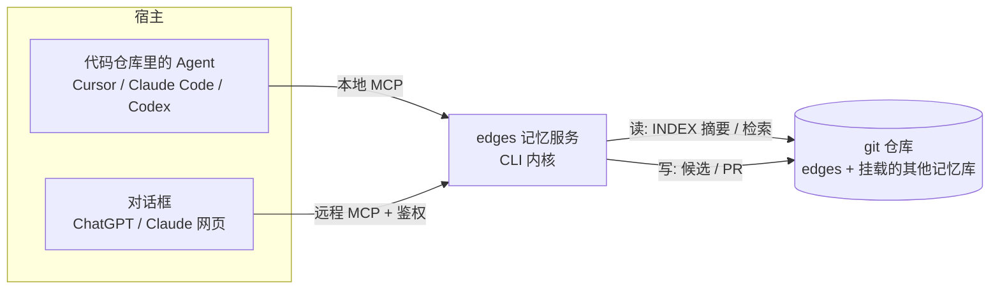

# 基于 git 仓库的 Agent 记忆：Letta 与 Devin/Cognition 实际机制调研

调研日期：2026-10-17（UTC+8）。只用一手来源（源码、官方文档、官方博客）。没能核实的内容标为 **未核实**。

源码版本：
- `letta-ai/letta-code` @ `0d3ad12`（提交于 2026-10-17 11:44 UTC+8）
- `letta-ai/letta` main @ `5bcdd17`：main 分支现在只有 README 等文件。README 写明 "The current source code lives in letta-ai/letta-code"，V1 API server 已退役，放在 `archive` 分支。`letta/services/memory_repo/` 只在 archive 分支 @ `56ba9c2` 里还有。
- `AgentMemoryRepo/agentmemoryrepo` @ `8798cb2`：只有 README.md、SPEC.md、skills/agent-memory-repo/SKILL.md、.devin-plugin/plugin.json、LICENSE，没有代码。

下文路径不带前缀时，均指 letta-code 仓库下的路径。

---

## 一、Letta（Letta Code + MemFS / Context Repositories）

### A. 接入具体项目

1. **记忆仓库属于 agent，不属于项目，也不放在项目目录里。**
   - 本地路径是 `~/.letta/agents/<agentId>/memory`，见 `src/agent/memory-filesystem.ts:46-57`（`getMemoryFilesystemRoot`，由 `.letta`、`agents`、agentId、`memory` 拼成）。
   - local backend 模式下的路径是 `~/.letta/lc-local-backend/.../memfs`，见 `src/utils/local-backend-paths.ts:24-37`。
   - 运行时通过环境变量 `$MEMORY_DIR` / `LETTA_MEMORY_DIR` 暴露给 agent，解析优先级见 `memory-filesystem.ts:91-131`。
   - 系统提示原文："your memory (in MemFS) belongs to you and travels with you wherever you run"；"Skills and files belonging to the environment stay with the environment (e.g. AGENTS.md or .agents)"（`src/agent/prompts/letta_local_memfs.md:137`）。
2. **remote 地址。** Cloud 模式下是 `${base}/v1/git/${agentId}/state.git`（`src/agent/memory-git.ts:228-233`），用 `cloneMemoryRepo`、`pullMemory` 同步（`memory-git.ts:1504`、`1589`）。启动时先 `pull --ff-only`；失败了退到 `pull --rebase`；如果和远端没有共同祖先，就 reset 到远端（`memory-git.ts:1589-1683`）。
3. **项目和 agent 怎么关联。**
   - 关联存在项目的 `.letta/settings.local.json` 里，`LocalProjectSettings` 有 `sessionsByServer` 和已废弃的 `lastAgent` 字段（`src/settings-manager.ts:143-160`）。也就是说，项目目录只记录"上次用的是哪个 agent / 会话"。
   - 关于项目的知识写进这个 agent 自己的 MemFS。`/init` 子代理的提示要求："Use the project's real name in flat root filenames (e.g., letta-code-overview.md)"（`src/agent/subagents/builtin/init-v2.md`）。
   - 也就是说，**不存在独立的项目级记忆仓库**。我的推断：一个 agent 服务多个项目时，按文件名或目录区分项目，源码里没有看到专门的隔离机制。
4. **shared / team 记忆：Shared memory repository。**
   - 这是组织所有的独立 git 仓库，remote 为 `/v1/git/${agentId}/repositories/<name>.git`（`memory-git.ts:235-244`）。
   - 挂载在 `$MEMORY_DIR/../<repo-name>`，与 MemFS 平级，不嵌套在里面（`memory-git.ts:246-251` 的 `getRepositoryMountDir`）。
   - 命令（`src/skills/builtin/managing-shared-memory/SKILL.md`）：
     ```
     letta shared-memory create --name shared-notes
     letta shared-memory attach shared-notes [--agent agent-...]
     letta shared-memory detach | sync | history <repo> --path <file>
     ```
   - 列出挂载仓库时会排除 primary 和 `memory`（`src/agent/attached-repositories.ts:25-28`）。
   - 共享仓库里的 `skills/<name>/SKILL.md` 会被并入可用技能（`src/agent/shared-memory-skills.ts`）。
   - 需要 Cloud。文档原文："Shared memory repositories require cloud-hosted agents"（https://docs.letta.com/concepts/shared-memory/）。
   - **多个仓库怎么组合**：每个仓库是 `$MEMORY_DIR/../` 下一个兄弟 checkout，各有自己的 origin 和权限（`read_write` 或只读，见 `src/agent/attached-repository-git-sync.ts:115-121`）。
5. **两处来源的不一致**：shared-memory 文档说 "The agent's system prompt lists the repository path and its top-level files"，内置 skill 却说 "Shared memory is not part of your system prompt"。我的理解：仓库内容不进系统提示，路径列表可能进。注入路径列表的代码在 letta-code 里没找到，可能在服务端，**未核实**。

### B. 检索机制

1. **每轮常驻（memfs-v2，仓库根目录有 `MEMORY.md` 时启用）。**
   - 判定逻辑在 `src/agent/memory-format.ts:6-19`：根目录的 `*.md`（core memory）**全文**进系统提示。
   - 根 `MEMORY.md` 渲染为 `<memory>` 块。带有自己 `MEMORY.md` 的子目录渲染为 `<deferred-memory><directory path=... index=.../MEMORY.md/>`，只放指针（`src/backend/local/system-prompt-compilation.ts:160-197`）。
   - 内容取自 `git show HEAD:<path>`，**只读已提交的版本**（同文件 `81-140`）。
   - 文档原文："Files at the memory root are loaded into the agent's system prompt on every turn... Directories with their own MEMORY.md index stay out of context until they are needed"（https://docs.letta.com/concepts/memfs）。
2. **旧格式 memfs-v1。** `system/` 下的文件全文进 `<memory>`，其余文件只以 `<external_projection>` 文件树形式出现（`system-prompt-compilation.ts:307-352`）。博客原文："The filetree structure is always in the system prompt... The system/ directory designates which files are always fully loaded"（https://www.letta.com/blog/context-repositories/）。
3. **按需检索。**
   - 主要靠 grep 和文件读取。系统提示原文："Searching through MemFS (running grep or other search operations)"（`letta_local_memfs.md:112-115`）。
   - 文件之间用 `[[path]]` 链接，提示里称之为 "References as synapses"（同文件 `31` 行）。
   - **默认没有向量检索。**文档原文："MemFS does not include a semantic or vector index by default"；可选安装 mod `letta install npm:@letta-ai/memfs-search`，配合 QMD 实现语义或混合检索。
   - 对话历史另有 recall 子代理和 `letta messages search`（Cloud 上支持 vector/hybrid）。
4. **预算与限制。**
   - 文件树：500 行、20000 字符、每个目录 50 个子项，可用环境变量 `LETTA_MEMFS_TREE_MAX_*` 覆盖（`src/utils/directory-limits.ts:6-19`）。
   - `.memfs.config.json` 默认 `maxDepth: 2`、`maxFileCharacters: 20000`、`maxCoreMemoryCharacters: 65536`（`src/memory-constraints.ts:188, 302-308`），由 pre-commit 校验。
   - 估算按 4 字节约 1 token（`src/agent/system-prompt-size.ts:17`）。系统提示过大时，提示 agent 用 `/doctor` 处理。
5. **生效时机。** 系统提示原文："Editing memory does NOT change your behavior in the current turn... applied on a later recompile"（`letta_local_memfs.md:46`）。

### C. 沉淀机制

1. **主代理直接写（inline）。** 系统提示给出的写法（`letta_local_memfs.md:50-67`）：
   ```bash
   cd "$MEMORY_DIR"; git status; git diff; git add <specific files>
   git commit --author="$author_name <$AGENT_ID@letta.com>" -m "<type>: <what changed>" -- <specific files>
   ```
   要求禁止 `git add -A`，只 stage 自己改的文件。
2. **memory 子代理（后台，由主代理委派）。**
   - 定义在 `src/agent/subagents/builtin/memory-v2.md`：在私有 worktree 中编辑，完成后由 harness 合并回主 checkout。
   - 原文要求："Do not push: the harness handles normal sync"，以及 "Reorganize or defragment memory only when explicitly requested"。
3. **reflection（文档称 dreaming / sleep-time，后台）。**
   - 触发方式：`off`、`step-count`、`compaction-event`。**默认是 `compaction-event`**，`stepCount` 默认 25，merge 默认 `auto`（`src/reflection-settings.ts:1`、`src/cli/helpers/memory-reminder.ts:15, 51-56`）。
   - 每轮结束时由 `maybeLaunchPostTurnReflection` 判断是否触发（`src/cli/helpers/post-turn-reflection.ts`）。
   - 也可以手动触发：`/reflect [--recent N | --conversation ID ... | --auto]`，`/dream` 是它的别名；用 `/sleeptime` 配置（`src/cli/commands/registry.ts:86-100, 140-147`）。
   - Windows 默认关闭自动 reflection（`reflection-settings.ts:7-11`）。
   - 子代理定义在 `src/agent/subagents/builtin/reflection-v2.md`：
     - 只有 Bash 和 Edit 两个工具。
     - 读取 `$TRANSCRIPT_PATH`（单个会话，或多会话 manifest，`mode: "replay"` 用于去重）。
     - 分五个阶段：Investigate → Extract（优先记录错误和纠正、偏好、新事实、矛盾、可复用流程）→ Update（矛盾要在源头修正；退役的内容移到 `ARCHIVE.md`）→ Review → Commit。
     - commit 信息模板为 `<type>(reflection): <summary> 🔮`，带 `Agent-ID` / `Parent-Agent-ID` trailer。
   - **worktree 隔离**：分支名 `letta/reflection/<id>`，目录 `memory-worktrees/reflection-<id>`（`src/agent/memory-worktree.ts:125-160`）。
     - 合并冲突时执行 `merge --abort`，清理 worktree，transcript 留待重试（同文件 `591-630`）。
   - **"Agent reviews before applying"（merge=explicit）**：另开一个"Reflection integration"会话，由主代理审阅提案、rebase 到最新 HEAD、自行解决冲突后 merge，但不 push（`src/cli/helpers/reflection-integration.ts`）。文档原文："This uses more model tokens and does not ask you for approval"（https://docs.letta.com/configuration/memory/）。
   - **没有人工审阅环节。**
4. **同步 push。**
   - 每轮结束后由 `syncPendingMemoryCommitsAfterTurn` 处理（`memory-git.ts:1837-1985`）：
     - 工作区有未提交改动 → 不 push，只报告 dirty。
     - 有 ahead 的提交 → 先跑 `invalidPendingMemory` 校验，再 `push origin main`。
     - 遇到 non-fast-forward → `pull --rebase` 后重推一次。
     - 出现冲突 → 状态记为 `conflict`，下一轮通过 reminder 交给 agent 处理。
   - shared 仓库走同样的逻辑，只读仓库不 push（`attached-repository-git-sync.ts`）。
   - 有可选的额外镜像：`/memory-repository set|push <url>`（`registry.ts:384-390`）。
5. **格式校验。**
   - pre-commit hook（`src/agent/memory-git-hooks.ts:30-35, 156-180`）：要求非空 `description` frontmatter；`read_only` 是受保护字段。
   - `validateMemoryTreeConstraints`：v2 必须有根 `MEMORY.md`，每个子目录必须有自己的 `MEMORY.md`，同时检查各项字符预算（`src/memory-constraints.ts:36-80`）。
   - INDEX（`MEMORY.md`）**不会自动生成**，由 agent 或 reflection 手工维护。
6. **初始化与整理。**
   - `/init`（`init-v2.md`，模型 `auto-fast`）：读 AGENTS.md / CLAUDE.md / README / 包清单，生成 5–8 个骨架文件后直接 commit（"No worktree"）。博客说 `/init` 还可以用并行子代理和 worktree 学习 Claude Code / Codex 的历史记录。
   - defrag：博客原文 "backs up the agent's memory filesystem, then launches a subagent that reorganizes files... clean hierarchy of 15–25 focused files"。当前源码里**没找到**名为 defrag 的 skill，只在 memory 子代理的提示里出现 "defragment ... only when explicitly requested"。文档写的是 "ask the agent to reorganize its memory... backs up the current repository before splitting large files, merging duplicates"。对应的独立实现**未核实**。
   - 文档提到 `/remember`，但当前源码的命令注册表里没找到（**未核实**，可能在服务端或已更名）。
7. **服务端实现（旧版）。** archive 分支的 `letta/services/memory_repo/memfs_client_base.py` 把仓库放在 `~/.letta/memfs/`。`path_mapping.py` 规定 `skills/{name}/SKILL.md` 映射为 block label `skills/{name}`，其他 `.md` 文件按 `path[:-3]` 映射为 block label，这就是 "memory block ↔ 文件" 的双向投影。Cloud 版用的 `memfs_client.py` 不在开源仓库里（**未核实**）。

---

## 二、Devin / Cognition Agent Memory Repo（AMR）

### A. 接入具体项目

1. **开源 skill（`skills/agent-memory-repo/SKILL.md`）。**
   - 记忆放在**独立仓库**，原文："never inside the project you're working on"。
   - 默认路径 `~/agent-memory`。如果路径就是当前项目或在项目内部，拒绝使用。
   - 默认只在本地，不配 remote。只有当用户给出自己的私有仓库时，才 `git clone` 或 `pull --ff-only`。
   - 原文："This skill does work only when it is invoked. It doesn't add hooks, scheduled jobs, or startup scripts"。
   - 安装方式：`devin plugins install AgentMemoryRepo/agentmemoryrepo` 或 `npx skills add AgentMemoryRepo/agentmemoryrepo --skill agent-memory-repo`（README）。
2. **多仓库组合（README / cognition.com 的 Composability 一节）。** 多个记忆仓库作为兄弟目录 clone 到同一台机器（`vm/memory-alice/`、`vm/memory-bob/`）。agent 读取每个仓库的 `MEMORY.md`，按"谁说的"写回对应仓库，不确定时询问用户。
3. **Devin 产品（https://docs.devin.ai/product-guides/memory.md）。**
   - 原文："Your memories live in a memory drive: a persistent Git repository of Markdown notes"。
   - 原文："Each session gets its own checkout of the drive and receives MEMORY.md as context"。
   - 作用域：每个用户在每个组织内各一份。原文："Memory is personal to you within each organization. It is not shared with your teammates"。
   - **checkout 在 VM 上的具体路径、相对代码仓库的位置、注入提示的具体文本，均未公开（未核实）。**
   - 由 automation 启动的会话不读也不写记忆。
   - 管理入口：Org / Enterprise 级开关；用户可在 Customize → Memory 关闭自己的记忆。
4. **项目级 / 团队级知识走另外几条通道。**
   - Repo Skills：`.agents/skills/<name>/SKILL.md`，提交在代码仓库里。来源有两个：后端索引，加上会话中 clone 后的磁盘扫描（https://docs.devin.ai/product-guides/skills.md）。
   - `AGENTS.md`：自动注入每个文件前 16 KiB（https://docs.devin.ai/onboard-devin/agents-md.md）。
   - Playbooks：组织级的提示模板。
   - Knowledge：已废弃，正迁移到 Plugins 中的 Skills（https://docs.devin.ai/onboard-devin/knowledge-onboarding.md）。
   - 产品中的 memory **只有个人级**。README 里提到的 "Team memory"、"Agent swarms" 是规范层面的用例，产品是否支持团队级记忆仓库**未核实**（文档明确写的是不共享）。

### B. 检索机制

- **每会话常驻**：只有 `MEMORY.md`。SPEC 原文："Agents load it at the start of every session, so keep it short: include only what every session needs, plus links to everything else"。
- **按需检索**：grep 加 `[[path]]` 链接。skill 原文："Read MEMORY.md → grep -rni "<term>" <path>, or follow [[path]] links"。产品文档原文："Devin searches and reads the other notes only when the task needs them"。
- **向量检索**：规范和文档都没提到（**未核实**，规范层面不存在）。
- **大小预算**：规范只要求 "keep it short"，没有数值。产品中 `MEMORY.md` 的注入上限**未核实**。AGENTS.md 的 16 KiB 是另一个机制，不能挪用过来。
- **条目格式**：一行一个 bullet，加 `[source: <会话链接>; added: YYYY-MM-DD]` 元数据（SPEC.md）。

### C. 沉淀机制

1. **开源 skill：由主代理 inline 写入，且只在调用 skill 时写。**
   - 写之前 `git status --porcelain` 必须为空，否则只读不写。
   - 只 `git add <path>`，禁止 `-A`、force-push、改写历史。
   - 每次编辑都 commit，消息为 `"Remember <short description>"`。只有在用户配置了私有 remote 并要求同步时才 `git push`。
   - 冲突处理：`pull --ff-only` 失败就停下来报告，不自动 merge 或 reset。
   - 原文："Automatic startup and scheduled Dreaming are not included"。
2. **规范层面（README 的 memory loop）**：Clone → Grep → Update（"with no human in the loop"）→ "Push after every edit"。并发冲突的处理：git 拒绝第二次 push，该 agent 读完两边的版本后写一份合并版。
3. **Devin 产品（memory.md 文档）。**
   - **写入时机**：会话中，用户纠正、说明偏好，或 Devin 总结出可复用的东西时，"Devin edits the relevant note"。会话里会出现 "Updated memory" 卡片。
   - **同步**：原文 "Devin commits the edit, merges changes from your other sessions, and saves the result to the drive... a stale write is rejected and retried, and conflicting edits are resolved rather than overwritten"。
   - **生效时机**：新记忆从下一个会话开始生效，写入它的会话本身不受影响。
   - **写什么**：偏好、纠正（附带下次应遵守的规则）、决策及理由、repo 和环境的坑。**不写**会话摘要、任务状态（PR 号等）、容易重新查到的内容、密钥。
   - **Dreaming**：后台会话，在用户近期用过 Devin 时 "about once a day" 运行（release notes 2026-10-09 写作 "Each night"）。职责：合并重叠的笔记；删除临时细节和没有会话用过的过时笔记；补记原会话里漏掉的经验；重组笔记和 `MEMORY.md` 索引。保留来源链接和用户明确说过的偏好。第一次 dream 会从近期会话生成初始记忆。
   - **人工审阅**：没有事前审阅。App 里的记忆文件是只读的，改动要在会话里让 Devin 去做（例如 "forget that I prefer npm"）。用户可以查看每次 dreaming 改了什么。
   - Dreaming 的具体实现（提示词、调度器、是否用 worktree 或分支、合并策略）**未公开（未核实）**。
4. **Repo Skills 的沉淀**是另一条路：Devin 自动建议新建或更新 skill，用户点 "Create PR" 提交到代码仓库，**需要人工通过 PR**（skills.md 的 "Devin Suggests Skills Automatically" 一节）。

---

## 三、与参考设计 "edges" 的对比

"edges" 的参考设计：git 仓库知识库；唯一写入口是一个 CLI，负责校验格式并自动生成 INDEX；所有写入通过人工审阅的 PR 进 main；检索靠路径 / INDEX 加 CLI 的 ask / search。

| 维度 | Letta MemFS | Devin Memory / AMR | edges（参考） |
|---|---|---|---|
| 仓库归属 | 每个 agent 一个，另有 org 共享仓库（Cloud） | 每个用户在每个组织一个（产品）；规范允许任意多个仓库组合 | 团队或项目知识库 |
| 与代码仓库的关系 | 独立，位于 `~/.letta/agents/<id>/memory`；共享仓库在 `$MEMORY_DIR/../<name>` | 独立（skill 明确禁止放在项目内）；产品中的路径未核实 | 独立仓库（假设） |
| 写入口 | 任意文件工具 + git，由 pre-commit hook 校验 frontmatter、索引存在性、预算 | 任意文件工具 + git；无校验器（规范只约定格式） | 唯一 CLI，校验格式 |
| INDEX | `MEMORY.md` 由 agent 手工维护；hook 只检查子目录是否有 `MEMORY.md` | `MEMORY.md` 由 agent 或 Dreaming 维护 | CLI 自动生成 |
| 进 main 的路径 | 直接 commit 到 main，每轮自动 push；后台子代理走 worktree 再 merge；可选"agent 自审"，**无人审** | 直接 commit 并 push / merge，"no human in the loop"；skill 版默认不配 remote | **人工审阅的 PR** |
| 每轮常驻内容 | 根目录 core 文件全文 + `MEMORY.md` + deferred 目录指针（v1 为 `system/` + 文件树） | 只有 `MEMORY.md` | INDEX / 路径（假设） |
| 按需检索 | grep / read、`[[path]]` 链接；可选 memfs-search mod（含语义检索）；recall 子代理检索对话 | grep、`[[path]]` 链接 | CLI ask / search |
| 后台整理 | reflection：按 compaction 或 N 步触发，用 worktree；按需重组 / defrag | Dreaming：约每天一次，去重、清理过时内容、重组索引 | 由人在 PR 中把关 |
| 冲突处理 | 先 rebase 再重试一次；冲突时通过 reminder 交给 agent；reflection 冲突则 abort 后重试 | stale write 被拒后重试，由 agent 解决冲突 | PR review / merge |

**结论要点**：两个系统都把"写入"完全交给 LLM 自主完成，并用后台整理（reflection / Dreaming）兜底质量，都不做人工审阅。edges 把质量门放在 CLI 校验和人工 PR 上，代价是写入延迟和更高的人力成本。Letta 的 pre-commit 约束（frontmatter、子目录必须有 `MEMORY.md`、字符预算），可以直接借鉴到 edges 的 CLI 校验中。Devin 的 `[source:; added:]` 单行条目格式，便于 Dreaming 去重和溯源，也值得借鉴。

---

## 补充：2026-10-17 讨论中的追问与结论

### 1. 仓库放在哪里，靠什么检索

- **Letta**：仓库固定在 `~/.letta/agents/<id>/memory`，通过 `$MEMORY_DIR` 告诉 Agent。不靠 skill：运行时每轮自动把 `MEMORY.md`、核心文件和文件树注入系统提示，Agent 再用普通文件工具按需读和 grep。
- **Devin 开源 skill**：默认目录 `~/agent-memory`，用户给了路径就用用户的。skill 本身不保存路径，下次会话要用户再指定或落到默认目录；只在 skill 被调用时工作，不会自动启动。
- **Devin 产品内**：平台每次会话自动 checkout 记忆仓库并把 `MEMORY.md` 放进上下文。
- **关键区别**：索引由运行时注入（每轮必有、零感知），还是靠 skill（要 Agent 想起来或用户点名，容易漏）。edges 目前相当于 skill 这一档；想做到运行时注入，可以加会话启动钩子（如 Claude Code 的 SessionStart hook），或在项目 AGENTS.md 里写硬指令。

skill 原文（`skills/agent-memory-repo/SKILL.md`）：

```markdown
Use the path or repo the user gives you. If they don't give one, use `~/agent-memory`. Resolve it to a full path.

Refuse a path that is the current project, inside the current project, or inside the `AgentMemoryRepo/agentmemoryrepo` spec repo.

- **Path is already a memory repo:** reuse it. It counts as a memory repo only if `git -C <path> rev-parse --show-toplevel` prints the path itself (not a parent directory) and `MEMORY.md` exists at the top.

## 2. Read what the task needs
1. Read `MEMORY.md`.
2. Grep for what the task needs, for example `grep -rni "<term>" <path>`, or follow `[[path]]` links.
```

`grep -rni`：`-r` 递归搜子目录，`-n` 显示行号，`-i` 不区分大小写。

### 2. 沉淀是不是自动的

- **Devin 开源 skill**：半自动。只在 skill 被调用的会话里，由 Agent 判断哪些值得记并 commit；没有 Dreaming。
- **Devin 产品**：自动。会话中 Agent 自己写，不经人工审核；Dreaming 约每天一次事后整理。
- **Letta**：全自动。主 Agent 随时写，反思子 Agent 在上下文压缩时或每隔若干步自动整理，每轮结束自动 push；可用 `/reflect` 手动触发。
- **记什么**（skill 原则）：偏好、决策、用户不想重复说的事实；只对当前任务有用或容易重新查到的不记。

### 3. 能不能按项目子目录配置记忆

两家的记忆仓库都不在项目里，所以没有「按项目子目录配置」的说法：

- 记忆仓库内部可以分子目录。Devin 随意组织，用 `[[链接]]` 串起来；Letta 的子目录可以有自己的 `MEMORY.md`，按需读，深度限 2 层。但这是按主题分，不跟代码目录对应。
- 跟着代码子目录走的上下文，靠代码仓库里嵌套的 AGENTS.md。Letta 明确说 AGENTS.md 和 `.agents` 属于环境，记忆属于 Agent。
- edges 在这点上更细：`.edges/` 可以按任意目录（`--scope`）初始化，子目录有自己的记忆，召回时逐层合并。

### 4. Devin 的 composable 体现在哪

- 组合的单位是**人**，不是项目目录：Alice 开会话 clone 她的仓库，Bob 加入时把他的仓库 clone 到同一台机器，两个仓库并排放。
- 仓库保持独立，各有归属、权限和历史，下次会话可以任意搭配。
- 写入按「谁说的」路由回各自的仓库，拿不准就问人。
- 共享由本人决定：Bob 同意才会被 clone 进来。
- 原文：「Memories compose because they are folders」。
- **限制**：这只停留在规范里，开源 skill 一次只处理一个路径，没有实现多仓库挂载和按人路由。

### 5. 多个记忆仓库怎么存、怎么读（以「前端规范」和「组件库」为例）

**Devin 规范**
- 存：两个独立 git 仓库，会话开始时并排 clone（`memory-fe-conventions/`、`memory-ui-kit/`），不嵌套也不合并。
- 读：两份 `MEMORY.md` 都读；正文分别 grep 或顺着各自的 `[[链接]]` 找，链接只在本仓库内有效。冲突时规范没定优先级，靠 `source`、`added` 判断，再交给 Dreaming。
- 写：Agent 判断属于哪个仓库就写哪个，分别 commit、push，拿不准就问。

**Letta**
- 存：`letta shared-memory attach <name>` 挂载，clone 到 `$MEMORY_DIR/../<name>`，与 Agent 自己的记忆并列；每个仓库有自己的远程和读写权限，`letta shared-memory sync` 同步。
- 读：系统提示列出每个挂载仓库的路径和顶层文件；正文按需读或 grep；共享仓库里的 `skills/*/SKILL.md` 自动成为可用 skill。
- 写：直接改对应目录、自己 commit 和 push；只读仓库写不进；冲突靠 rebase 后重推。
- 限制：共享仓库只支持云端 Agent。

**edges 的建议做法（尚未实现）**

在项目里放一份挂载清单：

```yaml
# .edges/memory-sources.yaml
sources:
  - name: project            # 本项目 .edges，可写，优先级最高
    path: .edges
    write: direct
  - name: fe-conventions
    repo: org/memory-fe-conventions
    write: pr
  - name: ui-kit
    repo: org/memory-ui-kit
    write: pr
```

- 存：每个记忆仓库遵守同一格式（edges memory 格式，带 INDEX），由 CLI 负责 clone 和同步。
- 读：会话开始时 CLI 合并各源 INDEX 摘要并标出来源；`edges ask` / `search` 跨源检索；冲突时项目级覆盖通用级，同层冲突交给人判断。
- 写：`edges remember` 按作用域路由；项目内直接写、随项目提交，共享仓库生成 PR 由人审。写入口始终只有 CLI。

### 6. `source` 和 `added`

Devin 规范推荐的条目元数据，写在每条记忆行末：

```markdown
- 付款和官网共用 2026-10-15 上线截止 [source: https://example.com/sessions/102; added: 2026-09-03]
```

- `source`：从哪次会话学来的链接，用于溯源和冲突核对。
- `added`：记下的日期（`YYYY-MM-DD`），用于判断新旧和复查过时条目。
- 格式 `[key: value; key: value]`，键可扩展（如 `owner`、`expires`）。Dreaming 靠它们溯源、判新旧、清理。

### 7. edges 作为外部记忆接入其他工作空间（我们的设计讨论，未实现）

**工作空间是另一个代码仓库**
- 读：在对方仓库 AGENTS.md 放指针（「通用经验去 edges 查，用 `edges ask` / `memory search`」），按需检索，不复制内容。
- 写：可复用经验通过 skill 或会话结束钩子调用 CLI 回流 edges；只属于该仓库的知识留在它自己的 `.edges/`。
- 挂载：本机装 CLI 用 `--scope` 指向 edges；或把 CLI 包成 MCP server（`search`、`remember`）供 Cursor、Claude Code、Codex 调用。

**工作空间是 ChatGPT 这类对话框**
- 首选：把 MCP server 部署成远程服务，ChatGPT（开发者模式 / connectors）、Claude 网页版接入；写入仍落成 PR。
- 次选：自定义 GPT + Actions，用轻量 HTTP API 包住 search 和 remember。
- 退路：读这头把关键规则生成精简上下文贴进自定义指令或 Projects；写这头定期导出对话，用 conversation-to-notes 整理入库。

**写入口原则**
- 每个仓库只有 CLI 一个写入口，负责校验格式、判断作用域、更新索引。
- 审核力度跟着作用域走：项目自己的 `.edges/` 直接写、随正常提交被审；团队库和 edges 走 PR；只读领域库不在当前工作区写。
- 高频小沉淀可先攒在 inbox 分支，定期批量合成一个 PR。
- 对照：Devin 和 Letta 都是 LLM 直接写、后台整理兜底，没有人工 PR。

**落地顺序建议**：先给 CLI 包本地 MCP，解决代码仓库场景；再部署到自托管机器加鉴权暴露出去，解决对话框场景；之后补挂载清单和多源检索、按作用域路由写入。

### 8. 分布式（git 仓库）还是中心化（记忆服务）

讨论对象：分布式指 Letta、Devin 这种 pull 到本地再 push 的 git 仓库方案；中心化指 Mem0、OpenViking 这类服务加 API 的方案（以及腾讯混元的 Hy Memory 2.0，见下文）。以下是讨论中的观点，不是来源事实。

**分布式的优势**：人可读、可改、可走 PR 审核；完整历史可回滚审计；文件可迁移、不锁定厂商；本地离线用 grep 即可；多仓库天然可组合。
**分布式的弱点**：同步和冲突要自己处理；语义检索弱；规模大时上下文预算和组织吃力；没有文件系统的对话框接不进来。

**中心化的优势**：任何环境调 API 即可接入；向量 / 语义检索与分层摘要，规模大也能召回；多 Agent 实时一致；服务端 LLM 自动抽取合并。
**中心化的弱点**：黑盒难审，错了不易发现；服务依赖与锁定风险；隐私与权限问题；需要 Infra 运维（与「公司 Infra 偏弱」的现状冲突）。


**Hy Memory 2.0（腾讯混元）**

来源：[Tencent-Hunyuan/Hy-Memory](https://github.com/Tencent-Hunyuan/Hy-Memory) README.zh.md 与 `memhub/README.md`（@2026-10-17 clone）。Apache-2.0；仓库 2026-10-15 创建，约 480 星。

- **形态**：Python SDK `hy-memory==2.0.2`（API：`add` / `search` / `get` / `update` / `delete` / `evolve`），存储是向量库（默认 ChromaDB，可选 Qdrant、FAISS）、图库（Kuzu / Neo4j，ultra 模式）和本地 SQLite。不是文件或 git，人不能直接读改。
- **三种场景**：`chat` 是 L0–L7 分层认知记忆（原始对话、原子事实、会话摘要、心智图式、前瞻意图等）；`working` 是「会话事实 + 可复用经验」双层，每次会话恰好产出 1 条事实、0–N 条经验；`coding` 在 working 基础上加「代码版本演进链」，零 LLM 地存下每一版真实 diff（来自本地 Git 或工具轨迹）。
- **接入项目**：不是挂仓库，而是写入时带 `workspace_id`（如仓库地址）和 `branch` 做隔离，`source` 参数区分宿主应用（cursor、codex 等）。
- **沉淀**：调用 `add()` 时由 LLM 抽取并做冲突消解（pro 模式）；ultra 模式用 `evolve()` 触发 System 2 的图式归纳。全自动，无人工审核。
- **MemHub**：基于 Hy Memory 的本地优先桌面端与 CLI（`memhub`），把 Claude Code、Cursor、Codex 等多个 AI 应用的历史对话汇入同一个本地 Runtime（数据默认在 `~/.one-memory`），再通过 Skill、Hook、插件和 MCP 向授权宿主提供跨应用记忆召回。
- **定位上的特点**：它是「中心化」，但中心在本机而不是云端：一个本地服务汇总所有 AI 应用的记忆。可以看作分布式与云端中心化之间的第三种形态。
- **未核实**：README 自述的「论文被 EMNLP 2026 接收」「CMB 已投稿 ICLR 2027」未在会议官方核实。

**判断三问**
1. 记忆需要人审吗？需要（团队规范、业务口径）用分布式；Agent 自己的偏好和会话细节用中心化即可。
2. 谁来读？都是有文件系统的 coding agent 用分布式；有聊天框或多种前端时中心化接入更方便。
3. 规模多大？几百到几千条 grep 加索引够用；量大且以模糊查询为主才需要向量检索。

**建议路线**：git 仓库作为唯一真相源（写入、审核、历史），上面叠一层由仓库派生的检索服务（MCP 加可选向量索引），负责跨环境读取和语义检索。服务坏了可从仓库重建。即「edges CLI 包成 MCP」再往前一步。

### 9. 回到原始痛点：edges 怎么接入别的工作空间

原始问题：edges 作为工作空间时边做边沉淀没问题，但工作空间换成另一个代码仓库或 ChatGPT 这类对话框时，怎么把 edges 当外部记忆接过去。对照上面几家，结论（设计建议，未实现）：

**接另一个代码仓库：学 Letta，记忆与项目分离，由宿主自动注入**
- 固定位置：edges 放在本机固定目录（如 `~/edges`），用环境变量（如 `EDGES_HOME`）告知 Agent，不复制进项目。对应 Letta 的 `$MEMORY_DIR`、Devin 的 `~/agent-memory`。
- 自动注入而非靠 skill：用宿主会话启动钩子（Claude Code SessionStart、Cursor rules 等）开局注入 edges INDEX 摘要；退路是在项目 AGENTS.md 写硬指令先读 edges 索引。
- 按需检索：`edges ask` / `search` / grep。
- 写回：跨项目经验经 CLI 写回 edges 走 PR；项目知识留在项目 `.edges/`。
- 多库组合：项目里的挂载清单声明 edges、规范库、组件库等，CLI 跨库读、按作用域写。

**接 ChatGPT 这类对话框：学 MemHub，走服务接口**
- 没有文件系统，只能走 MCP / API。MemHub 即用 MCP、Skill、Hook 向多个应用提供同一份记忆。
- edges：CLI 包成 MCP server，部署在自托管机器，加鉴权后经 Cloudflare Tunnel 暴露，ChatGPT 与 Claude 网页版通过 connector 接入。读是实时检索；写只提交候选，落成 PR 由人审。
- 该服务只是 git 仓库的派生检索层，仓库仍是唯一真相源，服务可从仓库重建。

**一句话**：代码仓库学 Letta（固定目录 + 自动注入），对话框学 MemHub（MCP 服务），共用 edges 这一个 git 真相源和 CLI 这一个写入口。

**落地顺序**：① CLI 加 MCP 模式 + 常用宿主的启动注入接线；② 远程部署与鉴权；③ 挂载清单与多库支持。

### 10. 统一方案（结论，未实现）

> 注：本节已被第 11 节修正（它把 edges 当成要挂进去的外部记忆库），原文保留作对照。

用户判断：两种场景不该各搞一套，应统一。方案是「一个真相源、一个记忆服务、一套接口、宿主薄接线」。



- **真相源**：只有 git 仓库（edges 与挂载的其他记忆库），人可读、可审、可回滚。
- **服务**：内核即 CLI；同一份代码既能本地以 MCP 运行，也能部署为远程 MCP。代码仓库连本地，对话框连远程，接口相同。
- **接口三个动作**：`context`（开局返回合并后的 INDEX 摘要用于注入）、`search` / `ask`（跨库检索，结果带来源标签）、`remember`（提交候选，按作用域路由，共享库落成 PR）。
- **宿主侧**：开局调一次 `context`（启动钩子或规则接线），其余让 Agent 自行调 `search`、`remember`。
- **好处**：所有宿主看到同一份记忆与写入规则；新接宿主只需配 MCP 地址加一行启动注入；多库组合、权限、审核只在服务层写一次。
- **取舍**：本地场景比直接 grep 多一层 MCP，但换来统一。

### 11. 重读 README 后的修正与 grill 结论

**修正**：重读 README 后发现，第 10 节的「统一方案」把 edges 当成一个要挂进其他工作空间的外部记忆库，偏离了 README 的两条前提：「harness 任何目录」和「把 harness 放在离被 harness 对象最近的地方」。修正为：项目自己的知识在项目里就地 init；大脑、团队库这类跨项目的 harness 仓库，通过「组合」叠加进来。

grill（2026-10-17）结论已写成 [ADR 0034](https://github.com/VirusPC/edges/blob/main/docs/adr/0034-compose-harness-repos-into-workspace.md)，要点如下（均未实现）。第 2–6、9、10 条等已被下文第二至十一轮 grill 修订改写，以 ADR 0034 与最新一轮修订为准（dream 以「第八轮修订」为准，`edges context` 与开场注入以「第九轮修订」为准，Compose 的 Domain/Service/CLI 与 clone/pull/push/traverse 以「第十一轮修订」为准，其余以「第六轮修订」为准）：

1. **范围与术语**：大脑、团队库、规范库、组件库用同一套机制，统一叫「组合（compose）」，对应 Devin 文章的 composable。不再说「外部记忆」「挂载」。工作空间 = 自身就地 harness + 若干被组合的 harness 仓库。
2. **组合清单可放任意目录（JSON）**（已被第三轮取代）：用户级 `~/.edges/compose.json`（如大脑，跟人走，不强加给同事）；任意目录都可以有 `.edges/compose.json`（随代码提交，协作者一致），和「harness 任何目录」一致。生效时从工作目录向上逐层收集，再加用户级；同名仓库离工作目录越近越优先，用户级最低。每项写名字、git 地址、可选分支。（grill 初稿是项目根 + 用户级两层 YAML，同日改成现在这样。）取代第 5 节设想的 `memory-sources.yaml`。
3. **拉到本地**（已被第二轮修订改写；第六轮又回到「一律 clone 到本地」，但不再有 MCP、服务端 clone）：CLI 统一 clone 到 `~/.edges/repos/<name>`（是否改到 `~/.edges/` 下另议），代码 Agent 按普通文件读写。ChatGPT 这类无 shell 宿主走远程 MCP，服务端同样持有 clone，MCP 子进程调 CLI，用服务端默认清单。否决 git submodule、手动 clone 写路径、主路径直接调中心化远程服务。
4. **`edges context`**（已被第二轮修订改写；第九轮起整体暂缓）：从工作目录向上收集各级清单再加用户级，合并 → 没有就 clone、有就带超时 pull（失败沿用旧版本并告警）→ 对项目自身和每个组合仓库，用 traverse 的 `localOnly` 取根 `AGENTS.md` 的「本层硬约束」和本层索引 → 按「项目自身 harness、由近到远的各级目录组合、用户级组合」拼 Markdown，标来源，有字数上限，超限先截索引 → 输出到 stdout。MCP `context` 工具调用同一条命令。`--super` 的 `harness-materials.json` 不能当组合清单用。
5. **注入从简**（第九轮起不再要求开场配置指令，靠 Agent 原生读 `AGENTS.md`）：不做 hook，只在用户级配置或 ChatGPT 自定义指令里写一句「开场先运行 / 调用 `edges context`」。对话框宿主只能尽力而为。
6. **写回**（已被第二轮修订改写）：默认写进项目自身 harness；用户明确要求写进某个组合仓库时按普通文件改，但走分支加 PR，不直推主分支。
7. **团队库写入**：Agent 只写自己的 harness；提升到团队库或大脑交给后续的 dream，批量出 PR，由维护者审。
8. **分支记忆**：不做标记。分支记忆留在分支自己的 `.edges/`，丢弃分支就没了；合入主分支时和代码一起被审；分支零碎经验到不了团队库。中心化方案只能靠事后打标签隔离。
9. **检索借 PageIndex 思路**（已被第二轮修订改写；第六轮起 PageIndex 式索引与 `edges search` 整体取消）：全库一棵树，就是 Edges 的目录层级加各层 `README.md` / `AGENTS.md` 组成登记里的 name / description（可选再加各目录汇总摘要）。索引留在同一个记忆仓库、随 PR 审核，不另设产物或向量库；离线建，由 dream 维护，检索时只读。每层子节点控制在几十个以内，过多就拆目录；摘要要帮模型判断分支。`edges context` 只注入根层硬约束和一级索引；新增 `edges search`（从根层读索引 → 模型选分支 → 逐层往下 → 读原文），MCP `search` 复用它。否决在线现建索引、直接用 PageIndex 开源代码；向量加 BM25、索引作为 CI 产物另存的方案暂不采用，留作以后补充召回的方向。
10. **dream 触发**（已被第二轮修订改写；第六轮起不维护索引；第七轮起 dream = 整棵组合树自下而上整理，不再「只做提升」；第八轮明确入口 = 工作空间 `AGENTS.md` / Compose block，不是大脑）：每 24 小时检查一次，代码库主分支自上次运行后有新提交才运行，没有变化就跳过，省成本、把一天的变化攒成一批。职责是从工作空间 `AGENTS.md`（Compose block）入口自下而上整理整棵组合树：合并/删除记忆、清理目录、刷新 name / description、经 PR 提升可复用内容到大脑或团队库（上层节点，非入口）。产出一律走 PR。
11. **dream 在哪运行另议**：GitHub Actions 定时任务或自建机器上的 cron 都可以。

**关键追问**

- **手机上的 ChatGPT 能保证开场注入吗？** 不能。MCP 工具只在模型决定时才被调用，自定义指令只能提高概率。
- **既然拉到本地了，写入不就是普通文件操作吗？** 是。但 dream 解决的不是「怎么写」，而是「什么时候想到要写、写什么」，以及把散在各项目里的经验挑出来往上提升。
- **团队分布式更新会不会很乱？** 乱的根源是谁都能直推，不是分布式本身。每个仓库只留 PR 一个写入口，团队库只经 dream 提升写入，就不乱。
- **分支记忆会不会污染团队记忆？** 污染主要是写入问题。分支记忆留在分支里、团队库只收审过的提升，从写入这一端就挡住了。
- **团队库很大时检索会不会很慢？** 粗算几千篇、每篇 300–1000 字，总共两三百万字。问题不在速度，而在两点：同义词漏检（grep 搜不到换了说法的内容），以及单层索引太长、模型读不完。
- **能不能直接用 PageIndex 建索引？** 核实了 [PageIndex](https://github.com/VectifyAI/PageIndex)：不用向量，给文档生成带摘要的目录树，检索时让模型顺树推理。但开源版按单篇长文档建树（主要是长 PDF，也支持 Markdown），跨文档库的 PageIndex File System 只在云服务里有。短文档单篇建树没有意义，所以只借思路：Edges 的目录层级加各层入口文件的 name / description 就是全库那棵树。
- **索引放哪？** 用户要求离线建、和记忆放在同一个仓库里管理。所以索引就是各层入口文件本身，随 PR 审核，由 dream 离线维护；向量库或 CI 产物另存的方案暂不采用。
- **dream 多久跑一次？** 每 24 小时检查一次，主分支有新提交才跑。在哪跑另议。

**第二轮 grill 修订（2026-10-17）**

追问过程：

- **团队库要拉到每个人本地吗？** 大库拉到每台机器上，各自读不完也建不好索引；而且代码 Agent 拉本地、对话框走远程，是两套路径。结论：远程仓库由服务端持有，两类宿主走同一套远程工具。
- **本地和远程按什么分？** 不按团队、项目或个人分，按「是不是工作空间里的本地文件」分。大脑虽是个人的，也按远程处理。
- **谁能写远程仓库？** 只有 dream。原来「用户明确要求时可以直接写进组合仓库再开 PR」被推翻，否则远程仓库会有多个写入口、PR 零碎。代价是经验可能隔天才对他人可见。
- **ChatGPT 没有本地 harness，记东西写到哪？** MCP 的 `remember` 只写服务端收件箱，dream 下一轮统一消化、开 PR。
- **组合清单里写 git 地址还是 MCP 地址？** 两个都写。`mcp` 用来读；`repo` 用来把检索结果链接回原文、确定 dream 往哪个仓库开 PR、服务端挂了时临时 clone。只写 `repo` 的就当本地仓库，小仓库不必起服务。

修订后的结论：

1. **两类记忆**（已被第六轮取代：不再有远程记忆仓库、MCP、PageIndex 式索引）：本地记忆是项目内就地的 `.edges/`，跟代码走、规模小，AI 顺着目录读，不建索引。远程记忆仓库是团队库、规范库和大脑，服务端持有并用 PageIndex 思路离线维护树状索引（索引仍是仓库里的入口文件和摘要，随 PR 审核），通过 MCP 暴露读一层索引、读原文、`search` 等工具；客户端不再拉到本地，代码 Agent 和 ChatGPT 走同一套远程工具。`search` 改为远程 MCP 工具，服务端仍用 CLI 实现。推翻第 3 条「一律 clone 到本地读写」和第 9 条「`edges search` 是本地命令」。
2. **`edges context` 保留**（第三轮改为顺组成登记 traverse，不再读 compose.json；第六轮改为只在本地顺树走，不调 MCP）：读本地 harness 的硬约束和一级索引，对组合清单里的远程仓库调用其 MCP 取根层硬约束和一级索引，拼在一起输出，不再负责 clone 远程仓库。改写第 4 条。
3. **远程仓库只有 dream 一个写入口**（已被第六轮取代：不再有远程仓库这一类）：产出一律走 PR；个人和 Agent 只写自己项目的 `.edges/`，由 dream 挑选提升。推翻第 6 条。
4. **`remember` 只进收件箱**（已被第六轮取代：`remember` 与收件箱暂不提供）：dream 的输入因此是项目 harness 主分支的变化加收件箱。触发仍是每 24 小时检查一次，有变化才运行；收件箱非空也算有变化（这一点是整理时补充的）。改写第 10 条。
5. **组合清单每项写 `repo` 和 `mcp`**（已被第三轮取代）：如 `{ "name": "team-kb", "repo": "<git url>", "mcp": "<https url>" }`。只填 `repo` 的按本地仓库处理，clone 到 `~/.edges/repos/<name>` 后顺目录读（是否改到 `~/.edges/` 下另议）。逐层收集、越近越优先的规则不变。
6. **分支记忆更站得住**（结论保留，第六轮起改说「被组合的仓库」）：远程仓库只经 dream 写入，dream 只看主分支，分支上的零碎经验更到不了远程仓库。

**第三轮 grill 修订（2026-10-17）**

进一步简化：不要组合清单文件，组合就是组成登记里的跨仓库引用。

追问与结论：

- **还需要 `compose.json` 吗？** 不需要。在当前作用域的 `AGENTS.md`（或组织清单）里登记一个指向记忆仓库入口的节点即可，traverse 顺着这条边走，和读本仓子目录一样。第二轮的「组合清单 / `repo`+`mcp` 字段 / 逐层收集」被本轮取代。
- **本地和远程怎么统一？**（已被第六轮取代：只有本地入口） 入口可以是本地目录（clone 下来的路径），也可以是远程目录（MCP 暴露的目录根）。模型里是同一种子节点，只是解析方式不同：本地读文件，远程用固定工具（读一层索引、读原文、`search`），不靠动态加载 tools。
- **一个模型还是两套？**（已被第六轮取代：远程 MCP、服务端 clone、收件箱都去掉） 一个模型，两种部署。每份记忆都是带 harness 的 git 仓库；读 = 顺树，写 = PR。MCP 服务 = 服务端 clone + 同一 CLI；dream = 定时 Agent，用同一 CLI，产出 PR。收件箱 = 仓库内 `.edges/inbox/`，`remember` 往里写文件并开 PR。
- **大脑必须走服务端吗？**（第六轮起一律本地 clone） 不必。默认可本地（clone 后登记本地路径），也可选远程（登记 MCP 入口）。
- **还保留什么？**（第六轮起 PageIndex 索引、收件箱、远程写入规则都去掉）PageIndex 思路维护远程大库的树状索引；远程写入以 dream 为主 + 收件箱；dream 每 24 小时检查、主分支或收件箱有变化才跑；dream 在哪运行另议；分支记忆优势。

术语：保留「组合（Compose）」的概念含义；「组合清单」废弃，改为「外部记忆仓库登记」（在组成登记里指向本地路径或远程 MCP 入口；第六轮起只登记本地入口）。见 [ADR 0034](https://github.com/VirusPC/edges/blob/main/docs/adr/0034-compose-harness-repos-into-workspace.md)。

**第四轮 grill 修订（2026-10-17）**

用户进一步澄清两处（并补充权限方向）：

1. **Compose block**：用户说「AgentsMD里面可能需要加一个Compose相关的block」。外部记忆仓库登记不是把现有组成登记列表原样多挂一个节点，而是在 `AGENTS.md` 里增加专用的 **Compose 相关 block**，在其中登记外部记忆仓库。仍不另造 `compose.json`。每个入口条目的字段形态另议；结构落点已明确。第三轮「在组成登记里登记」的含糊说法以本轮为准。
2. **本地可直接写**：用户说「简单点，可以直接写，是不是逻辑一致些。或者说后面加个读写权限控制」。本地登记的记忆仓库（clone 在本机、入口是本地路径）**允许直接写**，与就地 `.edges/` 一致——本地入口读本地文件，写也直接落盘。远程记忆仓库仍 dream + PR，不变（第六轮起不再有远程记忆仓库）。此前 ADR 里「本地写另议 / 默认仍建议走 PR」已取代；「本地也强制走 dream/PR」否决。
3. **权限以后再加，且要和 Git 关联**：读写权限控制可以以后再加，且要和底层 Git 仓库权限关联（谁能读/写该仓），不另造独立 ACL；本轮不定方案。现行规则仍是本地直接写、远程 dream-only（第六轮起只剩本地直接写；dream 整理/提升仍走 PR，见第七轮）。

见 [ADR 0034](https://github.com/VirusPC/edges/blob/main/docs/adr/0034-compose-harness-repos-into-workspace.md) Decision #2、#8 与 Consequences。

**第五轮 grill 修订（2026-10-17）**

用户确认：「compose block算本层」。

Compose block 与 edges 里「本层硬约束」「本层系统维护信息」同一层语义，属于当前作用域本层材料，不是层模型外的旁路。对当前作用域做 traverse、`edges context`、本层硬约束收集时，Compose block 归入该层。见 [ADR 0034](https://github.com/VirusPC/edges/blob/main/docs/adr/0034-compose-harness-repos-into-workspace.md) Decision #2、#6。

**第六轮 grill 修订（2026-10-17）**

用户说：「感觉要不彻底分离一下，我们这个不管大规模记忆检索。纯clone本地通过composeblock挂到树上。如果需要额外的远程大规模知识管理系统，它就爱用什么用什么吧，不管了。」此前用户觉得远程 MCP、收件箱、dream 叠在一起太重。

修订后的结论（取代前几轮里关于远程、MCP、PageIndex、收件箱的内容）：

1. **edges 只管 git 仓库和本地目录树**：工作空间 = 就地 `.edges/` + 若干被组合的 harness 仓库；被组合的仓库一律 clone 到本机，在 `AGENTS.md` 的 Compose block 里登记本地入口，挂到树上。Compose block 仍算本层，仍不要 `compose.json`。
2. **读写**：读 = 顺着目录走；本地组合进来的仓库和 `.edges/` 一样可直接写。读写权限以后再加，和 Git 仓库权限关联（不变）。
3. **去掉**：远程入口、远程 MCP 服务、服务端 clone、PageIndex 式远程索引、大规模检索、`edges search` 远程工具。需要远程大规模知识管理的，自己选用什么系统都行，edges 不管也不集成。
4. **暂不提供**：MCP `remember` 和收件箱。它们只为 ChatGPT 这类没有本地 harness 的宿主准备，这类宿主不在范围内。（与本地的 `$project-memory-remember` skill 无关。）
5. **dream 收窄**（已被第七轮改写：dream = 整棵树整理，不再「只做提升」）：只把项目 harness 主分支里可复用的内容提升到大脑或团队库，走 PR；每 24 小时检查，主分支有变化才跑；在哪跑另议。顺带可在目标仓库里按维护要求整理目录树（拆目录、更新 name / description），不是独立职责（这一点是整理时补充的）。不消化收件箱，不维护索引。
6. **检索**：就是顺树走。每层几十个子节点以内、name / description 写好，这条维护要求仍有用；edges 不承诺几千篇文档规模的检索。
7. **保留**：术语「组合」；`edges context`（只在本地顺树走，含 Compose block 里的入口）；开场不做 hook、只写一句配置；分支记忆的优势。

见 [ADR 0034](https://github.com/VirusPC/edges/blob/main/docs/adr/0034-compose-harness-repos-into-workspace.md)。

**第七轮 grill 修订（2026-10-17）**

用户说：「Dream可的概念简单点。就是整个树整理的过程。包括从树底层向上层整理，包括记忆的合并删除等等。」

修订后的结论（改写第六轮「dream 收窄 / 只做提升」）：

1. **dream = 整棵组合树的整理过程**（第八轮补充：入口是工作空间 `AGENTS.md` / Compose block，不是大脑）：自下而上（从树底层向上层），包括记忆的合并与删除、目录结构清理、刷新 name / description，以及把可复用内容经 PR 提升到上层仓库（大脑 / 团队库）。不再把「提升」与「整理目录」拆成主职责 / 顺带附带。
2. **触发与产出保留**：每 24 小时检查一次，项目 harness 主分支自上次运行以来有新提交才跑；整理结果开 PR。与新定义不冲突，故不简化触发。
3. **在哪运行仍另议**。

见 [ADR 0034](https://github.com/VirusPC/edges/blob/main/docs/adr/0034-compose-harness-repos-into-workspace.md) Decision #8。

**第八轮 grill 修订（2026-10-17）**

用户说：「dream 应该是以仓库的 AGENTS.md 为入口，而不是直接指到大脑。」

修订后的结论（澄清第七轮「整棵组合树」的入口）：

1. **dream 入口 = 工作空间的 `AGENTS.md`（其 Compose block）**：从该入口出发，自下而上走完整棵组合树（就地 `.edges/` + Compose block 挂上的本地仓库）。
2. **大脑 / 团队库是树上的上层节点，不是入口**：提升仍可经 PR 落到这些上层仓库，但不把 dream 直接指到大脑。
3. **其余不变**：整理内容（合并/删除、目录清理、刷新 name / description、经 PR 提升）、24h 检查 + 主分支有变化才跑、在哪运行另议。

见 [ADR 0034](https://github.com/VirusPC/edges/blob/main/docs/adr/0034-compose-harness-repos-into-workspace.md) Decision #8。

**第九轮 grill 修订（2026-10-17）**

用户决定：先砍掉 `edges context`，放进一张待办任务卡。

理由（双方认同）：主流代码 Agent 开场本来就会读 `AGENTS.md`。Compose block 写在 `AGENTS.md` 里、算本层，所以 Agent 开场就能看到各入口的路径和 name / description，可以自己顺着走。`edges context` 和这一步重复，还多了一个必须做的开场步骤。

修订后的结论（改写第六轮「保留 `edges context`、开场写一句配置」）：

1. **`AGENTS.md` 本身就是入口**：不提供 `edges context` 命令，也不要求在客户端配置里写「开场先运行 `edges context`」。Agent 开场读 `AGENTS.md`，看到 Compose block 后顺着路径往下走。
2. **暂缓，不是否决**：出现以下情况再回头看：组合树很深，硬约束要手动展开才看得到；或者 Agent 实际不顺着 Compose block 的路径走。
3. **未核实**：Agent 是否会可靠地顺着 Compose block 的路径走，还没验证。跟进见任务卡 [评估是否需要 `edges context`](<https://github.com/VirusPC/edges/blob/main/.edges/tasks/project-memory/backlog/2026-10-17--%E8%AF%84%E4%BC%B0%E6%98%AF%E5%90%A6%E9%9C%80%E8%A6%81-edges-context/INDEX.md>)。
4. **ADR 编号变化**：ADR 0034 的 Decision 重新编号——原 #6（`edges context`）和 #7（开场注入）合并为新 #6（`AGENTS.md` 本身就是入口）；dream 由 #8 改为 #7，分支记忆 #9 改为 #8，`remember` 与收件箱 #10 改为 #9。上文各轮里的「Decision #N」是当轮编号。

见 [ADR 0034](https://github.com/VirusPC/edges/blob/main/docs/adr/0034-compose-harness-repos-into-workspace.md) Decision #6 与 Considered Options。

**第十轮 grill 修订（2026-10-17）**

用户决定：CLI 围绕 Compose 节点需要支持，至少是 clone 与 pull；而且不只是 CLI——Domain、Service、CLI 三层都要改。

修订后的结论：

1. **三层一起改**：Domain 要有 Compose 节点模型；Service 要能 clone / pull / 登记 / traverse；CLI 把这些能力暴露出来。不是只加几个命令。
2. **已确认的最小 CLI 面**：clone（把 Compose block 里登记的仓库拉到本机路径）与 pull（更新已有 clone）。
3. **完整操作列表仍在 grill**：本轮不定（不要把尚未确认的 op 写成已定）。
4. **仍另议**：入口条目的字段形态；clone 放在哪。
5. **跟进**：写入 ADR 0034 Decision #10（不另开任务卡）。

见 [ADR 0034](https://github.com/VirusPC/edges/blob/main/docs/adr/0034-compose-harness-repos-into-workspace.md) Decision #10 与 Consequences。

**第十一轮 grill 修订（2026-10-17）**

用户补充：还有 traverse 要求——须沿 Compose 边跨仓走（走到 Compose block 登记的本地组合仓库时继续向下），不是只遍历同仓子节点；另外 CLI / Service 还要对组合仓支持 push，且须兼容各仓自己的既有 git 流程。

修订后的结论：

1. **traverse 须沿 Compose 边跨仓**：Domain / Service / CLI 的 traverse 走到 Compose block 里登记的本地组合仓库时，继续跨仓向下遍历，而不是只遍历同仓子节点。
2. **push**：CLI / Service 需要对组合进来的仓库支持 push，且兼容各仓自己的既有 git 流程（兼容现有流程），不另造一套提交流程。
3. **最小 CLI 面仍是 clone 与 pull**：第十轮已确认的 clone / pull 不变。
4. **本轮确认的操作**：clone / pull / push / traverse；完整操作列表仍在 grill，其余不定。
5. **仍另议**：入口条目的字段形态；clone 放在哪。
6. **跟进**：写入 ADR 0034 Decision #10 / Consequences（不另开任务卡；用户：不要开 task，直接写 ADR）。已删 backlog 任务卡。

见 [ADR 0034](https://github.com/VirusPC/edges/blob/main/docs/adr/0034-compose-harness-repos-into-workspace.md) Decision #3、#10 与 Consequences。

**任务卡撤回（2026-10-17）**

用户明确：不要开 task，直接写 ADR。已删除 backlog 任务卡 `2026-10-17--Compose-节点-CLI-clone-与-pull`；Decision #10（Domain/Service/CLI + clone/pull/push/traverse）保留在 ADR 0034，不新开任务。
