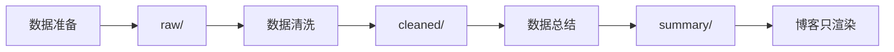

# AI 资讯周报

生成日为 D。覆盖窗口是 D-7 到 D-1 的完整 UTC 日（含两端，不含 D）。一期数据放在 `VirusPC/ai-news-data` 的 `issues/YYYY-MM-DD/`，里面固定三个目录：`raw/`、`cleaned/`、`summary/`。同一期重跑就地更新这三个目录，Git 保留历史，不另建 run 目录。

这是已确认的目标结构。现行采集脚本仍把文件写在期次根目录，博客仍读取 `ai-news/*.md`。旧期没有迁进这三个目录，站点也还没有改成只读 `summary/`。

三阶段按顺序做。上一阶段汇合校验通过，才把目录交给下一阶段。阶段内部没有依赖的任务可以并行。上游或规则 commit 变了，只重算引用它的下游，再校验；没有引用关系的分支不动。不另做调度引擎或数据库。

- [数据准备](references/prepare/prepare.md)：窗口、订阅、补录和三路原始抓取，落入 `raw/`。
- [数据清洗](references/clean/clean.md)：去重、规范链接、核验事实和榜单数字，落入 `cleaned/`。不做选文。
- [数据总结](references/summarize/summarize.md)：三路展示内容并行写完后，再提炼关键词并做整页校验，落入 `summary/`。

每期自包含。对照上一期时，锁定上一期的文件和版本，不建跨期共享目录，也不把上一期文件复制进本期。

稳定内容 ID 跟着内容走：文章用规范化后的链接，项目用仓库地址，模型用官方名。榜单条目用榜单名加模型官方名。不用文件路径，也不用写入顺序。这里不另定哈希算法。

每个阶段目录有 `stage.json` 和 `gaps.json`。`stage.json` 的 name 用目录名 `raw`、`cleaned` 或 `summary`，并记下规则仓库、40 位 commit，以及本阶段入口 `prepare.md`、`clean.md` 或 `summarize.md`。`gaps.json` 记下缺口和原因。来源引用写在各条文件里。空文件不能当成这份数据已经准备好。来源对不上或文件损坏时，记入缺口，不能标成可以正常渲染。

博客只读 `summary/`：按 `summary/index.json` 排版，用其中的榜单数据画图，并使用已经写好的关键词映射。不选文，不写摘要，不推断关键词和条目的关系。按关键词筛选的界面本次不做。

侧重点是 Agent 与产品。研究向、红队、纯学术长文可以不写。融资、IPO、营收、定价套餐和厂商客户案例不收，除非里面有具体技术或产品细节。优惠和白嫖不写。判断依据是内容，不是 URL 路径。不要编造数字、名次或材料里没有的事实。

默认定时交到两个打开的 PR，不自动合并，也不发布。日程、仓库、密钥和交接见 routine 入口。
