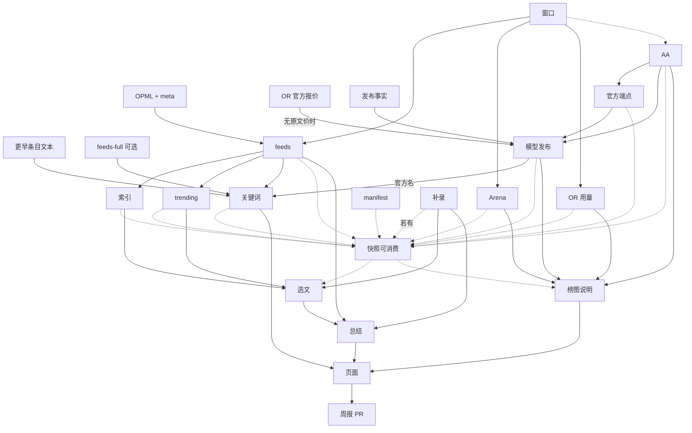

# AI 资讯周报

生成日为 D。覆盖窗口是 D-7 到 D-1 的完整 UTC 日（含两端，不含 D）。快照在 `VirusPC/ai-news-data` 的 `issues/YYYY-MM-DD/`。目录、版本引用和失效后重算见 [产物](references/产物.md)。

下面这张图就是流程。实线是数据，虚线是控制门槛。互不指向的节点可以并行。实线上游变了，只重算实线下游，并再校验；没有实线连着的不动。

节点正文：

- [采集](references/采集.md) 写 feeds、索引、trending
- [榜单](references/榜单.md) 写 AA、Arena、OpenRouter、端点、模型发布，以及榜图说明
- [关键词](references/关键词.md)
- [选文](references/选文.md)
- [总结](references/总结.md)
- [页面](references/页面.md)

写的时候侧重 Agent 与产品。研究向、红队、纯学术长文可以不写。融资、IPO、营收、定价套餐、厂商客户案例等营销内容不收，除非里面有具体技术或产品细节。优惠和白嫖不写。判断依据是内容，不是 URL 路径。不要编造数字、名次或快照里没有的事实。

默认定时停在数据 PR 和周报 PR，两份都打开，不自动合并，也不发布。发布门槛在页面节点。
