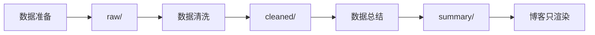

# AI 资讯周报

生成日由输入「生成日」给出，记为 D。覆盖窗口是 D-7 到 D-1 的完整 UTC 日（含两端，不含 D）。一期数据放在输入「数据仓库」本地检出的 `issues/<生成日>/`，里面固定三个目录：`raw/`、`cleaned/`、`summary/`。同一期重跑就地更新这三个目录，Git 保留历史，不另建 run 目录。

## 输入

这里只声明需要哪些输入、各自是什么意思、缺了怎么处理。具体仓库、检出路径、日期和提交由调用方的 routine 入口给出，不写在本文件。当前定时任务的值见 [routine 入口](../../../.edges/routines/weekly-ai-blogs-digest/INDEX.md)。

- **数据仓库**。远端是期次数据的 git 仓库。本地检出是脚本的输出根，一期写在 `<本地检出>/issues/<生成日>/`。没有远端或没有本地检出就停止，不改写到别的目录，也不用临时目录充数。
- **生成日**。名为 D 的 `YYYY-MM-DD`。覆盖窗口是 D-7 到 D-1 的完整 UTC 日，含两端，不含 D。没有生成日就停止，不用运行时刻的当天代替。
- **规则仓库**。仓库身份，以及写出这期数据时的 40 位 commit。`stage.json` 记这一对。没有解析到仓库或 commit 就停止，不用别的提交，也不用周报稿自己的提交。
- **站点仓库**。只在渲染博客时需要。不渲染就不读它。要渲染却没有这个仓库就停止，不猜路径。
- **密钥**。环境变量名是 `AA_API_KEY`（或 `ARTIFICIAL_ANALYSIS_API_KEY`）和 `OPENROUTER_API_KEY`。某个变量没有设置，就跳过依赖它的那份文件，在对应阶段的 `gaps.json` 写明原因。不写空文件，也不把跳过假装成有数据。
- **补录**。可选。用户点名要补进这一期、但订阅里没有的条目。没有就不写 `raw/articles/backfill.json`。
- **上一期**。可选。对照用的上一期期次及其文件版本。没有就不对照，不把上一期文件复制进本期。

这是已确认的目标结构。采集脚本仍把文件写在期次根目录，博客仍读取站点仓库里的 `ai-news/*.md`。下面的目录树和 `schemas/` 是这份结构的契约，分阶段校验按它验收。旧期没有迁进这三个目录，站点也还没有改成只读 `summary/`。

三阶段按顺序做。上一阶段汇合校验通过，才把目录交给下一阶段。阶段内部没有依赖的任务可以并行。上游或规则 commit 变了，只重算引用它的下游，再校验；没有引用关系的分支不动。不另做调度引擎或数据库。



- [数据准备](references/prepare/prepare.md)：窗口、订阅、补录和三路原始抓取，落入 `raw/`。
- [数据清洗](references/clean/clean.md)：去重、规范链接、核验事实和榜单数字，落入 `cleaned/`。不做选文。
- [数据总结](references/summarize/summarize.md)：三路展示内容并行写完后，再提炼关键词并做整页校验，落入 `summary/`。

每期自包含。对照上一期时，锁定上一期的文件和版本，不建跨期共享目录，也不把上一期文件复制进本期。

稳定内容 ID 跟着内容走：文章用规范化后的链接，项目用仓库地址，模型用官方名。榜单条目用榜单名加模型官方名。不用文件路径，也不用写入顺序。这里不另定哈希算法。

每个阶段目录有 `stage.json` 和 `gaps.json`。`stage.json` 的 name 用目录名 `raw`、`cleaned` 或 `summary`，并记下规则仓库、40 位 commit，以及本阶段入口 `prepare.md`、`clean.md` 或 `summarize.md`。`gaps.json` 记下缺口和原因。来源引用写在各条文件里。空文件不能当成这份数据已经准备好。来源对不上或文件损坏时，记入缺口，不能标成可以正常渲染。

## 数据存储

一期数据在数据仓库本地检出的 `issues/<生成日>/`。完整目录如下。没有单独文件名的官方发布原文，抓不到就写进 `raw/gaps.json`。`feeds.index.json` 仍是现行选文用的薄文件，写在期次根目录，不属于这棵树。

```text
issues/YYYY-MM-DD/
  raw/
    stage.json
    gaps.json
    window.json
    articles/
      feeds.json
      backfill.json
    projects/
      github-trending.json
      releases.json
    models/
      aa-language-models.json
      llm-arena-<榜单发布日>.json
      openrouter-rankings-daily.json
      openrouter-rankings-programming.json
      openrouter-app-rankings.json
      openrouter-app-rankings-coding.json
      openrouter-official-endpoints.json
  cleaned/
    stage.json
    gaps.json
    articles/
      index.json
      {id}.json
    projects/
      index.json
      {id}.json
    models/
      index.json
      {id}.json
      boards/
        {id}.json
  summary/
    stage.json
    gaps.json
    index.json
    keywords.json
    articles/
      {id}.json
    projects/
      {id}.json
    models/
      {id}.json
      boards/
        {id}.json
```

`articles/backfill.json` 只在用户点名补录时出现。`openrouter-app-rankings-coding.json` 是旁路，缺了不用写缺口。其余列出的文件，要么落盘，要么在该阶段 `gaps.json` 里有一条 `path` 和 `reason`。`stage.json` 本身不能用缺口代替。空文件、以及 `skipped: true` 的模型快照，都不算落盘。

`{id}.json` 的文件名不是 ID。ID 写在文件里：文章是规范化链接，项目是仓库地址，模型是官方名，榜单条目是榜单名加模型官方名。`index.json` 只列这些 ID。

契约在 `schemas/raw/`、`schemas/cleaned/`、`schemas/summary/`。校验脚本按子阶段放在 `scripts/prepare/`、`scripts/clean/`、`scripts/summarize/`，公共代码在 `scripts/lib/`。已经在用的采集、榜单和关键词脚本仍留在 `scripts/` 根目录，输出路径不变。

| 子阶段 | 校验脚本 | Schema |
| --- | --- | --- |
| [prepare/window.md](references/prepare/window.md) | `scripts/prepare/window/validate.py` | `schemas/raw/window.schema.json` |
| [prepare/articles.md](references/prepare/articles.md) | `scripts/prepare/articles/validate.py` | `schemas/raw/articles/feeds.schema.json`、`schemas/raw/articles/backfill.schema.json` |
| [prepare/projects.md](references/prepare/projects.md) | `scripts/prepare/projects/validate.py` | `schemas/raw/projects/github-trending.schema.json`、`schemas/raw/projects/releases.schema.json` |
| [prepare/models.md](references/prepare/models.md) | `scripts/prepare/models/validate.py` | `schemas/raw/models/*.schema.json` |
| [prepare/check.md](references/prepare/check.md) | `scripts/prepare/check/validate.py` | `schemas/raw/stage.schema.json`、`schemas/raw/gaps.schema.json` |
| [clean/articles.md](references/clean/articles.md) | `scripts/clean/articles/validate.py` | `schemas/cleaned/articles/index.schema.json`、`schemas/cleaned/articles/item.schema.json` |
| [clean/projects.md](references/clean/projects.md) | `scripts/clean/projects/validate.py` | `schemas/cleaned/projects/index.schema.json`、`schemas/cleaned/projects/item.schema.json` |
| [clean/models.md](references/clean/models.md) | `scripts/clean/models/validate.py` | `schemas/cleaned/models/index.schema.json`、`schemas/cleaned/models/item.schema.json`、`schemas/cleaned/models/board.schema.json` |
| [clean/check.md](references/clean/check.md) | `scripts/clean/check/validate.py` | `schemas/cleaned/stage.schema.json`、`schemas/cleaned/gaps.schema.json` |
| [summarize/articles.md](references/summarize/articles.md) | `scripts/summarize/articles/validate.py` | `schemas/summary/articles/item.schema.json` |
| [summarize/projects.md](references/summarize/projects.md) | `scripts/summarize/projects/validate.py` | `schemas/summary/projects/item.schema.json` |
| [summarize/models.md](references/summarize/models.md) | `scripts/summarize/models/validate.py` | `schemas/summary/models/item.schema.json`、`schemas/summary/models/board.schema.json` |
| [summarize/merge.md](references/summarize/merge.md) | `scripts/summarize/merge/validate.py` | 不另建文件，检查三路 ID 不重复 |
| [summarize/keywords.md](references/summarize/keywords.md) | `scripts/summarize/keywords/validate.py` | `schemas/summary/keywords.schema.json` |
| [summarize/check.md](references/summarize/check.md) | `scripts/summarize/check/validate.py` | `schemas/summary/index.schema.json`、`schemas/summary/stage.schema.json`、`schemas/summary/gaps.schema.json` |

博客只读 `summary/`：按 `summary/index.json` 排版，用其中的榜单数据画图，并使用已经写好的关键词映射。不选文，不写摘要，不推断关键词和条目的关系。按关键词筛选的界面本次不做。

侧重点是 Agent 与产品。研究向、红队、纯学术长文可以不写。融资、IPO、营收、定价套餐和厂商客户案例不收，除非里面有具体技术或产品细节。优惠和白嫖不写。判断依据是内容，不是 URL 路径。不要编造数字、名次或材料里没有的事实。

默认定时交到两个打开的 PR，不自动合并，也不发布。日程、仓库、密钥和交接见 routine 入口。
