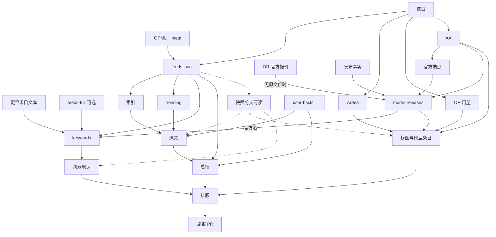

# 数据流

手动跑和定时跑都用这一张图。节点契约和变更后重算只写在这里。采集命令、选文规则、总结格式、榜图和排版仍在 [01](01-采集数据并存入-ai-news-data.md) 到 [05](05-排版与开-PR.md)。选词和排名的算法在 `scripts/`，这里不抄公式。

一次运行只读同一版 skill 和 references。缺了这次要读的文件就停，不改用以前保存的文本。上游或中间产物变了，沿实线依赖的下游全部失效，按依赖顺序重算，再做最终验收。没有实线连着的分支不重算。没变的上游不重新获取。调用方当次写明的顺序照做。

实线是数据：下游读上游的内容。虚线是控制门槛：只决定能不能开始，不把内容传下去。互不指向的节点可以并行。

定时的时钟、仓库、密钥和两个 PR 交到哪，写在 [routine 入口](../../../../.edges/routines/weekly-ai-blogs-digest/INDEX.md)。那份入口不另画这张图。

## 总图

`user-backfill` 只进入选文和对应总结。它不进入 feeds、索引和关键词。关键词不读周报，也不读入选后的 `####`。选文不读关键词。OR 用量榜只进入榜图；用量名次不写进模型卡，也不因整张榜变了就重写文章。manifest 汇集各必要文件的有无、条数和跳过原因，不反向成为文章或关键词的输入。

## 节点

| 节点 | 输入 | 输出 | 开始 | 完成 |
| --- | --- | --- | --- | --- |
| 窗口 | 生成日 D | D-7 到 D-1 的完整 UTC 日，含两端 | 已知 D | 日期可写进抓取命令 |
| feeds | 窗口、OPML、meta | `feeds.json` | 窗口已定，可与 AA、Arena、OR 用量并行 | 窗口内条目落盘；短文原样保留 |
| 索引 | 同一次抓取 | `feeds.index.json` | feeds 已有 | 只含标题、日期、链接、来源、`thin` 和开头约 400 字 |
| trending | feeds 里的 weekly/all | `github-trending.json` | feeds 已有 | 只含这一条源；名次以 XML 原始顺序为准 |
| AA | 密钥 | `aa-language-models.json` | 窗口已定即可开始；内容不按文章窗口过滤 | 有密钥则写入精简字段；无密钥则跳过并记入 manifest |
| Arena | 窗口结束日 | `llm-arena-日期.json` | 可与 feeds 并行 | 结束日之前最近一份已发布榜 |
| OR 用量 | 窗口、密钥 | 日用量、编程用量、应用用量 | 可与 feeds 并行 | 有密钥则落盘；无密钥则跳过并记入 manifest |
| 官方端点 | AA、OR 密钥 | `openrouter-official-endpoints.json` | AA 已有 | 对上的官方标准档写入；无密钥则 `skipped`，不请求端点 |
| 模型发布 | AA 的智力指数、端点的速度、发布事实；原文没有价格时用 OR 官方报价 | `model-releases.json` | 上述输入已有，或已标明缺失 | 价格、速度、智力指数和两种排名在同一文件；缺的数字写「暂无」 |
| 关键词 | 窗口内 `feeds.json`；同链接若有 `feeds-full.json` 则用更长摘要；`models[].name`；更早 issues 的条目标题和正文 | `keywords.json` | 条目和模型发布已落盘；不等选文 | 词、种类、score、mentions、sources、weight，概念里至多一条 `theme`；`gaps` 写缺什么 |
| manifest | 各必要文件的状态 | `manifest.json` | 对应文件已有结果 | 写下窗口、来源、条数、字节和跳过原因；不含密钥 |
| 补录 | 用户点名的条目和原发日 | `user-backfill.json` | 用户给出这份清单 | 日期仍是原发日；不改 feeds、索引、关键词 |
| 选文 | 索引、trending 的标题和 XML 名次、补录 | 入选清单：链接、归入哪一节；补录另标原发日 | 快照在数据分支上可读 | 见下面的完成条件 |
| 总结 | 入选清单；对应条目在 `feeds.json` 的全文；补录全文 | 文章卡、项目卡或一句话 | 清单已完成，且快照可读 | 每篇只依据读到的 summary；短源只留一句话，并写明订阅源里只有这些 |
| 榜图与模型条目 | AA、Arena、OR 用量、`model-releases.json` | 榜图和模型卡 | 快照可读；可与选文、总结并行 | 缺文件就去掉该小节，原因进说明；名次用快照里的 `rank` |
| 词云展示 | `keywords.json` 的 `words` | 正文里的词云注释 | 快照可读；可与选文、总结并行 | 注释是已生成 `words` 的副本；文件不在或 `words` 为空就去掉该章，原因进说明 |
| 排版 | 总结、榜图、词云注释 | 周报 PR | 这三块都完成 | provenance 写上这次的 `rules.commit` 和已落库的 `data.commit`；PR 打开 |

模型发布的价格排名和速度排名在采集时写入。排名只读 AA 标价和端点 latency，不改已经写好的价格、速度和智力指数名次。热度 `weight` 也在采集时写入，公式见 [04](04-榜单与图.md)，实现在 `scripts/build_keywords.mjs`。

选文完成时，清单里每条都能指回索引、trending 或 `user-backfill.json`。窗口外的不进清单。补录全部留在本期，正文标补录并写原发日。weekly/all 取 XML 顺序的前 5。项目开源只收 GitHub 仓库。判断依据是标题、来源和开头。清单可以交给总结，选文才算完成。

数据节点重算之后，撰写仍等新快照在分支上可读。这是同一道门槛。日常初跑不要求数据 PR 已经合并。

## 变更后重算

下表是直接失效的节点。沿实线继续往下的一并重算。例如 feeds 变了，词云展示会跟着 keywords 失效。

| 变化 | 重算 | 保持不动 |
| --- | --- | --- |
| feeds 的条目或正文 | 索引、相关 trending、keywords、选文、依赖该全文的总结、manifest、词云展示、最终验收 | AA、Arena、OR、端点的输入没变就不重拉。补录清单不因此改写 |
| 更早 issues 的条目标题或正文 | 本期「窗口前是否已经公开」的判断，以及因此变化的 keywords 下游 | 更早一期的榜单不传入本期关键词 |
| AA、官方端点，或 OR 的用量与官方报价 | 用到这次变化的模型事实、排名和对应榜图，以及 manifest、最终验收 | 文章不重抓。只有 `models[].name` 变了才重算 keywords |
| keywords，或选词规则 | 词云展示的注释、最终验收 | 不重抓文章，不重做选文 |
| `user-backfill.json` | 选文，以及清单里有变的那几篇总结、最终验收 | feeds、索引、keywords 不改 |
| 某节点的措辞或版式 | 该节点的下游和最终验收 | 不重采上游 |

相关 trending 指 weekly/all 的标题、正文或 XML 名次变了的那些仓库。其他源的条目变了，不为它们重写项目卡。

最终验收看周报 PR 是否和这次采用的快照、入选清单、说明里的缺口一致。没算过的节点不能写成已经算过。

## 几种跑法

日常初跑从窗口和采集走到两个 PR。快照分支可读之后，选文完成再写总结；榜图和词云展示同时只读快照。数据 PR 保持打开。

仅正文调整从改动的那段正文或版式开始，重做它的下游和验收，上游快照继续用。

feeds 补数、关键词规则变化、榜单数据变化、补录变化，各按上一表从变动的节点往下重算。

用户说重跑时，用现行 skill 从采集起整期生成。正文重写和历史数据补数不叫重跑。历史补数从变动的数据节点起；当次任务如果写明先核验数据并入库、再写正文，就按这个顺序。没有这句时，仍是分支可读后撰写，不把合并数据 PR 写成默认前提。

不是从采集整期重跑时，当期说明写下实际起点、输入版本、影响节点、复用依据和缺口。输入版本包括规则那次 commit，以及数据快照 commit 或复用的文件。

## 交付停在哪

默认终点是数据 PR 和周报 PR 都打开，并且不合并。

站点的 test、build、verify-dist 和 Pages 不在这条默认路径里。另获发布授权之后，才由人合并，再由 Pages 从 main 发布。PR 还开着的时候，交付物就是 PR。
