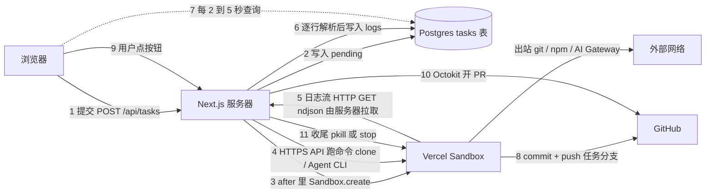

# 2026-10-19--云端CodingAgent架构学习

> 这份笔记记录 peng cheng 用 vercel-labs/coding-agent-template 学习云端 Coding Agent 架构的一天：完成了第 1、2、3 课，并追问清楚了 Sandbox 的寿命、续时长、Sandbox 和外界怎么通信，以及怎样预先做好环境、Vercel Sandbox 底下是不是 Docker。面试前读这一份就能把主线讲出来。

## 背景

peng cheng 想在面试里讲清楚“云端编程 Agent 产品是怎么搭起来的”，同时对这个领域的主流做法心里有数。选 vercel-labs/coding-agent-template 作为解剖对象，是因为它是一个完整、开源、每一行都能读到的真实系统：Vercel Sandbox、AI Gateway、多种 Agent CLI，再加上自动推分支和开 PR。

课程的成功标准写在 MISSION.md 里：不看笔记用 60 秒讲清一个任务从提交到 PR、再到 Sandbox 收尾的全过程；能讲出至少三个架构取舍；能和 OpenAI Codex Cloud、LangChain Open SWE 等同类产品对比；被追问时能指出一处文档和代码不一致的地方。所有源码引用固定在 main 分支的 commit e753e1b。

## 主题

这场对话在学一件事：一个云端 Coding Agent 平台，怎样把用户的一句需求变成一台隔离虚拟机里的 Agent 运行，再把结果变成 GitHub 上的分支和 PR；其中 Sandbox 的一生怎么管理，进度和控制指令又是怎么在浏览器、服务器、数据库、Sandbox 之间流动的。

- 难点一：寿命管理。模板里 Sandbox 的存活时长在创建时就定死，Keep Alive 关闭时的“收尾”其实只结束进程，机器会空转到超时。要分清“代码里写的”“README 说的”和“今天的 Vercel 能做的”三件事。
- 难点二：通信方向容易混。Sandbox 不会主动回调服务器；服务器靠 HTTPS API 指挥它，靠一条长时间不断开的 HTTP 请求把日志流拉回来；网页看到的进度又是另一段，靠定时查询数据库。几段链路叠在一起，很容易把“走数据库”和“走 HTTP 流”说成一回事。
- 难点三：信任边界。模板把 GitHub 令牌写进克隆地址，把 API 密钥临时换进服务器进程的环境变量，Sandbox 默认能随意联网。要能说清这些做法的风险，以及 Codex Cloud、Open SWE、现在的 Vercel 防火墙分别怎么处理。

## 过程

### 约 17:20 定下学习目标并完成第 1 课《任务的一生》

先定下目标：为了面试和整体理解，弄懂这个模板的架构。随后做出第 1 课，跟着一个任务走完全程：

1. 用户提交，`POST /api/tasks` 把任务写进 `tasks` 表，状态是 pending，然后马上回话。
2. 用 Next.js 的 `after()` 把真正的活放到回话之后去做。
3. `Sandbox.create()` 开一台 Vercel Sandbox。
4. 把仓库浅克隆进 Sandbox。
5. 安装并运行用户选的 Agent CLI，用免确认模式运行（例如 Claude Code 的 `--dangerously-skip-permissions`）。
6. 日志追加进 `tasks.logs`，网页定时拉取。
7. 有改动就 commit 并 push 到任务分支。
8. PR 只在用户点按钮后才由后端去开。
9. 收尾清理 Sandbox。

同时记下了这个模板的几处毛病：Keep Alive 关闭时的清理只用 pkill 结束进程，并不调用 stop()；API 密钥被临时换进服务器进程的环境变量，同一个服务器实例同时跑多个用户的任务时可能串用；GitHub 令牌直接写在克隆地址里；主流程不会自动开 PR；README 已经过时。

### 19:37 课程页面显示出一大段原始 JS

用户反馈课程页面上露出了原始的 JavaScript 代码。原因是 quiz.js 的注释里含有 `</script>`，内联进页面后，浏览器把它当成脚本标签的结束，后面的代码就被当成普通文字显示出来。修法是把它转义成 `<\/script>`，然后重新发布。

### 约 19:59 完成第 2 课《Sandbox 的生与死》

第 2 课讲一台 Sandbox 的一生：

- 创建参数是运行环境 node22、4 个 CPU 核、端口和存活时长 timeout，时长等于用户选的最长时长。
- Keep Alive 关闭时，任务结束只结束进程，机器空转到超时才停。
- Keep Alive 打开时，机器留着，追问时用数据库里的 sandboxId 调 `Sandbox.get()` 重连。
- 用户手动点“停止 Sandbox”时，后端才真正调用 `sandbox.stop()`。
- 模板锁定的 SDK 其实已经有 `stop()`，代码注释里“SDK 没有关机方法”的说法站不住。
- `vercel.json` 给任务接口设了 maxDuration 300 秒，后台流程可能被限制在 5 分钟以内。这一点是按文档推断，没有实测。
- 追问接口不看 Keep Alive 开关，重连失败就新开一台并克隆任务分支。

### 20:01 问：为什么寿命在创建时就定死，现在还是这样吗

回答分两层。为什么当时这样设计：timeout 是成本上的安全网，防止机器忘了关一直计费；当时还没有快照，机器只能在“开着等”和“关掉丢文件”之间二选一；一个任务一台机器，逻辑最简单。通过解开 npm 包核实，模板用的 SDK 0.0.21 确实没有 extendTimeout。

现在的 Vercel 有两层机制。第一层是单个会话：创建时设 timeout，运行中可以调用 `extendTimeout()` 续到套餐上限（Pro / Enterprise 24 小时，Hobby 45 分钟），`expiresAt` 是当前真实的到期时间。第二层是持久 Sandbox：停下时自动拍快照，之后恢复成一个新会话，重新开始计时；快照 30 天过期。现在推荐的做法是：timeout 设短一些，需要时再续，用完就 stop，下次从快照恢复。第 2 课里那句“寿命在出生时就定死”随之补上了现行 SDK 的说明。

### 20:05 问：Sandbox 里面能不能自己调用 extendTimeout

默认不能。`extendTimeout` 是 SDK 对 Vercel API 的一次调用，需要项目凭证，而 Sandbox 里没有这些凭证。理论上可以把一个令牌注入 Sandbox，让里面的程序自己续时长，但这只是推断，没有测试过；而且这样做等于把“能延长计费时间”的权限交给了一个跑免确认 Agent 的环境，跨越了信任边界。结论是应该由外面的编排服务来决定续不续。

### 20:05 问：Sandbox 和外界是怎么通信的

按四个方向回答：

- 控制方向：服务器调用 Vercel 的 HTTPS API 指挥 Sandbox。比如 `runCommand` 就是 `POST /v1/sandboxes/{id}/cmd`，带上令牌和 teamId。写文件、读文件也是通过跑 cat 或 heredoc 命令来完成的。
- 回传方向：命令以 detached 方式启动，服务器再拉取它的日志流，逐行解析后写进数据库。Sandbox 从来不主动回调服务器。
- 出站方向：默认允许访问任意地址，所以 git、npm、AI Gateway 的请求都直接从 Sandbox 发出，密钥也就放在 Sandbox 里。现在的 Vercel 提供 deny-all 和白名单式的防火墙，以及在 Sandbox 外面注入凭证的功能。
- 入站方向：创建时开放端口 3000 和 5173，通过 `sandbox.domain` 得到 vercel.run 上的预览地址。

对照同类产品：Codex Cloud 的 Agent 阶段默认断网（这是旧版 Legacy 文档的说法）；Open SWE 通过认证代理注入短期有效的 GitHub 令牌，真令牌不进 Sandbox。

### 20:10 问：日志流到底是怎么拉的

服务器发出一个长时间保持的 HTTP GET 请求，地址形如 `.../cmd/{cmdId}/logs`，返回类型是 `application/x-ndjson`（每行一个 JSON），并且关闭了响应体的超时限制。它不是 WebSocket，也不是 Sandbox 主动推送。

### 20:11 问：之前不是说消息走数据库吗

这是两段不同的链路。Sandbox 到服务器，走的是上面那条 HTTP 流；服务器到数据库，是一次写入；网页到数据库，是每 2 到 5 秒查询一次。数据库在这里是一个中转站，所以刷新页面、换一台设备、任务结束后再来看的人，看到的都是同一份状态。

### 20:24 问：能不能预先做好环境，不用每个任务都装一遍

先看模板现在怎么做：每个任务都开一台空的 Sandbox，只传 `runtime: 'node22'`，不带镜像也不带快照；然后浅克隆、装项目依赖、勾选浏览器时用 dnf 装 25 个 Chromium 系统库，最后装 Agent CLI（creation.ts L81–127、L165–324、L513–565，以及六个 agents/*.ts 的安装行）。原因是它锁定的 SDK 0.0.21 只有 `runtime` 和 git / tarball 两种 source，没有镜像和快照，这一点通过解开 npm 包核实。

今天的 Vercel Sandbox 可以提前做好：用 Dockerfile 建镜像，`vercel vcr build` 推到 VCR，再 `Sandbox.create({ image })`；只支持 `linux/amd64`，不运行 ENTRYPOINT 和 CMD。也可以把装好依赖的机器拍成快照，下次用 `source: { type: 'snapshot' }` 开机。`runtime` 参数已经弃用，改用 `image`；持久 Sandbox 用 `getOrCreate` 的 `onCreate` / `onResume` 两个钩子；Drives 放共享缓存，已于 2026-10-15 正式发布（不再是 private beta）。

通用做法是三层：基础镜像、setup 脚本、快照或缓存。密钥只在 setup 阶段出现、不进快照，Agent 阶段把网络收紧。对照了 Codex Cloud、Copilot cloud agent、Codespaces prebuild、Cursor cloud agents、E2B templates，模式基本一致，见第 3 课。

### 20:28 问：Vercel 底下是不是就是 Docker

不是。Vercel 官方文档原话：“Unlike Docker containers, each sandbox runs in its own Firecracker microVM with a dedicated kernel.”（Understanding Sandboxes 页的 Sandboxes vs containers 一节），并写明 `Sandbox.create()` 时 Vercel 开的是一台 Firecracker microVM。所以“每台 Sandbox 跑在自己的 Firecracker microVM 里”这个说法已核实，原文还多一句“有独立的内核”。

能用 Dockerfile，是因为 OCI 镜像本质上只是一叠文件系统层加一份配置，Vercel 只拿文件系统当 microVM 的根文件系统，没有容器运行时去执行启动命令，所以 ENTRYPOINT 和 CMD 不跑。E2B 也用 Firecracker，它的安全页和 Firecracker 官网的使用者名单都写了。

## 结果

- 已完成：第 1 课《任务的一生》、第 2 课《Sandbox 的生与死》、第 3 课《预制环境与隔离》，均已发布；第 2 课关于寿命的那句话已按现行 SDK 补充说明。
- 已修复：课程页面露出原始 JS 的问题，已转义 `</script>` 并重新发布。
- 未完成：计划中的第 4 课《把别人的 Agent CLI 关进笼子》、第 5 课《进度怎么回到网页》、第 6 课《密钥、令牌与信任边界》还没有写。
- 未完成：用户还没有反馈两课测验的得分，所以学习记录还没有开始写。
- 仍是推断、没有实测的三点：maxDuration 300 秒会把后台流程限制在 5 分钟；在 Sandbox 里注入令牌后可以自己续时长；装 pip 失败时那条 apt-get 后路（把 `&&` 当参数传、系统又是 dnf 的 Amazon Linux 2023）看起来永远不会成功。

## 所学

### 一个任务的完整路径

把这一天学到的串起来，一个任务的路径如下：

读图要点：实线是真实发起请求的方向，虚线是网页查询进度。箭头 5 是服务器去拉，不是 Sandbox 推过来。

### 面试时 60 秒这样讲

“我读过 Vercel 的 coding-agent-template。用户提交任务时，Next.js 接口先把任务写进 Postgres 的 tasks 表，状态是 pending，马上回话，再用 after() 在后台跑真正的流程。后台先用 Sandbox.create 开一台 Vercel Sandbox，这是一台有独立内核的 Firecracker microVM，不是 Docker 容器，存活时长在创建时就定了。服务器通过 Vercel 的 HTTPS API 在里面跑命令：浅克隆仓库，安装用户选的 Agent CLI，用免确认模式运行，模型请求走 AI Gateway。Sandbox 不会回调服务器，是服务器用一条长时间不断开的 HTTP 请求把日志流拉回来，逐行写进数据库，网页每隔几秒查一次数据库，所以刷新或换设备看到的都是同一份状态。跑完后平台 commit、push 到任务分支，用户点一下按钮，后端才用 Octokit 开 PR。最后按 Keep Alive 决定留着机器给追问，还是收尾。我会指出它的几个问题：清理只 pkill 不 stop，机器会空转到超时；GitHub 令牌写在克隆地址里，Sandbox 又默认能任意联网；密钥临时换进服务器的环境变量，多用户并发时可能串。今天更好的做法是：timeout 设短、按需 extendTimeout、用完就 stop、从快照恢复；出站用防火墙白名单，凭证在 Sandbox 外面注入，就像 Open SWE 的认证代理那样。”

### Sandbox 寿命：当时为什么这样设计，今天怎么做

- 当时把寿命定死在创建时，有三个理由：timeout 是防止忘关一直计费的安全网；没有快照，只能在“开着等追问”和“关掉丢文件”之间二选一；一个任务一台机器，最简单。
- 边界判断：模板锁定的 SDK 0.0.21 确实没有 extendTimeout，这一点已通过解包 npm 包核实；但它已经有 stop()，所以“只 pkill 不 stop”不是 SDK 的限制，而是代码没用上。
- 今天的 Vercel 把“单个会话多长”和“跨会话保留文件”分成两套开关：会话可以用 extendTimeout() 续到套餐上限，expiresAt 是实时到期时间；持久 Sandbox 停下时自动快照，恢复时是一个新会话、重新计时，快照 30 天过期。
- 最终认可的方案：timeout 设短，按需续，用完立刻 stop，追问时从快照恢复。可选的另一条路是一开始就把 timeout 设得很长，不选它，是因为空转期间内存照样计费。

### 续时长该由谁来做

- 可选项一：Sandbox 里的程序自己调用 extendTimeout。默认做不到，因为这需要 Vercel 项目凭证，而 Sandbox 里没有。
- 可选项二：往 Sandbox 里注入一个令牌，让它自己续。这只是推断，没有测试；不推荐，因为这样把“延长计费时间”的权限交给了一个跑免确认 Agent、可能被提示注入的环境。
- 最终认可的方案：由 Sandbox 外面的编排服务根据任务进度决定续不续。

### Sandbox 通信的四个方向

| 方向 | 谁发起 | 怎么做 | 模板的问题或今天的改进 |
| --- | --- | --- | --- |
| 控制 | 服务器 | 调 Vercel HTTPS API，例如 `POST /v1/sandboxes/{id}/cmd`，带令牌和 teamId；读写文件也靠 cat 或 heredoc 命令 | 无特别问题 |
| 回传 | 服务器 | 命令以 detached 方式启动，服务器用长时间不断开的 HTTP GET 拉 ndjson 日志流，逐行解析写库 | Sandbox 从不回调服务器 |
| 出站 | Sandbox | 默认允许任意出站，git、npm、AI Gateway 直接从 Sandbox 发出 | 密钥放在 Sandbox 里；今天可用 deny-all 或白名单防火墙，并在 Sandbox 外注入凭证 |
| 入站 | 外部用户 | 开放端口 3000 和 5173，`sandbox.domain` 给出 vercel.run 预览地址 | 无特别问题 |

### 进度传递的三段链路

- 第一段，Sandbox 到服务器：HTTP 流，服务器发出长时间保持的 GET 请求，返回 `application/x-ndjson`，关闭了响应体超时。它不是 WebSocket，也不是 Sandbox 推送。
- 第二段，服务器到数据库：把解析出的日志写入 `tasks.logs`。
- 第三段，网页到数据库：每 2 到 5 秒查询一次。
- 为什么中间要过数据库：数据库是中转站，刷新页面、换设备、任务结束后再看的人都能看到同一份状态。这一点在第 1 课里对应的取舍是“用数据库当传话筒，换来简单，代价是实时性和写入效率”（每条日志都要整串读出、追加、写回，并发时可能丢）。

### 凭证和信任边界的对照

- 模板：GitHub 令牌写进克隆地址，Sandbox 里的 Agent 看得到；Sandbox 默认能任意联网；API 密钥临时换进服务器进程的环境变量。
- Codex Cloud（旧版文档）：安装依赖阶段可以联网，Agent 阶段默认断网。
- Open SWE：在 Sandbox 外铸造短期有效的 GitHub App 令牌，通过 LangSmith Sandbox 的认证代理注入请求头，Sandbox 里只看到占位值。
- 今天的 Vercel Sandbox：防火墙支持 allow-all、deny-all 和自定义白名单，并能在 Sandbox 外给出站请求注入凭证。

### 预制环境的三层做法

- 模板现状：每个任务都在任务时间里重做克隆、装依赖、装系统库、装 Agent CLI。不是设计选择，而是当时的 SDK 0.0.21 没有镜像和快照参数。
- 第一层，基础镜像：操作系统、系统包、语言版本、Agent CLI，用 Dockerfile 建，按周或按月重建。好处是可复现（用 tag 或 digest 固定）。
- 第二层，setup 脚本：按仓库克隆、装依赖、生成代码；可以联网，私有仓库的密钥只在这里出现。Codex 还有 maintenance 脚本，在恢复缓存时补差。
- 第三层，快照或缓存：把 setup 的结果拍下来，开机直接用。lockfile 变了、代码走远了、setup 改了、镜像该打补丁了，它就过时；Vercel 快照默认 30 天没用就删，所以 setup 必须能重复跑。
- 取舍：冷启动换新鲜度和存储费；快照是“跑出来的结果”，不如镜像好复现，所以底层用镜像、上层才用快照。
- 两条安全规则：密钥只在 setup 阶段注入、绝不进快照或镜像（快照会被复制、共享、长期保存）；Agent 阶段把网络收紧（Vercel 的 `networkPolicy` 默认 allow-all，可在 setup 后换成白名单）。
- 对照：Codex 的 secrets 只给 setup、Agent 阶段默认断网；Copilot 的 Agents secrets 在整个任务里都是环境变量，靠防火墙和只限本仓库的令牌兜底。

### 容器和 microVM

- 容器：和宿主机共用一个内核，靠 namespaces 和 cgroups 隔开；最省，但一个内核漏洞就可能逃出去。
- microVM：每台有自己的内核，靠硬件虚拟化（KVM）隔开；Firecracker 官网写启动不到 125 毫秒、每台额外开销不到 5 MiB。Vercel Sandbox 和 E2B 都用 Firecracker。
- gVisor：折中方案，在用户态再实现一个内核拦截系统调用，代价是慢一些、部分程序不兼容。
- Docker 镜像只是文件系统格式：Vercel 拿它当 microVM 的根文件系统，所以 ENTRYPOINT 和 CMD 不运行，进程要用 `runCommand()` 启动。
- 为什么跑 AI 代码选 microVM：多租户、免确认、可能被提示注入，共用内核风险太大；Firecracker 本来就是为不同客户的 Lambda 函数挤在同一台机器上而做的。

### 一个工程上的小教训

把 JS 内联进 HTML 的 `<script>` 时，任何位置出现的 `</script`（哪怕在注释里）都会提前结束脚本标签。内联前统一转义成 `<\/script`。

## 行动指南

### 主题行动指南

#### 背景

面试时被问“云端 Coding Agent 产品怎么搭”，需要在一分钟内讲清主线，并经得起对寿命、通信、凭证三类细节的追问。

#### 核心问题

如何用一个真实开源系统把架构讲清楚，同时说出它的取舍、缺陷，以及今天平台能力下更好的做法。

#### 核心解决方案

1. 先讲一条主线：提交写库并立即回话，后台开 Sandbox，克隆，跑 Agent CLI，日志回传，推分支，用户点击后开 PR，收尾。
2. 讲通信时按四个方向分开说：控制、回传、出站、入站；明确“Sandbox 不回调服务器，日志流是服务器拉的”。
3. 讲进度时分三段：Sandbox 到服务器是 HTTP 流，服务器到数据库是写入，网页到数据库是定时查询。可选的另一种说法是“全程走数据库”，不用它，是因为这会把第一段的 HTTP 流说错。
4. 讲寿命时先说当时为什么定死（成本安全网、没有快照、最简单），再说今天的做法（短 timeout、按需续、用完 stop、快照恢复）。
5. 讲安全时指出模板的三个问题（令牌在克隆地址里、默认任意出站、密钥换进服务器环境变量），再给出对照方案（出站白名单、Sandbox 外注入凭证、短期令牌）。
6. 凡是推断没有实测的点，面试时明确说“这是我读代码和文档推断的”。

#### 验收标准

- 不看笔记，能在 60 秒内讲完主线，并点出至少两个关键文件或接口。
- 能画出浏览器、服务器、数据库、Sandbox、GitHub、外部网络之间的箭头，并说清每个箭头由谁发起。
- 能回答“日志是推还是拉”“为什么要过数据库”“extendTimeout 能不能在 Sandbox 里调”三个追问。
- 能说出至少一处文档或注释与代码不一致的地方。
- 能把模板和 Codex Cloud、Open SWE 在联网和凭证两方面做对比。

### 细节与其他

#### 若面试官追问“为什么不用 WebSocket 推进度”

则说明：Sandbox 到服务器这一段用的是长时间保持的 HTTP GET 加 ndjson 流；服务器到网页这一段用数据库加定时查询，好处是刷新、换设备、事后查看都一致，部署在用完就停的服务器上也不怕；代价是实时性和每条日志整串读写的效率。

#### 若被问到 Sandbox 跑到一半时长不够

则说明：模板用的 SDK 0.0.21 没有 extendTimeout，到时就停，没推送的改动会丢；今天可以由外部编排服务调用 extendTimeout() 续到套餐上限，或者依靠持久 Sandbox 停机自动快照、之后恢复。不要建议让 Sandbox 内部自己续。

#### 若面试官问“Vercel 底下是不是 Docker”

则说明：不是，官方文档写明每台 Sandbox 是一台有独立内核的 Firecracker microVM；Dockerfile 只用来生成根文件系统，所以 ENTRYPOINT 和 CMD 不运行；跑不可信的 AI 代码，多租户下 microVM 比共用内核的容器安全，代价是每台多一个内核的内存和对硬件虚拟化的依赖。

#### 若要再做课程页面并内联脚本

则把脚本里的 `</script` 转义成 `<\/script` 后再内联；当时的手机版构建脚本（本地辅助工具，没有放进仓库）已经这样做，并用断言检查。

#### 若继续本课程

则下一步是第 4 课《把别人的 Agent CLI 关进笼子》，然后是第 5 课《进度怎么回到网页》和第 6 课《密钥、令牌与信任边界》；同时请用户报告前三课的测验得分，再开始写学习记录。

## 补充说明

- 原始材料：本次 Grok Bot 对话，助手为 Coding Agent 专家，用户 peng cheng，时间为 2026-10-19 17:20–20:30（Asia/Shanghai）。
- 课程目录：仓库里的 `teaching/cloud-coding-agent/`，其中 `MISSION.md` 是课程目标，`NOTES.md` 是备课笔记，`RESOURCES.md` 是资料清单。
- 课程页面：`lessons/0001-life-of-a-task.html`、`lessons/0002-sandbox-lifecycle.html`、`lessons/0003-prebuilt-environments-and-isolation.html`、`reference/glossary.html`、`reference/architecture-cheatsheet.html`。
- 源码版本：[vercel-labs/coding-agent-template，commit e753e1b](https://github.com/vercel-labs/coding-agent-template/tree/e753e1b6d28b2d64446dd5f9ef33a93909cc7a09)（main 分支，2026-02-12 提交，北京时间 17:21），课程里所有源码链接都固定在这个版本。
- [Vercel Sandbox JS SDK Reference](https://vercel.com/docs/sandbox/sdk-reference)：查 create、runCommand、stop、extendTimeout 等方法。
- [How Vercel Sandbox duration and persistence work](https://vercel.com/kb/guide/vercel-sandbox-duration-and-persistence)：讲单个会话时长和跨会话持久化是两套开关，以及计费方式。
- [Vercel Sandbox firewall](https://vercel.com/docs/sandbox/concepts/firewall)：讲 allow-all、deny-all、自定义白名单和凭证注入。
- [Codex Cloud (Legacy): internet access](https://learn.chatgpt.com/docs/cloud/internet-access)：说明旧版 Codex Cloud 的 Agent 阶段默认断网。
- [LangSmith Sandbox auth proxy](https://docs.langchain.com/langsmith/sandbox-auth-proxy)：说明 Open SWE 如何通过代理注入短期 GitHub 令牌。
- [@vercel/sandbox 0.0.21 的 dist/sandbox.js](https://unpkg.com/@vercel/sandbox@0.0.21/dist/sandbox.js)：模板锁定的 SDK 版本，可核对有 stop()、没有 extendTimeout。
- [Vercel Sandbox — Understanding Sandboxes](https://vercel.com/docs/sandbox/concepts)：“each sandbox runs in its own Firecracker microVM with a dedicated kernel” 的出处。
- [Vercel Sandbox — Images](https://vercel.com/docs/vercel-sandbox/concepts/images) 与 [Snapshots](https://vercel.com/docs/vercel-sandbox/concepts/snapshots)：自定义镜像、VCR、官方镜像、ENTRYPOINT/CMD 不运行；快照的创建、过期和区域。
- [Firecracker 官网](https://firecracker-microvm.github.io/)：KVM、jailer、启动不到 125 毫秒、使用者名单含 E2B。
- 本笔记的网页版：[2026-10-19--cloud-coding-agent-architecture.html](./2026-10-19--cloud-coding-agent-architecture.html)。
